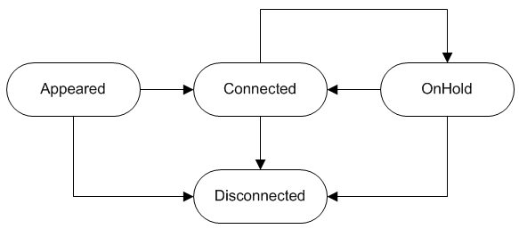

## 4.3. Состояние звонка

> Трассировка: PDF §4.3 · сквозные стр. 51-52 · источники: ч.1 `kb/sources/api-server-client/Api_server_client.pdf` с.51-52.

Список состояний:

| Код | Описание |
| --- | --- |
| APPEARED | Звонок в состоянии ожидания |
| CONNECTED | Звонок в состоянии разговора |
| ON_HOLD | Звонок на удержании |
| DISCONNECTED | Звонок завершен |

Код Описание

APPEARED Звонок в состоянии ожидания

CONNECTED Звонок в состоянии разговора

ON_HOLD Звонок на удержании

DISCONNECTED Звонок завершен

Диаграмма состояний вызова:

> **Описание иллюстрации APISC-§4.3-1** (к §4.3 «Состояние звонка», стр. 52; 583×257 px). Снимок экрана / схема.
> Относится к тексту руководства: «…DISCONNECTED Звонок завершен Диаграмма состояний вызова:».
> Текст на изображении (OCR, требует сверки): Connected

Начальное состояние вызова - APPEARED.

Уведомления о вызовах для каждого пользователя можно упорядочить по времени поступления (timestamp).

Конечным состоянием любого вызова является DISCONNECTED.
