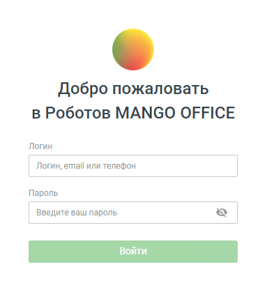

# 1. Страница авторизации

> Трассировка: PDF §1 · сквозные стр. 5-6 · источники: ч.1 `kb/sources/cov-robot-fil/Модуль ЦОВ Робот Фил 2,0_manual_v7.26.28.pdf` с.5-6.

Доступ к модулю ЦОВ «Робот Фил 2,0» осуществляется по ссылке robot.mango-office.ru. При первом входе на страницу открывается форма авторизации:

> **Описание иллюстрации ROBOTFIL-§1-1** · к разделу §1 «Страница авторизации» · стр. 5 · снимок экрана / схема, 393×439 px.
> Относится к тексту руководства: «Доступ к модулю ЦОВ «Робот Фил 2,0» осуществляется по ссылке robot.mango-office.ru. При первом входе на страницу открывается форма авторизации:»
> Следующий за иллюстрацией текст: «В качестве логина используются: Логин сотрудника, e-mail, номер телефона – для доступа к учетной записи сотрудника. Данные для доступа имеются в карточке сотрудника в Личном кабинете пользователя ВАТС…»
> Текст на изображении (OCR, требует сверки): Добро пожаловать; в Роботов MANGO OFFICE; Логин; / Логин, email или телефон; Пароль; / Введите ваш пароль; [Ss

В качестве логина используются: Логин сотрудника, e-mail, номер телефона – для доступа к учетной записи сотрудника. Данные для доступа имеются в карточке сотрудника в Личном кабинете пользователя ВАТС. После ввода корректного пароля и нажатия кнопки Войти сотрудник получает доступ к модулю ЦОВ «Робот Фил 2,0».

| Важно: Доступ к модулю ЦОВ «Робот Фил 2,0» имеют сотрудники ВАТС с ролью Администратор, а также |
| --- |
| сотрудники с ролью, которой были делегированы права на доступ к продукту «Роботы» в ЛК ВАТС. |

Меню модуля содержит разделы: Робот-администратор, Чат-боты, Роботы, Настройки интеграций и Услуги. В правой части шапки страницы отображаются:

> **Описание иллюстрации ROBOTFIL-§1-2** · к разделу §1 «Страница авторизации» · стр. 6 · пиктограмма (значок элемента интерфейса), 24×23 px.
> Относится к тексту руководства: «Меню модуля содержит разделы: Робот-администратор, Чат-боты, Роботы, Настройки интеграций и Услуги. В правой части шапки страницы отображаются:»
> Следующий за иллюстрацией текст: « кнопка – ссылка на Руководство пользователя;  аватар пользователя;»
> Текста на изображении нет; назначение значка — см. текст, к которому он относится.

 кнопка – ссылка на Руководство пользователя;  аватар пользователя;

> **Описание иллюстрации ROBOTFIL-§1-3** · к разделу §1 «Страница авторизации» · стр. 6 · пиктограмма (значок элемента интерфейса), 22×20 px.
> Относится к тексту руководства: « кнопка – ссылка на Руководство пользователя;  аватар пользователя;»
> Следующий за иллюстрацией текст: « кнопка – выход из учетной записи»
> Текста на изображении нет; назначение значка — см. текст, к которому он относится.

 кнопка – выход из учетной записи

> **Описание иллюстрации ROBOTFIL-§1-4** · к разделу §1 «Страница авторизации» · стр. 6 · пиктограмма (значок элемента интерфейса), 28×30 px.
> Относится к тексту руководства: « кнопка – выход из учетной записи»
> Следующий за иллюстрацией текст: « кнопка – вызов формы обратной связи.»
> Текста на изображении нет; назначение значка — см. текст, к которому он относится.

 кнопка – вызов формы обратной связи.
