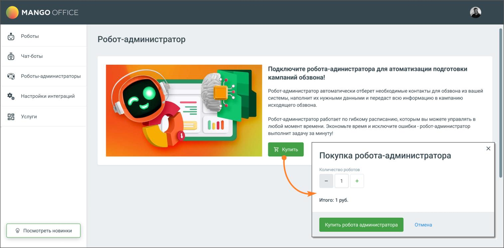
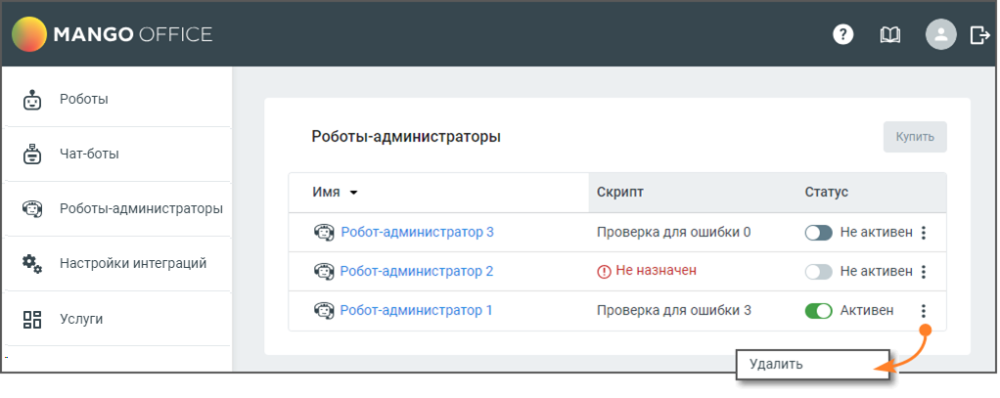

# 2. Робот-администратор

> Трассировка: PDF §2 · сквозные стр. 6-7 · источники: ч.1 `kb/sources/cov-robot-fil/Модуль ЦОВ Робот Фил 2,0_manual_v7.26.28.pdf` с.6-7.

Для подключения робота-администратора нажмите кнопку Купить, в открывшемся окне выберите необходимое количество и нажмите кнопку Купить робота администратора.

> **Описание иллюстрации ROBOTFIL-§2-1** · к разделу §2 «Робот-администратор» · стр. 6 · снимок экрана / схема, 1515×747 px.
> Относится к тексту руководства: «Для подключения робота-администратора нажмите кнопку Купить, в открывшемся окне выберите необходимое количество и нажмите кнопку Купить робота администратора.»
> Следующий за иллюстрацией текст: «После покупки робот-администратор будет доступен в соответствующем разделе модуля. Максимальное доступное количество роботов-администраторов – 3.»
> Текст на изображении (OCR, требует сверки): MANGO OFFICE; Роботы; Робот-администратор; Чат-боты; Подключите робота-адинистратора для атоматизации подготовки; Роботы-администраторы; кампаний обзвон;; Lf; Робот-администратор автоматически отберет необходимые контакты для обзвона из вашей; Настройки интеграций; системы, наполнит их нужными данными и передаст всю информацию в кампанию; исходящего обзвона.; oo; 20; Услуги; Робот-администратор работает по гибкому расписанию, которым вы можете управлять в; любой момент времени. Экономьте время и исключите ошибки - робот-администратор; выполнит задачу за минуту!; Покупка робота-администратора; …

После покупки робот-администратор будет доступен в соответствующем разделе модуля. Максимальное доступное количество роботов-администраторов – 3.

> **Описание иллюстрации ROBOTFIL-§2-2** · к разделу §2 «Робот-администратор» · стр. 7 · снимок экрана / схема, 1022×407 px.
> Относится к тексту руководства: «После покупки робот-администратор будет доступен в соответствующем разделе модуля. Максимальное доступное количество роботов-администраторов – 3.»
> Следующий за иллюстрацией текст: «Страница содержит:  Роботы-администраторы – в столбце отображается имя робота-администратора. По клику на имя открывается Карточка робота-администратора.  Скрипт – название скрипта, назначенного роб…»
> Текст на изображении (OCR, требует сверки): MANGO OFFIC.; Роботы; Купить; Роботы-администраторы; Чат-боты; Имя *; ‘Скрипт; Статус; © тобот-администратор 3; Проверка для ошибки 0; OD Неактивен; настройки интеграций; © робот-администратор 2; @ Не назначен; Неактивен; © Робот-администратор 1; Проверка для ошибки 3; © лкивен; 50; Услуги; Удалить

Страница содержит:  Роботы-администраторы – в столбце отображается имя робота-администратора. По клику на имя открывается Карточка робота-администратора.  Скрипт – название скрипта, назначенного роботу-администратору.  Статус – переключатель статуса робота активен/не активен.  Кнопка «Купить робота» – по клику на кнопку открывается форма покупки робота. После покупки трех роботов кнопка не доступна для нажатия.

> **Описание иллюстрации ROBOTFIL-§2-3** · к разделу §2 «Робот-администратор» · стр. 7 · пиктограмма (значок элемента интерфейса), 11×22 px.
> Относится к тексту руководства: «…ипта, назначенного роботу-администратору.  Статус – переключатель статуса робота активен/не активен.  Кнопка «Купить робота» – по клику на кнопку открывается форма покупки робота. После покупки трех роботов кнопка не доступна для нажатия.»
> Следующий за иллюстрацией текст: « Пиктограмма – клик по пиктограмме открывает меню действия с роботом-администратором. Откройте карточку робота-администратора, кликнув на имя робота, и произведите настройки.»
> Текста на изображении нет; назначение значка — см. текст, к которому он относится.

 Пиктограмма – клик по пиктограмме открывает меню действия с роботом-администратором. Откройте карточку робота-администратора, кликнув на имя робота, и произведите настройки.
