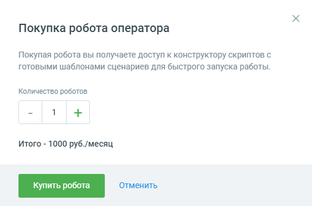

# 3.1. Форма покупки роботов

> Трассировка: PDF §3.1 · сквозные стр. 15-16 · источники: ч.1 `kb/sources/cov-robot-fil/Модуль ЦОВ Робот Фил 2,0_manual_v7.26.28.pdf` с.15-16.

Форма покупки роботов открывается при первом входе пользователя в модуль ЦОВ «Робот Фил 2,0». Ознакомьтесь с условиями и выберите необходимое количество роботов. Нажмите кнопку Купить робота.

> **Описание иллюстрации ROBOTFIL-§3.1-1** · к разделу §3.1 «Форма покупки роботов» · стр. 15 · снимок экрана / схема, 524×347 px.
> Относится к тексту руководства: «Форма покупки роботов открывается при первом входе пользователя в модуль ЦОВ «Робот Фил 2,0». Ознакомьтесь с условиями и выберите необходимое количество роботов. Нажмите кнопку Купить робота.»
> Следующий за иллюстрацией текст: «После нажатия кнопки Купить робота в левом верхнем углу страницы появляется уведомление Успешно создано __ роботов, с указанием количества созданных роботов.»
> Текст на изображении (OCR, требует сверки): Покупка робота оператора; Покупая робота вы получаете доступ к конструктору скриптов с; готовыми шаблонами сценариев для быстрого запуска работы.; Количество роботов; Итого - 1000 руб./месяц; Отменить

После нажатия кнопки Купить робота в левом верхнем углу страницы появляется уведомление Успешно создано __ роботов, с указанием количества созданных роботов.

| Примечание: при недостатке средств на счету покупка не осуществляется. О недостатке средств пользователь |
| --- |
| уведомляется системным сообщением. |

Кнопка Отменить закрывает форму покупки без сохранения изменений. После создании робота, сотрудник-робот появляется в разделе Сотрудники Личного кабинета ВАТС, а также других продуктах аналогично обычным сотрудникам. В списке сотрудников сотрудник-робот

> **Описание иллюстрации ROBOTFIL-§3.1-2** · к разделу §3.1 «Форма покупки роботов» · стр. 15 · пиктограмма (значок элемента интерфейса), 21×19 px.
> Относится к тексту руководства: «…ть закрывает форму покупки без сохранения изменений. После создании робота, сотрудник-робот появляется в разделе Сотрудники Личного кабинета ВАТС, а также других продуктах аналогично обычным сотрудникам. В списке сотрудников сотрудник-робот»
> Следующий за иллюстрацией текст: «отображается с пиктограммой и ролью «Робот». Робот попадает в статистику аналогично другим»
> Текста на изображении нет; назначение значка — см. текст, к которому он относится.

отображается с пиктограммой и ролью «Робот». Робот попадает в статистику аналогично другим

сотрудникам, может быть добавлен в группы и участвовать в схеме переадресации. В системе ведется поминутный учет длительности разговоров сотрудника-робота.
