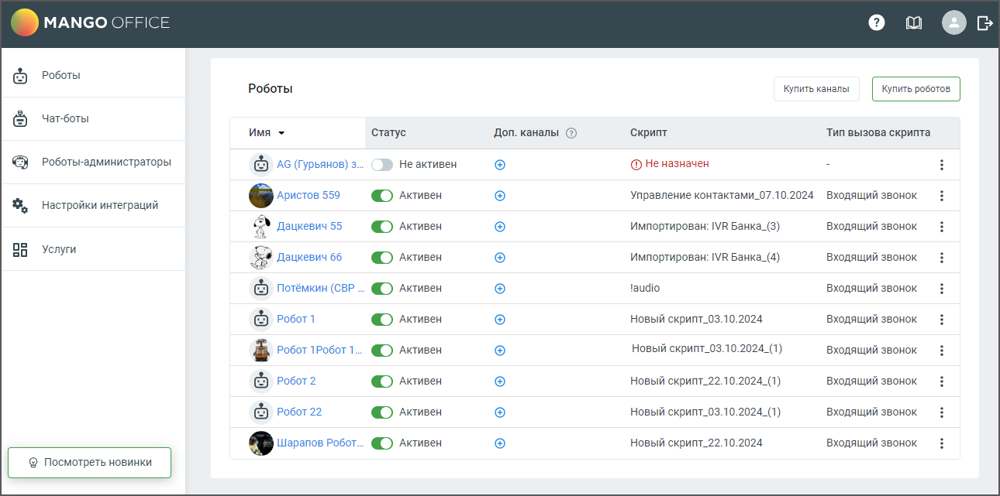

# 3.2. Страница «Роботы MANGO OFFICE»

> Трассировка: PDF §3.2 · сквозные стр. 16-17 · источники: ч.1 `kb/sources/cov-robot-fil/Модуль ЦОВ Робот Фил 2,0_manual_v7.26.28.pdf` с.16-17.

После покупки робота-оператора у пользователя открывается страница Роботы, на которой размещен список имеющихся роботов и краткая инструкция по работе с роботом. Пример внешнего вида страницы представлен на рисунке ниже.

> **Описание иллюстрации ROBOTFIL-§3.2-1** · к разделу §3.2 «Страница «Роботы MANGO OFFICE»» · стр. 16 · снимок экрана / схема, 1290×641 px.
> Относится к тексту руководства: «После покупки робота-оператора у пользователя открывается страница Роботы, на которой размещен список имеющихся роботов и краткая инструкция по работе с роботом. Пример внешнего вида страницы представлен на рисунке ниже.»
> Следующий за иллюстрацией текст: «Страница содержит:  Робот – в столбце отображается аватар робота, имя робота. По клику на имя открывается Карточка робота.  Статус – переключатель статуса робота активен/не активен.  Доп.каналы – к…»
> Текст на изображении (OCR, требует сверки): MANGO OFFIC; Роботы; Чат-боты; Имя +; ‘Статус; Don. каналы ©; ‘Скрипт; Тип вызова скрипта; Роботы-администраторы; © AG (Гурьянов) з; Неактивен; @ Неназначен; © лктивен; Управление контактами_07.10.2024; входящий звонок; настройки интеграций; és Аристов 559; ro; Дацкевич 55; Импортирован: IVR Банка_(3); 50; Услуги; Импортирован: IVR Банка_(4); $9 дацкевич 65; faudio; (© потёмкин (CBP; Новый скрипт_03.10.2024; © Posort; Новый cxpunt_03.10.2024_(1); ф e601 1Pos0r1; © Posor2; Новый скрипт_22.10.2024_(1); © Posor 22; ® Шарапов Робот.; Новый скрипт_22.10.2024

Страница содержит:  Робот – в столбце отображается аватар робота, имя робота. По клику на имя открывается Карточка робота.  Статус – переключатель статуса робота активен/не активен.  Доп.каналы – количество дополнительных каналов (услуга "Многоканальный робот").  Скрипт – название скрипта, назначенного роботу.  Тип вызова скрипта – входящий звонок или исходящий обзвон.  Кнопка «Купить робота» - по клику на кнопку открывается Форма покупки робота.  Кнопка «Купить каналы» - по клику на кнопку открывается форма перехода на страницу услуг.  Ссылка справку Роботов  Ссылка на форму обратной связи  Пиктограмма выхода из аккаунта

Откройте карточку робота-оператора, кликнув на имя робота, и заполните данные на вкладках.
