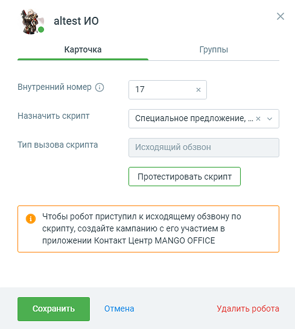
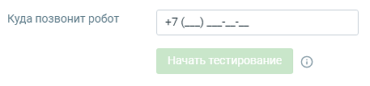
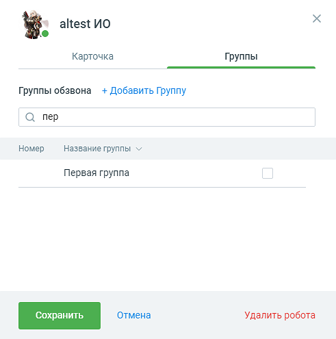

# 3.3. Карточка робота

> Трассировка: PDF §3.3 · сквозные стр. 17-20 · источники: ч.1 `kb/sources/cov-robot-fil/Модуль ЦОВ Робот Фил 2,0_manual_v7.26.28.pdf` с.17-20.

Карточка робота-оператора содержит две вкладки: Карточка и Группы.

> **Описание иллюстрации ROBOTFIL-§3.3-1** · к разделу §3.3 «Карточка робота» · стр. 17 · снимок экрана / схема, 489×546 px.
> Относится к тексту руководства: «Карточка робота-оператора содержит две вкладки: Карточка и Группы.»
> Следующий за иллюстрацией текст: «Робот, как участник кампании Исходящего обзвона, может:  Произносить значения полей ИО, выбранных при создании кампании;  Отправлять значения полей ИО в смс и e-mail;  Использовать значения полей И…»
> Текст на изображении (OCR, требует сверки): ея altest UO; Карточка; Группы; Внутренний номер (2); 17; Назначить скрипт; Специальное предложение, ..х v; Тип вызова скрипта; Исходящий обзвон; Протестировать скрипт; e Чтобы робот приступил к исходящему обзвону по; скрипту, создайте кампанию с его участием в; приложении Контакт Центр MANGO OFFICE; Удалить робота

Робот, как участник кампании Исходящего обзвона, может:  Произносить значения полей ИО, выбранных при создании кампании;  Отправлять значения полей ИО в смс и e-mail;  Использовать значения полей ИО в http-запросе;  Записывать произнесенную абонентом фразу/часть фразы в поле ИО.

На вкладке Карточка размещаются следующие настройки:

> **Описание иллюстрации ROBOTFIL-§3.3-2** · к разделу §3.3 «Карточка робота» · стр. 18 · пиктограмма (значок элемента интерфейса), 20×18 px.
> Относится к тексту руководства: «На вкладке Карточка размещаются следующие настройки:»
> Следующий за иллюстрацией текст: « Имя и фото робота. Клик на пиктограмму в поле аватара открывает окно для загрузки аватара»
> Текста на изображении нет; назначение значка — см. текст, к которому он относится.

 Имя и фото робота. Клик на пиктограмму в поле аватара открывает окно для загрузки аватара

> **Описание иллюстрации ROBOTFIL-§3.3-3** · к разделу §3.3 «Карточка робота» · стр. 18 · пиктограмма (значок элемента интерфейса), 15×15 px.
> Относится к тексту руководства: « Имя и фото робота. Клик на пиктограмму в поле аватара открывает окно для загрузки аватара»
> Следующий за иллюстрацией текст: «при помощи стандартных диалоговых средств Windows. Клик по пиктограмме позволяет изменить имя робота. Сохраните внесенные изменения, кликнув в любой области экрана, либо кнопкой Ввод/Enter на клавиату…»
> Текста на изображении нет; назначение значка — см. текст, к которому он относится.

при помощи стандартных диалоговых средств Windows. Клик по пиктограмме позволяет изменить имя робота. Сохраните внесенные изменения, кликнув в любой области экрана, либо кнопкой Ввод/Enter на клавиатуре компьютера.  Статус робота: активен (если роботу назначен скрипт), не активен. Управлять статусами робота

> **Описание иллюстрации ROBOTFIL-§3.3-4** · к разделу §3.3 «Карточка робота» · стр. 18 · пиктограмма (значок элемента интерфейса), 10×10 px.
> Относится к тексту руководства: «…е позволяет изменить имя робота. Сохраните внесенные изменения, кликнув в любой области экрана, либо кнопкой Ввод/Enter на клавиатуре компьютера.  Статус робота: активен (если роботу назначен скрипт), не активен. Управлять статусами робота»
> Следующий за иллюстрацией текст: «можно следующими способами:  активация/деактивация робота через список роботов;  активация/деактивация скрипта - меняет статус всех роботов, которым назначен скрипт.  Внутренний номер – внутренний …»
> Текста на изображении нет; назначение значка — см. текст, к которому он относится.

> **Описание иллюстрации ROBOTFIL-§3.3-5** · к разделу §3.3 «Карточка робота» · стр. 18 · пиктограмма (значок элемента интерфейса), 10×11 px.
> Относится к тексту руководства: «…е позволяет изменить имя робота. Сохраните внесенные изменения, кликнув в любой области экрана, либо кнопкой Ввод/Enter на клавиатуре компьютера.  Статус робота: активен (если роботу назначен скрипт), не активен. Управлять статусами робота»
> Следующий за иллюстрацией текст: «можно следующими способами:  активация/деактивация робота через список роботов;  активация/деактивация скрипта - меняет статус всех роботов, которым назначен скрипт.  Внутренний номер – внутренний …»
> Текста на изображении нет; назначение значка — см. текст, к которому он относится.

можно следующими способами:  активация/деактивация робота через список роботов;  активация/деактивация скрипта - меняет статус всех роботов, которым назначен скрипт.  Внутренний номер – внутренний номер сотрудника-робота, не более 5 символов. Номер может быть сгенерирован автоматически, либо задан вручную пользователем.  Назначить скрипт – выпадающий список имеющихся скриптов. Скрипты, сделанные под заказ, имеют дополнительный текст «Сделан под заказ». При выборе пункта «Создать скрипт» открывается форма Выбор шаблона.  Тип вызова скрипта – в зависимости от настроек выбранного скрипта исходящий обзвон или входящий звонок.  Кнопка «Протестировать скрипт» – по нажатию на кнопку появляется поле для ввода номера телефона, на который позвонит робот после нажатия кнопки «Начать тестирование».

> **Описание иллюстрации ROBOTFIL-§3.3-6** · к разделу §3.3 «Карточка робота» · стр. 18 · снимок экрана / схема, 457×107 px.
> Относится к тексту руководства: «…ти от настроек выбранного скрипта исходящий обзвон или входящий звонок.  Кнопка «Протестировать скрипт» – по нажатию на кнопку появляется поле для ввода номера телефона, на который позвонит робот после нажатия кнопки «Начать тестирование».»
> Следующий за иллюстрацией текст: «Примечание: Кнопка «Протестировать скрипт» доступна только при наличии назначенного роботу скрипта. На вкладке Группа размещаются следующие настройки:»
> Текст на изображении (OCR, требует сверки): Куда позвонит робот; TO

Примечание: Кнопка «Протестировать скрипт» доступна только при наличии назначенного роботу скрипта. На вкладке Группа размещаются следующие настройки:

> **Описание иллюстрации ROBOTFIL-§3.3-7** · к разделу §3.3 «Карточка робота» · стр. 19 · снимок экрана / схема, 491×495 px.
> Относится к тексту руководства: «Примечание: Кнопка «Протестировать скрипт» доступна только при наличии назначенного роботу скрипта. На вкладке Группа размещаются следующие настройки:»
> Следующий за иллюстрацией текст: « Группы обзвона – поле выбора групп обзвона. Осуществляет поиск по группам, содержащим введенные символы в названии или номере группы. В списке групп отображаются только группы, содержащие введенные …»
> Текст на изображении (OCR, требует сверки): ея altest UO; Карточка; Группы; Группы обзвона + Добавить Группу; О пер; Номер; Название группы v; Первая группа; Удалить робота

 Группы обзвона – поле выбора групп обзвона. Осуществляет поиск по группам, содержащим введенные символы в названии или номере группы. В списке групп отображаются только группы, содержащие введенные символы. Возможен поиск как по полным данным, так и по частичному наименованию. Группы в списке отображаются в алфавитном порядке.  Данные групп – номер и название группы ВАТС. К обоим вкладкам относятся:  Кнопка «Сохранить» – сохраняет внесенные в карточку изменения, карточка закрывается.  Кнопка «Отмена» – по нажатию кнопки внесенные изменения отменяются, карточка робота закрывается.  Кнопка «Удалить робота» – удаление созданного робота. По нажатию на кнопку подтвердите согласие на удаление. Если робот в момент удаления обрабатывает звонок, он заканчивает текущий разговор, после чего удаляется.