# 3.4. Скрипты для роботов

> Трассировка: PDF §3.4 · сквозные стр. 20-28 · источники: ч.1 `kb/sources/cov-robot-fil/Модуль ЦОВ Робот Фил 2,0_manual_v7.26.28.pdf` с.20-28.

Пример внешнего вида блока "Скрипты для роботов":

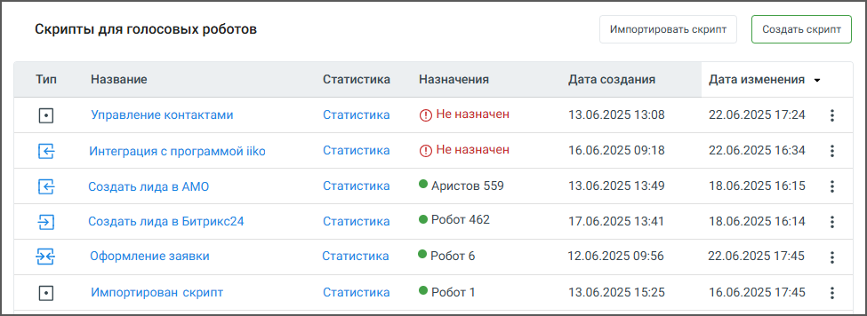

> **Описание иллюстрации ROBOTFIL-§3.4-1** · к разделу §3.4 «Скрипты для роботов» · стр. 20 · снимок экрана / схема, 975×356 px.
> Относится к тексту руководства: «Пример внешнего вида блока "Скрипты для роботов":»
> Следующий за иллюстрацией текст: «Блок содержит следующие элементы:  Кнопка «Создать скрипт» – по клику на кнопку открывается пользователь переходит к первом шагу создания скрипта – выбору шаблона.  Кнопка «Импортировать скрипт» – п…»
> Текст на изображении (OCR, требует сверки): ‘Скрипты для голосовых роботов; Импортировать скрипт; Тип; Название; Статистика.; Назначения; Дата изменения ~; Дата создания; Статистика; 13.06.2025 13:08; 22.06.2025 17:24; Управление контактами; @ He назначен; 16.06.2025 09:18; 22.06.2025 16:34; Интеграция с программой ко; Создать лида в AMO; © дристов 559; 13.06.2025 13:49; 18.06.2025 16:15; ® Робот 462; Создать лида в Битрикс24; 17.06.2025 13:41; 18.06.2025 16:14; 54; Оформление заявки; ФРоботб; 12.06.2025 09:56; 22.06.2025 17:45; Импортирован скрипт; © Робот1; 13.06.2025 15:25; 16.06.2025 17:45

Блок содержит следующие элементы:  Кнопка «Создать скрипт» – по клику на кнопку открывается пользователь переходит к первом шагу создания скрипта – выбору шаблона.  Кнопка «Импортировать скрипт» – по клику на кнопку открывается поле для импорта скрипта.  Название – название скрипта, сохраненное при создании. По двойному клику на название открывается Карточка сценария скрипта. Скрипты, созданные под заказ, перед наименованием

> **Описание иллюстрации ROBOTFIL-§3.4-2** · к разделу §3.4 «Скрипты для роботов» · стр. 20 · пиктограмма (значок элемента интерфейса), 23×24 px.
> Относится к тексту руководства: «…рипт» – по клику на кнопку открывается поле для импорта скрипта.  Название – название скрипта, сохраненное при создании. По двойному клику на название открывается Карточка сценария скрипта. Скрипты, созданные под заказ, перед наименованием»
> Следующий за иллюстрацией текст: «помечаются иконкой , и недоступны для просмотра и редактирования. Скрипты с активным»
> Текста на изображении нет; назначение значка — см. текст, к которому он относится.

помечаются иконкой , и недоступны для просмотра и редактирования. Скрипты с активным

> **Описание иллюстрации ROBOTFIL-§3.4-3** · к разделу §3.4 «Скрипты для роботов» · стр. 20 · пиктограмма (значок элемента интерфейса), 27×23 px.
> Относится к тексту руководства: «помечаются иконкой , и недоступны для просмотра и редактирования. Скрипты с активным»
> Следующий за иллюстрацией текст: «фоновым сценарием, помечаются иконкой .  Статистика – открывает окно статистики прохода скрипта.  Назначен – имя робота, которому назначен скрипт. Если скрипт назначен нескольким роботам, назначение…»
> Текста на изображении нет; назначение значка — см. текст, к которому он относится.

фоновым сценарием, помечаются иконкой .  Статистика – открывает окно статистики прохода скрипта.  Назначен – имя робота, которому назначен скрипт. Если скрипт назначен нескольким роботам, назначение обозначается пиктограммой «робот» и числом. По наведению на значок, появляется всплывающая подсказка с перечнем имён роботов через запятую.  Дата создания – дата и время создания скрипта в формате дд.мм.гггг чч:мм.  Дата изменения – дата и время последнего изменения скрипта дд.мм.гггг чч:мм.

 Пиктограмма – открывает меню доступных действий со скриптом: назначить робота, редактировать, изменить тип вызова, продублировать, остановить работу (только для назначенных скриптов роботов), удалить скрипт, активировать скрипт (отображается, если нет ни одного активного робота), экспортировать скрипт.  Тип – иконки типа скрипта. Варианты: без переходов, с исходящим переходом, с входящим переходом, с входящим и исходящим переходом. Нажатие на иконку открывает всплывающее окно с информацией о входящих и исходящих переходах между скриптами, а также возможностью открыть любой из них в новой вкладке:

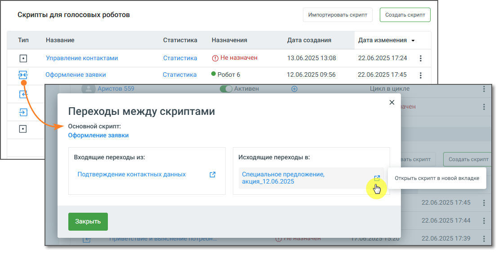

> **Описание иллюстрации ROBOTFIL-§3.4-4** · к разделу §3.4 «Скрипты для роботов» · стр. 21 · снимок экрана / схема, 1108×566 px.
> Относится к тексту руководства: «…дящим переходом, с входящим переходом, с входящим и исходящим переходом. Нажатие на иконку открывает всплывающее окно с информацией о входящих и исходящих переходах между скриптами, а также возможностью открыть любой из них в новой вкладке:»
> Следующий за иллюстрацией текст: «3.4.1. Создание скрипта В Конструкторе скриптов скрипт для Роботов может быть создан по одному из преднастроенных шаблонов, либо без шаблона, а также может быть импортирован. Также скрипт может быть с…»
> Текст на изображении (OCR, требует сверки): ‘Скрипты для голосовых роботов; Импортировать скрипт; 'Название; Статистика.; 'Назначения; Дата создания; Дата изменения >; Управление контактами; Статистика; @ He назначен; 13.06.2025 13:08; 22.06.2025 17:24; 54; Оформление заявки; ФРоботб; 12.06.2025 09:56; 22.06.2025 17:45; Переходы между скриптами; Основной скрипт:; Входящие переходы из:; Исходящие переходы в:; Подтверждение контактных данных; ie; Специальное предложение,; акция_12.06.2025

3.4.1. Создание скрипта В Конструкторе скриптов скрипт для Роботов может быть создан по одному из преднастроенных шаблонов, либо без шаблона, а также может быть импортирован. Также скрипт может быть создан разработчиком под заказ, вне интерфейса конструктора.

| Важно: В скрипте «под заказ» пользователю недоступны для просмотра и редактирования настройки и схема |
| --- |
| скрипта. Также пользователю недоступны дублирование скрипта, отображение результатов работы скрипта в |
| статистике, изменение типа запуска скрипта и его экспорт. |

В скрипте «под заказ» пользователь самостоятельно может только изменить наименование скрипта и просмотреть список роботов, работающих по скрипту. 3.4.2. Выбор шаблона для скрипта Помимо стандартных шаблонов скриптов для Роботов в этом окне также можно заказать разработку скрипта под ключ для конкретного бизнес-процесса.

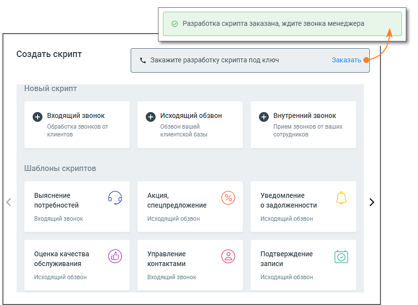

> **Описание иллюстрации ROBOTFIL-§3.4-5** · к разделу §3.4 «Скрипты для роботов» · стр. 22 · снимок экрана / схема, 857×626 px.
> Относится к тексту руководства: «…ние скрипта и просмотреть список роботов, работающих по скрипту. 3.4.2. Выбор шаблона для скрипта Помимо стандартных шаблонов скриптов для Роботов в этом окне также можно заказать разработку скрипта под ключ для конкретного бизнес-процесса.»
> Следующий за иллюстрацией текст: «Из списка преднастроенных шаблонов выберите вариант, отвечающий целям создаваемого скрипта, и кликните на окно шаблона. В окне сценария скрипта отредактируйте блоки скрипта и текст в блоках. Узнать бо…»
> Текст на изображении (OCR, требует сверки): / [© Разработка скрипта заказана, ждите звонка менеджера; Создать скрипт; Заказать; / \. Закажите разработку скрипта под ключ; Новый скрипт; [+] Входящий звонок; [+] Исходящий обзвон; [+] Внутренний звонок; Обработка звонков от; Обзвон вашей; Прием звонков от ваших; клиентов; клиентской базы; сотрудников; Шаблоны скриптов; Выяснение; Акция,; Уведомление; о задолженности; al; потребностей; спецпредложение; Входящий звонок; Исходящий обзвон; Оценка качества; Управление; Подтверждение; обслуживания; контактами; записи

Из списка преднастроенных шаблонов выберите вариант, отвечающий целям создаваемого скрипта, и кликните на окно шаблона. В окне сценария скрипта отредактируйте блоки скрипта и текст в блоках. Узнать больше в разделе Конструктор скриптов. Для создания скрипта без шаблона в окне Создать скрипт кликните на тип создаваемого скрипта: исходящий обзвон, внутренний или входящий звонок. Откроется окно конструктора скрипта, с именем скрипта по умолчанию Новый скрипт <дата создания дд.мм.гггг>.

3.4.3. Назначение скрипта роботу

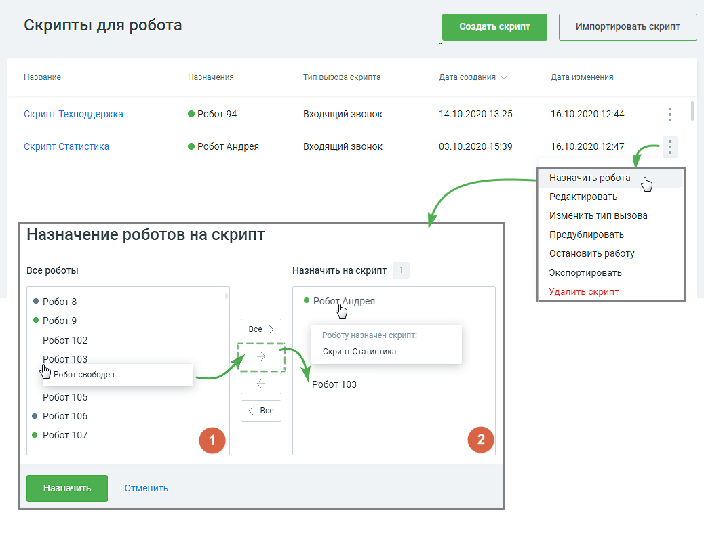

> **Описание иллюстрации ROBOTFIL-§3.4-6** · к разделу §3.4 «Скрипты для роботов» · стр. 23 · снимок экрана / схема, 1038×788 px.
> Относится к тексту руководства: «3.4.3. Назначение скрипта роботу»
> Следующий за иллюстрацией текст: «Чтобы назначить робота для работы по скрипту, откройте главную страницу раздела Скрипты и кликните»
> Текст на изображении (OCR, требует сверки): Скрипты для робота; Название; Назначения; Тип вызова скрипта; ‘Дата создания v; Дата изменения; Скрипт Техподдержка; © Робот 94; входящий звонок; 14.10.2020 13:25; 16.10.2020 12:44; Скрипт Статистика; @ Робот Андрея; 03.10.2020 15:39; 16.10.2020 12:47; Редактировать; Изменить тип вызова; Назначение роботов на скрипт; Продублировать; Остановить работу; все роботы; Назначить на скрипт; Экспортировать,; © Робот 8; Удалить скрипт; © Робот Андрея; © Робото; Bee >; Posory назначен скрипт:; Робот 102; es; Робот 103; РОбОт свободен; Робот 105; © Робот 106; < Bee; © Робот 107

Чтобы назначить робота для работы по скрипту, откройте главную страницу раздела Скрипты и кликните

> **Описание иллюстрации ROBOTFIL-§3.4-7** · к разделу §3.4 «Скрипты для роботов» · стр. 23 · пиктограмма (значок элемента интерфейса), 9×24 px.
> Относится к тексту руководства: «Чтобы назначить робота для работы по скрипту, откройте главную страницу раздела Скрипты и кликните»
> Следующий за иллюстрацией текст: «по пиктограмме в строке выбранного скрипта. Клик в строке Назначить робота всплывающего меню откроет форму Назначение роботов на скрипт.»
> Текста на изображении нет; назначение значка — см. текст, к которому он относится.

по пиктограмме в строке выбранного скрипта. Клик в строке Назначить робота всплывающего меню откроет форму Назначение роботов на скрипт.

> **Описание иллюстрации ROBOTFIL-§3.4-8** · к разделу §3.4 «Скрипты для роботов» · стр. 23 · пиктограмма (значок элемента интерфейса), 44×44 px.
> Относится к тексту руководства: «по пиктограмме в строке выбранного скрипта. Клик в строке Назначить робота всплывающего меню откроет форму Назначение роботов на скрипт.»
> Следующий за иллюстрацией текст: «- в левом окне «Все роботы» формы размещается список всех роботов, доступных для назначения.»
> Текста на изображении нет; назначение значка — см. текст, к которому он относится.

- в левом окне «Все роботы» формы размещается список всех роботов, доступных для назначения.

> **Описание иллюстрации ROBOTFIL-§3.4-9** · к разделу §3.4 «Скрипты для роботов» · стр. 23 · пиктограмма (значок элемента интерфейса), 41×41 px.
> Относится к тексту руководства: «- в левом окне «Все роботы» формы размещается список всех роботов, доступных для назначения.»
> Следующий за иллюстрацией текст: «- в правом окне «Назначить на скрипт» размещается список роботов, назначенных на данный скрипт.»
> Текста на изображении нет; назначение значка — см. текст, к которому он относится.

- в правом окне «Назначить на скрипт» размещается список роботов, назначенных на данный скрипт.

Роботы, которым назначен скрипт, отображаются со значками статуса – активен, не активен.

> **Описание иллюстрации ROBOTFIL-§3.4-10** · к разделу §3.4 «Скрипты для роботов» · стр. 24 · пиктограмма (значок элемента интерфейса), 10×10 px.
> Относится к тексту руководства: «Роботы, которым назначен скрипт, отображаются со значками статуса – активен, не активен.»
> Следующий за иллюстрацией текст: «Свободные роботы значка статуса не имеют. При наведении курсора на имя робота появляется уведомление «Робот свободен» или «Роботу назначен скрипт: наименование скрипта». Для перемещения роботов между …»
> Текста на изображении нет; назначение значка — см. текст, к которому он относится.

> **Описание иллюстрации ROBOTFIL-§3.4-11** · к разделу §3.4 «Скрипты для роботов» · стр. 24 · пиктограмма (значок элемента интерфейса), 10×11 px.
> Относится к тексту руководства: «Роботы, которым назначен скрипт, отображаются со значками статуса – активен, не активен.»
> Следующий за иллюстрацией текст: «Свободные роботы значка статуса не имеют. При наведении курсора на имя робота появляется уведомление «Робот свободен» или «Роботу назначен скрипт: наименование скрипта». Для перемещения роботов между …»
> Текста на изображении нет; назначение значка — см. текст, к которому он относится.

Свободные роботы значка статуса не имеют. При наведении курсора на имя робота появляется уведомление «Робот свободен» или «Роботу назначен скрипт: наименование скрипта». Для перемещения роботов между окнами используются следующие кнопки:

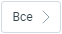

> **Описание иллюстрации ROBOTFIL-§3.4-12** · к разделу §3.4 «Скрипты для роботов» · стр. 24 · пиктограмма (значок элемента интерфейса), 62×34 px.
> Относится к тексту руководства: «Свободные роботы значка статуса не имеют. При наведении курсора на имя робота появляется уведомление «Робот свободен» или «Роботу назначен скрипт: наименование скрипта». Для перемещения роботов между окнами используются следующие кнопки:»
> Следующий за иллюстрацией текст: «- перенести всех доступных роботов в окно-2;»
> Текста на изображении нет; назначение значка — см. текст, к которому он относится.

- перенести всех доступных роботов в окно-2;

> **Описание иллюстрации ROBOTFIL-§3.4-13** · к разделу §3.4 «Скрипты для роботов» · стр. 24 · пиктограмма (значок элемента интерфейса), 61×34 px.
> Относится к тексту руководства: «- перенести всех доступных роботов в окно-2;»
> Следующий за иллюстрацией текст: «- перенести выбранных в окне-1 роботов в окно-2;»
> Текста на изображении нет; назначение значка — см. текст, к которому он относится.

- перенести выбранных в окне-1 роботов в окно-2;

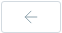

> **Описание иллюстрации ROBOTFIL-§3.4-14** · к разделу §3.4 «Скрипты для роботов» · стр. 24 · пиктограмма (значок элемента интерфейса), 62×33 px.
> Относится к тексту руководства: «- перенести выбранных в окне-1 роботов в окно-2;»
> Следующий за иллюстрацией текст: «- перенести выбранных в окне-2 роботов в окно-1;»
> Текста на изображении нет; назначение значка — см. текст, к которому он относится.

- перенести выбранных в окне-2 роботов в окно-1;

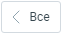

> **Описание иллюстрации ROBOTFIL-§3.4-15** · к разделу §3.4 «Скрипты для роботов» · стр. 24 · пиктограмма (значок элемента интерфейса), 62×34 px.
> Относится к тексту руководства: «- перенести выбранных в окне-2 роботов в окно-1;»
> Следующий за иллюстрацией текст: «- перенести всех роботов в окно-1. Важно: Один робот не может быть назначен на два скрипта одновременно. Если роботу уже назначен скрипт, происходит переназначение, и роботу назначается новый скрипт с…»
> Текста на изображении нет; назначение значка — см. текст, к которому он относится.

- перенести всех роботов в окно-1. Важно: Один робот не может быть назначен на два скрипта одновременно. Если роботу уже назначен скрипт, происходит переназначение, и роботу назначается новый скрипт с предварительным системным уведомлением. Переназначение происходит после завершения роботом текущего вызова. Сохраните сделанные назначения кнопкой Назначить. По клику на кнопку Отменить форма назначения закрывается без изменений. Назначенный на скрипт робот начинает работу по скрипту сразу по назначении:  При работе по скрипту с типом «исходящий обзвон» робот скажет первую фразу (начнет скрипт) только после того, как абонент возьмет трубку и скажет какую-либо фразу.  При работе по скрипту с типом «входящий звонок» или «внутренний звонок» робот скажет первую фразу (начнет скрипт) сразу после установления соединения с абонентом.

3.4.4. Остановка работы по скрипту

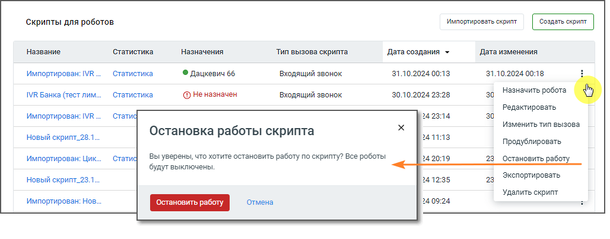

> **Описание иллюстрации ROBOTFIL-§3.4-16** · к разделу §3.4 «Скрипты для роботов» · стр. 25 · снимок экрана / схема, 1028×405 px.
> Относится к тексту руководства: «3.4.4. Остановка работы по скрипту»
> Следующий за иллюстрацией текст: «Чтобы остановить работы по скрипту, откройте главную страницу раздела Скрипты и кликните по»
> Текст на изображении (OCR, требует сверки): скрипты для роботов; ‘импортировать скрипт; 'Название; Статистика; Назначения; "Тип вызова скрипта; Дата создания ~; Дата изменения; 31.10.2024 00:13; 31.10.2024 00:18; Импортирован: IVR; © Дацкевич 66; входящий звонок; 30.10.2024 23:28; 30; IVR Банка (тест лим.; Ф Неназначен; rensorerton (6); Редактировать; стати; 242314; Изменить тип вызова; Остановка работы скрипта; 241113; новый скрипт_28.1; Продублировать; Вы уверены, что хотите остановить работу по скрипту? Все роботы; 242019; Импортирован: Цик.; Остановить работу; будут выключены; 241235; Экспортировать; новый скрипт_23.1; Удалить скрип…

Чтобы остановить работы по скрипту, откройте главную страницу раздела Скрипты и кликните по

> **Описание иллюстрации ROBOTFIL-§3.4-17** · к разделу §3.4 «Скрипты для роботов» · стр. 25 · пиктограмма (значок элемента интерфейса), 9×24 px.
> Относится к тексту руководства: «Чтобы остановить работы по скрипту, откройте главную страницу раздела Скрипты и кликните по»
> Следующий за иллюстрацией текст: «пиктограмме в строке выбранного скрипта. Клик в строке Остановить работу всплывающего меню откроет форму Остановка работы скрипта. Подтвердите свое согласие на остановку нажатием кнопки Остановить раб…»
> Текста на изображении нет; назначение значка — см. текст, к которому он относится.

пиктограмме в строке выбранного скрипта. Клик в строке Остановить работу всплывающего меню откроет форму Остановка работы скрипта. Подтвердите свое согласие на остановку нажатием кнопки Остановить работу. Также пользователь может остановить работу по скрипту, сменив статус робота в списке роботов на «Не активен». Если робот в момент остановки обрабатывает звонок, он заканчивает текущий разговор, после чего останавливает работу. Статус робота меняется на «Не активен». По клику на кнопку Отменить форма остановки работы по скрипту закрывается без изменений. Важно: Активация/деактивация скрипта влияет на статус всех роботов, которым назначен скрипт. 3.4.5. Редактирование скрипта Для редактирования созданного скрипта откройте главную страницу раздела Скрипты и кликните по

пиктограмме в строке выбранного скрипта. Клик в строке Редактировать всплывающего меню откроет форму Редактирования скрипта. Перемещайтесь по скрипту, зажав правую клавишу мыши. Также редактирование скрипта доступно из окна просмотра Статистики скрипта.

3.4.6. Импорт и экспорт скрипта Импорт/экспорт скриптов MANGO OFFICE возможен как внутри одного, так и между различными лицевыми счетами системы. Для импорта скрипта кликните по кнопке «Импортировать скрипт» на главной странице раздела Скрипты.

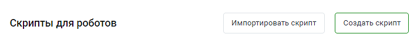

> **Описание иллюстрации ROBOTFIL-§3.4-18** · к разделу §3.4 «Скрипты для роботов» · стр. 26 · снимок экрана / схема, 710×78 px.
> Относится к тексту руководства: «…6. Импорт и экспорт скрипта Импорт/экспорт скриптов MANGO OFFICE возможен как внутри одного, так и между различными лицевыми счетами системы. Для импорта скрипта кликните по кнопке «Импортировать скрипт» на главной странице раздела Скрипты.»
> Следующий за иллюстрацией текст: «Максимальный размер файла импортируемого скрипта не более 10 Мб. При импорте производится проверка соответствия данных импортируемого скрипта с текущими данными системы:  Соответствие переменных и по…»
> Текст на изображении (OCR, требует сверки): Скрипты для роботов; Импортировать скрипт

> **Описание иллюстрации ROBOTFIL-§3.4-19** · к разделу §3.4 «Скрипты для роботов» · стр. 26 · пиктограмма (значок элемента интерфейса), 9×24 px.
> Относится к тексту руководства: «…6. Импорт и экспорт скрипта Импорт/экспорт скриптов MANGO OFFICE возможен как внутри одного, так и между различными лицевыми счетами системы. Для импорта скрипта кликните по кнопке «Импортировать скрипт» на главной странице раздела Скрипты.»
> Следующий за иллюстрацией текст: «Максимальный размер файла импортируемого скрипта не более 10 Мб. При импорте производится проверка соответствия данных импортируемого скрипта с текущими данными системы:  Соответствие переменных и по…»
> Текста на изображении нет; назначение значка — см. текст, к которому он относится.

Максимальный размер файла импортируемого скрипта не более 10 Мб. При импорте производится проверка соответствия данных импортируемого скрипта с текущими данными системы:  Соответствие переменных и полей  Соответствие тематик  Соответствие сотрудников и групп  Соответствие ответов в Справочнике ответов В случае, если при проверке в блоках системы отсутствуют какие-либо данные, то импортируемые данные автоматически исключаются. Пользователь может просмотреть информацию об исключенных данных, а также сохранить текст ошибок в текстовый файл .txt. Пример 1. В импортируемом скрипте в блоке "Фраза робота", в поле "Произнести текст" имеется переменная "ФИО" из Адресной книги КЦ. Система ищет переменную ФИО только среди полей Адресной книги КЦ Пример 2. В импортируемом скрипте в блоке "Голос в текст", в поле "Записать то, что сказал абонент в переменную" имеется переменная "Ответ клиента" из справочника переменных робота. Система ищет переменную "Ответ клиента" только среди переменных справочника переменных робота в текущей системе Для экспорта созданного скрипта откройте главную страницу раздела Скрипты и кликните по

пиктограмме в строке выбранного скрипта. Клик в строке Экспортировать всплывающего меню инициирует загрузку скрипта в формате .enc. Скрипт загружается в папку, указанную пользователем для загрузки файлов в настройках браузера. При экспорте скрипта в файл сохраняется следующая информация:  Наименование скрипта  Тип запуска скрипта

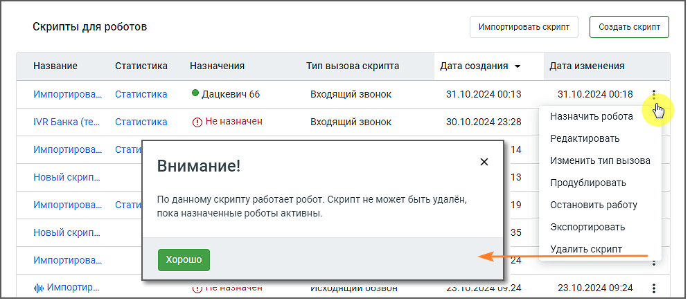

> **Описание иллюстрации ROBOTFIL-§3.4-20** · к разделу §3.4 «Скрипты для роботов» · стр. 27 · снимок экрана / схема, 996×441 px.
> Относится к тексту руководства: «…ирует загрузку скрипта в формате .enc. Скрипт загружается в папку, указанную пользователем для загрузки файлов в настройках браузера. При экспорте скрипта в файл сохраняется следующая информация:  Наименование скрипта  Тип запуска скрипта»
> Следующий за иллюстрацией текст: « Блоки (с той же последовательностью и расположением) и связи между блоками  Настройки блоков, в том числе настройки перевода звонка на оператора  Текст, переменные, поля (название, тип и раздел/сп…»
> Текст на изображении (OCR, требует сверки): Скрипты для роботов; noise co; Название; Статистика.; Назначения; Тип вызова скрипта; Дата создания +; ‘Дата изменения; Статистика; 31.10.2024 00:13; 31.10.2024 00:18; Импортирова.; © Дацкевич 66; входящий звонок; 30.10.2024 23:28; Назначить робота; IVR Банка (те.; @ He назначен; Редактировать; стати; 14; Изменить тип вызова; Внимание!; новый скрип.; 13; Продублировать; По данному скрипту работает робот. Скрипт не может быть удалён,; 19; Остановить работу; пока назначенные роботы активны; Экспортировать; 35; Удалить скрипт; sj Импортир.; ие поопочен; исходящии оозвон; 5.2024 0.24.; 23.10.2024 …

 Блоки (с той же последовательностью и расположением) и связи между блоками  Настройки блоков, в том числе настройки перевода звонка на оператора  Текст, переменные, поля (название, тип и раздел/справочник переменных и полей) и значения в настройках блоков

| Важно: Статистика, пользовательские переменные, справочник ответов и настройки робота - не экспортируются и |
| --- |
| не импортируются. |

3.4.7. Удаление скрипта

> **Описание иллюстрации ROBOTFIL-§3.4-21** · к разделу §3.4 «Скрипты для роботов» · стр. 27 · пиктограмма (значок элемента интерфейса), 9×24 px.
> Относится к тексту руководства: «3.4.7. Удаление скрипта»
> Следующий за иллюстрацией текст: «Чтобы удалить скрипт, откройте главную страницу раздела Скрипты и кликните по пиктограмме в строке выбранного скрипта. Клик в строке Удалить скрипт всплывающего меню откроет форму Удалить скрипт. Если…»
> Текста на изображении нет; назначение значка — см. текст, к которому он относится.

Чтобы удалить скрипт, откройте главную страницу раздела Скрипты и кликните по пиктограмме в строке выбранного скрипта. Клик в строке Удалить скрипт всплывающего меню откроет форму Удалить скрипт. Если назначенные на скрипт роботы в момент удаления скрипта обрабатывают звонки, они заканчивают текущие разговоры, после чего скрипт удаляется, статусы роботов автоматически меняются на «Не активен». Важно: Невозможно удалить скрипт, если он используется как дочерний при переходе из других скриптов. Если скрипт не назначен роботам, либо назначенные роботы не активны, скрипт удаляется с предварительным предупреждением. Подтвердите свое согласие на удаление нажатием кнопки Удалить.

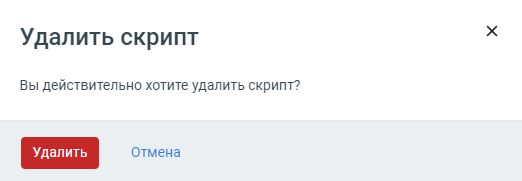

> **Описание иллюстрации ROBOTFIL-§3.4-22** · к разделу §3.4 «Скрипты для роботов» · стр. 28 · снимок экрана / схема, 522×181 px.
> Относится к тексту руководства: «…пользуется как дочерний при переходе из других скриптов. Если скрипт не назначен роботам, либо назначенные роботы не активны, скрипт удаляется с предварительным предупреждением. Подтвердите свое согласие на удаление нажатием кнопки Удалить.»
> Следующий за иллюстрацией текст: «По клику на кнопку Отмена форма удаления скрипта закрывается без изменений.»
> Текст на изображении (OCR, требует сверки): Удалить скрипт; Вы действительно хотите удалить скрипт?; Отмена

<!-- изображение на стр. 28: байты не извлечены (PyMuPDF недоступен) -->

По клику на кнопку Отмена форма удаления скрипта закрывается без изменений.
