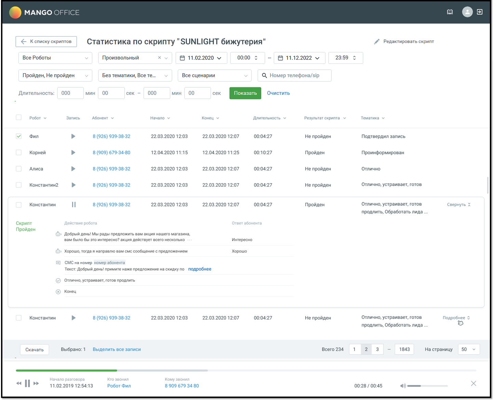
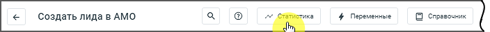

# 3.6. Статистика по скрипту робота

> Трассировка: PDF §3.6 · сквозные стр. 32-36 · источники: ч.1 `kb/sources/cov-robot-fil/Модуль ЦОВ Робот Фил 2,0_manual_v7.26.28.pdf` с.32-36.

Чтобы просмотреть статистику по скрипту робота, кликните по кнопке «Статистика» в строке выбранного скрипта. Если по скрипту не было ни одного разговора, его статистика не отображается.

> **Описание иллюстрации ROBOTFIL-§3.6-1** · к разделу §3.6 «Статистика по скрипту робота» · стр. 33 · снимок экрана / схема, 1451×1175 px.
> Относится к тексту руководства: «Чтобы просмотреть статистику по скрипту робота, кликните по кнопке «Статистика» в строке выбранного скрипта. Если по скрипту не было ни одного разговора, его статистика не отображается.»
> Следующий за иллюстрацией текст: «В окне статистики по скрипту задайте параметры фильтрации:  Роботы – по умолчанию выбраны все роботы, которым назначен данный скрипт. Если выбрать опцию «Все роботы», то в таблице отображаются звонки…»
> Текст на изображении (OCR, требует сверки): МАМСО; ao @a; < Kennoxy скриптов,; Статистика по скрипту "SUNLIGHT бижутерия"; #7 Редактировать скрипт; Все Роботы; 00:00; 23:59; Произвольный; В 11.02.2020 v; В 11.12.2022 м; Пройден, Не пройден; Без тематики, Все Te...; Все сценарии; Q Номер телефона/зр; 000; мин; 00; сек -; Длительность:; Робот; Запись; Абонент; Начало; Конец; Длительность; Результат скрипта; Тематика; Фил; 8 (926) 939-38-32; 22.03.2020 12:03; 22.03.2020 12:07; 00:04:27; He пройден; Подтвердил запись; Корней; 8 (909) 679-34-80; 12.04.2020 11:15; 12.04.2020 11:25; 00:10:27; Пройден; Проинформирован; Алиса; Отлично; Не пройде…

В окне статистики по скрипту задайте параметры фильтрации:  Роботы – по умолчанию выбраны все роботы, которым назначен данный скрипт. Если выбрать опцию «Все роботы», то в таблице отображаются звонки по всем роботам, в том числе удаленным;  Период – выбор одного из значений: Текущий день / Текущая неделя / Текущий месяц / Произвольный;  Результаты – общий результат разговора по скрипту.  «Пройден» - будут выбраны звонки, где диалог с абонентом прошёл от блока «Начало» до блока «Завершение разговора» в соответствии со скриптом;  «Не пройден» - будут выбраны звонки, где диалог с абонентом не дошел до блока «Завершение разговора» в соответствии со скриптом, а был прерван в процессе разговора;  Тематики – cписок тематик Контакт-центра MANGO OFFICE. По умолчанию выбраны все тематики. Также в фильтре имеется возможность выбора звонков «Без тематики»;

 Сценарии – выбор одного из значений: С фоновым сценарием, Без фонового сценария, Все сценарии;  По номеру телефона – работает поиск по введенным символам  По длительности разговора – по умолчанию, значение «От» = 00 минут 00 секунд, значение «До» = 10 минут 00 секунд  Время – по умолчанию, значение «От» = 00:00, «До» = 23:59

| Примечание: Блок «Фоновые события» и все связанные с ним блоки, попадают в статистику только в случае, |
| --- |
| если Фоновые события активен, и робот перешел на «Фоновые события». |

> **Описание иллюстрации ROBOTFIL-§3.6-2** · к разделу §3.6 «Статистика по скрипту робота» · стр. 34 · пиктограмма (значок элемента интерфейса), 16×18 px.
> Относится к тексту руководства: «| Примечание: Блок «Фоновые события» и все связанные с ним блоки, попадают в статистику только в случае, | | --- | | если Фоновые события активен, и робот перешел на «Фоновые события». |»
> Следующий за иллюстрацией текст: «Для отображения результатов с учетом фильтрации нажмите кнопку Показать. Клик по пиктограмме очищает поле фильтра. Клик по кнопке «Очистить фильтры» сбрасывает значения фильтров к значениям по умолчан…»
> Текста на изображении нет; назначение значка — см. текст, к которому он относится.

Для отображения результатов с учетом фильтрации нажмите кнопку Показать. Клик по пиктограмме очищает поле фильтра. Клик по кнопке «Очистить фильтры» сбрасывает значения фильтров к значениям по умолчанию. Помимо параметров фильтрации, для каждого робота, работавшего по скрипту, доступна следующая информация:  Робот – название робота, который участвовал в диалоге.

> **Описание иллюстрации ROBOTFIL-§3.6-3** · к разделу §3.6 «Статистика по скрипту робота» · стр. 34 · пиктограмма (значок элемента интерфейса), 37×36 px.
> Относится к тексту руководства: «…опке «Очистить фильтры» сбрасывает значения фильтров к значениям по умолчанию. Помимо параметров фильтрации, для каждого робота, работавшего по скрипту, доступна следующая информация:  Робот – название робота, который участвовал в диалоге.»
> Следующий за иллюстрацией текст: « Суммаризация диалога GPT – клик по иконке предоставляет возможность быстро получить краткую информацию о диалоге, сгенерированную YandexGPT, без необходимости прослушивать запись или просматривать в…»
> Текста на изображении нет; назначение значка — см. текст, к которому он относится.

 Суммаризация диалога GPT – клик по иконке предоставляет возможность быстро получить краткую информацию о диалоге, сгенерированную YandexGPT, без необходимости прослушивать запись или просматривать весь скрипт.  Запись – пиктограмма, позволяющая воспроизвести запись диалога.  Клиент – имя абонента (если имеется в Адресной книге) или номер телефона. Для внутренних вызовов отображается имя или внутренний номер сотрудника. Клик по имени клиента открывает окно информации о клиенте.  Начало – дата и время начала разговора в формате дд.мм.гггг чч:мм;  Конец – дата и время окончания разговора в формате дд.мм.гггг чч:мм;  Длительность – длительность разговора в формате дд.мм.гггг чч:мм;  Тематика – классификация тематик диалога.  Действие робота – в блоке «Действие робота» отображаются действия, последовательно в соответствии со схемой скрипта. Клик по кнопке Подробнее приводит к отображению полного текста смс/e-mail во всплывающем уведомлении.  Ответ абонента – если в схеме скрипта в блоках «Фраза робота» настроены ответы собеседника, в колонке «Ответ абонента» отображается текст распознанной речи собеседника в ответ на соответствующую фразу робота.  Результат перевода звонка и статус оператора, на которого был переведен звонок – если в процессе прохода скрипта робот перевел звонок на один из доступных вариантов.  Сценарий взаимодействия  Статус отправки запросов – варианты: успешный, ошибка  Выбранный режим распознавания для блока «Фраза робота» – информация помогает анализировать качество распознавания  Процедуры – вход в процедуру, информация о работе в процедуре, выход из процедуры

Запись разговора можно прослушать при помощи встроенного плеера. Способ хранения записи разговоров - в облачном хранилище или на внешнем ftp-сервере - настраивается в Личном кабинете ВАТС. В модуле ЦОВ «Робот Фил 2,0» значение этой настройки не изменяется. Для экспорта статистики выберите записи и нажмите кнопку Скачать. Доступны следующие форматы выгрузки статистики: 1. Отчет по разговорам - в файл .csv будет выгружена следующая информация (выгрузка в csv поддерживает до 300 тысяч звонков):  Данные скрипта: id скрипта/ Название скрипта  Данные разговора: id разговора/Робот/Абонент/Начало/Конец/Длительность/Результат скрипта/Тематика  Диалог робота с абонентом: id действия /Тип действия/Фраза(действие)робота/Ответ абонента  Результат перевода звонка и статус оператора, на которого был переведен звонок 2. Записи разговоров - скачивание аудиозаписей всех выбранных разговоров в едином архиве, где:  Формат имени аудиозаписей: «ГГГГ-ММ-ДД_ЧЧ-ММ-СС_Номер абонента_SIP Сотрудника_Номер АТС.mp3»  Имя скачиваемого архива формируется в зависимости от времени скачивания: «ГГГГ-ММ- ДД_ЧЧ-ММ-СС.zip» По нажатию кнопки «Выделить все записи» происходит выбор записей на всех страницах. Просмотр статистики также доступен из карточки скрипта в режиме редактирования.

> **Описание иллюстрации ROBOTFIL-§3.6-4** · к разделу §3.6 «Статистика по скрипту робота» · стр. 35 · снимок экрана / схема, 704×47 px.
> Относится к тексту руководства: «… формируется в зависимости от времени скачивания: «ГГГГ-ММ- ДД_ЧЧ-ММ-СС.zip» По нажатию кнопки «Выделить все записи» происходит выбор записей на всех страницах. Просмотр статистики также доступен из карточки скрипта в режиме редактирования.»
> Текст на изображении (OCR, требует сверки): < Создать лида в AMO; ка; 4 Переменные; {Я справочник