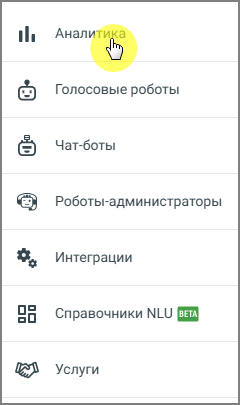
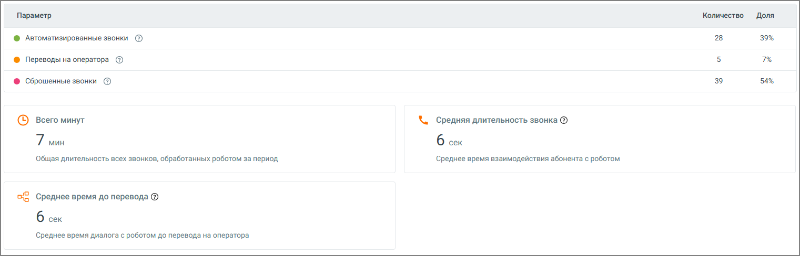
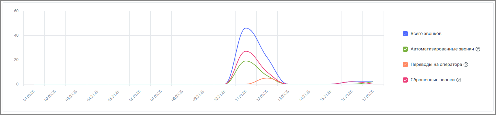
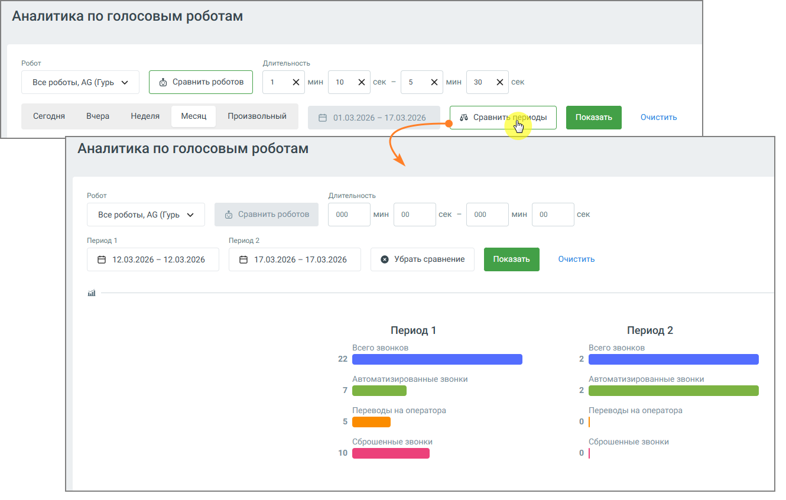
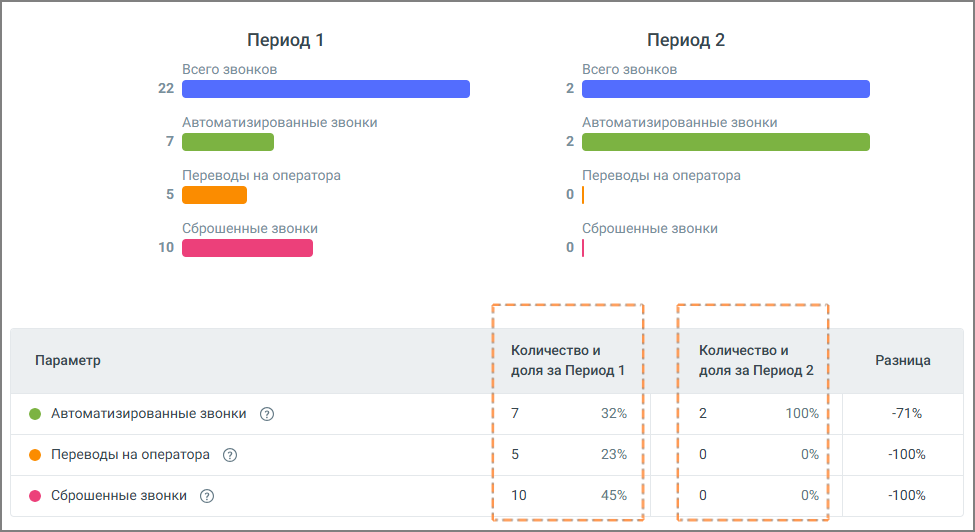

# 3.7. Аналитика по голосовым роботам

> Трассировка: PDF §3.7 · сквозные стр. 36-39 · источники: ч.1 `kb/sources/cov-robot-fil/Модуль ЦОВ Робот Фил 2,0_manual_v7.26.28.pdf` с.36-39.

> **Описание иллюстрации ROBOTFIL-§3.7-1** · к разделу §3.7 «Аналитика по голосовым роботам» · стр. 36 · снимок экрана / схема, 240×405 px.
> Относится к тексту руководства: начало раздела «Аналитика по голосовым роботам».
> Следующий за иллюстрацией текст: «Страница предназначена для оперативной оценки работы голосовых роботов. Здесь в одном месте собраны ключевые показатели, которые позволяют понять, как проходят звонки, насколько эффективно работает ав…»
> Текст на изображении (OCR, требует сверки): th; те; Голосовые роботы; Чат-боты; Роботы-администраторы; Интеграции; 08; oO; Справочники NLU; Услуги

Страница предназначена для оперативной оценки работы голосовых роботов. Здесь в одном месте собраны ключевые показатели, которые позволяют понять, как проходят звонки, насколько эффективно работает автоматизация и где возникают потери. 3.7.1. Фильтры и управление данными

> **Описание иллюстрации ROBOTFIL-§3.7-2** · к разделу §3.7 «Аналитика по голосовым роботам» · стр. 36 · снимок экрана / схема, 1190×235 px.
> Относится к тексту руководства: «…ативной оценки работы голосовых роботов. Здесь в одном месте собраны ключевые показатели, которые позволяют понять, как проходят звонки, насколько эффективно работает автоматизация и где возникают потери. 3.7.1. Фильтры и управление данными»
> Следующий за иллюстрацией текст: «Перед построением отчета можно задать условия отбора данных:  По роботам – выбрать один, несколько или все голосовые роботы  По скриптам – отфильтровать по используемым сценариям»
> Текст на изображении (OCR, требует сверки): Аналитика по голосовым роботам; Робот; Длительность; Bee роботы, AG Type 1 x mm 10 x leek =/ 5X mH Хек; ‘Сегодня; Вчера; Неделя; Месяц; Произвольный; В 01.03.2026 - 17.03.2026

Перед построением отчета можно задать условия отбора данных:  По роботам – выбрать один, несколько или все голосовые роботы  По скриптам – отфильтровать по используемым сценариям

 По периоду – доступны быстрые варианты (сегодня, вчера, неделя, месяц) или произвольный диапазон После выбора параметров нажмите кнопку Показать, чтобы обновить данные. Дополнительно доступны:  Очистить – сбрасывает все выбранные фильтры  Сравнить периоды – позволяет сопоставить два временных интервала  Сравнить роботов – включает режим сравнения двух роботов между собой  Полноэкранный режим – разворачивает дашборд для более детального анализа 3.7.2. Как читать дашборд

> **Описание иллюстрации ROBOTFIL-§3.7-3** · к разделу §3.7 «Аналитика по голосовым роботам» · стр. 37 · снимок экрана / схема, 1521×488 px.
> Относится к тексту руководства: «…ы  Сравнить периоды – позволяет сопоставить два временных интервала  Сравнить роботов – включает режим сравнения двух роботов между собой  Полноэкранный режим – разворачивает дашборд для более детального анализа 3.7.2. Как читать дашборд»
> Следующий за иллюстрацией текст: «На дашборде выводятся агрегированные показатели за выбранный период:  Всего звонков – общее количество всех зафиксированных вызовов  Автоматизированные звонки – звонки, полностью обработанные робото…»
> Текст на изображении (OCR, требует сверки): Параметр; Количество — Доля; ® Автоматизированные звонки ®; 28; 39%; ® Переводы на оператора @; © Сброшенные звонки ©; 39; 54%; © всего минут; \. средняя длительность звонка @; 7 мин; бек; `Общая длительность всех звонков, обработанных роботом за период; Среднее время взаимодействия абонента с роботом; oS Среднее время до перевода ©; ‘Среднее время диалога с роботом до перевода на оператора

На дашборде выводятся агрегированные показатели за выбранный период:  Всего звонков – общее количество всех зафиксированных вызовов  Автоматизированные звонки – звонки, полностью обработанные роботом без участия оператора  Переводы на оператора – звонки, завершившиеся переводом в на оператора Контакт-центра или на внешний номер  Сброшенные звонки – звонки, которые абонент завершил в течение заданного короткого интервала после начала  Среднее время до эскалации – среднее время звонков, которые закончились переводом на оператора Контакт-центра или внешний номер  Всего минут – суммарная длительность всех звонков  Средняя длительность звонка – среднее время взаимодействия с роботом  Среднее время до перевода – среднее время до момента эскалации на оператора Показатели даны как в абсолютных значениях, так и в долях, что позволяет быстро оценить структуру звонков.

Ниже расположен график, который показывает изменение показателей по времени. Это удобно для выявления пиков, аномалий и влияния изменений в сценариях.

> **Описание иллюстрации ROBOTFIL-§3.7-4** · к разделу §3.7 «Аналитика по голосовым роботам» · стр. 38 · снимок экрана / схема, 1531×358 px.
> Относится к тексту руководства: «Ниже расположен график, который показывает изменение показателей по времени. Это удобно для выявления пиков, аномалий и влияния изменений в сценариях.»
> Следующий за иллюстрацией текст: «3.7.3. Режим сравнения В системе предусмотрены два варианта сравнительного анализа:  Сравнение роботов – два робота сравниваются в рамках одного периода  Сравнение периодов – один и тот же набор роб…»
> Текст на изображении (OCR, требует сверки): Всего звонков; @ ^етоматизированные звонки ®; Переводы на оператора @; @ сброшенные звонки @; eo

3.7.3. Режим сравнения В системе предусмотрены два варианта сравнительного анализа:  Сравнение роботов – два робота сравниваются в рамках одного периода  Сравнение периодов – один и тот же набор роботов анализируется в разные даты

> **Описание иллюстрации ROBOTFIL-§3.7-5** · к разделу §3.7 «Аналитика по голосовым роботам» · стр. 38 · снимок экрана / схема, 1330×846 px.
> Относится к тексту руководства: «3.7.3. Режим сравнения В системе предусмотрены два варианта сравнительного анализа:  Сравнение роботов – два робота сравниваются в рамках одного периода  Сравнение периодов – один и тот же набор роботов анализируется в разные даты»
> Следующий за иллюстрацией текст: «В режиме сравнения дашборд делится на две части. Для каждой стороны отдельно показываются одинаковые метрики. Это позволяет быстро увидеть различия в количестве звонков, уровне автоматизации и доле пе…»
> Текст на изображении (OCR, требует сверки): Аналитика по голосовым роботам; Робот; Длительность; Bee роботы, AG Type 1 x mm 10 x leek =/ 5X mH Хек; ‘Сегодня; Вчера; Неделя; Месяц; Произвольный; В 01.03.2026 - 17.03.2026; очиотить; Все роботы, AG (Гурь м; © сравнить роботов; 000; мин; 00; сек -; сек; Период1; Период 2; В 12.03.2026 - 12.03.2026; В 17.03.2026 - 17.03.2026; © Убрать сравнение Очистить; Период 1; Всего звонков; 2. Ино; ee; `Автоматизированные звонки; Переводы на оператора; Сброшенные звонки; то

В режиме сравнения дашборд делится на две части. Для каждой стороны отдельно показываются одинаковые метрики. Это позволяет быстро увидеть различия в количестве звонков, уровне автоматизации и доле переводов. График также отображается в режиме сравнения.

> **Описание иллюстрации ROBOTFIL-§3.7-6** · к разделу §3.7 «Аналитика по голосовым роботам» · стр. 39 · снимок экрана / схема, 975×532 px.
> Относится к тексту руководства: «…ения дашборд делится на две части. Для каждой стороны отдельно показываются одинаковые метрики. Это позволяет быстро увидеть различия в количестве звонков, уровне автоматизации и доле переводов. График также отображается в режиме сравнения.»
> Следующий за иллюстрацией текст: «3.7.4. Как пользоваться аналитикой Страница используется для регулярного мониторинга и точечной диагностики:  если растет доля сброшенных звонков – вероятна проблема в начале сценария  если увеличив…»
> Текст на изображении (OCR, требует сверки): Период 1; Период 2; Всего звонков; 2. Ино; ee; `Автоматизированные звонки; Переводы на оператора; Сброшенные звонки; то; Количество и; Параметр; Разница; ‘доля за Период 1; доля за Период? /; ® Автоматизированные звонки ®; 32%; 71%; ® Переводы на оператора @; 23%; 100%; © Сброшенные звонки ©; 10; 45%; besssssss=4

3.7.4. Как пользоваться аналитикой Страница используется для регулярного мониторинга и точечной диагностики:  если растет доля сброшенных звонков – вероятна проблема в начале сценария  если увеличивается количество переводов – робот не справляется с обработкой части обращений  если падает средняя длительность – возможно, сценарий стал короче или пользователи чаще завершают звонок Основание для таких выводов – сопоставление метрик между собой и анализ динамики на графике. Если нужно быстро понять эффект от изменений, используйте сравнение периодов. Если задача – выбрать более эффективного робота, используйте сравнение роботов.
