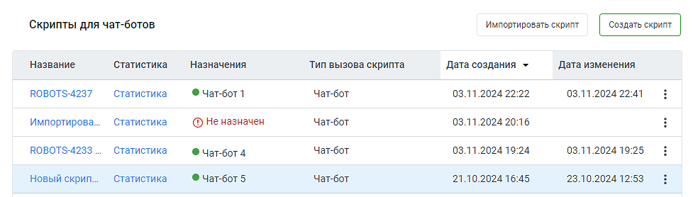

# 4.1. Скрипты для чат-ботов

> Трассировка: PDF §4.1 · сквозные стр. 41-42 · источники: ч.1 `kb/sources/cov-robot-fil/Модуль ЦОВ Робот Фил 2,0_manual_v7.26.28.pdf` с.41-42.

Пример внешнего вида блока "Скрипты для чат-ботов":

> **Описание иллюстрации ROBOTFIL-§4.1-1** · к разделу §4.1 «Скрипты для чат-ботов» · стр. 42 · снимок экрана / схема, 977×278 px.
> Относится к тексту руководства: «Пример внешнего вида блока "Скрипты для чат-ботов":»
> Следующий за иллюстрацией текст: «Блок содержит следующие элементы:  Кнопка «Создать скрипт» – по клику на кнопку пользователь переходит к первому шагу создания скрипта – выбору шаблона либо созданию скрипта без шаблона.  Кнопка «Им…»
> Текст на изображении (OCR, требует сверки): Скрипты для чат-ботов; tao; Название; ‘Статистика.; Назначения; Тип вызова скрипта; Дата создания >; ‘Дата изменения; ROBOTS-4237; Статистика; © Чат-бот1; Чат.бот; 03.11.2024 22:22; 03.11.2024 22:41; Импортирова.; @ Неназначен; 03.11.2024 20:16; ROBOTS-4233; © Чат-бот4; 03.11.2024 19:24; 03.11.2024 19:25; новый скрип.; © Yar-6or 5; Yar-6oT; 21.10.2024 16:45; 23.10.2024 12:53

Блок содержит следующие элементы:  Кнопка «Создать скрипт» – по клику на кнопку пользователь переходит к первому шагу создания скрипта – выбору шаблона либо созданию скрипта без шаблона.  Кнопка «Импортировать скрипт» – позволяет загружать ранее экспортированные в Конструкторе скрипты.  Название – название скрипта, сохраненное при создании. По двойному клику на название открывается Карточка сценария скрипта. Скрипты, созданные под заказ, перед наименованием

> **Описание иллюстрации ROBOTFIL-§4.1-2** · к разделу §4.1 «Скрипты для чат-ботов» · стр. 42 · пиктограмма (значок элемента интерфейса), 23×24 px.
> Относится к тексту руководства: «…зволяет загружать ранее экспортированные в Конструкторе скрипты.  Название – название скрипта, сохраненное при создании. По двойному клику на название открывается Карточка сценария скрипта. Скрипты, созданные под заказ, перед наименованием»
> Следующий за иллюстрацией текст: «помечаются иконкой , и недоступны для просмотра и редактирования. Скрипты с активным»
> Текста на изображении нет; назначение значка — см. текст, к которому он относится.

помечаются иконкой , и недоступны для просмотра и редактирования. Скрипты с активным

> **Описание иллюстрации ROBOTFIL-§4.1-3** · к разделу §4.1 «Скрипты для чат-ботов» · стр. 42 · пиктограмма (значок элемента интерфейса), 27×23 px.
> Относится к тексту руководства: «помечаются иконкой , и недоступны для просмотра и редактирования. Скрипты с активным»
> Следующий за иллюстрацией текст: «фоновым сценарием, помечаются иконкой .  Статистика – открывает окно статистики прохода скрипта.  Назначен – имя чат-бота, которому назначен скрипт. Если скрипт назначен нескольким чат-ботам, назнач…»
> Текста на изображении нет; назначение значка — см. текст, к которому он относится.

фоновым сценарием, помечаются иконкой .  Статистика – открывает окно статистики прохода скрипта.  Назначен – имя чат-бота, которому назначен скрипт. Если скрипт назначен нескольким чат-ботам, назначение обозначается пиктограммой «робот» и числом. По наведению на значок, появляется всплывающая подсказка с перечнем имён чат-ботов через запятую.  Тип вызова скрипта – входящий звонок, внутренний звонок или исходящий обзвон.  Дата создания – дата и время создания скрипта в формате дд.мм.гггг чч:мм.  Дата изменения – дата и время последнего изменения скрипта дд.мм.гггг чч:мм.

 Пиктограмма – открывает меню доступных действий со скриптом: назначить чат-бота, редактировать, продублировать, экспортировать или удалить скрипт.
