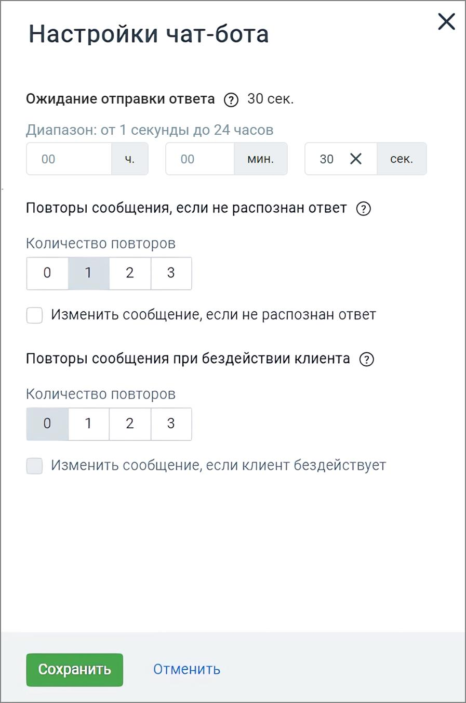

# 4.2. Настройки Чат-бота

> Трассировка: PDF §4.2 · сквозные стр. 42-44 · источники: ч.1 `kb/sources/cov-robot-fil/Модуль ЦОВ Робот Фил 2,0_manual_v7.26.28.pdf` с.42-44.

Важно: Настройки чат-бота задаются индивидуально для каждого скрипта. Кликните по кнопке «Настройки» в правом верхнем углу страницы создания скрипта и заполните форму настроек.

> **Описание иллюстрации ROBOTFIL-§4.2-1** · к разделу §4.2 «Настройки Чат-бота» · стр. 43 · снимок экрана / схема, 897×1351 px.
> Относится к тексту руководства: «Важно: Настройки чат-бота задаются индивидуально для каждого скрипта. Кликните по кнопке «Настройки» в правом верхнем углу страницы создания скрипта и заполните форму настроек.»
> Следующий за иллюстрацией текст: «Окно настроек содержит следующие элементы: Шкала «Ожидание отправки ответа» – позволяет установить временной интервал ожидания отправки ответа от 1 секунды до 24 часов. Такой диапазон дает возможность…»
> Текст на изображении (OCR, требует сверки): Настройки чат-бота; Ожидание отправки ответа (2) 30 сек.; Диапазон: от 1 секунды до 24 часов; 00; МИН.; 30 Ж; сек; Повторы сообщения, если не распознан ответ (2); Количество повторов; Изменить сообщение, если не распознан ответ; Повторы сообщения при бездействии клиента (2); Изменить сообщение, если клиент бездействует; Отменить

Окно настроек содержит следующие элементы: Шкала «Ожидание отправки ответа» – позволяет установить временной интервал ожидания отправки ответа от 1 секунды до 24 часов. Такой диапазон дает возможность клиенту продолжить диалог с чат-ботом после большого перерыва. Повторы сообщения, если не распознан ответ – выберите количество повторных сообщений (0, 1, 2, 3), если ответ не распознан. Чекбокс «Изменить сообщение, если не распознан ответ» – если отмечен, появляется многострочное текстовое поле "Что напишет чат-бот", где можно задать сообщение для условия «если ответ не распознан». Повторы сообщения при бездействии клиента – выберите количество повторных сообщений (0, 1, 2, 3), если клиент не активен.

Чекбокс «Изменить сообщение, если клиент бездействует» – если отмечен, появляется многострочное текстовое поле «Что напишет чат-бот», где можно задать сообщение для условия «если клиент неактивен». Кнопка Сохранить – клик по кнопке применяет внесенные изменения. Кнопка Отменить – клик по кнопке отменяет внесенные изменения и возвращает к предыдущим настройкам.
