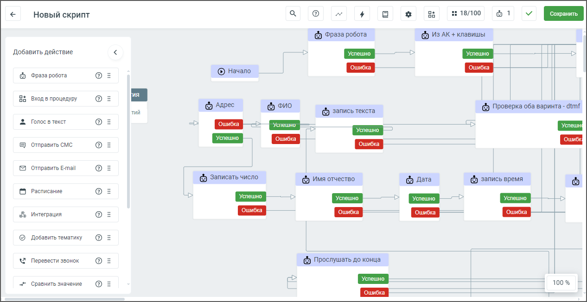
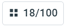
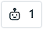
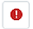
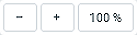
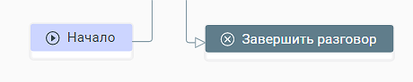
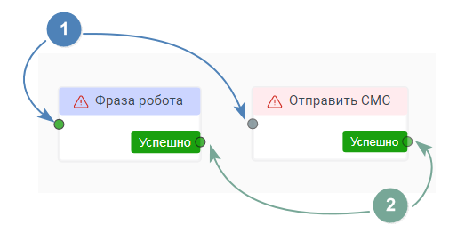
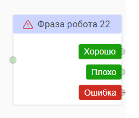

# 5. Конструктор скриптов

> Трассировка: PDF §5 · сквозные стр. 46-49 · источники: ч.1 `kb/sources/cov-robot-fil/Модуль ЦОВ Робот Фил 2,0_manual_v7.26.28.pdf` с.46-49.

> **Описание иллюстрации ROBOTFIL-§5-1** · к разделу §5 «Конструктор скриптов» · стр. 46 · снимок экрана / схема, 1266×652 px.
> Относится к тексту руководства: начало раздела «Конструктор скриптов».
> Следующий за иллюстрацией текст: «Окно конструктора скриптов содержит: 1) Наименование скрипта – для переименования кликните на текущее имя скрипта и отредактируйте его.»
> Текст на изображении (OCR, требует сверки): os; #1 18/100; 61; Новый скрипт; ay]; © Фраза робота; © ИЗАК + клавишы; Добавить действие; ‘Фраза робота; © Начало; Вход в процедуру; тий; © Адрес; © ovo; © Проверка оба варинта - т?; @ запись текста; Голос в текст; `Отправить CMC; Отправить E-mail; © записать число; © Имя отчество; fara; © запись время; Расписание; Ls; интеграция; Добавить тематику; Перевести звонок; (© Прослушать до конца; ‘Сравнить значение; 100%

Окно конструктора скриптов содержит: 1) Наименование скрипта – для переименования кликните на текущее имя скрипта и отредактируйте его.

> **Описание иллюстрации ROBOTFIL-§5-2** · к разделу §5 «Конструктор скриптов» · стр. 46 · пиктограмма (значок элемента интерфейса), 37×37 px.
> Относится к тексту руководства: «Окно конструктора скриптов содержит: 1) Наименование скрипта – для переименования кликните на текущее имя скрипта и отредактируйте его.»
> Следующий за иллюстрацией текст: «2) – справочник возможных ответов абонента (недоступно для робота-администратора).»
> Текста на изображении нет; назначение значка — см. текст, к которому он относится.

2) – справочник возможных ответов абонента (недоступно для робота-администратора).

> **Описание иллюстрации ROBOTFIL-§5-3** · к разделу §5 «Конструктор скриптов» · стр. 46 · пиктограмма (значок элемента интерфейса), 38×37 px.
> Относится к тексту руководства: «2) – справочник возможных ответов абонента (недоступно для робота-администратора).»
> Следующий за иллюстрацией текст: «3) – настройки голоса робота и распознавания ответа в рамках конкретного скрипта. Для каждого скрипта настройки можно изменять (недоступно для робота-администратора).»
> Текста на изображении нет; назначение значка — см. текст, к которому он относится.

3) – настройки голоса робота и распознавания ответа в рамках конкретного скрипта. Для каждого скрипта настройки можно изменять (недоступно для робота-администратора).

> **Описание иллюстрации ROBOTFIL-§5-4** · к разделу §5 «Конструктор скриптов» · стр. 46 · пиктограмма (значок элемента интерфейса), 39×37 px.
> Относится к тексту руководства: «3) – настройки голоса робота и распознавания ответа в рамках конкретного скрипта. Для каждого скрипта настройки можно изменять (недоступно для робота-администратора).»
> Следующий за иллюстрацией текст: «4) – статистика, для скриптов, завершивших проход, доступна статистика работы скрипта.»
> Текста на изображении нет; назначение значка — см. текст, к которому он относится.

4) – статистика, для скриптов, завершивших проход, доступна статистика работы скрипта.

> **Описание иллюстрации ROBOTFIL-§5-5** · к разделу §5 «Конструктор скриптов» · стр. 46 · пиктограмма (значок элемента интерфейса), 39×36 px.
> Относится к тексту руководства: «4) – статистика, для скриптов, завершивших проход, доступна статистика работы скрипта.»
> Следующий за иллюстрацией текст: «5) – переменные, список доступных переменных скрипта и системных переменных.»
> Текста на изображении нет; назначение значка — см. текст, к которому он относится.

5) – переменные, список доступных переменных скрипта и системных переменных.

> **Описание иллюстрации ROBOTFIL-§5-6** · к разделу §5 «Конструктор скриптов» · стр. 46 · пиктограмма (значок элемента интерфейса), 39×36 px.
> Относится к тексту руководства: «5) – переменные, список доступных переменных скрипта и системных переменных.»
> Следующий за иллюстрацией текст: «6) – процедуры, список блоков Процедур, доступных для встраивания в скрипт (недоступно для робота-администратора).»
> Текста на изображении нет; назначение значка — см. текст, к которому он относится.

6) – процедуры, список блоков Процедур, доступных для встраивания в скрипт (недоступно для робота-администратора).

> **Описание иллюстрации ROBOTFIL-§5-7** · к разделу §5 «Конструктор скриптов» · стр. 46 · фрагмент интерфейса (кнопка, переключатель, поле или подпись), 95×41 px.
> Относится к тексту руководства: «6) – процедуры, список блоков Процедур, доступных для встраивания в скрипт (недоступно для робота-администратора).»
> Следующий за иллюстрацией текст: «7) – количество задействованных блоков скрипта из 100 возможных.»

7) – количество задействованных блоков скрипта из 100 возможных.

> **Описание иллюстрации ROBOTFIL-§5-8** · к разделу §5 «Конструктор скриптов» · стр. 46 · пиктограмма (значок элемента интерфейса), 55×37 px.
> Относится к тексту руководства: «7) – количество задействованных блоков скрипта из 100 возможных.»
> Следующий за иллюстрацией текст: «8) – количество роботов или чат-ботов, назначенных на скрипт.»
> Текста на изображении нет; назначение значка — см. текст, к которому он относится.

8) – количество роботов или чат-ботов, назначенных на скрипт.

> **Описание иллюстрации ROBOTFIL-§5-9** · к разделу §5 «Конструктор скриптов» · стр. 47 · пиктограмма (значок элемента интерфейса), 34×33 px.
> Относится к тексту руководства: «8) – количество роботов или чат-ботов, назначенных на скрипт.»
> Следующий за иллюстрацией текст: «9) – иконки отсутствия или наличия ошибок скрипта. Уведомление о состояние скрипта при наличии ошибок отображается красным шрифтом. 10) Кнопка «Сохранить» – клик по кнопке сохраняет введенные изменени…»
> Текста на изображении нет; назначение значка — см. текст, к которому он относится.

> **Описание иллюстрации ROBOTFIL-§5-10** · к разделу §5 «Конструктор скриптов» · стр. 47 · пиктограмма (значок элемента интерфейса), 38×33 px.
> Относится к тексту руководства: «8) – количество роботов или чат-ботов, назначенных на скрипт.»
> Следующий за иллюстрацией текст: «9) – иконки отсутствия или наличия ошибок скрипта. Уведомление о состояние скрипта при наличии ошибок отображается красным шрифтом. 10) Кнопка «Сохранить» – клик по кнопке сохраняет введенные изменени…»
> Текста на изображении нет; назначение значка — см. текст, к которому он относится.

9) – иконки отсутствия или наличия ошибок скрипта. Уведомление о состояние скрипта при наличии ошибок отображается красным шрифтом. 10) Кнопка «Сохранить» – клик по кнопке сохраняет введенные изменения.

> **Описание иллюстрации ROBOTFIL-§5-11** · к разделу §5 «Конструктор скриптов» · стр. 47 · пиктограмма (значок элемента интерфейса), 41×33 px.
> Относится к тексту руководства: «9) – иконки отсутствия или наличия ошибок скрипта. Уведомление о состояние скрипта при наличии ошибок отображается красным шрифтом. 10) Кнопка «Сохранить» – клик по кнопке сохраняет введенные изменения.»
> Следующий за иллюстрацией текст: «11) – кнопка «К списку скриптов», клик по кнопке открывает главное окно раздела Скрипты.»
> Текста на изображении нет; назначение значка — см. текст, к которому он относится.

11) – кнопка «К списку скриптов», клик по кнопке открывает главное окно раздела Скрипты.

> **Описание иллюстрации ROBOTFIL-§5-12** · к разделу §5 «Конструктор скриптов» · стр. 47 · пиктограмма (значок элемента интерфейса), 36×33 px.
> Относится к тексту руководства: «11) – кнопка «К списку скриптов», клик по кнопке открывает главное окно раздела Скрипты.»
> Следующий за иллюстрацией текст: «12) – клик по иконке открывает поле поиска, позволяет искать блоки скрипта по наименованию, типу, или содержимому блоков, чтобы тратить меньше времени на переход и изменение нужной части скрипта.»
> Текста на изображении нет; назначение значка — см. текст, к которому он относится.

12) – клик по иконке открывает поле поиска, позволяет искать блоки скрипта по наименованию, типу, или содержимому блоков, чтобы тратить меньше времени на переход и изменение нужной части скрипта.

> **Описание иллюстрации ROBOTFIL-§5-13** · к разделу §5 «Конструктор скриптов» · стр. 47 · фрагмент интерфейса (кнопка, переключатель, поле или подпись), 137×35 px.
> Относится к тексту руководства: «12) – клик по иконке открывает поле поиска, позволяет искать блоки скрипта по наименованию, типу, или содержимому блоков, чтобы тратить меньше времени на переход и изменение нужной части скрипта.»
> Следующий за иллюстрацией текст: «13) – пиктограммы масштабирования экрана, позволяют увеличивать и уменьшать размер экрана для ускорения работы со скриптом. 14) Поле построения сценария скрипта. 15) Блок Фонового события – по умолчан…»
> Текст на изображении (OCR, требует сверки): 100%

13) – пиктограммы масштабирования экрана, позволяют увеличивать и уменьшать размер экрана для ускорения работы со скриптом. 14) Поле построения сценария скрипта. 15) Блок Фонового события – по умолчанию не активен, требует активации пользователем (недоступно для робота-администратора). 16) Вертикальное меню с перечнем блоков скрипта. Блоки скрипта доступны в Конструкторе в зависимости от раздела: чат-боты, роботы, роботы-администраторы. Перенесите блок на поле построения сценария, зажав и удерживая на нем левую кнопку мыши.

| Чтобы в поле сценария изменить наименование блока, кликните на текущее наименование и |
| --- |
| отредактируйте его. |

| Совет: также блок действия может быть добавлен на поле построения сценария автоматически, с помощью настроек |
| --- |
| предыдущего блока. |

Максимальное количество блоков скрипта – 100. Каждый скрипт начинается с блока Начало и завершается блоком Завершить разговор. Эти блоки не редактируются.

> **Описание иллюстрации ROBOTFIL-§5-14** · к разделу §5 «Конструктор скриптов» · стр. 47 · снимок экрана / схема, 460×92 px.
> Относится к тексту руководства: «Максимальное количество блоков скрипта – 100. Каждый скрипт начинается с блока Начало и завершается блоком Завершить разговор. Эти блоки не редактируются.»
> Следующий за иллюстрацией текст: «Если в текущий скрипт настроены переходы из других скриптов, в блоке «Начало» отображается надпись «Переход из N скриптов», где N – их количество. Двойное нажатие левой кнопкой мыши по блоку «Начало» …»
> Текст на изображении (OCR, требует сверки): (©) Завершить разговор

Если в текущий скрипт настроены переходы из других скриптов, в блоке «Начало» отображается надпись «Переход из N скриптов», где N – их количество. Двойное нажатие левой кнопкой мыши по блоку «Начало» открывает список скриптов, из которых настроен переход.

> **Описание иллюстрации ROBOTFIL-§5-15** · к разделу §5 «Конструктор скриптов» · стр. 48 · снимок экрана / схема, 532×262 px.
> Относится к тексту руководства: «…скрипт настроены переходы из других скриптов, в блоке «Начало» отображается надпись «Переход из N скриптов», где N – их количество. Двойное нажатие левой кнопкой мыши по блоку «Начало» открывает список скриптов, из которых настроен переход.»
> Следующий за иллюстрацией текст: «Каждый блок скрипта (кроме блоков Начало, Фоновые события и Завершить разговор) содержит:»
> Текст на изображении (OCR, требует сверки): А Фраза робота; an Отправить CMC; / Успешно 2; Успешно

Каждый блок скрипта (кроме блоков Начало, Фоновые события и Завершить разговор) содержит:

> **Описание иллюстрации ROBOTFIL-§5-16** · к разделу §5 «Конструктор скриптов» · стр. 48 · пиктограмма (значок элемента интерфейса), 43×42 px.
> Относится к тексту руководства: «Каждый блок скрипта (кроме блоков Начало, Фоновые события и Завершить разговор) содержит:»
> Следующий за иллюстрацией текст: « точку входа для размещения входящей связи – допускается не более 50 точек входа.»
> Текста на изображении нет; назначение значка — см. текст, к которому он относится.

 точку входа для размещения входящей связи – допускается не более 50 точек входа.

> **Описание иллюстрации ROBOTFIL-§5-17** · к разделу §5 «Конструктор скриптов» · стр. 48 · пиктограмма (значок элемента интерфейса), 44×44 px.
> Относится к тексту руководства: « точку входа для размещения входящей связи – допускается не более 50 точек входа.»
> Следующий за иллюстрацией текст: « точку выхода для размещения исходящей связи – количество точек выхода не ограничено.»
> Текста на изображении нет; назначение значка — см. текст, к которому он относится.

 точку выхода для размещения исходящей связи – количество точек выхода не ограничено.

> **Описание иллюстрации ROBOTFIL-§5-18** · к разделу §5 «Конструктор скриптов» · стр. 48 · снимок экрана / схема, 230×195 px.
> Относится к тексту руководства: « точку выхода для размещения исходящей связи – количество точек выхода не ограничено.»
> Следующий за иллюстрацией текст: «С любым из блоков (кроме блока Фонового сценария) доступны следующие действия: 1) Редактировать – открывает форму настройки соответствующего блока. 2) Копировать – копирует блок с настройками, но без …»
> Текст на изображении (OCR, требует сверки): А Фраза робота 22

С любым из блоков (кроме блока Фонового сценария) доступны следующие действия: 1) Редактировать – открывает форму настройки соответствующего блока. 2) Копировать – копирует блок с настройками, но без исходящих и входящих связей. 3) Дублировать – дублирует на поле построения скрипта блок с настройками, но без исходящих и входящих связей. 4) Вставить – вставка того блока, который был скопирован и находится в буфере обмена 5) Удалить блок - блок удаляется из поле построения сценария скрипта. От каждого блока действия, кроме блоков «Начало» и «Завершение разговора», можно протянуть соединяющую исходящую стрелку к следующему блоку.

Исключения (невозможно протянуть исходящую стрелку):  К блоку или из блока «Фоновые события»  Из блока «Начало» в любой другой блок  Из блока «Завершение разговора» в любой другой блок  Из блока «Фраза робота», в котором выбран вариант ответа абонента «Распознать и сохранить ответ», в любой блок «Голос в текст».  Из блока «Фраза робота», для направления «Молчание», в любой блок «Голос в текст».  Из блока «Сравнение значения» для направлений «Верно» и «Не верно», в любой блок «Голос в текст» (для исключения ошибок пользователя). Чтобы открыть меню действий с блоком, кликните на поле блока правой кнопкой мыши. Максимальное количество блоков скрипта – 80. В блоках скрипта возможно использование следующих переменных.  поля адресной книги;  поля кампании ИО;  пользовательские переменные, созданные в блоках скрипта, или в справочнике Переменные;  поля профиля сотрудника в Личном кабинете (только получение данных, запись данных в переменную невозможна). Пользователь может выделить несколько блоков на поле конструктора с помощью указателя мыши, после чего скопировать их в буфер обмена и вставить в нужное место (определенное позицией курсора) с помощью сочетания клавиш Ctrl+V. Далее связи между блоками можно откорректировать. При вставке все блоки переносятся вместе, сохраняя взаимное расположение.
