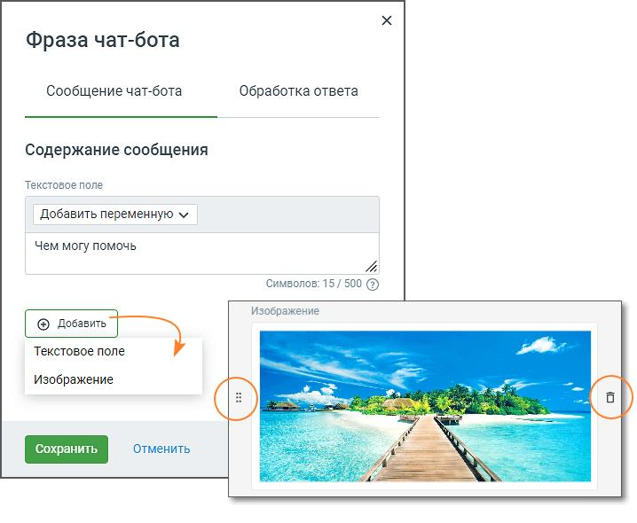
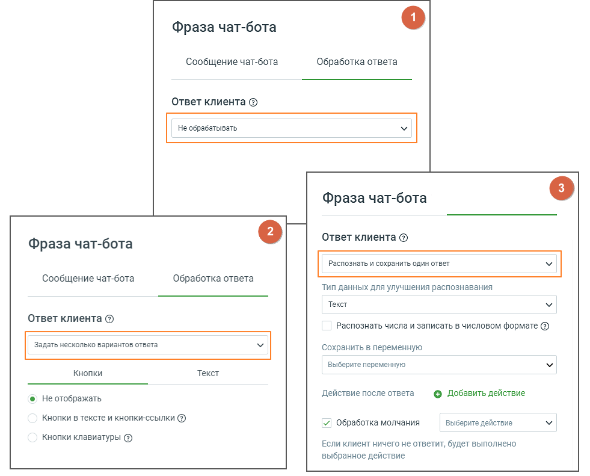
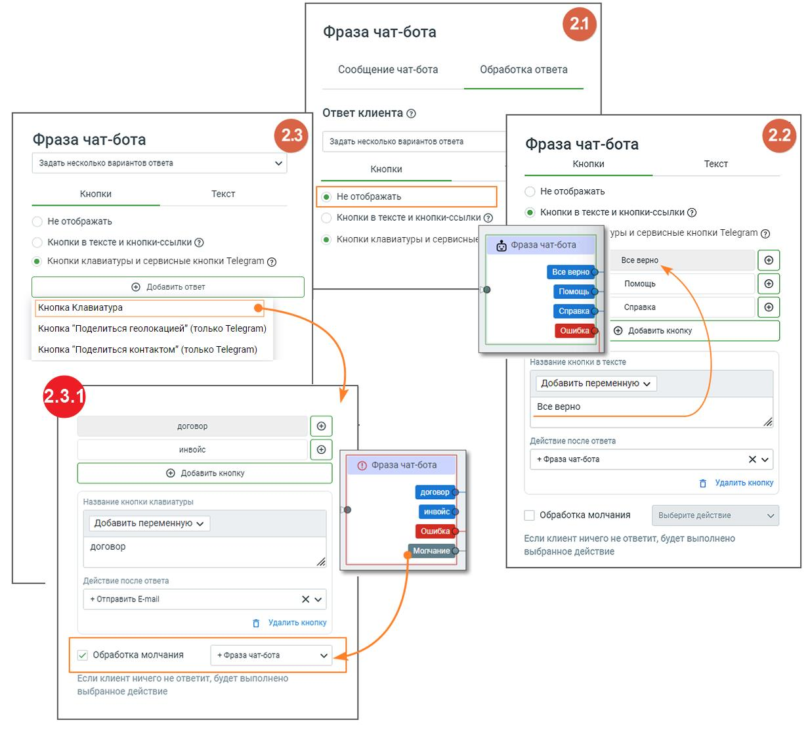
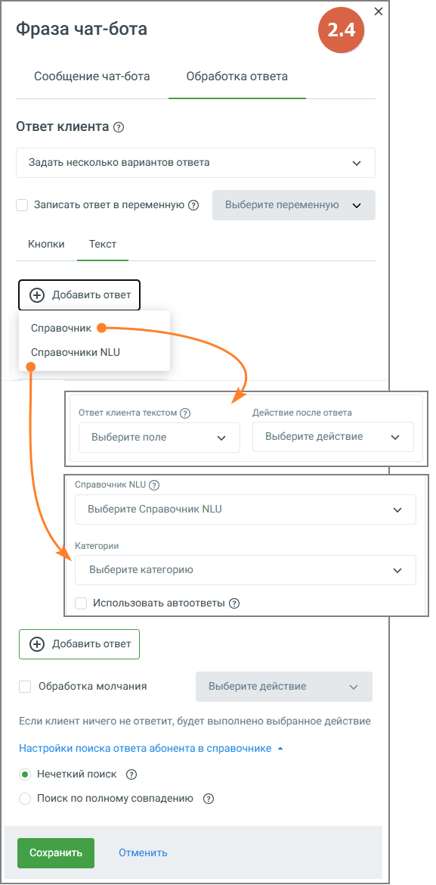
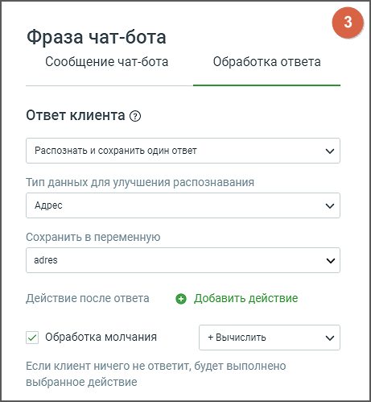

# 5.2. Блок Фраза чат-бота

> Трассировка: PDF §5.2 · сквозные стр. 59-67 · источники: ч.1 `kb/sources/cov-robot-fil/Модуль ЦОВ Робот Фил 2,0_manual_v7.26.28.pdf` с.59-67.

| В схеме скрипта присутствует как минимум один блок Фразы чат-бота, связанный с не редактируемым |
| --- |
| блоком «Начало». Первый блок Фразы чат-бота не может быть удален. |

> **Описание иллюстрации ROBOTFIL-§5.2-1** · к разделу §5.2 «Блок Фраза чат-бота» · стр. 60 · снимок экрана / схема, 718×590 px.
> Относится к тексту руководства: «| В схеме скрипта присутствует как минимум один блок Фразы чат-бота, связанный с не редактируемым | | --- | | блоком «Начало». Первый блок Фразы чат-бота не может быть удален. |»
> Следующий за иллюстрацией текст: «Элементы настроек блока:»
> Текст на изображении (OCR, требует сверки): Фраза чат-бота; Сообщение чат-бота; Обработка ответа; Содержание сообщения; Текстовое поле; Добавить переменную м; Чем могу помочь; Символов: 15 / 500 (3); Изображение; Ро; Eo; Cnet; Отменить; 25

Элементы настроек блока:

| Каждый блок содержит пиктограммы перемещения |
| --- |
| кнопки Сохранить, Отменить. |

> **Описание иллюстрации ROBOTFIL-§5.2-2** · к разделу §5.2 «Блок Фраза чат-бота» · стр. 60 · пиктограмма (значок элемента интерфейса), 19×20 px.
> Относится к тексту руководства: «| Каждый блок содержит пиктограммы перемещения | | --- | | кнопки Сохранить, Отменить. |»
> Следующий за иллюстрацией текст: «| Кнопка «Сохранить» – сохраняет внесенные изменения, форма настроек блока закрывается. | | --- | | Кнопка «Отменить» – закрывает форму настройки блока, без сохранения изменений. |»
> Текста на изображении нет; назначение значка — см. текст, к которому он относится.

> **Описание иллюстрации ROBOTFIL-§5.2-3** · к разделу §5.2 «Блок Фраза чат-бота» · стр. 60 · пиктограмма (значок элемента интерфейса), 16×19 px.
> Относится к тексту руководства: «| Каждый блок содержит пиктограммы перемещения | | --- | | кнопки Сохранить, Отменить. |»
> Следующий за иллюстрацией текст: «| Кнопка «Сохранить» – сохраняет внесенные изменения, форма настроек блока закрывается. | | --- | | Кнопка «Отменить» – закрывает форму настройки блока, без сохранения изменений. |»
> Текста на изображении нет; назначение значка — см. текст, к которому он относится.

| Кнопка «Сохранить» – сохраняет внесенные изменения, форма настроек блока закрывается. |
| --- |
| Кнопка «Отменить» – закрывает форму настройки блока, без сохранения изменений. |

СООБЩЕНИЕ ЧАТ-БОТА 1. Название блока – название блока, должно быть уникальным в рамках скрипта. Максимальное количество символов – 50.

2. Текстовое поле – текст, который напишет чат-бот в диалоге с абонентом. Максимальная длина текста 500 символов, без учета переменных. 3. Добавить переменную – выпадающий список, содержащий все доступные переменные модуля. Клик по кнопке «Добавить переменную» открывает форму поиска переменных, без учета регистра. В форме также доступно создание новой переменной скрипта. 4. Кнопка «Добавить» – нажатие на кнопку открывает выпадающий список для добавления следующего текстового поля или изображения. При выборе изображения оно отобразится в блоке. При создании скрипта в диалог чат-бота можно добавлять изображения, которые добавлялись ранее, и находятся в Хранилище файлов Личного Кабинета ВАТС. ОБРАБОТКА ОТВЕТА

> **Описание иллюстрации ROBOTFIL-§5.2-4** · к разделу §5.2 «Блок Фраза чат-бота» · стр. 61 · снимок экрана / схема, 981×791 px.
> Относится к тексту руководства: «…вого поля или изображения. При выборе изображения оно отобразится в блоке. При создании скрипта в диалог чат-бота можно добавлять изображения, которые добавлялись ранее, и находятся в Хранилище файлов Личного Кабинета ВАТС. ОБРАБОТКА ОТВЕТА»
> Следующий за иллюстрацией текст: «При обработке ответов клиентов предусмотрены три варианта действий»
> Текст на изображении (OCR, требует сверки): Фраза чат-бота; Сообщение чат-бота; Обработка ответа; Ответ клиента ©; He обрабатывать,; распознать и сохранить один ответ; Тип данных для улучшения распознавания; Текст; Ответ клиента @; распознать числа и записать в числовом формате @; Задать несколько вариантов ответа.; Сохранить в переменную; Выберите переменную; Кнопки; © Не отображать; Действие после ответа; © Добавить действие; Кнопки в тексте и кнопки-ссылки ©; VY) обработка молчания; Выберите действие; кнопки клавиатуры @); Если клиент ничего не ответит, будет выполнено; выбранное действие

При обработке ответов клиентов предусмотрены три варианта действий

1. Вариант «Не обрабатывать». При выборе этого варианта ответ клиента не обрабатывается. Чат завершается. 2. Вариант «Задать несколько вариантов ответа»: Кнопки / Текст. При выборе этого варианта пользователь имеет возможность управлять отображением в чате: 2.1 не отображать – кнопки чат-бота не отображаются; 2.2 кнопки в тексте – под сообщением чат-бота размещены кнопки, которые могут быть активированы в процессе диалога с клиентом. Если пользователь в окне диалога кликнет по названию кнопки, то чат-бот выполнит соответствующее действие, привязанное к этой кнопке; кнопки-ссылки – кнопки-ссылки привязаны к определенным веб-страницам, перенаправляя пользователя на соответствующие адреса. Не предусмотрено добавление действий после активации этих кнопок. При использовании только кнопок-ссылок, чат- бот автоматически перейдет по ветке "Успешно" сразу после отображения сообщения чат-бота; 2.3 кнопки клавиатуры и сервисные кнопки Телеграм – это элементы управления, которые позволяют пользователям в чате быстро отправлять данные. Клик по кнопке "Добавить ответ" открывает меню с тремя опциями:  Кнопка "Клавиатура" – при выборе данного варианта, чат-бот выполнит соответствующее действие, привязанное к данной кнопке;  Кнопка "Поделиться геолокацией" – отправляет текущее местоположение (работает только в мобильной версии Telegram).  Кнопка "Поделиться контактом" – отправляет сохраненный контакт.

> **Описание иллюстрации ROBOTFIL-§5.2-5** · к разделу §5.2 «Блок Фраза чат-бота» · стр. 63 · снимок экрана / схема, 1234×1116 px.
> Относится к тексту руководства: «…ит соответствующее действие, привязанное к данной кнопке;  Кнопка "Поделиться геолокацией" – отправляет текущее местоположение (работает только в мобильной версии Telegram).  Кнопка "Поделиться контактом" – отправляет сохраненный контакт.»
> Следующий за иллюстрацией текст: «Как это работает: 2.3.1 Кнопка Клавиатура – под окном ввода сообщений в чате располагаются кнопки клавиатуры. 2.3.2 Поделится геолокацией и контактом – в блоке ответа чат-бота выберите опцию Сервисные…»
> Текст на изображении (OCR, требует сверки): Фраза чат-бота; Сообщение чат-бота; ‘Обработка ответа; Ответ клиента ©; Задать несколько вариантов ответа; Кнопки; Текст; Не отображать; © Кнопки в тексте и кнопки-ссылки @; Кнопки в тексте и кнопки-ссылки ®; ® Кнопки клавиатуры и сервисные; ры и сервисные кнопки Telegram @); Кнопки в тексте и кнопки-ссылки ©; © Фраза чат-бота'; © Кнопки клавиатуры и сервисные кнопки Telegram @); Все верно; Boe ве; © добавить ответ; Помощь; мощь; ра; ‘Справка; "Кнопка Клавиатура; Кнопка "Поделиться геолокацией" (только Telegram); ши; ® добавить кнопку; Кнопка "Поделиться контактом" (только Telegram); Название …

Как это работает: 2.3.1 Кнопка Клавиатура – под окном ввода сообщений в чате располагаются кнопки клавиатуры. 2.3.2 Поделится геолокацией и контактом – в блоке ответа чат-бота выберите опцию Сервисные кнопки Telegram и задайте действие для кнопки: поделиться контактом или поделиться локацией. При нажатии кнопки пользователем, данные сохраняются в системные переменные:  Контакт – номер телефона в международном формате, например +79991112233.

 Локация – координаты, например 55°39'45.3"N 37°32'47.8"E. Особенности:  Кнопки работают только в Telegram, использование в других каналах не поддерживается.  Геолокацией можно поделиться только с мобильной версии Telegram. В веб- и десктоп- версиях эта функция недоступна. 2.4 При выборе переключателя «Текст» чат-бот анализирует все слова, введённые клиентом, и сопоставляет их с вручную заданными вариантами ответов, записями из справочника, а также с данными из базы знаний (Справочник NLU). Такой подход позволяет строить ветвления сценария не только на основе точных текстовых совпадений, но и с учётом смысла сообщений клиента.

> **Описание иллюстрации ROBOTFIL-§5.2-6** · к разделу §5.2 «Блок Фраза чат-бота» · стр. 65 · снимок экрана / схема, 577×1169 px.
> Относится к тексту руководства: «…нными вариантами ответов, записями из справочника, а также с данными из базы знаний (Справочник NLU). Такой подход позволяет строить ветвления сценария не только на основе точных текстовых совпадений, но и с учётом смысла сообщений клиента.»
> Следующий за иллюстрацией текст: «Кнопка «Добавить ответ» открывает выбор источника обработки сообщения. Доступны два варианта:  Справочник – используется для сопоставления ответа с полями справочника и выполнения заданных действий. …»
> Текст на изображении (OCR, требует сверки): Фраза чат-бота; Сообщение чат-бота; Обработка ответа; Ответ клиента ©; Задать несколько вариантов ответа; Записать ответ в переменную (2); Выберите переменную м; Кнопки; Текст; Справочник; Справочники NLU; Ответ клиента текстом (3); Действие после ответа; Выберите поле; Выберите действие; Справочник NLU (3); Выберите Справочник NLU; Категории; Выберите категорию; Использовать автоответы (2); (+) добавить ответ; Обработка молчания; Vv; Если клиент ничего не ответит, будет выполнено выбранное действие; Настройки поиска ответа абонента в справочнике +; ® Нечеткий поиск (3); Поиск по полному совпа…

Кнопка «Добавить ответ» открывает выбор источника обработки сообщения. Доступны два варианта:  Справочник – используется для сопоставления ответа с полями справочника и выполнения заданных действий.  Справочник NLU – обрабатывает ответы на основе базы знаний. При выборе Справочника NLU становится доступен список категорий, определённых в соответствующей базе знаний. Настроить ветвление можно как на весь Справочник NLU в целом, так и на отдельные категории. Если выбраны конкретные категории, остальные части базы обрабатываются по принципу: поиск совпадений по всем категориям, не выделенным в отдельные ветки. Чекбокс «Использовать автоответы» включает возможность использования настроенных в Справочнике NLU автоответов. Поиск ответов осуществляется поэтапно: сначала проверяются совпадения по словарям из справочника, затем – по базе знаний Справочника NLU. Если совпадение найдено, выполняется действие, настроенное в поле «Действие после ответа» – например, переход к следующей фразе, запуск сценария или выполнение команды.

| Чекбокс «Обработка молчания» – при проставленном чекбоксе если абонент ничего не отвечает или не |
| --- |
| нажимает ни одну из кнопок, то диалог двигается по ветке «Молчание». |

3. Вариант «Распознать и сохранить один ответ». При выборе типа данных "Текст" распознаются все написанные клиентом слова. В остальных случаях чат-бот распознает только выбранный тип данных. Например, если выбран тип данных «Адрес», а написано: «Мой адрес – Москва, Декабристов 12, кв.23», то чат-бот распознает и сохранит в переменную только «г. Москва, ул. Декабристов, д.12, кв.23».

> **Описание иллюстрации ROBOTFIL-§5.2-7** · к разделу §5.2 «Блок Фраза чат-бота» · стр. 67 · снимок экрана / схема, 461×499 px.
> Относится к тексту руководства: «…т-бот распознает только выбранный тип данных. Например, если выбран тип данных «Адрес», а написано: «Мой адрес – Москва, Декабристов 12, кв.23», то чат-бот распознает и сохранит в переменную только «г. Москва, ул. Декабристов, д.12, кв.23».»
> Текст на изображении (OCR, требует сверки): Фраза чат-бота; Сообщение чат-бота; Обработка ответа; Ответ клиента @; Распознать и сохранить один ответ; Тип данных для улучшения распознавания; Адрес; Сохранить в переменную; adres; Действие после ответа; © Добавить действие; м“. Обработка молчания; + Вычислить; Если клиент ничего не ответит, будет выполнено; выбранное действие