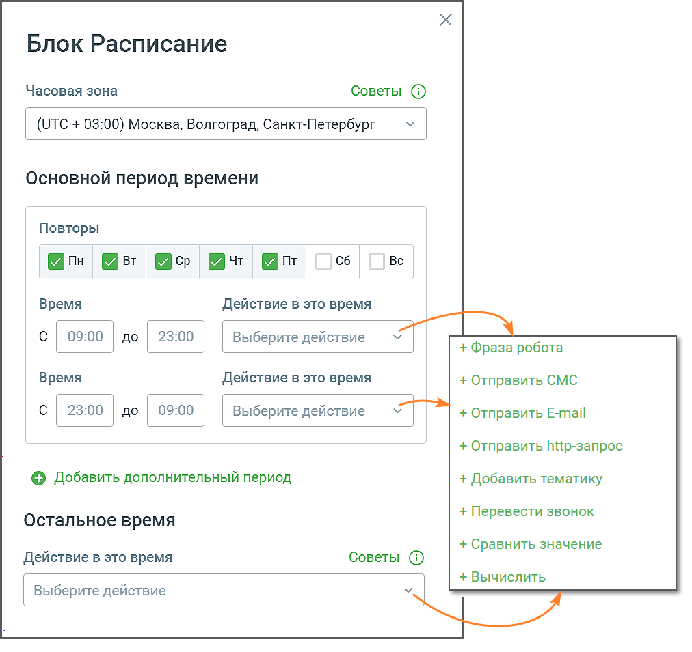

# 5.13. Блок Расписание

> Трассировка: PDF §5.13 · сквозные стр. 116-117 · источники: ч.1 `kb/sources/cov-robot-fil/Модуль ЦОВ Робот Фил 2,0_manual_v7.26.28.pdf` с.116-117.

Блок доступен при создании скрипта для Роботов и Чат-ботов. Блок позволяет настраивать действия робота в зависимости от дня недели и времени суток.

> **Описание иллюстрации ROBOTFIL-§5.13-1** · к разделу §5.13 «Блок Расписание» · стр. 116 · снимок экрана / схема, 1012×955 px.
> Относится к тексту руководства: «Блок доступен при создании скрипта для Роботов и Чат-ботов. Блок позволяет настраивать действия робота в зависимости от дня недели и времени суток.»
> Следующий за иллюстрацией текст: «Элементы настроек блока: 1. Название блока – название блока, должно быть уникальным в рамках скрипта. Максимальное количество символов – 50. 2. Часовая зона – выбор часовой зоны, в которой будет дейст…»
> Текст на изображении (OCR, требует сверки): Блок Расписание; Часовая зона; Советы @; / (UTC + 03:00) Москва, Волгоград, Санкт-Петербург; Основной период времени; Повторы; @пн; Я ср; Qu; сб; Be; Bpema; Действие в это время; Cc / 09:00 / до / 23:00 / / Выберите действие; + Фраза робота; Время; + Отправить СМС; Cc / 23:00 / до / 09:00 / / Выберите действие; + Отправить Е-тай; + Отправить ВИр-запрос; © Добавить дополнительный период; + Добавить тематику; + Перевести звонок; Остальное время; + Сравнить значение; + Вычислить; Выберите действие

Элементы настроек блока: 1. Название блока – название блока, должно быть уникальным в рамках скрипта. Максимальное количество символов – 50. 2. Часовая зона – выбор часовой зоны, в которой будет действовать Расписание. 3. Основной и дополнительный период времени – выбор времени, когда произойдет действие робота. Выбор дня недели в одном из периодов, исключает возможность выбора этого дня недели в другом периоде. 4. Остальное время – действие робота запускается при условии, что текущие день или время (в момент звонка) не указаны в интервале основного или дополнительного периодов. 5. Кнопка «Сохранить» – сохраняет внесенные изменения, форма настроек блока закрывается. 6. Кнопка «Отменить» – закрывает форму настройки блока, без сохранения изменений.