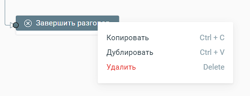

# 5.14. Блок Завершить

> Трассировка: PDF §5.14 · сквозные стр. 117 · источники: ч.1 `kb/sources/cov-robot-fil/Модуль ЦОВ Робот Фил 2,0_manual_v7.26.28.pdf` с.117.

Блоки доступны при создании скрипта для Роботов, Роботов-администраторов и Чат-ботов.  Завершить разговор – завершает скрипт робота  Завершить диалог – завершает скрипт чат-бота  Завершить сценарий – завершает скрипт робота-администратора Блоки не редактируются. Блоки могут быть скопированы в буфер обмена, продублированы в поле создания сценария скрипта, удалены.

> **Описание иллюстрации ROBOTFIL-§5.14-1** · к разделу §5.14 «Блок Завершить» · стр. 117 · снимок экрана / схема, 507×196 px.
> Относится к тексту руководства: «…бота  Завершить диалог – завершает скрипт чат-бота  Завершить сценарий – завершает скрипт робота-администратора Блоки не редактируются. Блоки могут быть скопированы в буфер обмена, продублированы в поле создания сценария скрипта, удалены.»
> Следующий за иллюстрацией текст: «Блоки Завершить являются обязательным завершающим блоком любого скрипта.»
> Текст на изображении (OCR, требует сверки): Копировать; Ctrl+C; Дублировать; Ctrl+V; Delete; Удалить

Блоки Завершить являются обязательным завершающим блоком любого скрипта.
