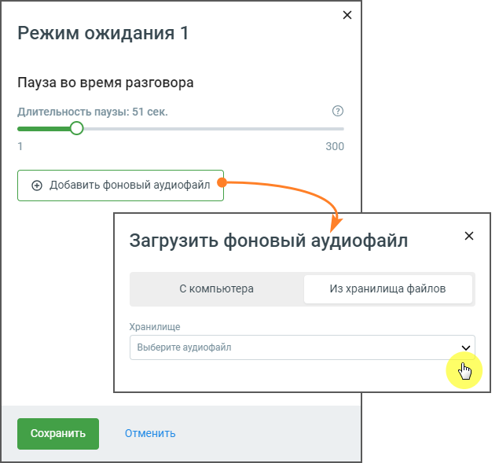
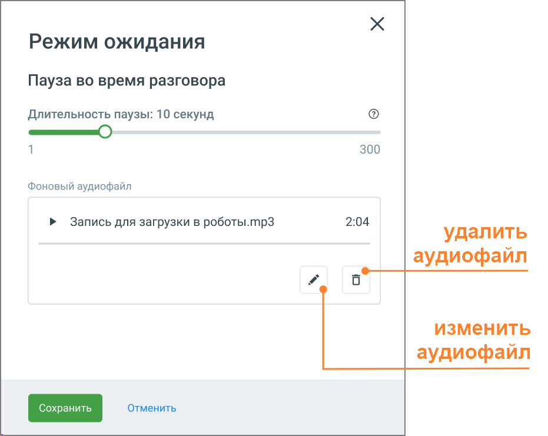

# 5.19. Блок Режим ожидания

> Трассировка: PDF §5.19 · сквозные стр. 128-130 · источники: ч.1 `kb/sources/cov-robot-fil/Модуль ЦОВ Робот Фил 2,0_manual_v7.26.28.pdf` с.128-130.

Блок доступен при создании скрипта для Голосовых роботов и Чат-ботов. Использование в скрипте Голосовых роботов блока "Режим ожидания" позволяет задать автоматическое воспроизведение музыкального фона во время пауз в диалоге. Это повышает удобство использования сервиса, убирая у абонента ощущение неопределенности. Размещение данного блока в теле скрипта Чат-бота дает возможность сделать паузу в диалоге для более плавного перехода к следующим этапам скрипта.

> **Описание иллюстрации ROBOTFIL-§5.19-1** · к разделу §5.19 «Блок Режим ожидания» · стр. 129 · снимок экрана / схема, 635×589 px.
> Относится к тексту руководства: «…оге. Это повышает удобство использования сервиса, убирая у абонента ощущение неопределенности. Размещение данного блока в теле скрипта Чат-бота дает возможность сделать паузу в диалоге для более плавного перехода к следующим этапам скрипта.»
> Следующий за иллюстрацией текст: «Элементы настроек блока: 1. Пауза во время разговора. Пауза в разговоре настраивается с помощью ползунка, который позволяет установить желаемую длительность от 1 до 300 секунд. 2. Фоновый аудиофайл. В…»
> Текст на изображении (OCR, требует сверки): Режим ожидания 1; Пауза во время разговора; Длительность паузы: 51 сек.; 300; @ Добавить фоновый аудиофайл; Загрузить фоновый аудиофайл; С компьютера; Из хранилища файлов; Хранилище; Выберите аудиофайл; Vv; Отменить

Элементы настроек блока: 1. Пауза во время разговора. Пауза в разговоре настраивается с помощью ползунка, который позволяет установить желаемую длительность от 1 до 300 секунд. 2. Фоновый аудиофайл. В поле необходимо загрузить аудиофайл, который будет использоваться в качестве музыкального сопровождения во время пауз. Для загрузки доступны два варианта: с компьютера пользователя или выбор из ранее загруженных в Хранилище файлов. Блок для скриптов Чат-ботов возможности загрузить голосовой файл не предоставляет. 3. Управление аудиофайлами. После загрузки аудиофайла отображаются дополнительные опции управления:

> **Описание иллюстрации ROBOTFIL-§5.19-2** · к разделу §5.19 «Блок Режим ожидания» · стр. 129 · пиктограмма (значок элемента интерфейса), 19×20 px.
> Относится к тексту руководства: «…вателя или выбор из ранее загруженных в Хранилище файлов. Блок для скриптов Чат-ботов возможности загрузить голосовой файл не предоставляет. 3. Управление аудиофайлами. После загрузки аудиофайла отображаются дополнительные опции управления:»
> Следующий за иллюстрацией текст: « Изменить аудиофайл: клик по иконке дает возможность загрузить новый файл.»
> Текста на изображении нет; назначение значка — см. текст, к которому он относится.

 Изменить аудиофайл: клик по иконке дает возможность загрузить новый файл.

> **Описание иллюстрации ROBOTFIL-§5.19-3** · к разделу §5.19 «Блок Режим ожидания» · стр. 129 · пиктограмма (значок элемента интерфейса), 18×21 px.
> Относится к тексту руководства: « Изменить аудиофайл: клик по иконке дает возможность загрузить новый файл.»
> Следующий за иллюстрацией текст: « Удалить аудиофайл: клик по иконке удаляет файл из текущего списка воспроизведения.»
> Текста на изображении нет; назначение значка — см. текст, к которому он относится.

 Удалить аудиофайл: клик по иконке удаляет файл из текущего списка воспроизведения.

> **Описание иллюстрации ROBOTFIL-§5.19-4** · к разделу §5.19 «Блок Режим ожидания» · стр. 130 · снимок экрана / схема, 931×741 px.
> Относится к тексту руководства: « Удалить аудиофайл: клик по иконке удаляет файл из текущего списка воспроизведения.»
> Следующий за иллюстрацией текст: «4. Кнопка «Сохранить» – сохраняет внесенные изменения, форма настроек блока закрывается. 5. Кнопка «Отменить» – закрывает форму настройки блока, без сохранения изменений. Блок "Режим ожидания" идеальн…»
> Текст на изображении (OCR, требует сверки): Режим ожидания; Пауза во время разговора; Длительность паузы: 10 секунд; 300; Фоновый аудиофайл; > Запись для загрузки в роботы.тр3; 2:04; удалить; аудиофайл; изменить; Отменить

4. Кнопка «Сохранить» – сохраняет внесенные изменения, форма настроек блока закрывается. 5. Кнопка «Отменить» – закрывает форму настройки блока, без сохранения изменений. Блок "Режим ожидания" идеально подходит для управления временем паузы в диалоге с абонентом, где необходимо организовать время его ожидания наиболее комфортно.
