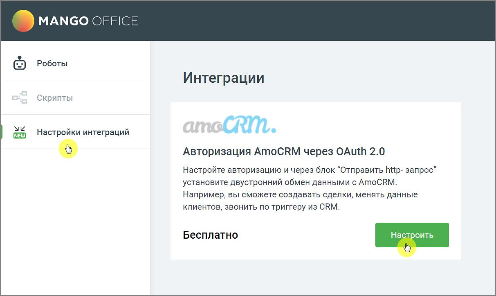
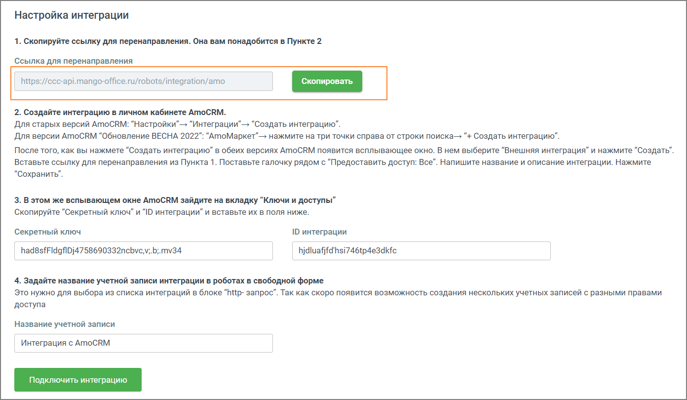
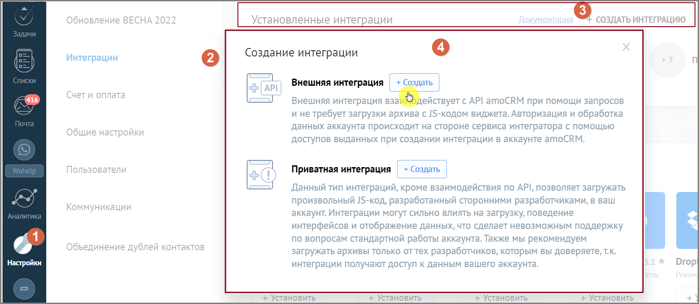
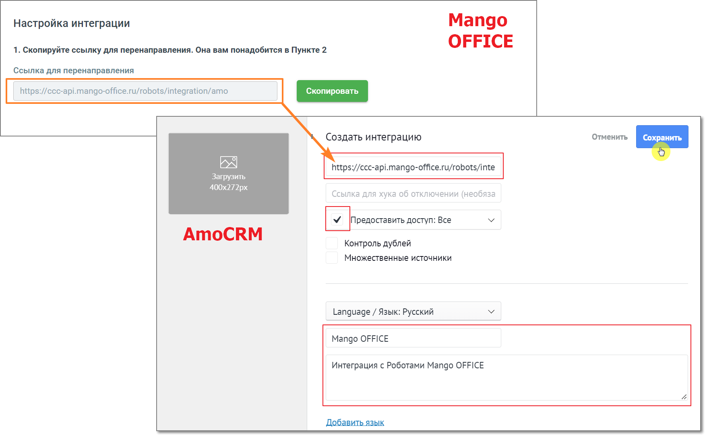
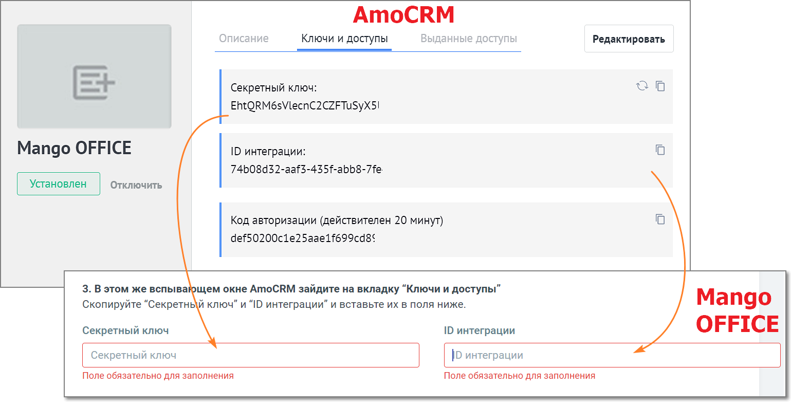
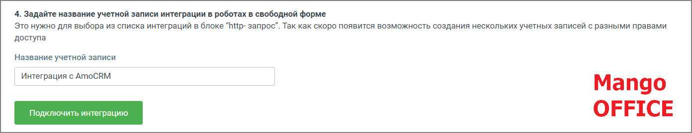

# 6.1. Интеграция с AmoCRM

> Трассировка: PDF §6.1 · сквозные стр. 142-146 · источники: ч.1 `kb/sources/cov-robot-fil/Модуль ЦОВ Робот Фил 2,0_manual_v7.26.28.pdf` с.142-146.

Модуль ЦОВ «Робот Фил 2,0» позволяет настраивать интеграцию с AmoCRM. После настройки двусторонней интеграции доступно создание сделок, изменение данных клиентов в AmoCRM или звонки по триггеру из AmoCRM.

Чтобы настроить интеграцию, перейдите в раздел вертикального меню «Настройки интеграций» и кликните на кнопку Настроить.

> **Описание иллюстрации ROBOTFIL-§6.1-1** · к разделу §6.1 «Интеграция с AmoCRM» · стр. 143 · снимок экрана / схема, 1213×723 px.
> Относится к тексту руководства: «Чтобы настроить интеграцию, перейдите в раздел вертикального меню «Настройки интеграций» и кликните на кнопку Настроить.»
> Следующий за иллюстрацией текст: «1) Ознакомьтесь с инструкцией по созданию интеграции. Скопируйте ссылку для перенаправления.»
> Текст на изображении (OCR, требует сверки): MANGO OFFICE; Роботы; Интеграции; Скрипты; Уи; Настройки интеграций; RM.; Авторизация АтоСКМ через OAuth 2.0; Настройте авторизацию и через блок “Отправить http- запрос’; ‘установите двустронний обмен данными с AMoCRM.; Например, вы сможете создавать сделки, менять данные; клиентов, звонить по триггеру из CRM.; Бесплатно; Настроить

1) Ознакомьтесь с инструкцией по созданию интеграции. Скопируйте ссылку для перенаправления.

> **Описание иллюстрации ROBOTFIL-§6.1-2** · к разделу §6.1 «Интеграция с AmoCRM» · стр. 144 · снимок экрана / схема, 1392×810 px.
> Относится к тексту руководства: «1) Ознакомьтесь с инструкцией по созданию интеграции. Скопируйте ссылку для перенаправления.»
> Следующий за иллюстрацией текст: «2) Войдите в свой аккаунт AmoCRM. Создайте интеграцию на стороне CRM одним из следующих вариантов:  Для старых версий AmoCRM: “Настройки”→ “Интеграции”→ “Создать интеграцию”.  Для версии AmoCRM “Обн…»
> Текст на изображении (OCR, требует сверки): Настройка интеграции; 1. Скопируйте ссылку для перенаправления. Она вам понадобится в Пункте 2; Ссылка для перенаправления; https://ccc-api.mango-office.ru/robots/integration/amo; 2. Создайте интеграцию в личном кабинете AMoCRM.; Для старых версий АтоСВМ: “Настройки” “Интеграции”-» "Создать интеграцию”.; Для версии AMOCRM "Обновление ВЕСНА 2022”: “АтоМаркет”-> нажмите Ha три точки справа от строки поиска-» “+ Создать интеграцию”.; После того, как вы нажмете “Создать интеграцию” в обеих версиях AMOCRM появится всплывающее окно. В нем выберите “Внешняя интеграция” и нажмите “Создать”.; Вставьте …

2) Войдите в свой аккаунт AmoCRM. Создайте интеграцию на стороне CRM одним из следующих вариантов:  Для старых версий AmoCRM: “Настройки”→ “Интеграции”→ “Создать интеграцию”.  Для версии AmoCRM “Обновление ВЕСНА 2022”: “AmoМаркет”→ нажмите на три точки справа от строки поиска→ “+ Создать интеграцию”. На рисунке ниже приведен пошаговый пример создания интеграции для старой версии AmoCRM.

> **Описание иллюстрации ROBOTFIL-§6.1-3** · к разделу §6.1 «Интеграция с AmoCRM» · стр. 144 · снимок экрана / схема, 1572×684 px.
> Относится к тексту руководства: «…”→ “Создать интеграцию”.  Для версии AmoCRM “Обновление ВЕСНА 2022”: “AmoМаркет”→ нажмите на три точки справа от строки поиска→ “+ Создать интеграцию”. На рисунке ниже приведен пошаговый пример создания интеграции для старой версии AmoCRM.»
> Следующий за иллюстрацией текст: «Кликните по кнопке Создать.»
> Текст на изображении (OCR, требует сверки): 06; ОЕ; ВЕСНА 2022; 3] СОЗДАТЬ ИНТЕГРАЦИЮ; Установленные интеграции; Создание интеграции; Интеграции; cb; Внешняя интеграция; Счети оплата; 416; Внешняя интеграция вза o ействует с API amoCRM при помощи запросов; и не требует загрузки архива с }5-кодом виджета. Авторизация и обработка; Общие настройки; данных аккаунта происходит на стороне сервиса интегратора с помощью; доступов выданных при создании интеграции в аккаунте amoCRM.; Приватная интеграция; Данный тип интеграций, кроме взаимодействия по API, позволяет загружать; произвольный /5-код, разработанный сторонними разработчиками, в ваш; К…

Кликните по кнопке Создать.

> **Описание иллюстрации ROBOTFIL-§6.1-4** · к разделу §6.1 «Интеграция с AmoCRM» · стр. 145 · снимок экрана / схема, 1756×1098 px.
> Относится к тексту руководства: «Кликните по кнопке Создать.»
> Следующий за иллюстрацией текст: «В открывшемся окне заполните поля:  Создать интеграцию – в это поле необходимо скопировать ссылку для перенаправления  Предоставить доступ – проставить галочку в чекбоксе  Название интеграции  Опи…»
> Текст на изображении (OCR, требует сверки): Настройка интеграции; Mango; 1. Скопируйте ссылку для перенаправления. Она вам понадобится в Пункте 2; OFFICE; Ссылка для перенаправления; htt; ‘ccc-api.mango-office.ru/robot:; legration/amo; Создать интеграцию; Отменить; Сохранить; https://ccc-api.mango-office.ru/robots/inte; Загрузить; 400х272рх; Ссылка для хука об отключении (необяза; МУ Предоставить доступ: Все; AmoCRM; Контроль дублей; Множественные источники; Language / Язык: Русский; Mango OFFICE; Интеграция с Роботами Mango OFFICE; a4

В открывшемся окне заполните поля:  Создать интеграцию – в это поле необходимо скопировать ссылку для перенаправления  Предоставить доступ – проставить галочку в чекбоксе  Название интеграции  Описание интеграции Нажмите кнопку Сохранить. 3) В открывшемся окне перейдите во вкладку Ключи и доступы. Данными вкладки заполните поля настроек Mango OFFICE

> **Описание иллюстрации ROBOTFIL-§6.1-5** · к разделу §6.1 «Интеграция с AmoCRM» · стр. 146 · снимок экрана / схема, 1539×788 px.
> Относится к тексту руководства: «…ния  Предоставить доступ – проставить галочку в чекбоксе  Название интеграции  Описание интеграции Нажмите кнопку Сохранить. 3) В открывшемся окне перейдите во вкладку Ключи и доступы. Данными вкладки заполните поля настроек Mango OFFICE»
> Следующий за иллюстрацией текст: «4) Задайте название учетной записи и нажмите кнопку Подключить интеграцию.»
> Текст на изображении (OCR, требует сверки): AmoCR; Ключи и доступы; Bolg; Rina; аннь; ед; Редактировать; Секретный ключ:; ou; EhtQRM6sVlecnC2CZFTuSyX5!; Mango OFFICE; ID интеграции:; Oo; 74608d32-aaf3-435f-abb8-7fe; Код авторизации (действителен 20 минут); def50200c1e25aae1f699cd8¢; 3. В этом же вспывающем окне AmoCRM зайдите на вкладку “Ключи и доступы”; Скопируйте “Секретный ключ” и “ID интеграции” и вставьте их в поля ниже.; Mango; OFFICE; Секретный ключ; ID интеграции; /6 интеграции; Поле обязательно для заполнения

4) Задайте название учетной записи и нажмите кнопку Подключить интеграцию.

> **Описание иллюстрации ROBOTFIL-§6.1-6** · к разделу §6.1 «Интеграция с AmoCRM» · стр. 146 · снимок экрана / схема, 1392×270 px.
> Относится к тексту руководства: «4) Задайте название учетной записи и нажмите кнопку Подключить интеграцию.»
> Следующий за иллюстрацией текст: «В открывшемся окне подтвердите разрешение на доступ к данным. Вы создали интеграцию MANGO OFFICE и AmoCRM. Передача данных при помощи интеграции доступна в блоке Отправить http-запрос.»
> Текст на изображении (OCR, требует сверки): 4. Задайте название учетной записи интеграции в роботах в свободной форме; Это нужно для выбора из списка интеграций в блоке “http- запрос”. Tak как скоро появится возможность создания нескольких учетных записей с разными правами; доступа; Название учетной записи; Интеграция с AmoCRM; Mango; OFFICE

В открывшемся окне подтвердите разрешение на доступ к данным. Вы создали интеграцию MANGO OFFICE и AmoCRM. Передача данных при помощи интеграции доступна в блоке Отправить http-запрос.
