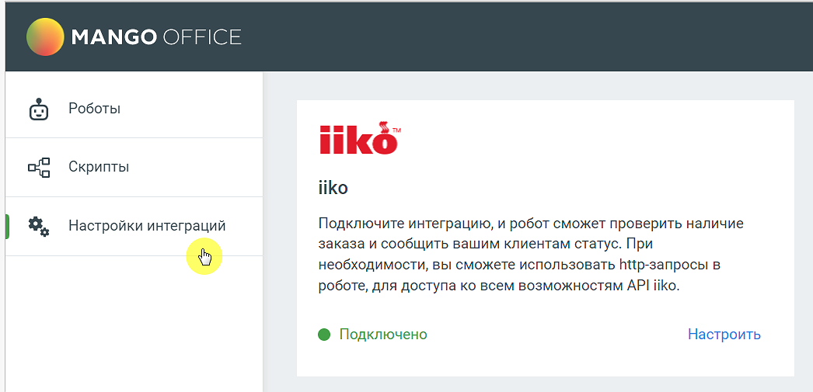
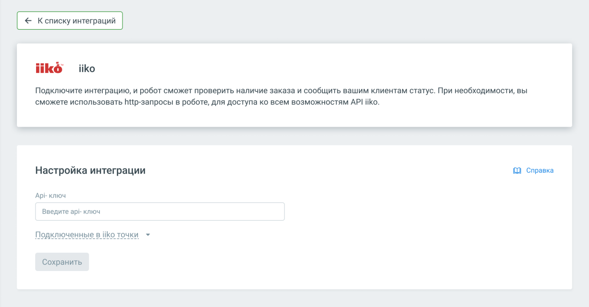
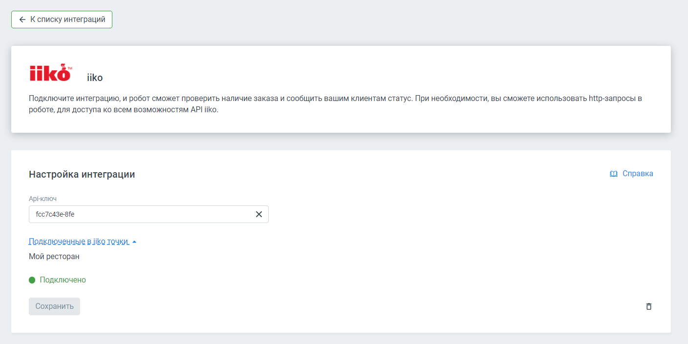

# 6.5. Интеграция с IIKO

> Трассировка: PDF §6.5 · сквозные стр. 151-153 · источники: ч.1 `kb/sources/cov-robot-fil/Модуль ЦОВ Робот Фил 2,0_manual_v7.26.28.pdf` с.151-153.

Администратор, отвечающий за настройку роботов, может подключить и настроить взаимодействие робота с IIKO. Робот будет проверять проверить наличие заказа и сообщать вашим клиентам информацию о заказе в момент звонка. Для настройки интеграции следует зайти в раздел Настройки интеграций левого бокового меню модуля, выбрать «IIKO» и нажать кнопку Подключить.

> **Описание иллюстрации ROBOTFIL-§6.5-1** · к разделу §6.5 «Интеграция с IIKO» · стр. 151 · снимок экрана / схема, 1046×505 px.
> Относится к тексту руководства: «…т проверять проверить наличие заказа и сообщать вашим клиентам информацию о заказе в момент звонка. Для настройки интеграции следует зайти в раздел Настройки интеграций левого бокового меню модуля, выбрать «IIKO» и нажать кнопку Подключить.»
> Следующий за иллюстрацией текст: «После подключения интеграцию необходимо настроить.»
> Текст на изображении (OCR, требует сверки): MANGO OFFICE; Роботы; Скрипты; iiko; Настройки интеграций; Подключите интеграцию, и робот сможет проверить наличие; заказа и сообщить вашим клиентам статус. При; необходимости, вы сможете использовать ПИр-запросы в; ‘роботе, для доступа ко всем возможностям АР! Ко.; @ Подключено; Настроить

После подключения интеграцию необходимо настроить.

> **Описание иллюстрации ROBOTFIL-§6.5-2** · к разделу §6.5 «Интеграция с IIKO» · стр. 152 · снимок экрана / схема, 1226×640 px.
> Относится к тексту руководства: «После подключения интеграцию необходимо настроить.»
> Следующий за иллюстрацией текст: «Заполните поле Api-ключ своими данными и нажмите кнопку «Сохранить».»
> Текст на изображении (OCR, требует сверки): ko; iiko; Подключите интеграцию, и робот сможет проверить наличие заказа и сообщить вашим клиентам статус. При необходимости, вы; сможете использовать Пир-запросы в роботе, для доступа ко всем возможностям АР! Ио.; Настройка интеграции; © Справка; Api- ключ; Введите api- ключ; Сохранить

Заполните поле Api-ключ своими данными и нажмите кнопку «Сохранить».

| Совет: Чтобы получить API-ключ iiko, необходимо обратиться в свою организацию-поставщика услуг iiko, либо |
| --- |
| оставить заявку в форме на сайте api.iiko.ru. |

> **Описание иллюстрации ROBOTFIL-§6.5-3** · к разделу §6.5 «Интеграция с IIKO» · стр. 152 · снимок экрана / схема, 1408×705 px.
> Относится к тексту руководства: «| Совет: Чтобы получить API-ключ iiko, необходимо обратиться в свою организацию-поставщика услуг iiko, либо | | --- | | оставить заявку в форме на сайте api.iiko.ru. |»
> Следующий за иллюстрацией текст: «После успешного подключения ваши подключенные к iiko точки отобразятся в настройках интеграции. В блоке «Интеграции» конструктора скриптов будет доступен способ интеграции «Интеграция с iiko».»
> Текст на изображении (OCR, требует сверки): кб; Подключите интеграцию, и робот сможет проверить наличие заказа и сообщить вашим клиентам статус. При необходимости, вы сможете использовать Рир-запросы в; роботе, для доступа ко всем возможностям API iiko.; Настройка интеграции; 0 Справка; Api-Kniou; fec7ed3esfe; Подкоюченные в ко точки. ~; Мой ресторан; @ Подключено; Сохранить

После успешного подключения ваши подключенные к iiko точки отобразятся в настройках интеграции. В блоке «Интеграции» конструктора скриптов будет доступен способ интеграции «Интеграция с iiko».