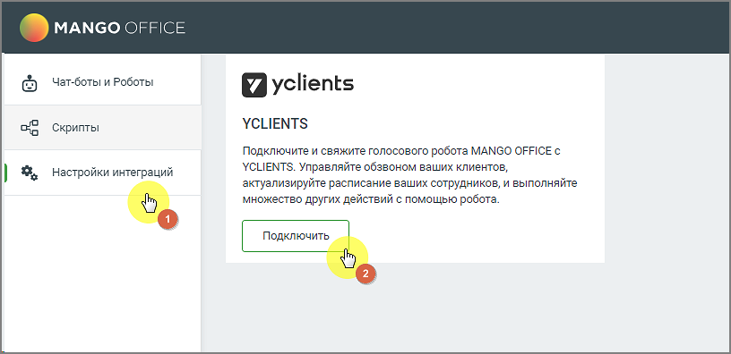
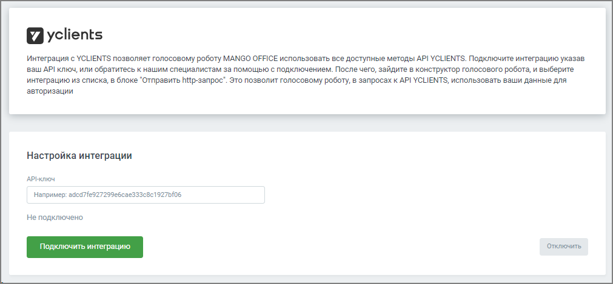
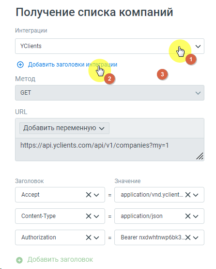

# 6.6. Интеграция с YCLIENTS

> Трассировка: PDF §6.6 · сквозные стр. 153-155 · источники: ч.1 `kb/sources/cov-robot-fil/Модуль ЦОВ Робот Фил 2,0_manual_v7.26.28.pdf` с.153-155.

Администратор, отвечающий за настройку роботов, может подключить и настроить взаимодействие робота с YCLIENTS. После подключения в момент звонка робот может выполнять в системе YCLIENTS следующие функции:  Записать клиента в расписание в удобное для него время;  Принять звонок и произвести корректировку записи клиента;  Перевести звонок в чат-бот WhatsApp или Telegram. Для настройки интеграции следует зайти в раздел Настройки интеграций левого бокового меню модуля, выбрать «YCLIENTS» и нажать кнопку Подключить.

> **Описание иллюстрации ROBOTFIL-§6.6-1** · к разделу §6.6 «Интеграция с YCLIENTS» · стр. 153 · снимок экрана / схема, 816×396 px.
> Относится к тексту руководства: «… и произвести корректировку записи клиента;  Перевести звонок в чат-бот WhatsApp или Telegram. Для настройки интеграции следует зайти в раздел Настройки интеграций левого бокового меню модуля, выбрать «YCLIENTS» и нажать кнопку Подключить.»
> Следующий за иллюстрацией текст: «После подключения интеграцию необходимо настроить.»
> Текст на изображении (OCR, требует сверки): MANGO OFFICE; Чат-боты и Роботы; yclients; Скрипты; УСНЕМТ$; Подключите и свяжите голосового робота MANGO OFFICE с; Настройки интеграций; YCLIENTS. Управляйте обзвоном ваших клиентов,; актуализируйте расписание ваших сотрудников, и выполняйте; множество других действий с помощью робота.

После подключения интеграцию необходимо настроить.

> **Описание иллюстрации ROBOTFIL-§6.6-2** · к разделу §6.6 «Интеграция с YCLIENTS» · стр. 154 · снимок экрана / схема, 1011×470 px.
> Относится к тексту руководства: «После подключения интеграцию необходимо настроить.»
> Следующий за иллюстрацией текст: «После успешного подключения в блоке «HTTP-запрос» конструктора скриптов для роботов, а также в блоке «Интеграция» конструктора скриптов для робота-администратора будет доступен способ интеграции «YCLI…»
> Текст на изображении (OCR, требует сверки): yclients; интеграция с YCLIENTS позволяет голосовому роботу MANGO OFFICE использовать все доступные методы API YCLIENTS. Подключите интеграцию указав; ваш API ключ, или обратитесь к нашим специалистам за помощью с подключением. После чего, зайдите в конструктор голосового робота, и выберите; интеграцию из списка, в блоке "Отправить http-sanpoc’. Это позволит голосовому роботу, в запросах к API YCLIENTS, использовать ваши данные для; ‘авторизации; Настройка интеграции; АРНКлЮч; Например: adcd7fe927299e6cae333c8¢1927bf05; He подключено; ключит; wer; ик; ‘Отключить,

После успешного подключения в блоке «HTTP-запрос» конструктора скриптов для роботов, а также в блоке «Интеграция» конструктора скриптов для робота-администратора будет доступен способ интеграции «YCLIENTS». ПРИМЕР. Администратор, отвечающий за настройку голосового робота, может использовать ключи авторизации в http-запросе, чтобы не терять время на повторный ввод этих данных в каждом http-запросе:

> **Описание иллюстрации ROBOTFIL-§6.6-3** · к разделу §6.6 «Интеграция с YCLIENTS» · стр. 155 · снимок экрана / схема, 446×554 px.
> Относится к тексту руководства: «…а будет доступен способ интеграции «YCLIENTS». ПРИМЕР. Администратор, отвечающий за настройку голосового робота, может использовать ключи авторизации в http-запросе, чтобы не терять время на повторный ввод этих данных в каждом http-запросе:»
> Текст на изображении (OCR, требует сверки): Получение списка компаний; Интеграции; YClients; (+) Добавить заголовки и; ии; Метод; GET; URL; Добавить переменную м; https://api.yclients.com/api/v1/companies?my=1; Заголовок; Значение; Accept; xv; application/vnd_yclient.. Х м; Content-Type; application/json; Authorization; Bearer nxdwhtnwp6bk3._.X м; © Добавить заголовок