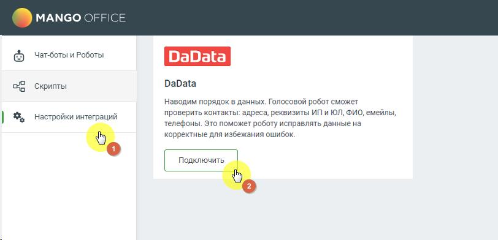
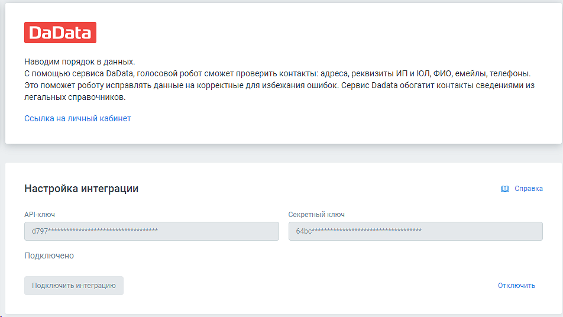
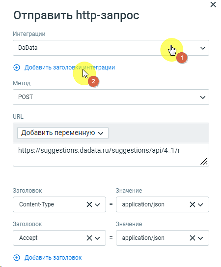

# 6.7. Интеграция с DaData

> Трассировка: PDF §6.7 · сквозные стр. 155-157 · источники: ч.1 `kb/sources/cov-robot-fil/Модуль ЦОВ Робот Фил 2,0_manual_v7.26.28.pdf` с.155-157.

Администратор, отвечающий за настройку роботов, может подключить и настроить взаимодействие робота с DaData. После подключения в момент звонка робот может выполнять в системе DaData следующие функции:  Адреса – автоматически проверяет, исправляет и геокодирует адреса;  Телефоны и email – проверяет телефон по Россвязи, определяет оператора, отсеивает одноразовые email;  ФИО и паспорта – проверяет и разбирает ФИО из строки. Проверяет паспорт по справочнику МВД;  Стандартизация – массово проверяет и исправляет контактные данные из файла и др. Для настройки интеграции следует зайти в раздел Настройки интеграций левого бокового меню модуля, выбрать «DaData» и нажать кнопку Подключить.

> **Описание иллюстрации ROBOTFIL-§6.7-1** · к разделу §6.7 «Интеграция с DaData» · стр. 156 · снимок экрана / схема, 812×392 px.
> Относится к тексту руководства: «…равочнику МВД;  Стандартизация – массово проверяет и исправляет контактные данные из файла и др. Для настройки интеграции следует зайти в раздел Настройки интеграций левого бокового меню модуля, выбрать «DaData» и нажать кнопку Подключить.»
> Следующий за иллюстрацией текст: «В открывшемся окне заполните поля «API-ключ», «Cекретный ключ» и нажмите кнопку Подключить. Совет: API-ключ и секретный ключ автоматически генерируются в Личном кабинете пользователя DaData. После нас…»
> Текст на изображении (OCR, требует сверки): MANGO OFFICE; Чат-боты и Роботы; Скрипты; DaData; Наводим порядок в данных. Голосовой робот сможет; проверить контакты: адреса, реквизиты ИП и ЮЛ, ФИО, емейлы,; Настройки интеграций; телефоны. Это поможет роботу исправлять данные на; корректные для избежания ошибок

В открывшемся окне заполните поля «API-ключ», «Cекретный ключ» и нажмите кнопку Подключить. Совет: API-ключ и секретный ключ автоматически генерируются в Личном кабинете пользователя DaData. После настройки и подключения интеграция получит статус «Подключено».

> **Описание иллюстрации ROBOTFIL-§6.7-2** · к разделу §6.7 «Интеграция с DaData» · стр. 156 · снимок экрана / схема, 952×536 px.
> Относится к тексту руководства: «…аполните поля «API-ключ», «Cекретный ключ» и нажмите кнопку Подключить. Совет: API-ключ и секретный ключ автоматически генерируются в Личном кабинете пользователя DaData. После настройки и подключения интеграция получит статус «Подключено».»
> Следующий за иллюстрацией текст: «После успешного подключения в блоке «HTTP-запрос» конструктора скриптов будет доступен способ интеграции «DaData».»
> Текст на изображении (OCR, требует сверки): наводим порядок в данных.; C помощью сервиса DaData, голосовой робот сможет проверить контакты: адреса, реквизиты ИП и ЮЛ, ФИО, емейлы, телефоны.; это поможет роботу исправлять данные на корректные для избежания ошибок. Сервис Dadata обогатит контакты сведениями из; легальных справочников.; ссылка на личный кабинет; Настройка интеграции; © справка; АРНКЛЮЧ; ‘Секретный ключ; ae; Qe; Подключено; Отключить,; Подключить интеграцию

После успешного подключения в блоке «HTTP-запрос» конструктора скриптов будет доступен способ интеграции «DaData».

ПРИМЕР. Администратор, отвечающий за настройку голосового робота, может использовать ключи авторизации в http-запросе, чтобы не терять время на повторный ввод этих данных в каждом http-запросе:

> **Описание иллюстрации ROBOTFIL-§6.7-3** · к разделу §6.7 «Интеграция с DaData» · стр. 157 · снимок экрана / схема, 450×542 px.
> Относится к тексту руководства: «ПРИМЕР. Администратор, отвечающий за настройку голосового робота, может использовать ключи авторизации в http-запросе, чтобы не терять время на повторный ввод этих данных в каждом http-запросе:»
> Текст на изображении (OCR, требует сверки): Отправить hitp-3sanpoc; Интеграции; DaData; @) Добавить заголо; грации; Метод; РОЗТ; URL; Добавить переменную м; https://suggestions.dadata.ru/suggestions/api/4_1/r; Заголовок; Значение; Content-Type; xv; application/json; Accept; {#) Добавить заголовок