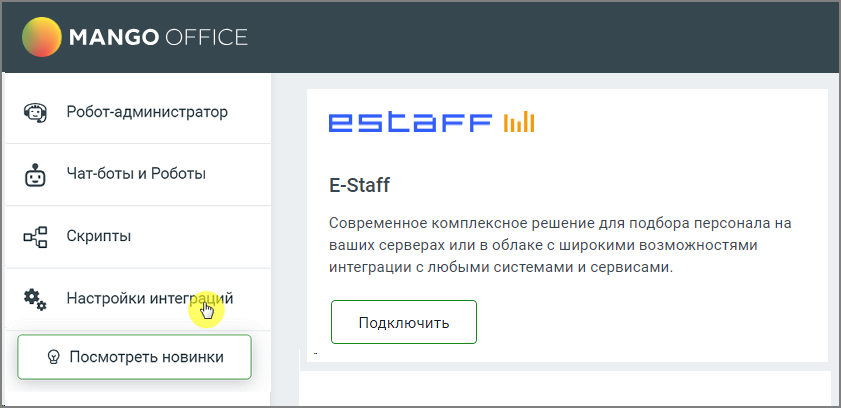
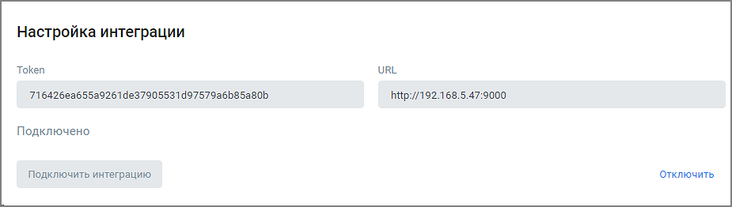

# 6.9. Интеграция с E-Staff

> Трассировка: PDF §6.9 · сквозные стр. 158-160 · источники: ч.1 `kb/sources/cov-robot-fil/Модуль ЦОВ Робот Фил 2,0_manual_v7.26.28.pdf` с.158-160.

E-staff – система автоматизации подбора персонала. Интеграция с E-staff позволит расширить возможности использования голосового робота:  Робот по заданному расписанию забирает из E-staff список кандидатов для обзвона  Робот наполняет кандидатов необходимыми данными из E-staff  Робот самостоятельно передает кандидатов в кампанию исходящего обзвона, для последующего обзвона голосовым роботом

> **Описание иллюстрации ROBOTFIL-§6.9-1** · к разделу §6.9 «Интеграция с E-Staff» · стр. 159 · снимок экрана / схема, 841×408 px.
> Относится к тексту руководства: «…у расписанию забирает из E-staff список кандидатов для обзвона  Робот наполняет кандидатов необходимыми данными из E-staff  Робот самостоятельно передает кандидатов в кампанию исходящего обзвона, для последующего обзвона голосовым роботом»
> Следующий за иллюстрацией текст: «Для настройки интеграции следует зайти в раздел Настройки интеграций левого бокового меню модуля, выбрать «E-Staff» и нажать кнопку Подключить. В открывшемся окне заполните поля «Token», «URL» и нажми…»
> Текст на изображении (OCR, требует сверки): MANGO OFFICE; Робот-администратор; ESCaFF ill; Чат-боты и Роботы; E-Staff; Современное комплексное решение для подбора персонала на; Скрипты; ваших серверах или в облаке с широкими возможностями; интеграции с любыми системами и сервисами.; Настройки пей; & Посмотреть новинки

Для настройки интеграции следует зайти в раздел Настройки интеграций левого бокового меню модуля, выбрать «E-Staff» и нажать кнопку Подключить. В открывшемся окне заполните поля «Token», «URL» и нажмите кнопку Подключить.

| Совет: Чтобы получить Token и URL, необходимо обратиться в E-Staff или свою организацию-поставщика услуг E- |
| --- |
| Staff. |

После настройки и подключения интеграция получит статус «Подключено».

> **Описание иллюстрации ROBOTFIL-§6.9-2** · к разделу §6.9 «Интеграция с E-Staff» · стр. 159 · снимок экрана / схема, 925×262 px.
> Относится к тексту руководства: «После настройки и подключения интеграция получит статус «Подключено».»
> Текст на изображении (OCR, требует сверки): Настройка интеграции; Token; URL; 7164262a655a9261de37905531d9757926b85a80b; httpy/192.168.5.47:9000; Подключено; Отключить; Подключить интеграцию