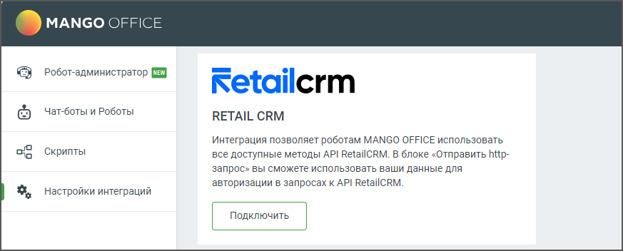
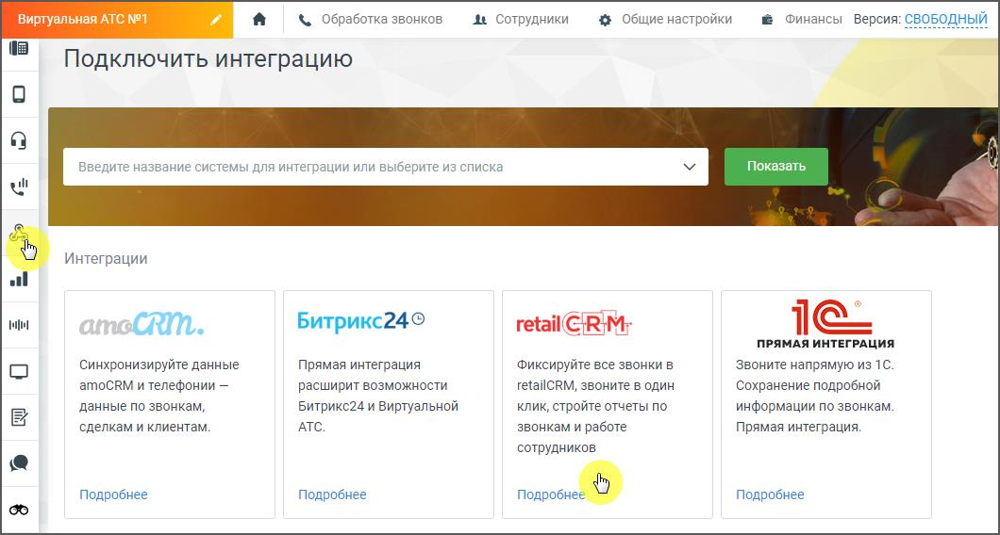

# 6.10. Интеграция с RetailCRM

> Трассировка: PDF §6.10 · сквозные стр. 160-161 · источники: ч.1 `kb/sources/cov-robot-fil/Модуль ЦОВ Робот Фил 2,0_manual_v7.26.28.pdf` с.160-161.

Администратор, настраивающий роботов, имеет возможность использовать API RetailCRM для управления своими заказами и клиентами в данной системе в рамках работы робота. Подключенная интеграция помогает клиентам автоматизировать использование RetailCRM в рамках голосовых звонков с помощью API. Это позволяет пользователям RetailCRM подключать роботов для входящей/исходящей линии и обрабатывать заказы автоматически.

> **Описание иллюстрации ROBOTFIL-§6.10-1** · к разделу §6.10 «Интеграция с RetailCRM» · стр. 160 · снимок экрана / схема, 873×352 px.
> Относится к тексту руководства: «…енная интеграция помогает клиентам автоматизировать использование RetailCRM в рамках голосовых звонков с помощью API. Это позволяет пользователям RetailCRM подключать роботов для входящей/исходящей линии и обрабатывать заказы автоматически.»
> Следующий за иллюстрацией текст: «Для подключения интеграции нажмите кнопку «Подключить». Затем в Личном кабинете ВАТС пройдите в раздел «Интеграции», выберите retailCRM и нажмите кнопку «Подробнее».»
> Текст на изображении (OCR, требует сверки): MANGO OFFICE; Робот-администратор fy; Setailcrm; Чат-боты и Роботы; RETAIL CRM; Интеграция позволяет роботам MANGO OFFICE использовать; Скрипты; все доступные методы API RetailCRM. В блоке «Отправить http-; запрос» вы сможете использовать ваши данные для; авторизации в запросах к API RetailCRM.; Настройки интеграций

Для подключения интеграции нажмите кнопку «Подключить». Затем в Личном кабинете ВАТС пройдите в раздел «Интеграции», выберите retailCRM и нажмите кнопку «Подробнее».

> **Описание иллюстрации ROBOTFIL-§6.10-2** · к разделу §6.10 «Интеграция с RetailCRM» · стр. 161 · снимок экрана / схема, 1060×568 px.
> Относится к тексту руководства: «Для подключения интеграции нажмите кнопку «Подключить». Затем в Личном кабинете ВАТС пройдите в раздел «Интеграции», выберите retailCRM и нажмите кнопку «Подробнее».»
> Следующий за иллюстрацией текст: «В открывшемся окне скачайте и ознакомьтесь с Руководством пользователя по настройке интеграции ВАТС и RetailCRM и произведите подключение. После успешного подключения в блоке HTTP-запрос конструктора …»
> Текст на изображении (OCR, требует сверки): й /< обработка звонков 4 сотрудники 4 Общие настройки @ Финансы версия: СВОБОДНЫЙ; Подключить интеграцию; Показать; ul; Интеграции; al; ao; CRM.; ButpuKc24®; retail {RI; 1G; ПРЯМАЯ ИНТЕГРАЦИЯ; Синхронизируйте данные; Фиксируйте все звонки в; звоните напрямую из 1C.; amoCRM и телефонии —; расширит возможности; retailCRM, звоните в один; Сохранение подробной; данные по звонкам,; Битрикс24 и Виртуальной; клик, стройте отчеты по; информации по звонкам; сделкам и клиентам.; АТС.; звонкам и работе; прямая интеграция.; сотрудников; Подробнее

В открывшемся окне скачайте и ознакомьтесь с Руководством пользователя по настройке интеграции ВАТС и RetailCRM и произведите подключение. После успешного подключения в блоке HTTP-запрос конструктора скриптов для роботов, а также в блоке Интеграция конструктора скриптов для робота-администратора будет доступен способ интеграции «retailCRM». В случае отсутствия интеграции можно писать HTTP-запросы к RetailCRM вручную через блок HTTP-запроса.
