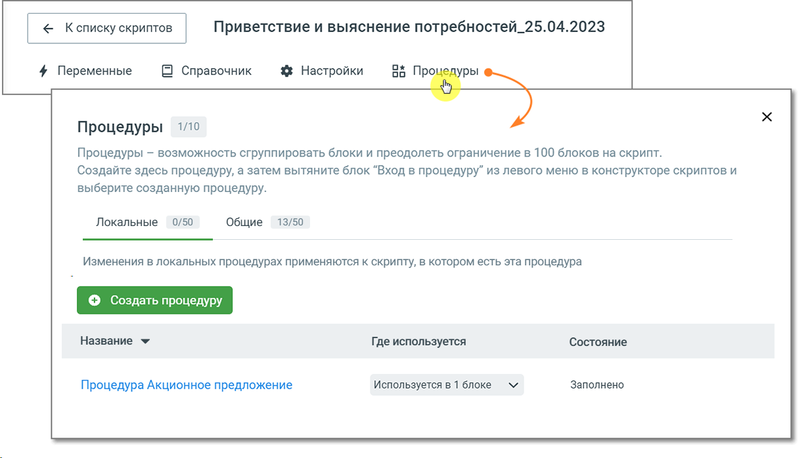
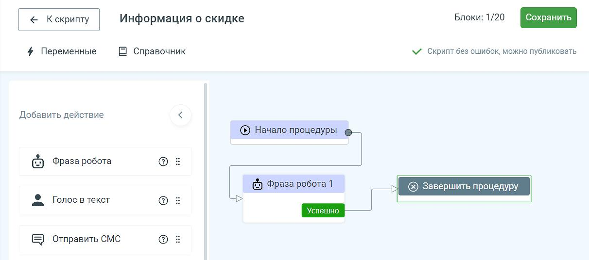

# 9.1. Создание процедуры

> Трассировка: PDF §9.1 · сквозные стр. 172-174 · источники: ч.1 `kb/sources/cov-robot-fil/Модуль ЦОВ Робот Фил 2,0_manual_v7.26.28.pdf` с.172-174.

Для перехода к созданию процедуры откройте поле конструктора скрипта и нажмите на строку подменю «Процедуры». Откроется окно со списком процедур, которые уже созданы на проекте, а также информацией о блоках скрипта, в которых они используются. Существуют локальные и общие процедуры. Локальные используются внутри одного скрипта, тогда как общие позволяют повторно применять логику и обрабатывать данные в разных скриптах. Для создания новой процедуры выберите вариант Локальные или Общие и нажмите кнопку «Создать процедуру». Введите название создаваемой процедуры и нажмите кнопку «Создать». Новая процедура отобразится в списке процедур.

> **Описание иллюстрации ROBOTFIL-§9.1-1** · к разделу §9.1 «Создание процедуры» · стр. 173 · снимок экрана / схема, 1233×699 px.
> Относится к тексту руководства: «…ные в разных скриптах. Для создания новой процедуры выберите вариант Локальные или Общие и нажмите кнопку «Создать процедуру». Введите название создаваемой процедуры и нажмите кнопку «Создать». Новая процедура отобразится в списке процедур.»
> Следующий за иллюстрацией текст: «Кликните по наименованию и откройте конструктор процедуры. Новая процедура имеет только нулевой и финальный блоки. Далее необходимо добавить блоки в процедуру, пользуясь конструктором. Процедура созда…»
> Текст на изображении (OCR, требует сверки): Приветствие и выяснение потребностей_25.04.2023; 4 Переменные; В Справочник; 1/10; se Sg; Процедуры; Процедуры — возможность сгруппировать блоки и преодолеть ограничение в 100 блоков на скрипт.; Создайте здесь процедуру, а затем вытяните блок “Вход в процедуру” из левого меню в конструкторе скриптов и; выберите созданную процедуру.; Локальные; 0/50; Общие; 13/50; Изменения в локальных процедурах применяются к скрипту, в котором есть эта процедура; Название У; ‘Состояние; Где используется; Используется в 1 блоке; Заполнено; Процедура Акционное предложение

Кликните по наименованию и откройте конструктор процедуры. Новая процедура имеет только нулевой и финальный блоки. Далее необходимо добавить блоки в процедуру, пользуясь конструктором. Процедура создается аналогично скрипту. Максимальное количество добавляемых блоков для одной процедуры – 20. В конструкторе процедуры доступен весь функционал основного скрипта (блоки, справочник, переменные).

> **Описание иллюстрации ROBOTFIL-§9.1-2** · к разделу §9.1 «Создание процедуры» · стр. 174 · снимок экрана / схема, 1212×536 px.
> Относится к тексту руководства: «…дуру, пользуясь конструктором. Процедура создается аналогично скрипту. Максимальное количество добавляемых блоков для одной процедуры – 20. В конструкторе процедуры доступен весь функционал основного скрипта (блоки, справочник, переменные).»
> Следующий за иллюстрацией текст: «Сохраните созданную процедуру кнопкой «Сохранить». Система подскажет о наличии или отсутствии ошибок в созданной процедуре.»
> Текст на изображении (OCR, требует сверки): Блоки: 1/20; /< Кофиту / Информация о скидке; 4 Переменные; В Справочник; М скрипт без ошибок, можно публиковать; Добавить действие; (©) Начало процедуры @—; © Фраза робота; (© Фраза робота1; Голос в текст; {Е Отправить CMC

Сохраните созданную процедуру кнопкой «Сохранить». Система подскажет о наличии или отсутствии ошибок в созданной процедуре.
