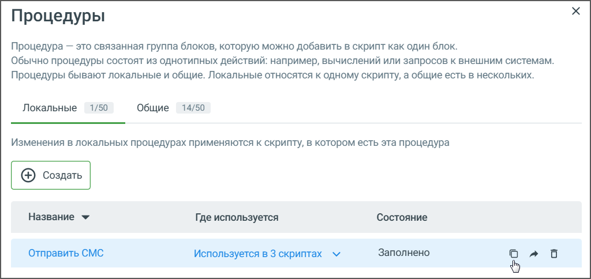
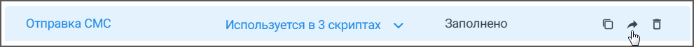

# 9.2. Копирование, перемещение и редактирование процедуры

> Трассировка: PDF §9.2 · сквозные стр. 174-175 · источники: ч.1 `kb/sources/cov-robot-fil/Модуль ЦОВ Робот Фил 2,0_manual_v7.26.28.pdf` с.174-175.

Для копирования процедуры выберите ее в списке и нажмите пиктограмму «Копировать». В списке отобразится новая процедура с пометкой (копия). Клик по наименованию открывает процедуру для редактирования.

> **Описание иллюстрации ROBOTFIL-§9.2-1** · к разделу §9.2 «Копирование, перемещение и редактирование процедуры» · стр. 175 · снимок экрана / схема, 1024×484 px.
> Относится к тексту руководства: «Для копирования процедуры выберите ее в списке и нажмите пиктограмму «Копировать». В списке отобразится новая процедура с пометкой (копия). Клик по наименованию открывает процедуру для редактирования.»
> Следующий за иллюстрацией текст: «Нажатием на иконку выбранной процедуры можно перенести процедуру из Общих в Локальные и наоборот.»
> Текст на изображении (OCR, требует сверки): Процедуры; Процедура — это связанная группа блоков, которую можно добавить в скрипт как один блок.; Обычно процедуры состоят из однотипных действий: например, вычислений или запросов к внешним системам.; Процедуры бывают локальные и общие. Локальные относятся к одному скрипту, а общие есть в нескольких.; Локальные; 1/50; Общие; 14/50; Изменения в локальных процедурах применяются к скрипту, в котором есть эта процедура; Название У; Где используется; ‘Состояние; Заполнено; Отправить CMC; Используется в 3 скриптах м; о A

> **Описание иллюстрации ROBOTFIL-§9.2-2** · к разделу §9.2 «Копирование, перемещение и редактирование процедуры» · стр. 175 · пиктограмма (значок элемента интерфейса), 16×13 px.
> Относится к тексту руководства: «Для копирования процедуры выберите ее в списке и нажмите пиктограмму «Копировать». В списке отобразится новая процедура с пометкой (копия). Клик по наименованию открывает процедуру для редактирования.»
> Следующий за иллюстрацией текст: «Нажатием на иконку выбранной процедуры можно перенести процедуру из Общих в Локальные и наоборот.»
> Текста на изображении нет; назначение значка — см. текст, к которому он относится.

Нажатием на иконку выбранной процедуры можно перенести процедуру из Общих в Локальные и наоборот.

> **Описание иллюстрации ROBOTFIL-§9.2-3** · к разделу §9.2 «Копирование, перемещение и редактирование процедуры» · стр. 175 · снимок экрана / схема, 991×68 px.
> Относится к тексту руководства: «Нажатием на иконку выбранной процедуры можно перенести процедуру из Общих в Локальные и наоборот.»
> Следующий за иллюстрацией текст: «Нажав на иконку «стрелка вниз» в столбце «Где используется», можно просмотреть список блоков, в которых используется данная процедура, а также быстро перейти к любому из этих блоков.»
> Текст на изображении (OCR, требует сверки): Отправка CMC; Используется в 3 скриптах м; Заполнено; lad

Нажав на иконку «стрелка вниз» в столбце «Где используется», можно просмотреть список блоков, в которых используется данная процедура, а также быстро перейти к любому из этих блоков.
