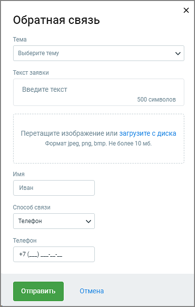

# 13. Форма обратной связи

> Трассировка: PDF §13 · сквозные стр. 194-195 · источники: ч.1 `kb/sources/cov-robot-fil/Модуль ЦОВ Робот Фил 2,0_manual_v7.26.28.pdf` с.194-195.

> **Описание иллюстрации ROBOTFIL-§13-1** · к разделу §13 «Форма обратной связи» · стр. 194 · пиктограмма (значок элемента интерфейса), 28×30 px.
> Относится к тексту руководства: начало раздела «Форма обратной связи».
> Следующий за иллюстрацией текст: «Нажав на пиктограмму в правом верхнем углу главного окна модуля Роботы пользователь может отправить свой вопрос, сообщение о проблеме или необходимости доработки продукта, чтобы как можно быстрее полу…»
> Текста на изображении нет; назначение значка — см. текст, к которому он относится.

Нажав на пиктограмму в правом верхнем углу главного окна модуля Роботы пользователь может отправить свой вопрос, сообщение о проблеме или необходимости доработки продукта, чтобы как можно быстрее получить обратную связь или решение вопроса.

> **Описание иллюстрации ROBOTFIL-§13-2** · к разделу §13 «Форма обратной связи» · стр. 195 · снимок экрана / схема, 401×629 px.
> Относится к тексту руководства: «Нажав на пиктограмму в правом верхнем углу главного окна модуля Роботы пользователь может отправить свой вопрос, сообщение о проблеме или необходимости доработки продукта, чтобы как можно быстрее получить обратную связь или решение вопроса.»
> Следующий за иллюстрацией текст: «Заполните поля формы и нажмите кнопку Отправить. Ответ службы поддержки поступит на выбранный при заполнении формы способ связи.»
> Текст на изображении (OCR, требует сверки): Обратная связь; Тема; Выберите тему; Текст заявки; Введите текст; 500 символов; Перетащите изображение или загрузите с диска; Формат jpeg, png, bmp. Не более 10 мб.; Имя; Иван; Способ связи; Телефон; отмена

Заполните поля формы и нажмите кнопку Отправить. Ответ службы поддержки поступит на выбранный при заполнении формы способ связи.
