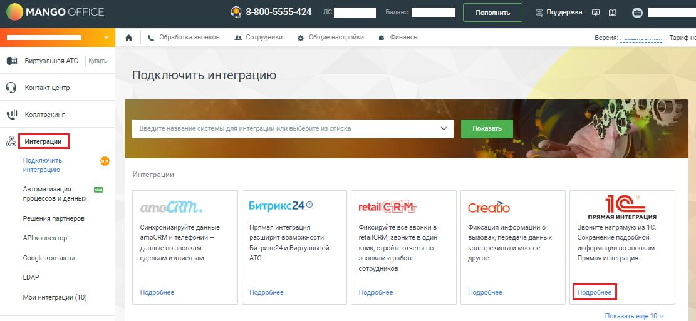
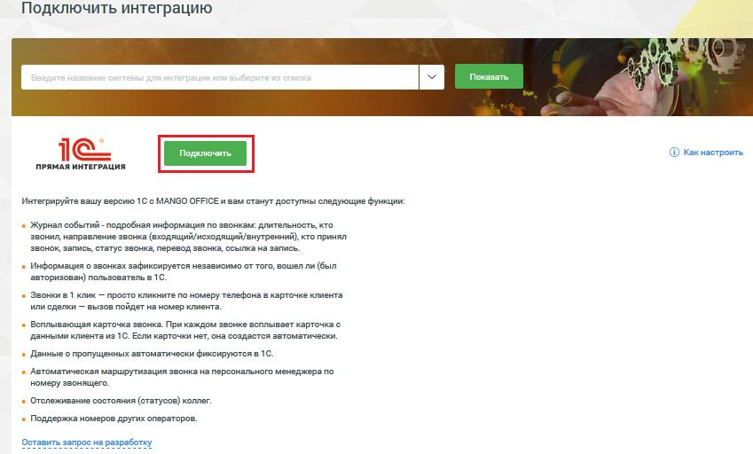
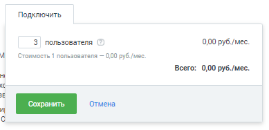
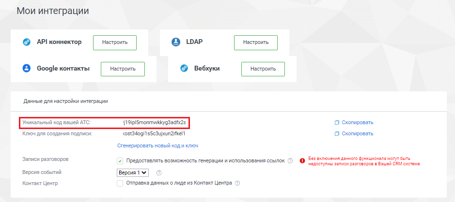

# Шаг 3. Подключение виджета интеграции в Личном кабинете MANGO OFFICE

> Трассировка: PDF §2 · сквозные стр. 5-7 · источники: ч.1 `kb/sources/integration_1c/Integratsiya_virtualnoy_ats_Pryamaya_integraciya_s_1C.pdf` с.5-7.

MANGO OFFICE Для того чтобы подключить виджет прямой интеграции с 1С, следует: 1) войдите в Личный кабинет Виртуальной АТС; 2) выберите вашу Виртуальную АТС и перейдите в раздел «Интеграции»; 3) нажмите кнопку «Подробнее» в блоке «1С. Прямая интеграция»:

> **Описание иллюстрации INT1C-§2-1** (к §2 «Шаг 3. Подключение виджета интеграции в Личном кабинете MANGO OFFICE», стр. 5; 1111×513 px). Снимок экрана / схема.
> Относится к тексту руководства: «…чный кабинет Виртуальной АТС; 2) выберите вашу Виртуальную АТС и перейдите в раздел «Интеграции»; 3) нажмите кнопку «Подробнее» в блоке «1С. Прямая интеграция»:».
> Подпись в руководстве: «Рисунок 1».
> Текст на изображении (OCR, требует сверки): MANGO ©; 8-800-5555-424; ne: НИ; Пополнить; © Поддержка; ков; „аа Сотрудники; в о; & Обработка; © Общиенаст; Версия.; Тарифы; НЕ вуртальная Aro; Подключить интеграцию; we; ЧИ Kone nne; ы AP; щим; Показать; Подключить; интеграцию; Интеграции; ‘Автоматизация; процессов и данных; CRM.; Битрикс24®; retail RM,; Creatio; Ie; Решения партнеров; ПРЯМАЯ ИНТЕГРАЦИЯ; ‘Синхронизируйте данные; ‘Фиксируйте все звонки в; Фиксация информации o; Звоните напрямую из 1C; API коннектор; атобВМ и телефонии —; расширит возможности; retalRM, звоните в один; вызовах, передача данных; ‘Сокренение подробной; клик,; дан…

Рисунок 1 4) нажмите кнопку «Подключить»: 5Прямая интеграция с системой «1С: Управление торговлей» Редакция 11 (11.3 - 11.4, 11.5) | Версия от 22.12 .2025

> **Описание иллюстрации INT1C-§2-2** (к §2 «Шаг 3. Подключение виджета интеграции в Личном кабинете MANGO OFFICE», стр. 6; 849×512 px). Снимок экрана / схема.
> Относится к тексту руководства: «….2025».
> Подпись в руководстве: «Рисунок 2».
> Текст на изображении (OCR, требует сверки): Подключить интеграцию; Показать; ааа абы ИИ (al; @ Как настроить; ПРЯМАЯ ИНТЕГРАЦИЯ; Интегрируйте вашу версию 1С с MANGO OFFICE и вам станут доступны следующие функции:; Журнал событий - подробная информация по звонкам: длительность, кто; звонил, направление звонка (входящий/исходящий/внутренний), кто принял; звонок, запись, статус звонка, перевод звонка, ссылка на запись.; Информация о звонках зафиксируется независимо от того, вошел ли (был; авторизован) пользователь в 1С.; Звонки в 1 клик — просто кликните по номеру телефона в карточке клиента; или сделки — вызов пойдет на номер клиента.; Вс…

Рисунок 2 5) выберите количество сотрудников, которые будут использовать прямую интеграцию. Минимальное количество – 3 человека; 6) нажмите кнопку «Сохранить»:

> **Описание иллюстрации INT1C-§2-3** (к §2 «Шаг 3. Подключение виджета интеграции в Личном кабинете MANGO OFFICE», стр. 6; 389×188 px). Снимок экрана / схема.
> Относится к тексту руководства: «… Рисунок 2 5) выберите количество сотрудников, которые будут использовать прямую интеграцию. Минимальное количество – 3 человека; 6) нажмите кнопку «Сохранить»:».
> Подпись в руководстве: «Рисунок 3».
> Текст на изображении (OCR, требует сверки): Подключить; 3) пользователя ©); 0,00 py6./mec.; Стоимость 1 пользователя — 0,00 руб./мес.; Всего: 0,00 руб./мес.; Сохранить; Отмена; Ml

Рисунок 3 7) сохраните к себе (например, скопируйте в Блокнот) уникальный код вашей Виртуальной АТС, он пригодится далее при настройке интеграции в 1С:

> **Описание иллюстрации INT1C-§2-4** (к §2 «Шаг 3. Подключение виджета интеграции в Личном кабинете MANGO OFFICE», стр. 6; 939×418 px). Снимок экрана / схема.
> Относится к тексту руководства: «…ранить»: Рисунок 3 7) сохраните к себе (например, скопируйте в Блокнот) уникальный код вашей Виртуальной АТС, он пригодится далее при настройке интеграции в 1С:».
> Подпись в руководстве: «Рисунок 4».
> Текст на изображении (OCR, требует сверки): Мои интеграции; © АР коннектор; @ Google контакты; © вебхуки; Dass для настройки интеграции; О Скопировать; Ключ для создания подлиси:; ost34ogh eSeSujrunairker!; Стенерировать новый коди ключ; Bes вилючения дачного Функшиочала wnt Gare; Записи разговоров:; 7 Предоставлять возможность генерации и использования ссылок; недестутны записи ранговороз в Bauer CRM cvcreue; Версия собътий; Версият У.; Контакт Центр; Отправка данных о лиде из Контакт Центра

Рисунок 4 5Прямая интеграция с системой «1С: Управление торговлей» Редакция 11 (11.3 - 11.4, 11.5) | Версия от 22.12 .2025
