# Шаг 4. Настройка интеграции в 1С

> Трассировка: PDF §2 · сквозные стр. 7-17 · источники: ч.1 `kb/sources/integration_1c/Integratsiya_virtualnoy_ats_Pryamaya_integraciya_s_1C.pdf` с.7-17.

Подключение расширения конфигурации Для подключения расширения конфигурации, выполните следующие действия: 1) запустите и авторизуйтесь в Конфигураторе 1С; 2) выберите пункт меню «Конфигурация», затем пункт «Расширения конфигурации»:

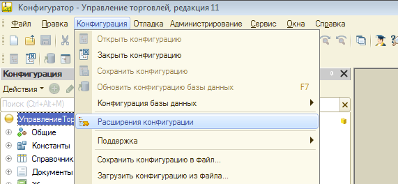

> **Описание иллюстрации INT1C-§2-1** (к §2 «Шаг 4. Настройка интеграции в 1С», стр. 7; 571×264 px). Снимок экрана / схема.
> Относится к тексту руководства: «…ии, выполните следующие действия: 1) запустите и авторизуйтесь в Конфигураторе 1С; 2) выберите пункт меню «Конфигурация», затем пункт «Расширения конфигурации»:».
> Подпись в руководстве: «Рисунок 5».
> Текст на изображении (OCR, требует сверки): [ee] Конфигуратор - Управление торговлей, редакция 11; Файл Правка | Конфигурация | Отладка ДАдминистрирование; Сервис; Окна; Справка; сова Хх; Открыть конфигурацию; Закрыть конфигурацию; еее; Сохранить конфигурацию; Действия > ©) oa; Обновить конфигурацию базы данных; F7; Конфигурация базы данных; лени; Расширения конфигурации; ® So Общие; ® Bf Константы; Поддержка; ® [| Справочник; Сохранить конфигурацию в Файл...; Документы; Загрузить конфигурацию из файла...

Рисунок 5 3) нажмите кнопку «Действия», затем выберите пункт «Добавить» в блоке «Расширения конфигурации»:

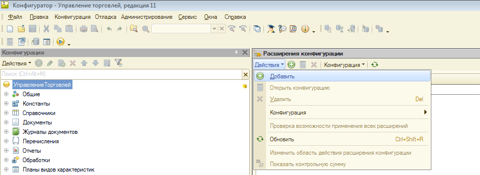

> **Описание иллюстрации INT1C-§2-2** (к §2 «Шаг 4. Настройка интеграции в 1С», стр. 7; 967×353 px). Снимок экрана / схема.
> Относится к тексту руководства: «…Конфигурация», затем пункт «Расширения конфигурации»: Рисунок 5 3) нажмите кнопку «Действия», затем выберите пункт «Добавить» в блоке «Расширения конфигурации»:».
> Подпись в руководстве: «Рисунок 6».
> Текст на изображении (OCR, требует сверки): Файл; Правка Конфигурация Отладка Администрирование Сервис Окна; Спозвка; ан.; (Koneborypaunns | fis Pacuperinn кори; Gere ODO UL; РО Deseo; рав; Открыть конфигурацию; So Общие; Удалить; Del; ® BF Константы; © Справочники; Конфигурация; ® Е Документы; Проверка возможности применения всех расширений; © Женаты sonnets; © [2 Перечисления; Обновить; CireShiteR,; © Ш Omer; Изменить область действия расширения конфигурации; © Обработки; Показать контрольную сумму; {ФМ Планы видов характеристик,

Рисунок 6 4) укажите удобное для идентификации название расширения:

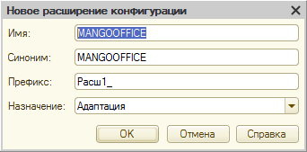

> **Описание иллюстрации INT1C-§2-3** (к §2 «Шаг 4. Настройка интеграции в 1С», стр. 7; 342×169 px). Снимок экрана / схема.
> Относится к тексту руководства: «…ажмите кнопку «Действия», затем выберите пункт «Добавить» в блоке «Расширения конфигурации»: Рисунок 6 4) укажите удобное для идентификации название расширения:».
> Подпись в руководстве: «Рисунок 7».
> Текст на изображении (OCR, требует сверки): Новое расширение конфигурации; Имя; МА; FIC; СЕ; Синоним:; |MANGOOFFICE; Префикс:; |Расш1_; Назначение: [Адаптация; ly); OK Отмена Справка

Рисунок 7 5) в строке с данными расширения "MANGOOFFICE" снимите следующие «галочки»: 5Прямая интеграция с системой «1С: Управление торговлей» Редакция 11 (11.3 - 11.4, 11.5) | Версия от 22.12 .2025 - Безопасный режим; - Защита от опасных действий;

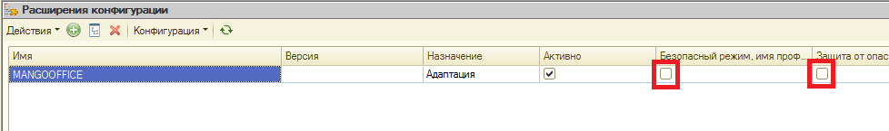

> **Описание иллюстрации INT1C-§2-4** (к §2 «Шаг 4. Настройка интеграции в 1С», стр. 8; 978×145 px). Снимок экрана / схема.
> Относится к тексту руководства: «….2025 - Безопасный режим; - Защита от опасных действий;».
> Подпись в руководстве: «Рисунок 8».
> Текст на изображении (OCR, требует сверки): "== Расширения конфигурации:; `Дестыя- ©; Ves; Версия; "Назначение; Активно; Адаптация; a режим. имя “ay oronac

Рисунок 8 Примечание. Функции "Безопасный режим" и "Защита от опасных действий" в 1С накладывают определенные ограничения на использование тех или иных методов программного кода. Например, ограничения на использование в методов Выполнить() и Вычислить(). Данные функции предназначены для обеспечения безопасности системы в целом, при запуске внешней конфигурации. Если установка расширения "MANGOOFFICE" выполняется при включенном безопасном режиме и включенной защите от опасных действий, то это расширение не будет работать в 1С. Чтобы избежать выдачи сообщения об ошибке в 1С, следует выключить "Безопасный режим" и функцию "Защита от опасных действий". 6) загрузите файл с расширением конфигурации:

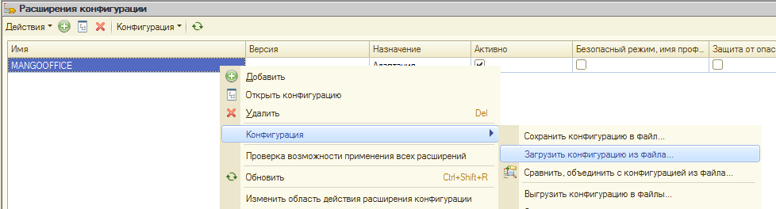

> **Описание иллюстрации INT1C-§2-5** (к §2 «Шаг 4. Настройка интеграции в 1С», стр. 8; 978×264 px). Снимок экрана / схема.
> Относится к тексту руководства: «…жать выдачи сообщения об ошибке в 1С, следует выключить "Безопасный режим" и функцию "Защита от опасных действий". 6) загрузите файл с расширением конфигурации:».
> Подпись в руководстве: «Рисунок 9».
> Текст на изображении (OCR, требует сверки): "== Расширения конфигурации:; `Дестыя- ©; Ves; "Назначение; Активно; [Еезотьоный режим. man np Sau or nae; Добавить; Открыть конфигурацию; Удалить; Del; Korourypaun; Coxpanute конфигурацию в Файл.; Проверка возможности применения всех расширений; Загрузить конфигурацию из файла.; Обновить; CireShiteR,; = @ecacteceeor oS; 'Выгрузить конфигурацию в файлы.; `Изменить область действия расширения конфигурации

Рисунок 9 7) укажите расширение конфигурации; 5Прямая интеграция с системой «1С: Управление торговлей» Редакция 11 (11.3 - 11.4, 11.5) | Версия от 22.12 .2025 Важно! Используйте разные расширения конфигурации для разных версий 1С:

| Версия 1С | Имя файла, содержащего расширение конфигурации | Ссылка для скачивания с сайта MANGO OFFICE |
| --- | --- | --- |
| 1С: Управление торговлей. Версии 11.3 -11.4 | MangoOffice_UT114_210117.zip | Скачать |
| 1С: Управление Торговлей. Версии 11.5 | MangoOffice_UT115_210120.zip | Скачать |

8) подтвердите необходимость добавления расширения:

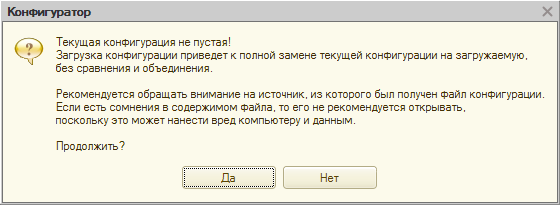

> **Описание иллюстрации INT1C-§2-6** (к §2 «Шаг 4. Настройка интеграции в 1С», стр. 9; 560×205 px). Снимок экрана / схема.
> Относится к тексту руководства: «…Скачать 1С: Управление Торговлей. Версии 11.5 8) подтвердите необходимость добавления расширения:».
> Подпись в руководстве: «Рисунок 10».
> Текст на изображении (OCR, требует сверки): Текущая конфигурация не пустая!; Загрузка конфигурации приведет к полной замене текущей конфигурации на загружаемую.; без сравнения и объединения.; Рекомендуется обращать внимание на источник, из которого был получен файл конфигурации.; Если есть сомнения в содержимом файла, то его не рекомендуется открывать.; поскольку это может нанести вред компьютеру и данным.; Продолжить?; Нет

Рисунок 10

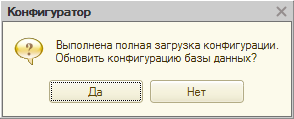

> **Описание иллюстрации INT1C-§2-7** (к §2 «Шаг 4. Настройка интеграции в 1С», стр. 9; 294×119 px). Снимок экрана / схема.
> Относится к тексту руководства: «…1С: Управление Торговлей. Версии 11.5 8) подтвердите необходимость добавления расширения: Рисунок 10».
> Подпись в руководстве: «Рисунок 11».
> Текст на изображении (OCR, требует сверки): Конфигуратор.; Выполнена полная загрузка конфигурации.; Обновить конфигурацию базы данных?; Нет

Рисунок 11 9) система «1С» выполнит и подтвердит обновление, после чего нажмите кнопку «Принять»:

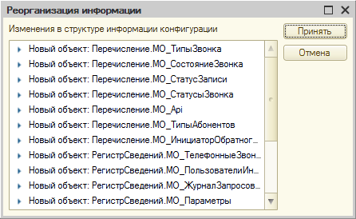

> **Описание иллюстрации INT1C-§2-8** (к §2 «Шаг 4. Настройка интеграции в 1С», стр. 9; 446×274 px). Снимок экрана / схема.
> Относится к тексту руководства: «…8) подтвердите необходимость добавления расширения: Рисунок 10 Рисунок 11 9) система «1С» выполнит и подтвердит обновление, после чего нажмите кнопку «Принять»:».
> Подпись в руководстве: «Рисунок 12».
> Текст на изображении (OCR, требует сверки): Реорганизация информации; ох; Изменения в структуре информации конфигурации; Новый объект: Перечисление.МО_ТипыЗвонка; A} Loner}; Новый объект: Перечисление.МО_СостояниеЗвонка; Новый объект: Перечисление.МО_СтатусЗаписи; Новый объект: Перечисление.МО_СтатусыЗвонка; Новый объект: Перечисление.МО_Ар!; Новый объект: Перечисление.МО_ТипыДбонентов; Новый объект: Перечисление.МО_ИнициаторОбратног_ ——; Новый объект: РегистрСведений.МО_ТелефонныеЗвон_; Новый объект: РегистрСведений.МО _ПользователиИн_; Новый объект: РегистрСведений.МО_ЖурналЗапросов_; Новый объект: РегистрСведений.МО_Параметры

Рисунок 12 10) расширение установлено, можно запускать 1С; 11) в состав расширения входит внешнее расширение, реализующее работу с сервером API. При запуске 1С оно автоматически устанавливается в папку: C:\Users\<имя_пользователя>\AppData\Roaming\1C\1cv8\ExtCompT 5Прямая интеграция с системой «1С: Управление торговлей» Редакция 11 (11.3 - 11.4, 11.5) | Версия от 22.12 .2025 Файл MangoOfficeSDK.dll (для 32-битной версии 1С) или MangoOfficeSDK64.dll (для 64- битной версии 1С). Также, в этой же папке должен быть файл registry.xml, в котором должен быть прописан файл расширения. Пример:

| <?xml version="1.0" encoding="UTF-8"?> |
| --- |
| <registry xmlns="http://v8.1c.ru/8.2/addin/registry"> |
| <component path="MangoOfficeSDK64.dll" type="native"/> |
| </registry> |

12) после первого запуска 1С выдается сообщение:

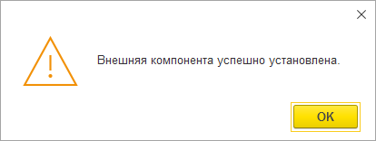

> **Описание иллюстрации INT1C-§2-9** (к §2 «Шаг 4. Настройка интеграции в 1С», стр. 10; 414×156 px). Снимок экрана / схема.
> Относится к тексту руководства: «… xmlns="http://v8.1c.ru/8.2/addin/registry"> <component path="MangoOfficeSDK64.dll" type="native"/> </registry> 12) после первого запуска 1С выдается сообщение:».
> Подпись в руководстве: «Рисунок 13».
> Текст на изображении (OCR, требует сверки): Внешняя компонента успешно установлена.; Lox]

Рисунок 13 Настройка первичного подключения интеграции Чтобы настроить прямую интеграцию, выполните: 1) перейдите в ваш 1С; 2) перейдите в административный раздел «Интеграция ВАТС «Mango office»; 5Прямая интеграция с системой «1С: Управление торговлей» Редакция 11 (11.3 - 11.4, 11.5) | Версия от 22.12 .2025 3) нажмите на ссылку «Настройки интеграции»:

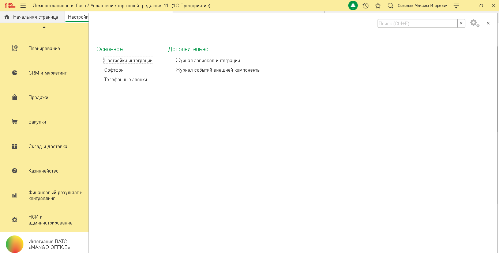

> **Описание иллюстрации INT1C-§2-10** (к §2 «Шаг 4. Настройка интеграции в 1С», стр. 11; 1364×692 px). Снимок экрана / схема.
> Относится к тексту руководства: «….2025 3) нажмите на ссылку «Настройки интеграции»:».
> Подпись в руководстве: «Рисунок 14».
> Текст на изображении (OCR, требует сверки): ft Начальная страница; Настройк; Основное; Дополнительно; {Настройки интеграции,; Журнал запросов интеграции; Софтфон; Журнал событий внешней компоненты; Телефонные звонки; Интеграция BATC; «MANGO OFFICE»

Рисунок 14 4) откройте вкладку «Параметры» в открывшейся форме «Настройки интеграции ВАТС «MANGO OFFICE»; 5) вставьте код вашей ВАТС в поле «Код ВАТС (vpbx_key)». Примечание. Код Виртуальной АТС и ключ для создания подписи вы получили ранее, при подключении виджета интеграции в Личном кабинете MANGO OFFICE.

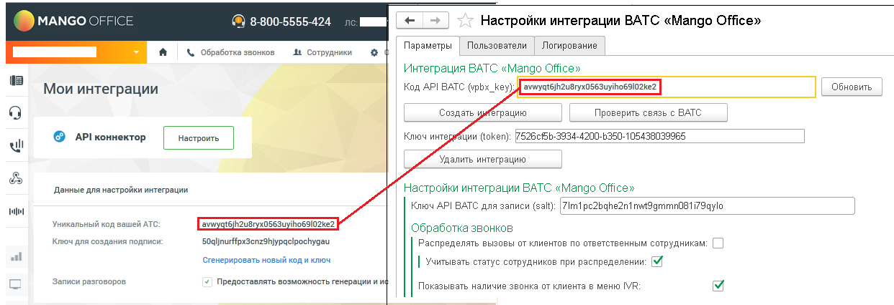

> **Описание иллюстрации INT1C-§2-11** (к §2 «Шаг 4. Настройка интеграции в 1С», стр. 11; 1242×426 px). Снимок экрана / схема.
> Относится к тексту руководства: «…С (vpbx_key)». Примечание. Код Виртуальной АТС и ключ для создания подписи вы получили ранее, при подключении виджета интеграции в Личном кабинете MANGO OFFICE.».
> Подпись в руководстве: «Рисунок 15».
> Текст на изображении (OCR, требует сверки): MANGO OFFIC!; @ 8-800-5555-424; mm; Настройки интеграции BATC «Mango Office»; Параметры; Пользователи; Логирование; ry; \ Обработка звонков; Ab Сотрудники; Интеграция BATC «Mango Officer; ‘Обновить; Мои интеграции; Код API BATC (ypbx_key); Создать; грацию; Проверить связь с BATC; © АРИконнектор; Ключ инте]; ции (token): 7526555-3934-4200-6350-105438039965; ul; Удалить интеграцию; Данные для настройки интеграции.; Настройки интеграции BATC «Mango Officer; Ключ API ВАТС для записи (salt) |7im1 pc2bqhe2n1 nwt9gmmnO81i73qylo; Уникальный код вашей ATC:; Обработка звонков; Ключ для создания подписи:…

Рисунок 15 6) нажмите кнопку «Создать интеграцию». Будут показаны настройки интеграции на вкладке «Параметры»: 5Прямая интеграция с системой «1С: Управление торговлей» Редакция 11 (11.3 - 11.4, 11.5) | Версия от 22.12 .2025

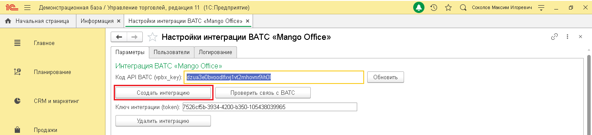

> **Описание иллюстрации INT1C-§2-12** (к §2 «Шаг 4. Настройка интеграции в 1С», стр. 12; 1364×312 px). Снимок экрана / схема.
> Относится к тексту руководства: «….2025».
> Подпись в руководстве: «Рисунок 16».
> Текст на изображении (OCR, требует сверки): Демонстрационная база / Управление торговлей, редакция 11 (1С:Предприятие); © эх а caronve Marcas Hropests; ft Начальная страница; Информация х; Настройки интеграции BATC «Мапдо Offices x; va; Главное; Настройки интеграции ВАТС «Mango Office»; Параметры; Пользователи; `Логирование; Интеграция ВАТС «Mango Officer; Планирование; Код API BATC (ypbx_key); ЕЕ; ИУ; ТЕТЕ; ‘Обновить; Проверить связь с BATC; CRM и маркетинг; Ключ интеграции (token): 7526685-3934-4200-5350-105438039965; Удалить интеграцию; Продажи

Рисунок 16 7) нажмите кнопку «Сохранить настройки» (кнопка расположена внизу на вкладки «Параметры»):

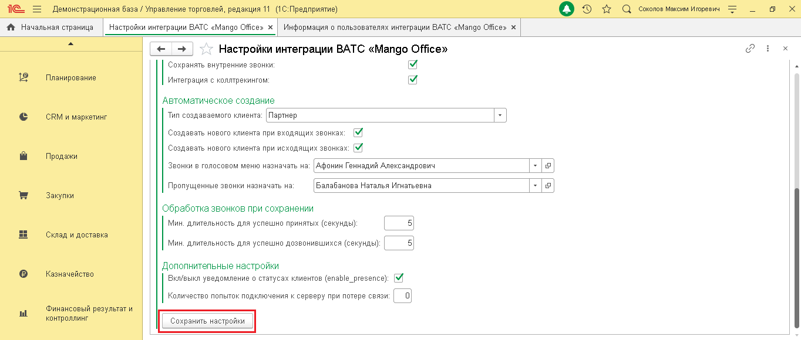

> **Описание иллюстрации INT1C-§2-13** (к §2 «Шаг 4. Настройка интеграции в 1С», стр. 12; 1364×580 px). Снимок экрана / схема.
> Относится к тексту руководства: «….2025 Рисунок 16 7) нажмите кнопку «Сохранить настройки» (кнопка расположена внизу на вкладки «Параметры»):».
> Подпись в руководстве: «Рисунок 17».
> Текст на изображении (OCR, требует сверки): ft Начальная страница; Настройки интеграции BATC «Мапдо Offices x; Информация о пользователях интеграции ВАТС «Mango Offices x; + | >> Настройки интеграции ВАТС «Mango Office»; Сохранять внутренние звонки; Интеграция с коллтрекингом:; Автоматическое создание; Тип создаваемого клиента:; Партнер; Создавать нового клиента при входящих звонках; Создавать нового клиента при исходящих звонках: [МИ; Звонки в голосовом меню назначать на: [Афонин Геннадий Александрович; ВЕ]; Пропущенные эвонки назначать на; Балабанова Наталья Игнатьевна; Обработка звонков при сохранении; Мин. длительность для успешно п…

Рисунок 17 8) проверьте, доступен ли сервер интеграции, нажав кнопку «Проверить связь с ВАТС»:

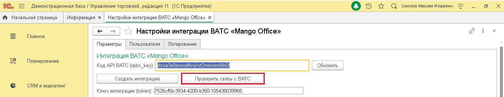

> **Описание иллюстрации INT1C-§2-14** (к §2 «Шаг 4. Настройка интеграции в 1С», стр. 12; 1359×263 px). Снимок экрана / схема.
> Относится к тексту руководства: «…ить настройки» (кнопка расположена внизу на вкладки «Параметры»): Рисунок 17 8) проверьте, доступен ли сервер интеграции, нажав кнопку «Проверить связь с ВАТС»:».
> Подпись в руководстве: «Рисунок 18».
> Текст на изображении (OCR, требует сверки): те; Демонстрационная база / Управление торговлей, редакция 11 (1С:Предприятие); © Кое; ft Начальная страница; Информация х; Настройки интеграции BATC «Мапдо Offices x; va; oO; Главное; Настройки интеграции ВАТС «Mango Office»; Параметры; Пользователи; `Логирование; Интеграция ВАТС «Mango Officer; Планирование; Код API BATC (ypbx_key); [ео; ‘Обновить; Создать интеграцию; CRM и маркетинг; Ключ интеграции (token): 7526685-3934-4200-5350-105438039965

Рисунок 18 Если связь установлена, то будет выдано сообщение «Сервер интеграции доступен»: 5Прямая интеграция с системой «1С: Управление торговлей» Редакция 11 (11.3 - 11.4, 11.5) | Версия от 22.12 .2025

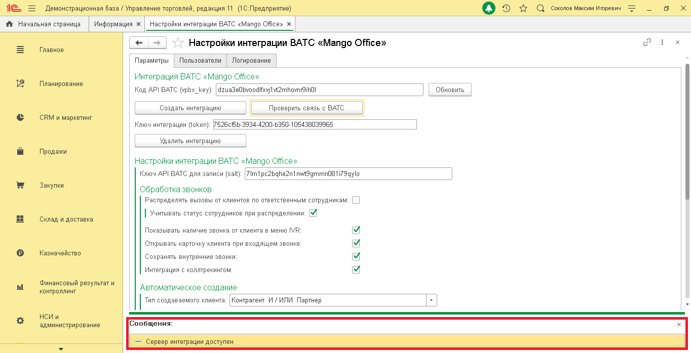

> **Описание иллюстрации INT1C-§2-15** (к §2 «Шаг 4. Настройка интеграции в 1С», стр. 13; 1364×698 px). Снимок экрана / схема.
> Относится к тексту руководства: «….2025».
> Подпись в руководстве: «Рисунок 19».
> Текст на изображении (OCR, требует сверки): Демонстрационная база / Управление торговлей, редакция 11 (1С:Предприятие); © д а comonoe marci ropes; ft Начальная страница; Информация х; Настройки интеграции BATC «Мапдо Offices x; va; Настройки интеграции BATC «Mango Office»; Главное; Параметры; Пользователи; `Логирование; Интеграция ВАТС «Mango Office»; Планирование; ‘Обновить; Код API BATC (ypbx_key): |dzuaSeObvoodlfxyjtvt2rnhovnrSihO; Создать интеграцию; Проверить связь с BATC; CRM и маркетинг; Ключ интеграции (token): 7526685-3934-4200-5350-105438039965; Удалить интеграцию; Продажи; Настройки интеграции BATC «Mango Officer; Ключ API BA…

Рисунок 19 После успешного подключения интеграции вам нужно присвоить внутренние телефонные номера пользователям 1С. После этого, вы можете установить дополнительные настройки обработки звонков. Как указать сопоставление пользователей 1С и внутренних номеров Виртуальной АТС После того, как вы подключили виджет прямой интеграции и настроили интеграцию в 1С, нужно присвоить сотрудникам, зарегистрированным в 1С, внутренние номера Виртуальной АТС. Тогда эти сотрудники смогут пользоваться прямой интеграцией. Важно! В прямой интеграции с 1С вы сами определяете ограничение на максимальное количество пользователей. Не гарантирована обработка звонков пользователей сверх установленных пределов. Если лимит на количество пользователей превышен, то будет выдано сообщение об ошибке и передача данных о звонках в 1С будет ограничена. Чтобы решить эту проблему, вы можете увеличить количество пользователей прямой интеграции. Чтобы присвоить внутренние номера сотрудникам в 1С нужно: 1) откройте вкладку «Пользователи» в форме «Настройки интеграции ВАТС «MANGO OFFICE»; 2) нажмите кнопку «Добавить»; 5Прямая интеграция с системой «1С: Управление торговлей» Редакция 11 (11.3 - 11.4, 11.5) | Версия от 22.12 .2025 Примечание. Список пользователей можно сортировать по возрастанию или убыванию значения в том или ином столбце. Для этого нужно кликнуть на заголовок (шапку) столбца.

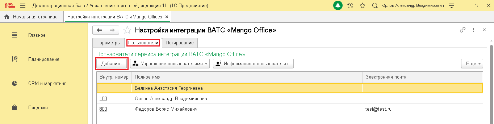

> **Описание иллюстрации INT1C-§2-16** (к §2 «Шаг 4. Настройка интеграции в 1С», стр. 14; 1364×344 px). Снимок экрана / схема.
> Относится к тексту руководства: «…ание. Список пользователей можно сортировать по возрастанию или убыванию значения в том или ином столбце. Для этого нужно кликнуть на заголовок (шапку) столбца.».
> Подпись в руководстве: «Рисунок 20».
> Текст на изображении (OCR, требует сверки): Демонстрационная база / Управление торговлей, редакция 11 (1С:Предприятие); Оо лс о ресадовладимиювич; ft Ночальная страница | Настройки интеграции BATC <Mango Office x |; va; Главное; Настройки интеграции ВАТС «Mango Office»; Параметры; `Логирование; Пользователи сервиса интеграции ВАТС «Mango Officer; Планирование; 20 Управление пользователями =; Информация о пользователях; Внутр. номер; Полное имя; Электронная почта; CRM и маркетинг; Белкина Анастасия Георгиевна; 100; Орлов Александр Владимирович; Продажи; 800; Федоров Борис Михайлович; test@test.ru

Рисунок 20 3) в открывшейся форме «Выбор пользователя» дважды кликните на фамилию сотрудника, которому нужно выдать номер:

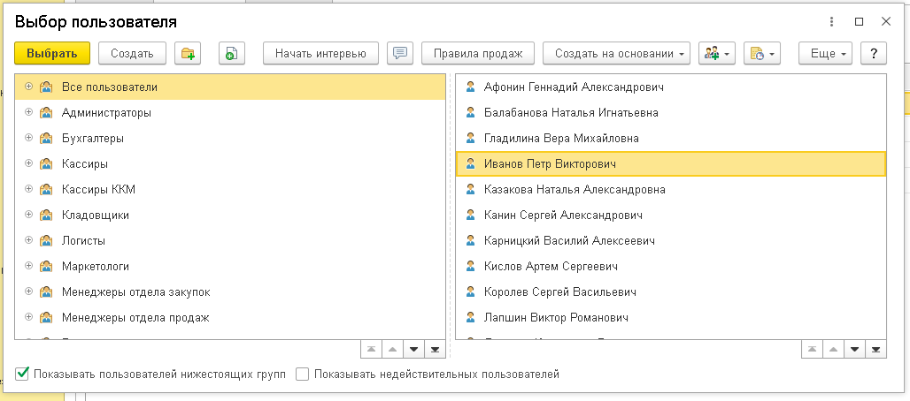

> **Описание иллюстрации INT1C-§2-17** (к §2 «Шаг 4. Настройка интеграции в 1С», стр. 14; 1028×454 px). Снимок экрана / схема.
> Относится к тексту руководства: «…ликнуть на заголовок (шапку) столбца. Рисунок 20 3) в открывшейся форме «Выбор пользователя» дважды кликните на фамилию сотрудника, которому нужно выдать номер:».
> Подпись в руководстве: «Рисунок 21».
> Текст на изображении (OCR, требует сверки): ох; Выбор пользователя; ОБН (con (а; |@ | Нечать интервью; 2 Афонин Геннадий Александрович; 2 Балабанова Наталья Игнатьевна; ‘Администраторы; Бухгалтеры; 2 Гладилина Вера Михайловна; Кассиры; [Simone |; Кассиры KKM; Казакова Наталья Александровна; Кладовщики; Канин Сергей Александрович; Логисты; Карницкий Василий Алексеевич; Маркетологи; Кислов Артем Сергеевич; Менеджеры отдела закупок; Королев Сергей Васильевич; Менеджеры отдела продаж; Лапшин Виктор Романович; М Показывать пользователей нижестоящих групп [_] Показывать недействительных; пользователей; тт

Рисунок 21 4) выбранный пользователь будет добавлен в список на вкладке «Пользователи». Дважды кликните на ячейку «Внутр. Номер» в сроке с данными сотрудника; 5) введите внутренний номер сотрудника, указанный в карточке сотрудника в Личном кабинете MANGO OFFICCE и нажмите кнопку «Ок» в открывшейся форме; 6) выполните шаги 2-5 для всех сотрудников, которые будут пользоваться прямой интеграцией:

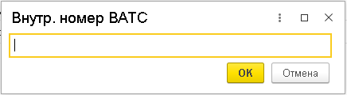

> **Описание иллюстрации INT1C-§2-18** (к §2 «Шаг 4. Настройка интеграции в 1С», стр. 14; 436×120 px). Снимок экрана / схема.
> Относится к тексту руководства: «…ном кабинете MANGO OFFICCE и нажмите кнопку «Ок» в открывшейся форме; 6) выполните шаги 2-5 для всех сотрудников, которые будут пользоваться прямой интеграцией:».
> Подпись в руководстве: «Рисунок 22».
> Текст на изображении (OCR, требует сверки): Внутр. номер ВАТС; ОИ; [ок | Отмена

Рисунок 22 Устранение ошибки при подключении расширения конфигурации При добавлении расширения конфигурации выдано следующее сообщение об ошибке? 5Прямая интеграция с системой «1С: Управление торговлей» Редакция 11 (11.3 - 11.4, 11.5) | Версия от 22.12 .2025

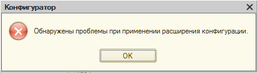

> **Описание иллюстрации INT1C-§2-19** (к §2 «Шаг 4. Настройка интеграции в 1С», стр. 15; 421×120 px). Снимок экрана / схема.
> Относится к тексту руководства: «….2025».
> Подпись в руководстве: «Рисунок 23».
> Текст на изображении (OCR, требует сверки): Конфигуратор; 9 Обнаружены проблемы при применении расширения конфигурации.; OK

Рисунок 23 Расширение конфигурации может не работать по следующим причинам: 1) расширение конфигурации подключено в безопасном режиме; 2) пользователю 1С не выданы права доступа. Расширение подключено в безопасном режиме В случае установки расширения в безопасном режиме, это расширение не будет работать в 1С. Чтобы проверить режим установки расширения, необходимо: 1) откройте Конфигуратор 1С; 2) выберите пункт меню «Конфигурация», затем пункт «Расширения конфигурации»: 3) убедитесь, что в строке с данными расширения «MANGOOFFICE» сняты следующие «галочки»: - Безопасный режим; - Защита от опасных действий. Примечание. Если «галочки» установлены, то снимите их.

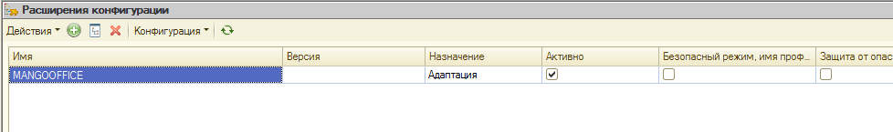

> **Описание иллюстрации INT1C-§2-20** (к §2 «Шаг 4. Настройка интеграции в 1С», стр. 15; 978×145 px). Снимок экрана / схема.
> Относится к тексту руководства: «…ыми расширения «MANGOOFFICE» сняты следующие «галочки»: - Безопасный режим; - Защита от опасных действий. Примечание. Если «галочки» установлены, то снимите их.».
> Подпись в руководстве: «Рисунок 24».
> Текст на изображении (OCR, требует сверки): 'з» Расширения конфигурации.; `Дестыя- ©; Ves; Версия; "Назначение; Активно; [Еезотьоный режим. man np Sau or nae; Адаптация

Рисунок 24 4) вам нужно перезапустить ваш 1С. Пользователю 1С не выданы права доступа Если, при подключении конфигурации, выдано сообщение об ошибке, убедитесь, что пользователю 1С присвоена роль «ВАТС Mango Office». Чтобы открыть список пользователей, в окне "Конфигуратор" нужно нажать на пункт меню "Администрирование". В открывшемся выпадающем меню нужно выбрать пункт "Пользователи". Будет открыто окно "Список пользователей", в котором дважды нажмите на 5Прямая интеграция с системой «1С: Управление торговлей» Редакция 11 (11.3 - 11.4, 11.5) | Версия от 22.12 .2025 строку с именем нужного вам пользователя. Будет открыто окно "Пользователь", в котором нужно открыть закладку "Пользователь" и проверить активацию пункта "ВАТС Mango Office":

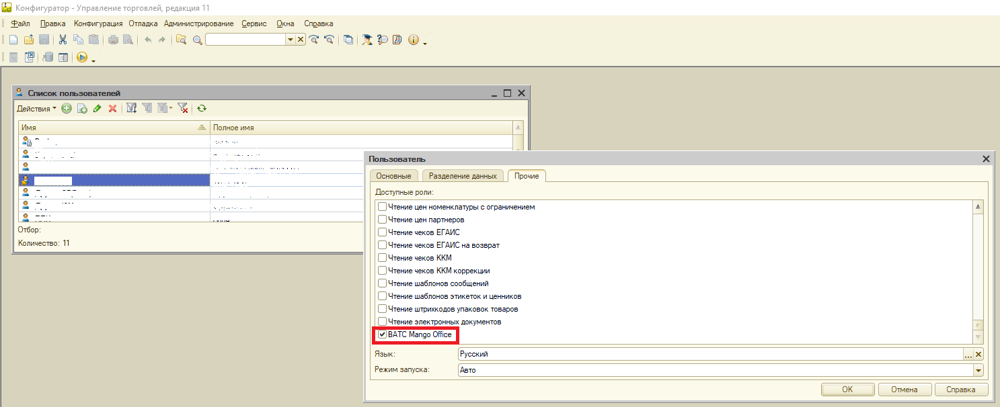

> **Описание иллюстрации INT1C-§2-21** (к §2 «Шаг 4. Настройка интеграции в 1С», стр. 16; 1487×606 px). Снимок экрана / схема.
> Относится к тексту руководства: «…м нужного вам пользователя. Будет открыто окно "Пользователь", в котором нужно открыть закладку "Пользователь" и проверить активацию пункта "ВАТС Mango Office":».
> Подпись в руководстве: «Рисунок 25».
> Текст на изображении (OCR, требует сверки): Gd конфигуратор - Управление торговлей, редакция 11; Файл; Правка; Конфигурация Отладка Администрирование Сервис Окна Справка; Ее ан.; Действия” 9 ЮФ X |G; © | Полное имя; my; Основные || Разделение данных | | Прочие,; re; "Доступные роли:; Чтение цен номенклатуры с ограничением.; "Чтение цен партнеров.; Количество: 11; "Чтение чеков ЕГАИС; Чтение чеков ЕГАИС на возврат; Чтение чеков ККМ; {Чтение чеков KKM коррекции; "О Чтение шаблонов сообщений; "Чтение шаблонов этикеток и ценников.; О Чтение штрихкодов упаковок товаров.; {Чтение электронных документов; `УВАТС Mango Office; Язык:; Русский; Ре…

Рисунок 25 Примечание. Если в строке «ВАТС Mango Office» не установлена «галочка», то установите ее. Затем, вам нужно перезапустить ваш 1С. 5Прямая интеграция с системой «1С: Управление торговлей» Редакция 11 (11.3 - 11.4, 11.5) | Версия от 22.12 .2025
