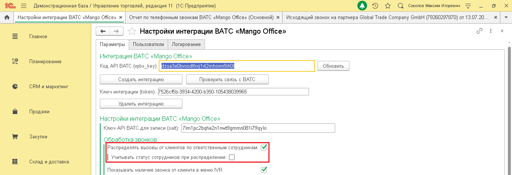
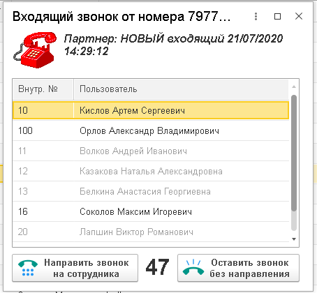
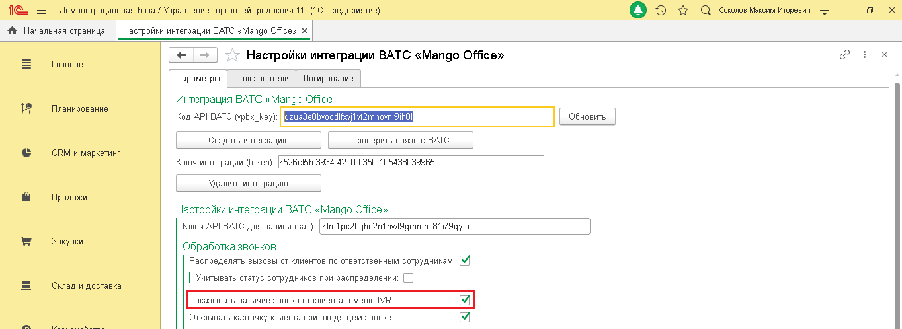
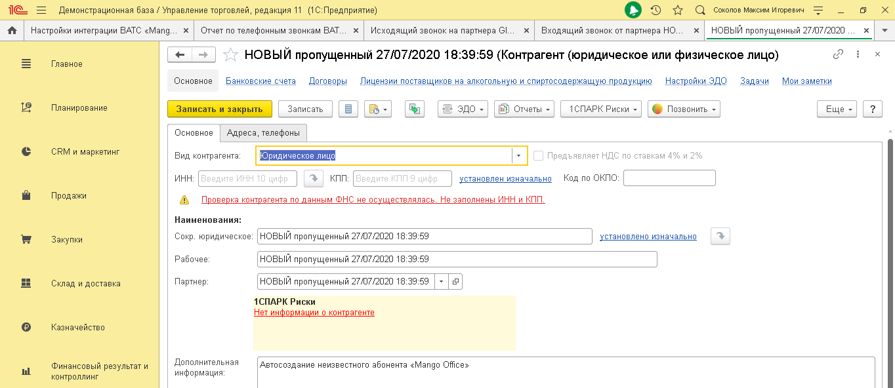
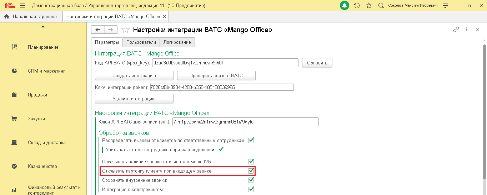
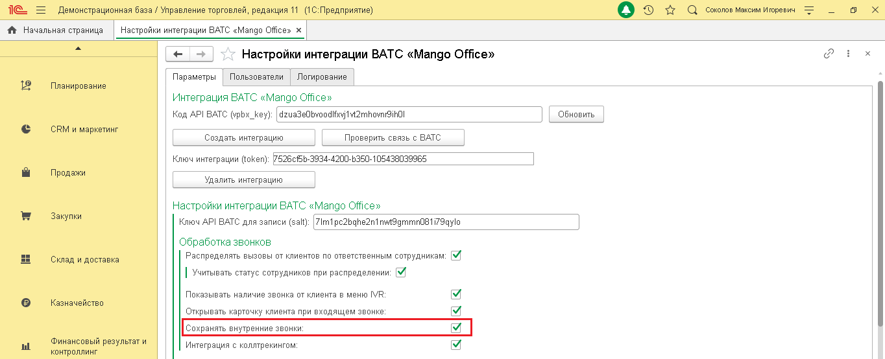
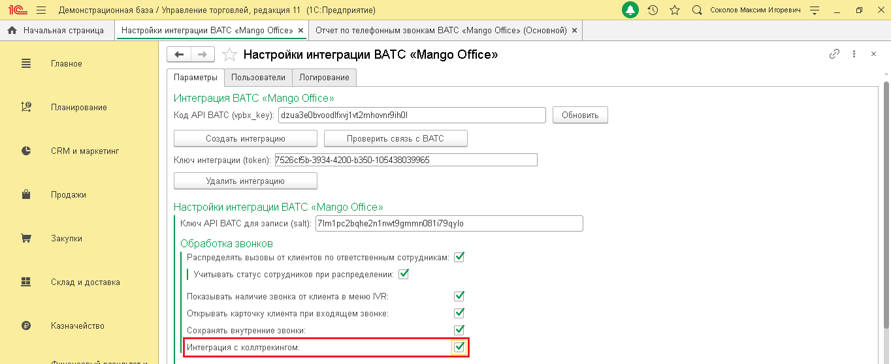

# 3.1. Обработка звонков

> Трассировка: PDF §3.1 · сквозные стр. 17-22 · источники: ч.1 `kb/sources/integration_1c/Integratsiya_virtualnoy_ats_Pryamaya_integraciya_s_1C.pdf` с.17-22.

Распределение вызовов по ответственным сотрудникам Если настройка включена, то звонок, поступивший от Клиента (чей контакт ранее уже был сохранен в 1С) будет сразу перенаправлен на ответственного сотрудника. Вы можете включить настройку «Учитывать статус сотрудника при распределении». В этом случае, если ответственный сотрудник разговаривает, то входящий звонок от Клиента останется в IVR и не будет переведен на ответственного. Чтобы включить распределение вызовов, выполните следующие действия: 1) активируйте переключатель «Распределять вызовы от Клиентов по ответственным сотрудникам»; 2) активируйте переключатель «Учитывать статус сотрудника при распределении», при необходимости; 3) сохраните настройки, нажав одноименную кнопку внизу формы «Настройки интеграции ВАТС «Mango office»:

> **Описание иллюстрации INT1C-§3.1-1** (к §3.1 «Обработка звонков», стр. 17; 1364×468 px). Снимок экрана / схема.
> Относится к тексту руководства: «…статус сотрудника при распределении», при необходимости; 3) сохраните настройки, нажав одноименную кнопку внизу формы «Настройки интеграции ВАТС «Mango office»:».
> Подпись в руководстве: «Рисунок 26».
> Текст на изображении (OCR, требует сверки): Демонстрационная база / Управление торговлей, редакция 11 (1С:Предприятие); Оу т с Comoros Marcin nropesns; tf; Настройки интеграции BATC «Mango Offices x; Отчет no телефонным звонкам BATC «Mango Offices (Основной) x; Исходящий звонок на партнера Global Trade Company GmbH (79260297870) or 13.07.20,; va; oO; Главное; Настройки интеграции ВАТС «Mango Office»; Параметры; Пользователи; `Логирование; Интеграция ВАТС «Mango Officer; Планирование; ЕЕ; ИЕ; ‘Обновить; Код API BATC (ypbx_key); ИУ; Создать интеграцию; Проверить связь с BATC; CRM и маркетинг; Ключ интеграции (token): 7526685-3934-4200-535…

Рисунок 26 Показывать наличие звонка от Клиента в меню IVR Позвонив вам, Клиент сначала попадает в IVR-меню, затем звонок направляется на сотрудника. 5Прямая интеграция с системой «1С: Управление торговлей» Редакция 11 (11.3 - 11.4, 11.5) | Версия от 22.12 .2025 Если данная настройка включена, то, как только звонок поступает в IVR-меню, информация о нем отображается на экране сотруднику, первому зарегистрировавшемуся в сессии интеграции (то есть, например, первому сотруднику, вошедшему в 1С в начале рабочего дня).

> **Описание иллюстрации INT1C-§3.1-2** (к §3.1 «Обработка звонков», стр. 18; 454×420 px). Снимок экрана / схема.
> Относится к тексту руководства: «…бражается на экране сотруднику, первому зарегистрировавшемуся в сессии интеграции (то есть, например, первому сотруднику, вошедшему в 1С в начале рабочего дня).».
> Подпись в руководстве: «Рисунок 27».
> Текст на изображении (OCR, требует сверки): oO x; Входящий звонок OT номера 7977; Партнер: НОВЫЙ входящий 21/07/2020; 14:29:12; Пользователь; Внутр. №; [10 Кемь Aprem Cepreeeny |; 100; Орлов Александр Владимирович; 11; Волков Андрей Иванович; акова Наталья Александровна; 13; Белкина Анастасия Георгиевна; 16; Соколов Максим Игоревич; Лапшин Виктор Романович; \ls; Оставить звонок; > Направить звонок; 47 wn; 3s; на сотрудника; $ % без направления

Рисунок 27 Важно: 1) сотрудникам, зарегистрировавшимся в сессии интеграции вторым и последующим (вошедшим в 1с вторым и последующим), информация о звонке в IVR-меню не будет выводиться на экран; 2) в настройке учитывается статус пользователя. Если первый зарегистрированный сотрудник свободен (не разговаривает по телефону), то, при поступлении звонка в IVR, этот пользователь увидит на экране окно «Входящий звонок от номера…» и сможет направить звонок на себя или другого свободного сотрудника. Чтобы настроить показ информации о звонке в IVR, выполните следующие действия: 1) активируйте переключатель «Показывать наличие звонка от Клиентов в меню IVR»; 2) сохраните настройки, нажав одноименную кнопку внизу вкладки «Параметры»: 5Прямая интеграция с системой «1С: Управление торговлей» Редакция 11 (11.3 - 11.4, 11.5) | Версия от 22.12 .2025

> **Описание иллюстрации INT1C-§3.1-3** (к §3.1 «Обработка звонков», стр. 19; 1364×498 px). Снимок экрана / схема.
> Относится к тексту руководства: «….2025».
> Подпись в руководстве: «Рисунок 28».
> Текст на изображении (OCR, требует сверки): Демонстрационная база / Управление торговлей, редакция 11 (1С:Предприятие); Оо т с coranoe Marcon nropesis; ft Начальная страница; Настройки интеграции BATC «Мапдо Offices x; va; Главное; Настройки интеграции ВАТС «Mango Office»; Параметры; Пользователи; `Логирование; Интеграция ВАТС «Mango Officer; Планирование; Код API BATC (ypbx_key); ЕЕ; fev; nh; ‘Обновить; Создать интеграцию; Проверить связь с BATC; CRM и маркетинг; Ключ интеграции (token): 7526685-3934-4200-5350-105438039965; Удалить интеграцию; Продажи; Настройки интеграции BATC «Mango Officer; Ключ API BATC для записи (salt) [7im1 pc2b…

Рисунок 28 Открывать карточку Клиента при входящем звонке Если эта настройка включена, то при входящем звонке от Клиента в интерфейсе 1С будет показана карточка Клиента:

> **Описание иллюстрации INT1C-§3.1-4** (к §3.1 «Обработка звонков», стр. 19; 1364×592 px). Снимок экрана / схема.
> Относится к тексту руководства: «…8 Открывать карточку Клиента при входящем звонке Если эта настройка включена, то при входящем звонке от Клиента в интерфейсе 1С будет показана карточка Клиента:».
> Подпись в руководстве: «Рисунок 29».
> Текст на изображении (OCR, требует сверки): Демонстрационная база / Управление торговлей, редакция 11 (1С:Предприятие); Оз х С comonoe Marcin nropesns; ft | Настройки интеграции ВАТС «Mang... x | Отчет по телефонным звонкам BAT... x Исходящий звонок на партнера 61... х | Входящий звонок от партнера НО... х | НОВЫЙ пропущенный 27/07/2020... x |); va; НОВЫЙ пропущенный 27/07/2020 18:39:59 (Контрагент (юридическое или физическое лицо); Главное; ‘Основное; Банковские счета; Договоры; „Лицензии поставщиков на алкогольную и спиртосодержащую продукцию; Настройки ЭДО; Задачи; Мои заметки; Планирование; Записать; 1СПАРК Риски =; Записать и закры…

Рисунок 29 Чтобы включить данную настройку, выполните следующие действия: 1) активируйте переключатель «Открывать карточку Клиента при входящем звонке»; 2) сохраните настройки, нажав одноименную кнопку внизу формы «Настройки интеграции ВАТС «Mango office»: 5Прямая интеграция с системой «1С: Управление торговлей» Редакция 11 (11.3 - 11.4, 11.5) | Версия от 22.12 .2025

> **Описание иллюстрации INT1C-§3.1-5** (к §3.1 «Обработка звонков», стр. 20; 1364×548 px). Снимок экрана / схема.
> Относится к тексту руководства: «….2025».
> Подпись в руководстве: «Рисунок 30».
> Текст на изображении (OCR, требует сверки): Демонстрационная база / Управление торговлей, редакция 11 (1С:Предприятие); Оо т с coranoe Marcon nropesis; ft Начальная страница; Настройки интеграции BATC «Мапдо Offices x; va; Настройки интеграции BATC «Mango Office»; Параметры; Пользователи; `Логирование; Планирование; Интеграция ВАТС «Mango Office»; Код API BATC (ypbx_key): |dzuaSeObvoodlfxyjtvt2rnhovnrSihO; ‘Обновить; CRM и маркетинг; Создать интеграцию; Проверить связь с BATC; Ключ интеграции (token): 7526685-3934-4200-5350-105438039965; Продажи; Удалить интеграцию; Настройки интеграции BATC «Mango Officer; Закупки; Ключ API ВАТС для за…

Рисунок 30 Сохранять внутренние звонки Внутренние звонки, это звонки одного вашего сотрудника, совершенные через Виртуальную АТС, другому сотруднику. Настройка «Сохранять внутренние звонки» позволяет передавать данные о внутренних звонках отчет по телефонным звонкам. Чтобы включить данную настройку, выполните следующие действия: 1) активируйте переключатель «Сохранять внутренние звонки»; 2) сохраните настройки, нажав одноименную кнопку внизу формы «Настройки интеграции ВАТС «Mango office»:

> **Описание иллюстрации INT1C-§3.1-6** (к §3.1 «Обработка звонков», стр. 20; 1364×554 px). Снимок экрана / схема.
> Относится к тексту руководства: «…активируйте переключатель «Сохранять внутренние звонки»; 2) сохраните настройки, нажав одноименную кнопку внизу формы «Настройки интеграции ВАТС «Mango office»:».
> Подпись в руководстве: «Рисунок 31».
> Текст на изображении (OCR, требует сверки): Демонстрационная база / Управление торговлей, редакция 11 (1С:Предприятие); Оу т с Comoros Marcin nropesns; ft Начальная страница; Настройки интеграции BATC «Мапдо Offices x; va; Настройки интеграции BATC «Mango Office»; Параметры; Пользователи; `Логирование; Планирование; Интеграция ВАТС «Mango Office»; ‘Обновить; Код API BATC (ypbx_key): |dzuaSeObvoodlfxyjtvt2rnhovnrSihO; CRM и маркетинг; Создать интеграцию; Проверить связь с BATC; Ключ интеграции (token): 7526685-3934-4200-5350-105438039965; Продажи; Удалить интеграцию; Настройки интеграции BATC «Mango Officer; Закупки; Ключ API ВАТС для за…

Рисунок 31 Интеграция с коллтрекингом Если ранее вы подключили Коллтрекинг к вашей Виртуальной АТС, то вы можете включить сохранение данных коллтрекинга в 1С. Это позволит вам видеть в 1С следующую информацию: 5Прямая интеграция с системой «1С: Управление торговлей» Редакция 11 (11.3 - 11.4, 11.5) | Версия от 22.12 .2025

| Поле | Описание |
| --- | --- |
| ДКТ: client_id | Уникальный id посетителя |
| ДКТ: client_сid | Google CID |
| ДКТ: ya_client_id | Уникальный id Клиента в сервисе Яндекс.Метрика |
| ДКТ: Город | Город, откуда посетитель. Если не указан, то сохраняется ISO код страны |
| ДКТ: Источник | Источник, utm_source |
| ДКТ: Канал | Канал, utm_medium |
| ДКТ: Кампания | Рекламная кампания, utm_ campaign |
| ДКТ: Содержимое | Содержимое, utm_content |
| ДКТ: Что искал | Что искал, utm_term |
| ДКТ: Время на сайте | Время посетителя на сайте с момента входа на сайт, сек. |
| ДКТ: Страница звонка | Текущая страница посетителя (на которой отобразился номер коллтрекинга) |
| ДКТ: Контекст вызова | id контекста вызова, служебный параметр |
| ДКТ: Custom | Дополнительные параметры, передаваемые в код виджета тем, кто разместил его на сайте. |
| ДКТ: Имя виджета | Имя виджета коллтрекинга |
| ДКТ: Тип заявки | Тип заявки (форма с сайта и другие) |
| roistat | Уникальный id обращения из Roistat. Заполняется только если включена интеграция с Roistat |
| ДКТ: Тип звонка | Тип звонка: статический / динамический |
| ДКТ: device | Тип устройства, с которого посетитель перешел на ваш сайт: настольный ПК, планшет, мобильный телефон, не определено. |
| ДКТ: новый пользователь | Признак нового пользователя |

В Личном кабинете Виртуальной АТС вы cможете использовать отчеты коллтрекинга, кроме Сквозной аналитики. Примечание. Интеграция не поддерживает передача данных из 1С в Сквозную аналитику. В отчете по звонкам в 1С появится возможность отбирать абонентов по рекламным кампаниям, по городам и другим параметрам. Вы сможете выявить и отказаться от неэффективных кампаний, каналов, ключевых слов и инвестировать средства в наиболее эффективные объявления и баннеры. 5Прямая интеграция с системой «1С: Управление торговлей» Редакция 11 (11.3 - 11.4, 11.5) | Версия от 22.12 .2025 Примечание. Если вы отключите настройку сохранения данных коллтрекинга, то все накопленные данные сохранятся в 1С. Чтобы включить сохранение данных коллтрекинга, выполните следующие действия: 1) активируйте переключатель «Интеграция с коллтрекингом»; 2) сохраните настройки, нажав одноименную кнопку внизу формы «Настройки интеграции ВАТС «Mango office»:

> **Описание иллюстрации INT1C-§3.1-7** (к §3.1 «Обработка звонков», стр. 22; 1364×558 px). Снимок экрана / схема.
> Относится к тексту руководства: «… активируйте переключатель «Интеграция с коллтрекингом»; 2) сохраните настройки, нажав одноименную кнопку внизу формы «Настройки интеграции ВАТС «Mango office»:».
> Подпись в руководстве: «Рисунок 32».
> Текст на изображении (OCR, требует сверки): Демонстрационная база / Управление торговлей, редакция 11 (1С:Предприятие); Оу т с coronoe Marcin nropesns; fr Ночальная страница | Настройки интеграции ВАТС <Mango Offices x | Отчет по телефонным звонкам ВАТС <Mango Offices (Основной) x |; va; Главное; Настройки интеграции ВАТС «Mango Office»; Параметры; Пользователи; `Логирование; Интеграция ВАТС «Mango Office»; Планирование; ‘Обновить; Код API BATC (ypbx_key): |dzuaSeObvoodlfxyjtvt2rnhovnrSihO; Создать интеграцию; Проверить связь с BATC; CRM и маркетинг; Ключ интеграции (token): 7526685-3934-4200-5350-105438039965; Удалить интеграцию; Прода…

Рисунок 32
