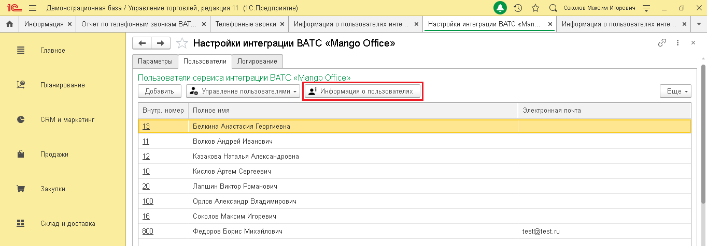
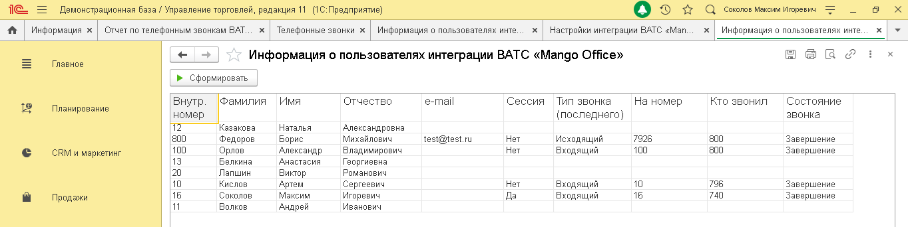
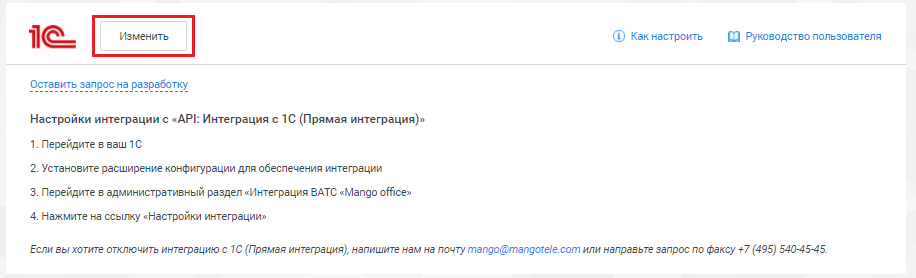
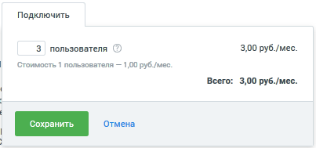
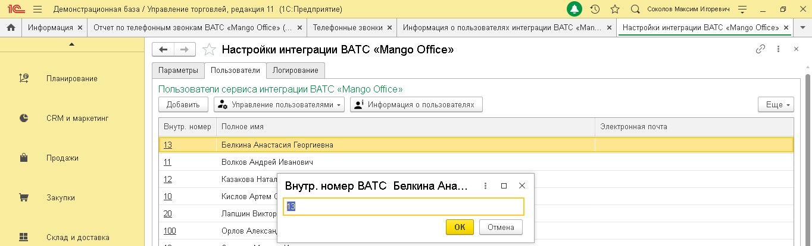
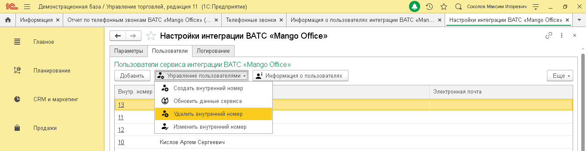
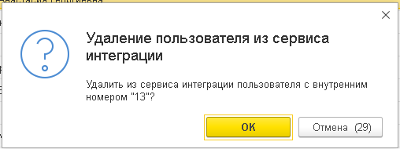

# 3.4. Управление пользователями интеграции 1С

> Трассировка: PDF §3.4 · сквозные стр. 25-29 · источники: ч.1 `kb/sources/integration_1c/Integratsiya_virtualnoy_ats_Pryamaya_integraciya_s_1C.pdf` с.25-29.

Информация о пользователях Чтобы открыть информацию о пользователях, нажмите на кнопку «Управление пользователями» на вкладке «Пользователи»:

> **Описание иллюстрации INT1C-§3.4-1** (к §3.4 «Управление пользователями интеграции 1С», стр. 25; 1364×476 px). Снимок экрана / схема.
> Относится к тексту руководства: «…лями интеграции 1С Информация о пользователях Чтобы открыть информацию о пользователях, нажмите на кнопку «Управление пользователями» на вкладке «Пользователи»:».
> Подпись в руководстве: «Рисунок 35».
> Текст на изображении (OCR, требует сверки): Демонстрационная база / Управление торговлей, редакция 11 (1С:Предприятие); © DQ cororoe Marcin nropesns; tf; Информация x; Отчет no телефонным звонкам ВАТ.; Настройки интеграции BATC «Мат.; Информация о пользователях инте.; Главное; Настройки интеграции ВАТС «Mango Office»; Параметры; Пользователи; `Логирование; Пользователи сервиса интеграции ВАТС «; ма!; Office»; Планирование; Добавить; 20 Управление пользователями =; Внутр. номер; Полное имя; Электронная почта; CRM и маркетинг; 13; Белкина Анастасия Георгиевна; Волков Андрей Иванович; Продажи; 12; Казакова Наталья Александровна; 10; Кислов…

Рисунок 35 Будет открыт список пользователей прямой интеграции с 1С. Вы можете сохранить список в

> **Описание иллюстрации INT1C-§3.4-2** (к §3.4 «Управление пользователями интеграции 1С», стр. 25; 143×29 px). Фрагмент интерфейса (кнопка, переключатель или поле).
> Относится к тексту руководства: «… кнопку «Управление пользователями» на вкладке «Пользователи»: Рисунок 35 Будет открыт список пользователей прямой интеграции с 1С. Вы можете сохранить список в».
> Подпись в руководстве: «Рисунок 36».
> Текста на изображении нет; назначение элемента — см. текст, к которому он относится.

файл или распечатать его, кнопки в правом верхнем углу списка:

> **Описание иллюстрации INT1C-§3.4-3** (к §3.4 «Управление пользователями интеграции 1С», стр. 25; 1364×342 px). Снимок экрана / схема.
> Относится к тексту руководства: «…Рисунок 35 Будет открыт список пользователей прямой интеграции с 1С. Вы можете сохранить список в файл или распечатать его, кнопки в правом верхнем углу списка:».
> Подпись в руководстве: «Рисунок 36».
> Текст на изображении (OCR, требует сверки): Демонстрационная база / Управление торговлей, редакция 11 (1С:Предприятие); tf; Информация x; Отчет no телефонным звонкам ВАТ.; Телефонные звонки х; Информация о пользователях инте.; Настройки интеграции BATC «Мат.; вес; Главное; Информация о пользователях интеграции ВАТС «Mango Office»; > Сформировать; Внутр.; Фамилия; Имя; Отчество; e-mail; Сессия Tun звонка; На номер; Кто звонил; Состояние; Планирование; номер; (последнего); звонка; 12; Казакова; Наталья; Александровна; 800; Федоров; Борис; Михайлович; test@test.ru; Her; Исходящий; 7926; Завершение; 100; Орлов; Александр; Владимирович; Нет;…

Рисунок 36 5Прямая интеграция с системой «1С: Управление торговлей» Редакция 11 (11.3 - 11.4, 11.5) | Версия от 22.12 .2025 Как добавить пользователя Управляйте количеством пользователей прямой интеграции 1С с Виртуальной АТС прямо из Личного кабинета MANGO OFFICE. Изменить количество пользователей интеграции можно в любое время. Чтобы изменить количество пользователей, выполните следующие действия: 1) откройте ваш Личный кабинет MANGO OFFICE; 2) перейдите в раздел «Интеграции»; 3) нажмите кнопку «Изменить» в блоке прямой интеграции с 1С:

> **Описание иллюстрации INT1C-§3.4-4** (к §3.4 «Управление пользователями интеграции 1С», стр. 26; 916×278 px). Снимок экрана / схема.
> Относится к тексту руководства: «…ледующие действия: 1) откройте ваш Личный кабинет MANGO OFFICE; 2) перейдите в раздел «Интеграции»; 3) нажмите кнопку «Изменить» в блоке прямой интеграции с 1С:».
> Подпись в руководстве: «Рисунок 37».
> Текст на изображении (OCR, требует сверки): @ Какнастроить.; 1 Руководство пользователя; Настройки интеграции с «API: Интеграция с 1С (Прямая интеграция)»; 1. Перейдите s sau 10; 2. Установите расширение конфигурации для обеслечения интеграции; 3. Перейдите в административный раздел «Интеграция ВАТС «Mango office»; 4. Нажмите на ссылку «Настройки интеграции»; Если вы хотите отключить интеграцию с 1C (Прямая интеграция) напишитенам на почту mengo@mangotele.com или направьте запрос по факсу +7 (495) 5404545.

Рисунок 37 4) укажите, сколько ваших сотрудников будут пользоваться интеграцией с 1С. Минимальное количество – 3 пользователя; 5) нажмите кнопку «Сохранить». Будет изменено количество пользователей прямой интеграции с 1С; 6) для новых пользователей интеграции нужно настроить сопоставление пользователей 1С и внутренних номеров Виртуальной АТС.

> **Описание иллюстрации INT1C-§3.4-5** (к §3.4 «Управление пользователями интеграции 1С», стр. 26; 403×189 px). Снимок экрана / схема.
> Относится к тексту руководства: «…пользователей прямой интеграции с 1С; 6) для новых пользователей интеграции нужно настроить сопоставление пользователей 1С и внутренних номеров Виртуальной АТС.».
> Подпись в руководстве: «Рисунок 38».
> Текст на изображении (OCR, требует сверки): Подключить; 3 пользователя ©); 3,00 руб./мес.; Стоимость 1 пользователя — 1,00 руб./мес.; Всего: 3,00 руб./мес.

Рисунок 38 5Прямая интеграция с системой «1С: Управление торговлей» Редакция 11 (11.3 - 11.4, 11.5) | Версия от 22.12 .2025 Как изменить внутрениий номер ВАТС Для того, чтобы изменить у пользователя 1С внутренний номер ВАТС, выполните следующие действия: 1) перейдите в ваш 1С; 2) перейдите в административный раздел «Интеграция ВАТС «Mango office»; 3) нажмите на ссылку «Настройки интеграции»; 4) перейдите на вкладку «Пользователи» в открывшейся форме «Настройки интеграции ВАТС «MANGO OFFICE»; 5) дважды кликните на ячейку «Внутр. Номер» в строке с данными сотрудника; 6) введите внутренний номер вашей Виртуальной АТС и нажмите кнопку «Ок» в открывшейся форме:

> **Описание иллюстрации INT1C-§3.4-6** (к §3.4 «Управление пользователями интеграции 1С», стр. 27; 1364×415 px). Снимок экрана / схема.
> Относится к тексту руководства: «…ды кликните на ячейку «Внутр. Номер» в строке с данными сотрудника; 6) введите внутренний номер вашей Виртуальной АТС и нажмите кнопку «Ок» в открывшейся форме:».
> Подпись в руководстве: «Рисунок 39».
> Текст на изображении (OCR, требует сверки): Демонстрационная база / Управление торговлей, редакция 11 (1С:Предприятие); Оз т с comonoe Marcon nropesis; tf; Информация x; Отчет no телефонным звонкам BATC «Mango Offices (; Телефонные звенки x | Информация о пользователях интеграции ВАТС «Man... x | Настройки интеграции BATC «Mango Offices x | +; Настройки интеграции ВАТС «Mango Office»; Параметры; Пользователи; `Логирование; Планирование; Пользователи сервиса интеграции ВАТС «Mango Отсе»; Добавить; #6 Управление пользователями ~; Информация о пользователях; CRM и маркетинг; Внутр. номер; Полное имя; 13; Белкина Анастасия Георгиевна; Прода…

Рисунок 39 5Прямая интеграция с системой «1С: Управление торговлей» Редакция 11 (11.3 - 11.4, 11.5) | Версия от 22.12 .2025 Удаление внутреннего номера Чтобы удалить внутренний номер у пользователя прямой интеграции с 1С, выполните следующие действия: 1) нажмите на кнопку «Управление пользователями» на вкладке «Пользователи»; 2) выберите пункт «Удалить внутренний номер»:

> **Описание иллюстрации INT1C-§3.4-7** (к §3.4 «Управление пользователями интеграции 1С», стр. 28; 1364×352 px). Снимок экрана / схема.
> Относится к тексту руководства: «…ии с 1С, выполните следующие действия: 1) нажмите на кнопку «Управление пользователями» на вкладке «Пользователи»; 2) выберите пункт «Удалить внутренний номер»:».
> Подпись в руководстве: «Рисунок 40».
> Текст на изображении (OCR, требует сверки): Демонстрационная база / Управление торговлей, редакция 11 (1С:Предприятие); © DQ coronoe Marcin nropesns; Fr | Информация x | Отчет по телефонным звонкам BATC «Mango Offices (.. x | Телефонные звонки x | Информация о пользователях интеграции ВАТС «Man... x | Настройки интеграции BATC «Mango Offices x | +; va; Настройки интеграции BATC «Mango Office»; Главное; Пользователи; Параметры; `Логирование; Пользователи сервиса интеграции ВАТС «Mango Officer; Планирование; Добавить; Информация о пользователях; Управление пользователями = |; © Создать внутренний номер; Внутр. номер; CRM и маркетинг; © Об…

Рисунок 40 3) нажмите кнопку «Ок»:

> **Описание иллюстрации INT1C-§3.4-8** (к §3.4 «Управление пользователями интеграции 1С», стр. 28; 508×190 px). Снимок экрана / схема.
> Относится к тексту руководства: «…ия: 1) нажмите на кнопку «Управление пользователями» на вкладке «Пользователи»; 2) выберите пункт «Удалить внутренний номер»: Рисунок 40 3) нажмите кнопку «Ок»:».
> Подпись в руководстве: «Рисунок 41».
> Текст на изображении (OCR, требует сверки): Удаление пользователя из сервиса; интеграции; Удалить из сервиса интеграции пользователя с внутренним; номером "13"?; Отмена (29)

Рисунок 41 5Прямая интеграция с системой «1С: Управление торговлей» Редакция 11 (11.3 - 11.4, 11.5) | Версия от 22.12 .2025
