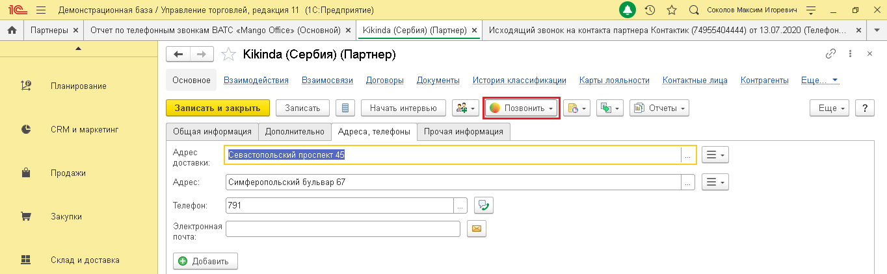
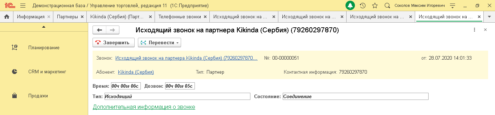

# 5.1. Звонок по клику

> Трассировка: PDF §5.1 · сквозные стр. 30-31 · источники: ч.1 `kb/sources/integration_1c/Integratsiya_virtualnoy_ats_Pryamaya_integraciya_s_1C.pdf` с.30-31.

Вы можете инициировать исходящий звонок из следующих элементов 1С: - карточка партнера; - карточка контактного лица; - список контактных лиц партнеров; - список партнеров; - список физических лиц; - карточка физического лица; - список контрагентов; - карточка контрагента; - документа «Телефонный звонок»; - список документов «Телефонный звонок».

> **Описание иллюстрации INT1C-§5.1-1** (к §5.1 «Звонок по клику», стр. 30; 114×31 px). Фрагмент интерфейса (кнопка, переключатель или поле).
> Относится к тексту руководства: «…еских лиц; - карточка физического лица; - список контрагентов; - карточка контрагента; - документа «Телефонный звонок»; - список документов «Телефонный звонок».».
> Текста на изображении нет; назначение элемента — см. текст, к которому он относится.

При нажатии на кнопку , сначала зазвонит ваш рабочий телефон, и только после того как вы поднимете трубку – начнется звонок на выбранный номер телефона:

> **Описание иллюстрации INT1C-§5.1-2** (к §5.1 «Звонок по клику», стр. 30; 1364×422 px). Снимок экрана / схема.
> Относится к тексту руководства: «…вонок». При нажатии на кнопку , сначала зазвонит ваш рабочий телефон, и только после того как вы поднимете трубку – начнется звонок на выбранный номер телефона:».
> Подпись в руководстве: «Рисунок 43».
> Текст на изображении (OCR, требует сверки): Демонстрационная база / Управление торговлей, редакция 11 (1С:Предприятие); Оз т с comonoe Marcin nropesns; ® | Партнеры х | Отчет по телефонным звонкам ВАТС «Mango Offices (Основной) x | Kikinda (Сербия) (Партнер) x | Исходящий звонок на контакта партнера Контактик (74955404444) от 13.07.2020 (Телефон. | +; 74; Kikinda (Сербия) (Партнер); ‘Основное; Взаимодействия; Вазимосвязи; Договоры; Документы; История классификации; Карты лояльности; Контактные лица; Контрагенты; Еще; Планирование; Еще -; CRM и маркетинг; Общая информация; Дополнительно; Адреса, телефоны; Прочая информация; Адрес; Се; on…

Рисунок 43 После того, как Клиент примет входящий звонок, в интерфейсе 1С будет показана карточка звонка, в которой будет показана информация о звонке. Чтобы завершить звонок, нужно

> **Описание иллюстрации INT1C-§5.1-3** (к §5.1 «Звонок по клику», стр. 30; 119×29 px). Фрагмент интерфейса (кнопка, переключатель или поле).
> Относится к тексту руководства: «…, как Клиент примет входящий звонок, в интерфейсе 1С будет показана карточка звонка, в которой будет показана информация о звонке. Чтобы завершить звонок, нужно».
> Текста на изображении нет; назначение элемента — см. текст, к которому он относится.

положить трубку рабочего телефона или нажать кнопку в карточке звонка: 5Прямая интеграция с системой «1С: Управление торговлей» Редакция 11 (11.3 - 11.4, 11.5) | Версия от 22.12 .2025

> **Описание иллюстрации INT1C-§5.1-4** (к §5.1 «Звонок по клику», стр. 31; 1364×320 px). Снимок экрана / схема.
> Относится к тексту руководства: «….2025».
> Подпись в руководстве: «Рисунок 44».
> Текст на изображении (OCR, требует сверки): те; Демонстрационная база / Управление торговлей, редакция 11 (1С:Предприятие); © DQ comonoe Marcin nope; Телефонные звонки х; Исходящий звонок на; Информация | Партнеры «| Kikinda (Сербия) (Парт. x; Исходящий звонок на «| Исходящий звонок на; va; Исходящий звонок Ha партнера Kikinda (Сербия) (79260297870); <? Завершить; {< Перевести -; Планирование; Звонок; Исходящий звонок на партнера Kikinda (Сербия) (79260297870.; №: 00-00000051; ov; 28.07.2020 14:01:33; CRM и маркетинг; Абонент; Kikinda (Сербия); Тип: Партнер; Контактная информация: 79260297870; Врен;; Продажи; Тип: Исходящий; Состояние: …

Рисунок 44

> **Описание иллюстрации INT1C-§5.1-5** (к §5.1 «Звонок по клику», стр. 31; 32×29 px). Пиктограмма (значок элемента интерфейса).
> Относится к тексту руководства: «….2025 Рисунок 44».
> Подпись в руководстве: «Рисунок 44».
> Текста на изображении нет; назначение элемента — см. текст, к которому он относится.

Примечание. Вы можете настроить стандартную кнопку вызова так, чтобы она инициировала исходящий звонок. Для этого нужно настроить конфигурацию модуля "УправлениеКонтактнойИнформациейКлиент".
