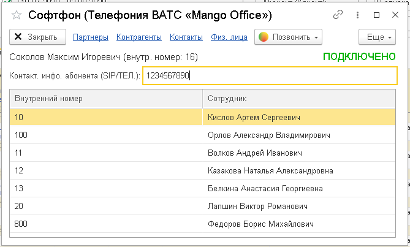

# 5.2. Софтфон

> Трассировка: PDF §5.2 · сквозные стр. 31-32 · источники: ч.1 `kb/sources/integration_1c/Integratsiya_virtualnoy_ats_Pryamaya_integraciya_s_1C.pdf` с.31-32.

Это встроенная функция прямой интеграции с 1С, при помощи которой вы можете набрать номер телефона и выполнить исходящий звонок Клиенту или сотруднику. Важно! Софтфон предназначен только для набора номера и поиска контактов в интерфейсе 1С. Чтобы слышать и разговаривать с собеседником используйте ваш рабочий SIP-телефон или бесплатный коммуникатор MANGO OFFICE. Чтобы позвонить при помощи софтфона, выполните следующие действия: 1) перейдите в раздел «Интеграция ВАТС «Mango office»; 2) нажмите на ссылку «Софтфон»; 3) введите номер телефона, на который нужно позвонить или выберите сотрудника, которому нужно позвонить;

> **Описание иллюстрации INT1C-§5.2-1** (к §5.2 «Софтфон», стр. 31; 114×31 px). Фрагмент интерфейса (кнопка, переключатель или поле).
> Относится к тексту руководства: «…ия ВАТС «Mango office»; 2) нажмите на ссылку «Софтфон»; 3) введите номер телефона, на который нужно позвонить или выберите сотрудника, которому нужно позвонить;».
> Текста на изображении нет; назначение элемента — см. текст, к которому он относится.

4) нажмите кнопку . При нажатии этой кнопки, сначала зазвонит ваш рабочий телефон, и только после того как вы поднимете трубку – начнется звонок на выбранный номер телефона:

> **Описание иллюстрации INT1C-§5.2-2** (к §5.2 «Софтфон», стр. 31; 669×403 px). Снимок экрана / схема.
> Относится к тексту руководства: «…опку . При нажатии этой кнопки, сначала зазвонит ваш рабочий телефон, и только после того как вы поднимете трубку – начнется звонок на выбранный номер телефона:».
> Подпись в руководстве: «Рисунок 45».
> Текст на изображении (OCR, требует сверки): АА.; At; ft; Софтфон (Телефония BATC «Mango Office»); oO x; Х Закрыть; Партнеры Контрагенты Контакты Физ. лица | © Позвонить ~; Еще ~; Соколов Максим Игоревич (внутр. номер: 16); ПОДКЛЮЧЕНО; Контакт. инфо. абонента вел) 1265794 sd; Внутренний номер; Сотрудник; 2 ЮАмоныя; 100; Орлов Александр Владимирович; 11; Волков Андрей Иванович; 12; Казакова Наталья Александровна; 13; Белкина Анастасия Георгиевна; 20; Лапшин Виктор Романович; 800; Федоров Борис Михайлович

Рисунок 45 5Прямая интеграция с системой «1С: Управление торговлей» Редакция 11 (11.3 - 11.4, 11.5) | Версия от 22.12 .2025
