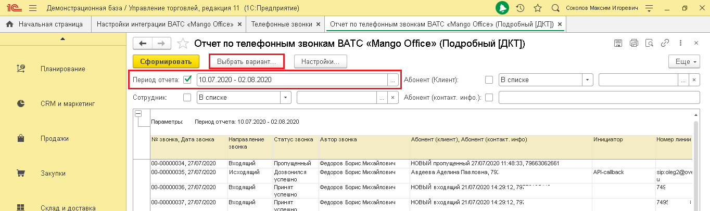
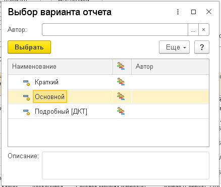
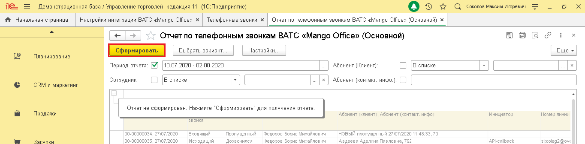
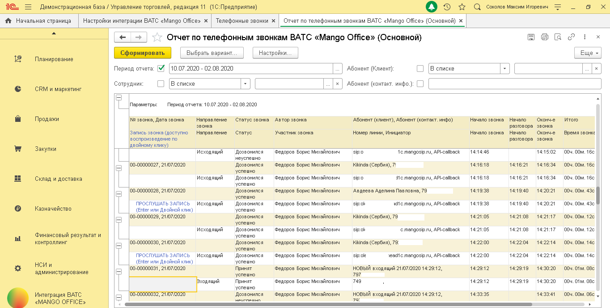
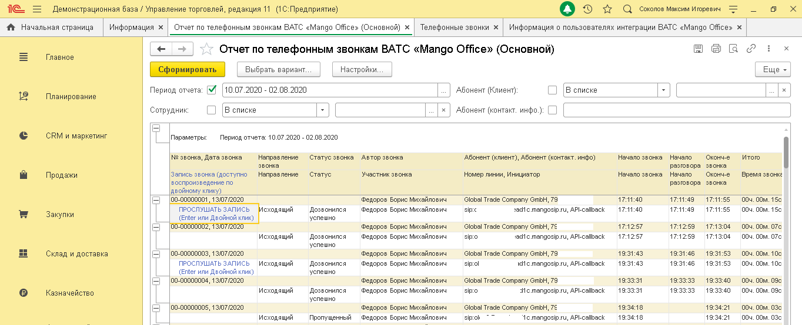
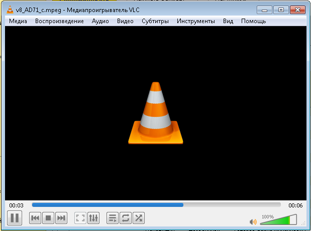

# 6.1. Отчет по телефонным звонкам ВАТС

> Трассировка: PDF §6.1 · сквозные стр. 32-36 · источники: ч.1 `kb/sources/integration_1c/Integratsiya_virtualnoy_ats_Pryamaya_integraciya_s_1C.pdf` с.32-36.

Это отчет в 1С, который отражает количество звонков, совершенных через вашу Виртуальную АТС «Mango office». Вы выбираете период и вариант отчета: краткий, основной, подробный (ДКТ). Как открыть отчет Для того, чтобы открыть отчет, выполните следующие действия: 1) перейдите в раздел «Интеграция ВАТС «Mango office»; 2) нажмите на ссылку «Отчет по телефонным звонкам»; 3) активируйте переключатель «Период отчета», затем выберите даты отчета; 4) нажмите кнопку «Выбрать вариант…»:

> **Описание иллюстрации INT1C-§6.1-1** (к §6.1 «Отчет по телефонным звонкам ВАТС», стр. 32; 1364×406 px). Снимок экрана / схема.
> Относится к тексту руководства: «…нажмите на ссылку «Отчет по телефонным звонкам»; 3) активируйте переключатель «Период отчета», затем выберите даты отчета; 4) нажмите кнопку «Выбрать вариант…»:».
> Подпись в руководстве: «Рисунок 46».
> Текст на изображении (OCR, требует сверки): те; Демонстрационная база / Управление торговлей, редакция 11 (1С:Предприятие); Оз х с comonoe Marcin nropesis; ft Начальная страница; Настройки интеграции BATC «Mango Offices x; Телефонные звонки х; Отчет по телефонным звонкам BATC «Mango Offices (Подробный [KT] x; Отчет по телефонным звонкам ВАТС «Mango Office» (Подробный [ДКТ]); вес; Сформировать,; Настройки; Еще -; Планирование; В списке; Сотрудник; Абонент (контакт. инфо.; CRM и маркетинг; Параметры:; Период отчета: 10.07.2020 - 02.08.2020; Продажи; Ne звонка, Дата звонка; Направление; Статус звонка; Автор звонка; ‘Абонент (клиент), Абоне…

Рисунок 46 5) выберите вариант отчета; 6) нажмите кнопку «Выбрать»:

> **Описание иллюстрации INT1C-§6.1-2** (к §6.1 «Отчет по телефонным звонкам ВАТС», стр. 32; 438×370 px). Снимок экрана / схема.
> Относится к тексту руководства: «…ключатель «Период отчета», затем выберите даты отчета; 4) нажмите кнопку «Выбрать вариант…»: Рисунок 46 5) выберите вариант отчета; 6) нажмите кнопку «Выбрать»:».
> Текст на изображении (OCR, требует сверки): oO xX; Выбор варианта отчета; Автор:; [выбрать _; Наименование; Автор; Краткий; [Основной]; Подробный [ДКТ]; Описание:

5Прямая интеграция с системой «1С: Управление торговлей» Редакция 11 (11.3 - 11.4, 11.5) | Версия от 22.12 .2025 Рисунок 47 7) нажмите кнопку «Сформировать»:

> **Описание иллюстрации INT1C-§6.1-3** (к §6.1 «Отчет по телефонным звонкам ВАТС», стр. 33; 1364×338 px). Снимок экрана / схема.
> Относится к тексту руководства: «….2025 Рисунок 47 7) нажмите кнопку «Сформировать»:».
> Подпись в руководстве: «Рисунок 48».
> Текст на изображении (OCR, требует сверки): Демонстрационная база / Управление торговлей, редакция 11 (1С:Предприятие); Оз т с comonoe marca nropesis; fr Начальная страница | Настройки интеграции BATC «Mango Offices x | Телефонные звонки x | Отчет по телефонным звонкам ВАТС «Мапдо Offices (Основной) x |; Отчет по телефонным звонкам BATC «Mango Office» (Основной); вес; OQ; Настройки; Еще -; Планирование; Период отчета: МИ [10.07.2020 - 02.08.2020; } Абонент (Клиент); О [В списке; ail; Сотрудник; Абонент (контакт. инфо. 0] [; CRM и маркетинг; Продажи; Orser He сфорнирован. Hexmure "Сформировать" для получения отчета | ‘Абонент (клиент), А…

Рисунок 48 Будет выведен на экран отчет по телефонным звонкам ВАТС выбранного варианта:

> **Описание иллюстрации INT1C-§6.1-4** (к §6.1 «Отчет по телефонным звонкам ВАТС», стр. 33; 1364×690 px). Снимок экрана / схема.
> Относится к тексту руководства: «….2025 Рисунок 47 7) нажмите кнопку «Сформировать»: Рисунок 48 Будет выведен на экран отчет по телефонным звонкам ВАТС выбранного варианта:».
> Подпись в руководстве: «Рисунок 49».
> Текст на изображении (OCR, требует сверки): Демонстрационная база / Управление торговлей, редакция 11 (1С:Предприятие); Оз т с comonoe marca nropesis; ft Ночальная страница | Настройки интеграции BATC <Mango Offices x | Телефонные звонки x | Отчет по телефонным звонкам ВАТС «Мапдо Offices (Основной) x |; Отчет по телефонным звонкам BATC «Mango Office» (Основной); вес; OQ; Выбрать вариант,; Настройки; Еще -; Планирование; Сформировать |; Период отчета: МИ [10.07.2020 - 02.08.2020; } Абонент (Клиент); С [Вслиске; Jl; Сотрудник; | [В списке; ail; x | Абонент (контакт. инфо.; of; CRM и маркетинг; Параметры:; Период отчета: 10.07.2020 - 02.0…

Рисунок 49 Описание параметров отчета Отчет по телефонным звонкам состоит из следующих параметров:

| Параметр отчета | Пояснение | Варианты отчета |  |  |
| --- | --- | --- | --- | --- |
|  |  | Краткий | Основной | Подробный |
| № звонка, Дата звонка | Номер звонящего (если звонок входящий) или номер, на который звонил сотрудник (исходящий звонок), а также дата начала звонка. | + | + | + |
| Запись звонка | Ссылка на запись разговора. Опционально | - | + | - |
| Направление звонка | Направление вызова. Возможные значения: внутренний, исходящий, входящий | + | + | + |
| Статус звонка | Возможные значения: | + | + | + |

5Прямая интеграция с системой «1С: Управление торговлей» Редакция 11 (11.3 - 11.4, 11.5) | Версия от 22.12 .2025

| Параметр отчета | Пояснение | Варианты отчета |  |  |
| --- | --- | --- | --- | --- |
|  |  | Краткий | Основной | Подробный |
|  | - Пропущенный: входящий звонок был пропущен; - Принят успешно: входящий звонок, длительность которого строго больше N сек; - Принят не успешно: входящий звонок, длительность которого меньше или равно N сек; - Дозвонился успешно: исходящий звонок, длительность которого строго больше M сек; - Дозвонился не успешно: исходящий звонок, длительность которого меньше или равно M сек; - Переведен: звонок переведен |  |  |  |
| Автор звонка | Сотрудник, принявший звонок при входящем. Сотрудник, совершивший звонок при исходящем. Примечание. Под сотрудником нужно понимать пользователя 1С | + | + | + |
| Участник звонка | Кто принял вызов. Опционально | - | + | - |
| Абонент | Имя Клиента, если звонок привязан к Клиенту или имя контакта, если звонок привязан к контакту, нет ни одного Клиента, связанного с контактом | + | + | + |
| Инициатор | Инициатор звонка | + | + | + |
| Номер линии | DID-номер, на который звонил Клиент или SIP-адрес линии, на который звонил Клиент (в том числе для звонка с сайта) при входящем. Номер, через который звонил сотрудник при исходящем звонке | + | + | + |
| Начало звонка | Время начала звонка. | + | + | + |
| Начало разговора | Время начала разговора. | + | + | + |
| Окончание звонка | Время окончания звонка | + | + | + |
| Время звонка | Суммарная длительность звонка, от начала звонка до его завершения. | + | + | + |
| Время разговора | Суммарное время разговоров, либо 0, если разговора не было | + | + | + |

5Прямая интеграция с системой «1С: Управление торговлей» Редакция 11 (11.3 - 11.4, 11.5) | Версия от 22.12 .2025

| Параметр отчета | Пояснение | Варианты отчета |  |  |
| --- | --- | --- | --- | --- |
|  |  | Краткий | Основной | Подробный |
| Данные ДКТ | Данные коллтрекинга о посещении вашего сайта | - | - | + |

Воспроизведение записи разговора Чтобы прослушать запись разговора, в основном или подробном отчете по звонкам ВАТС дважды кликните по ссылке «Прослушать запись». Примечание. Если ссылка на запись разговора отсутствует, то значит разговор не состоялся либо не велась запись разговора по той или иной причине.

> **Описание иллюстрации INT1C-§6.1-5** (к §6.1 «Отчет по телефонным звонкам ВАТС», стр. 35; 1364×554 px). Снимок экрана / схема.
> Относится к тексту руководства: «…ушать запись». Примечание. Если ссылка на запись разговора отсутствует, то значит разговор не состоялся либо не велась запись разговора по той или иной причине.».
> Подпись в руководстве: «Рисунок 50».
> Текст на изображении (OCR, требует сверки): те; Демонстрационная база / Управление торговлей, редакция 11 (1С:Предприятие); Оз т с comonoe Marcin nropesns; ft Начальная страница; Информация х; Отчет по телефонным звонкам BATC «Мапдо Offices (Основной) x; Телефонные звонки х; Информация о пользователях интеграции ВАТС «Mango Offices x; Ber?; Главное; Отчет по телефонным звонкам BATC «Mango Office» (Основной); | сформировать |; Выбрать вариант,; Настройки; Еще -; В списке; Период отчета: [М |10.07.2020 - 02.08.2020; Абонент (Клиент); Планирование; Сотрудник; Абонент (контакт. инфо.; CRM и маркетинг; Параметры:; Период отчета: 10.07.2020 -…

Рисунок 50 Начнется воспроизведение выбранной вами записи. Примечание. Воспроизведение записи разговора выполняется на медиапеере, ранее установленном на вашем ПК.

> **Описание иллюстрации INT1C-§6.1-6** (к §6.1 «Отчет по телефонным звонкам ВАТС», стр. 35; 619×460 px). Снимок экрана / схема.
> Относится к тексту руководства: «…унок 50 Начнется воспроизведение выбранной вами записи. Примечание. Воспроизведение записи разговора выполняется на медиапеере, ранее установленном на вашем ПК.».
> Подпись в руководстве: «Рисунок 51».
> Текст на изображении (OCR, требует сверки): AL.; стр; едиапро; грывате;; диз; 30; cnp; едение; ‘AMO; Видео; бтитры; Инстр; HTbI; Вид Помощь; il; Ia; tt

Рисунок 51 5Прямая интеграция с системой «1С: Управление торговлей» Редакция 11 (11.3 - 11.4, 11.5) | Версия от 22.12 .2025
