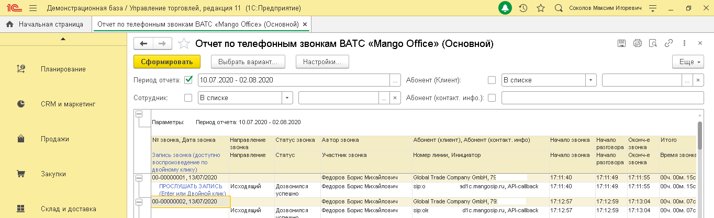
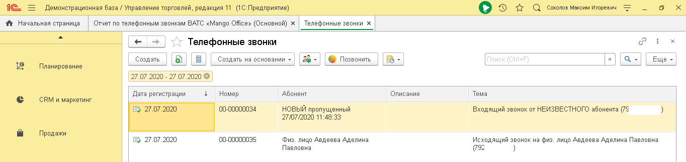
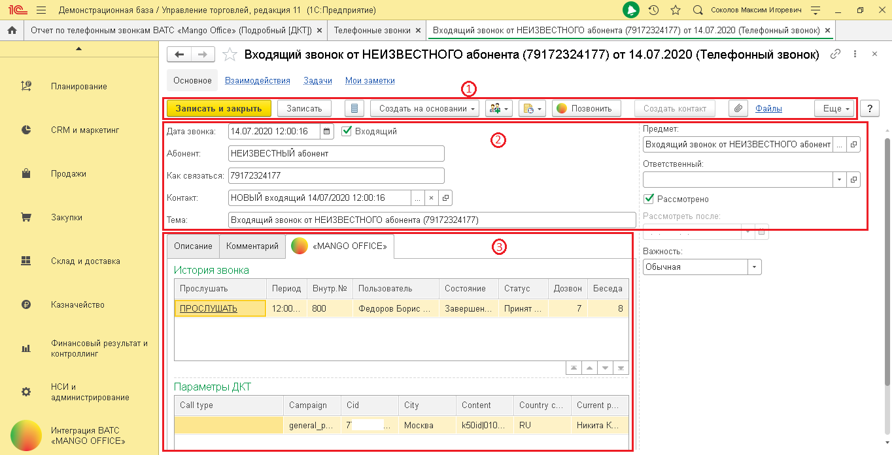
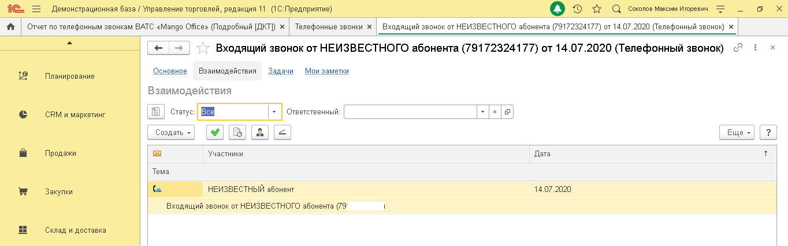

# 6.2. Карточка звонка

> Трассировка: PDF §6.2 · сквозные стр. 36-38 · источники: ч.1 `kb/sources/integration_1c/Integratsiya_virtualnoy_ats_Pryamaya_integraciya_s_1C.pdf` с.36-38.

Общие сведения Для каждого звонка в 1С автоматически создается отдельная карточка, в которой сохраняются подробные сведения о звонке, например, номер телефона, ФИО ответственного сотрудника и т.д. Вы можете в карточке звонка прослушать запись разговора, посмотреть данные коллтрекинга, прикрепить файл к карточке и многое другое. Информация в карточке звонка обновляется автоматически и вы сможете узнать, последние актуальные сведения. Как открыть отчет Чтобы открыть карточку звонка, дважды кликните по номеру звонка в отчете по звонкам ВАТС:

> **Описание иллюстрации INT1C-§6.2-1** (к §6.2 «Карточка звонка», стр. 36; 1364×418 px). Снимок экрана / схема.
> Относится к тексту руководства: «… и вы сможете узнать, последние актуальные сведения. Как открыть отчет Чтобы открыть карточку звонка, дважды кликните по номеру звонка в отчете по звонкам ВАТС:».
> Подпись в руководстве: «Рисунок 52».
> Текст на изображении (OCR, требует сверки): те; Демонстрационная база / Управление торговлей, редакция 11 (1С:Предприятие); Оз т с comonoe Marcin nropesns; ЧА Ночальная страница | Отчет по телефонным звонкам ВАТС «Mango Offices (Основной) x |; Отчет по телефонным звонкам BATC «Mango Office» (Основной); вес; OQ; Сформировать |; Выбрать вариант,; Настройки; Еще -; Планирование; Период отчета: МИ [10.07.2020 - 02.08.2020; } Абонент (Клиент); С Всписке; Сотрудник; | [В списке; ail; Абонент (контакт. инфо.): [|; CRM и маркетинг; LI; Параметры:; Период отчета: 10.07.2020 - 02.08.2020; Продажи; Ne звонка, Дата звонка; Направление; Статус звонк…

Рисунок 52 или в отчете «Телефонные звонки»:

> **Описание иллюстрации INT1C-§6.2-2** (к §6.2 «Карточка звонка», стр. 36; 1364×324 px). Снимок экрана / схема.
> Относится к тексту руководства: «…едения. Как открыть отчет Чтобы открыть карточку звонка, дважды кликните по номеру звонка в отчете по звонкам ВАТС: Рисунок 52 или в отчете «Телефонные звонки»:».
> Подпись в руководстве: «Рисунок 53».
> Текст на изображении (OCR, требует сверки): Демонстрационная база / Управление торговлей, редакция 11 (1С:Предприятие); © > 2 Q comonoe marca nropesis; ft Начальная страница; Отчет no телефонным звонкам ВАТС «Mango Offices (Основной) x; Телефонные звонки x; OQ; Телефонные звонки; Создать; я в; Создать на основании ~; © Позвонить; Be; Еще -; Планирование; 27.07.2020 - 27.07.2020 ©; ‘Абонент; Описание; Тема; CRM и маркетинг; Дата регистрации; Номер; © 27.07.2020; 100-00000034; НОВЫЙ пропущенный; Входящий звонок от НЕИЗВЕСТНОГО абонента (75; 27/07/2020 11:48:33; Продажи; (00-00000035; Физ. лицо Авдеева Аделина; Исходящий звонок на физ. лиц…

Рисунок 53 В карточке звонка информация собрана на нескольких вкладках: 5Прямая интеграция с системой «1С: Управление торговлей» Редакция 11 (11.3 - 11.4, 11.5) | Версия от 22.12 .2025 - Основное; - Взаимодействие; - Задачи; - Мои заметки. На вкладке «Основное» отображаются основные сведения о звонке: 1) панель с элементами управления; 2) параметры звонка; 3) дополнительные вкладки: - Описание: внесите дополнительные сведения о звонке, при необходимости; - Комментарий: добавьте комментарий, при необходимости; - MANGO OFFICE: содержит 2 таблицы а) История звонка: запись разговора и информация звонке; б) Параметры ДКТ: данные коллтрекинга о посещении вашего сайта. Доступны, если в ВАТС подключен Коллтрекинг:

> **Описание иллюстрации INT1C-§6.2-3** (к §6.2 «Карточка звонка», стр. 37; 1364×698 px). Снимок экрана / схема.
> Относится к тексту руководства: «…тория звонка: запись разговора и информация звонке; б) Параметры ДКТ: данные коллтрекинга о посещении вашего сайта. Доступны, если в ВАТС подключен Коллтрекинг:».
> Подпись в руководстве: «Рисунок 54».
> Текст на изображении (OCR, требует сверки): те; Демонстрационная база / Управление торговлей, редакция 11 (1С:Предприятие); Оз лс comonoe marci nropesis; fr | Отчет по телефонным звонкам BATC «Mango Offices (Подробный (OKT) x | Телефонные звонки х | Входящий звонок от НЕИЗВЕСТНОГО абонента (79172324177) от 14.07.2020 (Телефонный 380H0K) x |; Входящий звонок от НЕИЗВЕСТНОГО абонента (79172324177) от 14.07.2020 (Телефонный звоною <; ‘Основное; Взаимодействия; Задачи; Мои заметки; Планирование; Записать и закрыть; Записать; Создать на основании -; Be; © Позвонить; Создать контакт; Еще -; Ф | Файлы; CRM и маркетинг; Дата звонка:; РЖИ; М вхо…

Рисунок 54 Взаимодействие – это контакты с Клиентом по различным каналам: телефон, смс, и т.д. На данной вкладке показана история контактов с Клиентом, зафиксированная в 1С: 5Прямая интеграция с системой «1С: Управление торговлей» Редакция 11 (11.3 - 11.4, 11.5) | Версия от 22.12 .2025

> **Описание иллюстрации INT1C-§6.2-4** (к §6.2 «Карточка звонка», стр. 38; 1364×428 px). Снимок экрана / схема.
> Относится к тексту руководства: «….2025».
> Подпись в руководстве: «Рисунок 55».
> Текст на изображении (OCR, требует сверки): Демонстрационная база / Управление торговлей, редакция 11 (1С:Предприятие); Оз т с coronoe Marcin nropesis; Ч | Отчет по телефонным звонкам ВАТС «Mango Offices (Подробный (OKT) x; Телефонные звонки х; Входящий звонок от НЕИЗВЕСТНОГО абонента (79172324177) от 14.07.2020 (Телефонный звоною_х; Входящий звонок от НЕИЗВЕСТНОГО абонента (79172324177) от 14.07.2020 (Телефонный звоною <; Основное; Мои заметки; Планирование; Взаимодействия; Задачи; CRM и маркетинг; Статус:; Ответственный:; Создать >; СВЕ:; Еще -; Участники; Продажи; Дата; Тема; to; НЕИЗВЕСТНЫЙ абонент; 14.07.2020; Закупки; Входящий зво…

Рисунок 55
