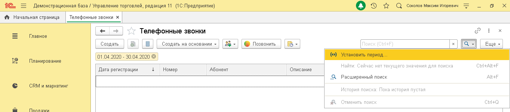
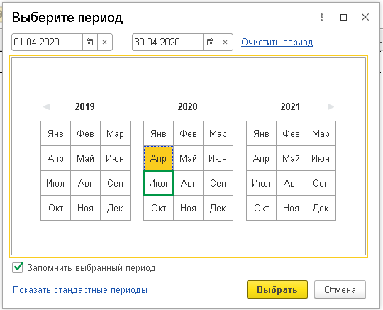
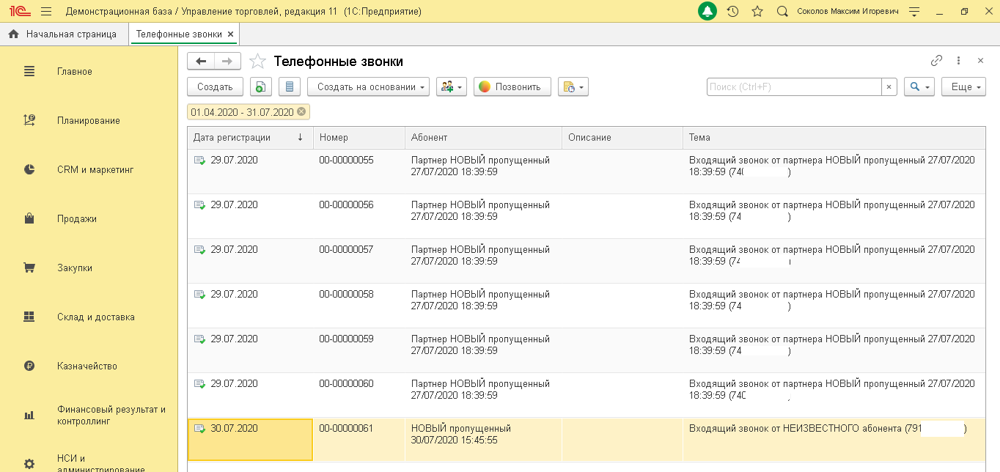

# 6.3. Отчет «Телефонные звонки»

> Трассировка: PDF §6.3 · сквозные стр. 38-40 · источники: ч.1 `kb/sources/integration_1c/Integratsiya_virtualnoy_ats_Pryamaya_integraciya_s_1C.pdf` с.38-40.

Отчет «Телефонные звонки» позволяет получить информацию о звонках пользователей через ВАТС MANGO OFFICE. В нем доступны следующие показатели: - дата регистрации звонка: - номер; - информация об абоненте или новом Клиенте; - описание, указанное в карточке Клиента; - тема. Чтобы открыть отчет в 1С, выполните: 1) перейдите в раздел «Интеграция ВАТС «Mango office»; 2) нажмите на ссылку «Телефонные звонки»; 3) нажмите кнопку, затем выберите пункт «Установить период»:

> **Описание иллюстрации INT1C-§6.3-1** (к §6.3 «Отчет «Телефонные звонки»», стр. 38; 1364×302 px). Снимок экрана / схема.
> Относится к тексту руководства: «…е: 1) перейдите в раздел «Интеграция ВАТС «Mango office»; 2) нажмите на ссылку «Телефонные звонки»; 3) нажмите кнопку, затем выберите пункт «Установить период»:».
> Подпись в руководстве: «Рисунок 56».
> Текст на изображении (OCR, требует сверки): Демонстрационная база / Управление торговлей, редакция 11 (1С:Предприятие); Оу т с Comoros Marcin nropesns; ft Начальная страница | Телефонные звонки х |; va; Телефонные звонки; Главное; Создать; Создать на основании ~; © Позвонить; 01.04.2020 - 30.04.2020 ©; Установить период; Планирование; ИНАЧЕ; ‘Абонент; Описание; Найти: Сейчас нет текущего значения для поиска; Дата регистрации; Номер; Расширенный поиск; АННЕ; CRM и маркетинг; История поиска: Пока история пустая; ях; Отменить поиск; crea.; Tenneawn

Рисунок 56 4) введите период отчета и нажмите кнопку «Выбрать»: 5Прямая интеграция с системой «1С: Управление торговлей» Редакция 11 (11.3 - 11.4, 11.5) | Версия от 22.12 .2025

> **Описание иллюстрации INT1C-§6.3-2** (к §6.3 «Отчет «Телефонные звонки»», стр. 39; 540×437 px). Снимок экрана / схема.
> Относится к тексту руководства: «….2025».
> Подпись в руководстве: «Рисунок 57».
> Текст на изображении (OCR, требует сверки): oO x; | Выберите период; 01.04.2020; Очистить период.; 2019; 2020; 2021; Янв; Фев; Мар; Апр; Май; Июн; Июл; Авг; Сен; Ок; Ноя; Дек; М Запомнить выбранный период; Показать стандартные периоды; [Выбрать | Отмена

Рисунок 57 На экране будет показан отчет за выбранный период:

> **Описание иллюстрации INT1C-§6.3-3** (к §6.3 «Отчет «Телефонные звонки»», стр. 39; 1364×644 px). Снимок экрана / схема.
> Относится к тексту руководства: «….2025 Рисунок 57 На экране будет показан отчет за выбранный период:».
> Подпись в руководстве: «Рисунок 58».
> Текст на изображении (OCR, требует сверки): Демонстрационная база / Управление торговлей, редакция 11 (1С:Предприятие); Оз т с comonoe Marcin nropesns; ft Начальная страница; Телефонные звонки x; Телефонные звонки; OQ; Главное; Создать; я в; Создать на основании ~; © Позвонить; Be; Еще -; 01.04.2020 - 31.07.2020; Планирование; Дата регистрации; Номер; ‘Абонент; Описание; Тема; 1 29.07.2020; 100-00000055; Партнер НОВЫЙ пропущенный; Входящий звонок от партнера НОВЫЙ пропущенный 27/07/2020; CRM и маркетинг; 27/07/2020 18:39:59; 18:39:59 (741; © 29.07.2020; 100-00000056; Продажи; 27/07/2020 18:39:69; 18:38:59 (74; (00-00000057; 18:39:59 (72…

Рисунок 58 Чтобы перезвонить по номеру, указанному в отчете, кликните по номеру, затем нажмите кнопку

> **Описание иллюстрации INT1C-§6.3-4** (к §6.3 «Отчет «Телефонные звонки»», стр. 39; 109×30 px). Фрагмент интерфейса (кнопка, переключатель или поле).
> Относится к тексту руководства: «…унок 57 На экране будет показан отчет за выбранный период: Рисунок 58 Чтобы перезвонить по номеру, указанному в отчете, кликните по номеру, затем нажмите кнопку».
> Текст на изображении (OCR, требует сверки): Позвонить

. Чтобы открыть карточку звонка для просмотра более подробных сведений – дважды кликните по номеру. 5Прямая интеграция с системой «1С: Управление торговлей» Редакция 11 (11.3 - 11.4, 11.5) | Версия от 22.12 .2025
