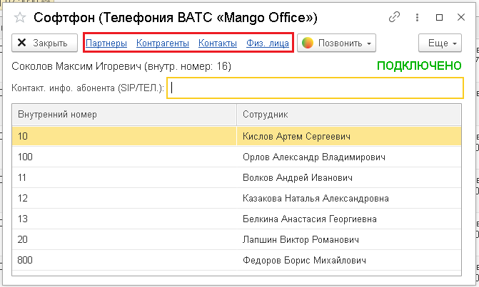

# 7.1. Как открыть справочник

> Трассировка: PDF §7.1 · сквозные стр. 40 · источники: ч.1 `kb/sources/integration_1c/Integratsiya_virtualnoy_ats_Pryamaya_integraciya_s_1C.pdf` с.40.

Чтобы перейти в справочник абонентов, выполните следующие действия: 1) откройте софтфон в 1С; 2) кликните на тип абонента: партнеры, контрагенты, контакты, физ.лица. Будет открыт справочник абонентов.

> **Описание иллюстрации INT1C-§7.1-1** (к §7.1 «Как открыть справочник», стр. 40; 671×403 px). Снимок экрана / схема.
> Относится к тексту руководства: «…полните следующие действия: 1) откройте софтфон в 1С; 2) кликните на тип абонента: партнеры, контрагенты, контакты, физ.лица. Будет открыт справочник абонентов.».
> Подпись в руководстве: «Рисунок 59».
> Текст на изображении (OCR, требует сверки): Софтфон (Телефония BATC «Mango Office»); oO x; Контакты; Х Закрыть; Партнеры; Контрагенты; Физ. лица; @ Позвонить ~; Еще ~; Соколов Максим Игоревич (внутр. номер: 16); ПОДКЛЮЧЕНО; Внутренний номер; Сотрудник; 2 ЮАмоныя; 100; Орлов Александр Владимирович; 11; Волков Андрей Иванович; 12; Казакова Наталья Александровна; 13; Белкина Анастасия Георгиевна; 20; Лапшин Виктор Романович; 800; Федоров Борис Михайлович

Рисунок 59
