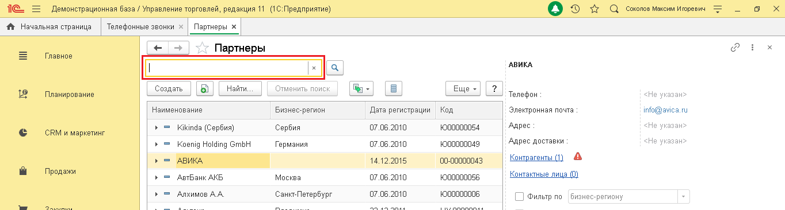
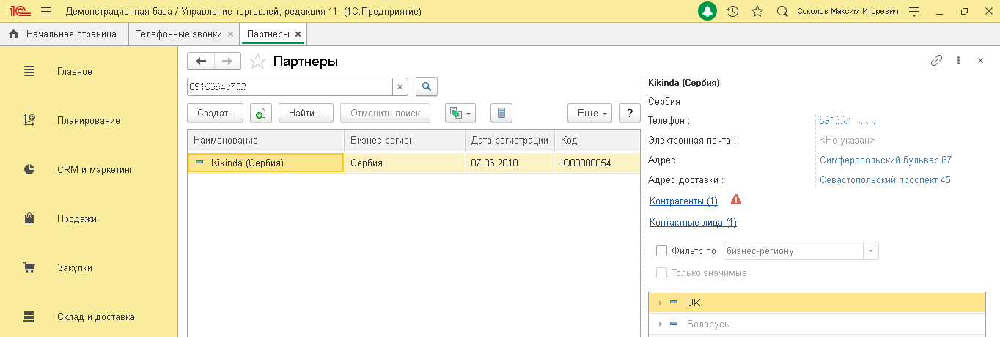

# 7.2. Поиск по номеру телефона

> Трассировка: PDF §7.2 · сквозные стр. 40-41 · источники: ч.1 `kb/sources/integration_1c/Integratsiya_virtualnoy_ats_Pryamaya_integraciya_s_1C.pdf` с.40-41.

Чтобы выполнить поиск абонента по номеру телефона, выполните следующие действия: 1) откройте справочник абонентов на нужном вам типе абонентов; 2) введите номер телефона и нажмите кнопку «Enter»:

> **Описание иллюстрации INT1C-§7.2-1** (к §7.2 «Поиск по номеру телефона», стр. 40; 1364×366 px). Снимок экрана / схема.
> Относится к тексту руководства: «…омеру телефона, выполните следующие действия: 1) откройте справочник абонентов на нужном вам типе абонентов; 2) введите номер телефона и нажмите кнопку «Enter»:».
> Подпись в руководстве: «Рисунок 60».
> Текст на изображении (OCR, требует сверки): те; Демонстрационная база / Управление торговлей, редакция 11 (1С:Предприятие); Оу т с Comoros Marcin nropesns; ft Начальная страница; Телефонные звонки; Партнеры x; va; oO; Главное; Партнеры; АВИКА; Создать; Найти; Отменить поиск; Еще -; Планирование; Телефон; Наименование; Бизнес-регион; Дата регистрации; Код; Электронная почта; info@aviea ru; > = Kikinda (Сербия); Сербия; 07.06.2010; 1600000054; Адрес; CRM и маркетинг; Koenig Holding GmbH; Германия; 1000000049; Адрес доставки; АВИКА,; 14.12.2015; (00-00000043; Контрагенты (1; Продажи; `АвтБанк АКБ; Москва; 1000000056; Контактные лица (}; Ал…

Рисунок 60 Результаты поиска будут показаны в справочнике абонентов, при этом в правой части окна отображен список найденных абонентов, а в левой части – подробные сведения об абоненте. Чтобы открыть карточку абонента, нужно дважды кликнуть на строку с данными этого абонента. 5Прямая интеграция с системой «1С: Управление торговлей» Редакция 11 (11.3 - 11.4, 11.5) | Версия от 22.12 .2025

> **Описание иллюстрации INT1C-§7.2-2** (к §7.2 «Поиск по номеру телефона», стр. 41; 1364×460 px). Снимок экрана / схема.
> Относится к тексту руководства: «….2025».
> Подпись в руководстве: «Рисунок 61».
> Текст на изображении (OCR, требует сверки): Демонстрационная база / Управление торговлей, редакция 11 (1С:Предприятие); Оу т с Comoros Marcin nropesns; va; Партнеры; Главное; 8915:; Kikinda (Сербия); Сербия; Найти; Отменить поиск; Планирование; Создать; wey; Be; BJ; Еще -; Телефон; us; Наименование; Бизнес-регион; Дата регистрации; Код; Электронная почта; «Не указан>; = Kikinda (Сербия); (07.06.2010; 1600000054; Адрес; Симферопольский бульвар 67; CRM и маркетинг; Адрес доставки; Севастопольский проспект 45; Контрагенты (1; Продажи; Контактные лица (1; О) Фильтр по; бизнес-региону; Закупки; Только значимые; Склад и доставка; > = Беларусь

Рисунок 61
