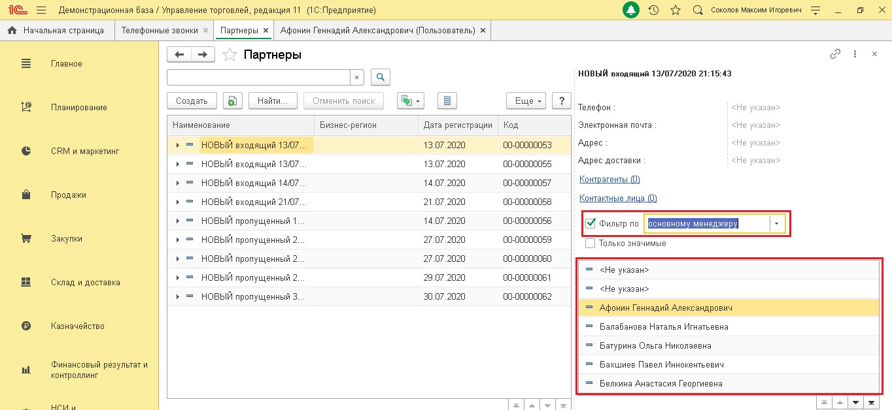

# 7.4. Фильтрация записей в справочнике

> Трассировка: PDF §7.4 · сквозные стр. 41-43 · источники: ч.1 `kb/sources/integration_1c/Integratsiya_virtualnoy_ats_Pryamaya_integraciya_s_1C.pdf` с.41-43.

Вы можете вывести на экран все записи справочника абонентов, в которых есть определенный параметр. Например, найти всех абонентов, привязанных к одному и тому же менеджеру. Вот как это сделать: 1) откройте справочник абонентов на нужном вам типе абонентов; 5Прямая интеграция с системой «1С: Управление торговлей» Редакция 11 (11.3 - 11.4, 11.5) | Версия от 22.12 .2025 2) активируйте переключатель «Фильтр по»; 3) выберите параметр фильтрации. В результате вы получите список информации об абонентах, соответствующих параметрам фильтрации.

> **Описание иллюстрации INT1C-§7.4-1** (к §7.4 «Фильтрация записей в справочнике», стр. 42; 1364×628 px). Снимок экрана / схема.
> Относится к тексту руководства: «…уйте переключатель «Фильтр по»; 3) выберите параметр фильтрации. В результате вы получите список информации об абонентах, соответствующих параметрам фильтрации.».
> Подпись в руководстве: «Рисунок 63».
> Текст на изображении (OCR, требует сверки): Демонстрационная база / Управление торговлей, редакция 11 (1С:Предприятие); Оу т с Comoros Marcin nropesns; ЧА Ночальная страница | Телефонные звонки | Партнеры x | Афонин Геннадий Александрович (Пользователь) x; Партнеры; Главное; НОВЫЙ входящий 13/07/2020 21:15:43; Найти; Отменить поиск; Планирование; Создать; Le; Be; LSJ; Еще -; Телефон; «Не указан>; Наименование; Бизнес-регион; Дата регистрации; Код; Электронная почта; > = НОВЫЙ входящий 13/07.; 13.07.2020; 100-00000053; Адрес; CRM и маркетинг; НОВЫЙ входящий 13/07; 100-00000055; Адрес доставки; НОВЫЙ входящий 14/07.; 14.07.2020; 100-00000…

Рисунок 63 5Прямая интеграция с системой «1С: Управление торговлей» Редакция 11 (11.3 - 11.4, 11.5) | Версия от 22.12 .2025
