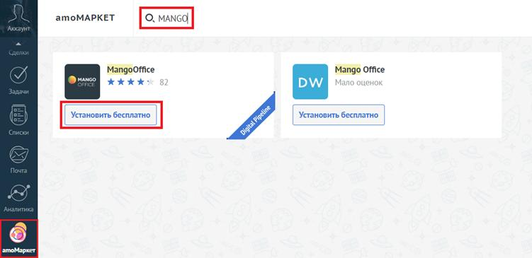
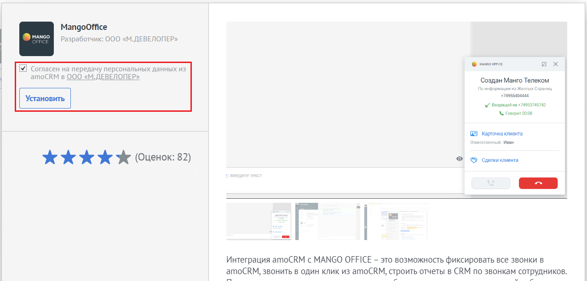
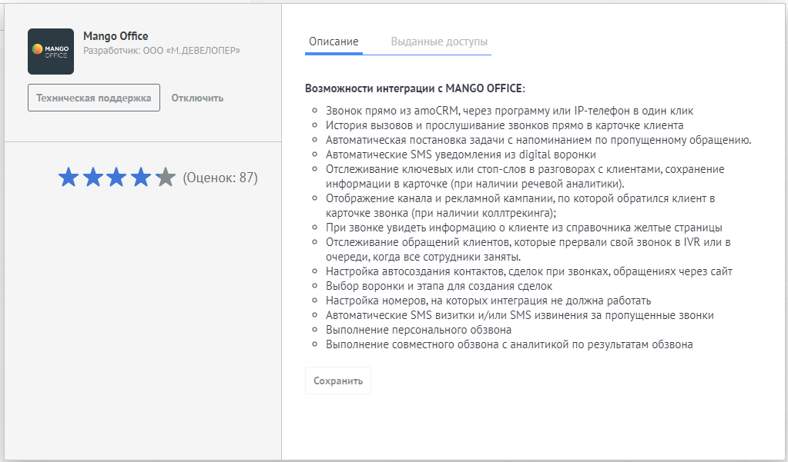

# Шаг 3. Установка виджета интеграции в amoCRM

> Трассировка: PDF §1 · сквозные стр. 6-8 · источники: ч.1 `kb/sources/integration_amocrm/Mango_office_integration_amoCRM.pdf` с.6-8.

Для этого необходимо: 1) войти в ваш amoCRM под учетной записью администратора; 2) перейти в раздел “amoМаркет”; 3) в поле “Поиск” введите значение “MangoOffice” и нажмите кнопку “Enter”; 4) в списке виджетов, найденных по вашему запросу, найдите виджет “MANGO OFFICE” (см. рисунок ниже) и нажмите кнопку “Установить бесплатно,” под ним. Примечание. Если в списке виджетов, найденных по вашему запросу, нет виджета “MANGO OFFICE” (такого как на рисунке ниже), то измените запрос: в поле “Поиск” вместо “MANGO OFFICE” введите значение “Mango Office” или “mango office”, или “MANGO”, или “OFFICE”. Интеграция Виртуальной АТС MANGO OFFICE и amoCRM | Версия от 25.08.2025

> **Описание иллюстрации INTAMO-§1-1** (к §1 «Шаг 3. Установка виджета интеграции в amoCRM», стр. 7; 751×365 px). Снимок экрана / схема.
> Относится к тексту руководства: «…го как на рисунке ниже), то измените запрос: в поле “Поиск” вместо “MANGO OFFICE” введите значение “Mango Office” или “mango office”, или “MANGO”, или “OFFICE”.».
> Текст на изображении (OCR, требует сверки): amoMAPKET; MangoOffice; Mango Office; vanco ххжх-; DW; Установить бесплатно; Ky; ry; amoMapxet

5) в открывшейся форме “MangoOffice” нужно установить “галочку” в поле “Согласен на передачу персональных данных…” и нажать на кнопку “Установить”:

> **Описание иллюстрации INTAMO-§1-2** (к §1 «Шаг 3. Установка виджета интеграции в amoCRM», стр. 7; 1276×611 px). Снимок экрана / схема.
> Относится к тексту руководства: «…5) в открывшейся форме “MangoOffice” нужно установить “галочку” в поле “Согласен на передачу персональных данных…” и нажать на кнопку “Установить”:».
> Текст на изображении (OCR, требует сверки): MangoOffice; Разработчик: 000 «М.ДЕВЕЛОПЕР»; mango; so orrce; Согласен Ha; ередачу персональных данных из; noCRM в 000; ЕВЕЛОП!; ‘Создан Манго Телеком; Пониформации из Желных Стр; ая; 1 веодащийна 74953745742; 1 Foeopur 0008; GB Корточка клиента; fe Иван; @ © Caenknnoenra; Cs); Интеграция amoCRM с MANGO OFFICE - это возможность фиксировать все звонки в; amoCRM, звонить в один клик из amoCRM, строить отчеты в CRM по звонкам сотрудников.

Виджет установлен в amoCRM, при этом в форме “MangoOffice” показаны данные о виджете:

> **Описание иллюстрации INTAMO-§1-3** (к §1 «Шаг 3. Установка виджета интеграции в amoCRM», стр. 7; 1023×601 px). Снимок экрана / схема.
> Относится к тексту руководства: «…огласен на передачу персональных данных…” и нажать на кнопку “Установить”: Виджет установлен в amoCRM, при этом в форме “MangoOffice” показаны данные о виджете:».
> Текст на изображении (OCR, требует сверки): Mango Office; Описание; разработчик: 000 «М.ДЕВЕЛОПЕР»; Возможности интеграции c MANGO OFFICE:; Звонок прямо из amoCRM, через программу или Р-телефон в один клик; История вызовов и прослушивание звонков прямо в карточке клиента; Автоматическая постановка задачи с напоминанием по пропущенному обращению.; Автоматические SMS уведомления из digital воронки; Отслеживание ключевых или стоп-слов в разговорах с клиентами, сохранение; KICK Х Ж (Quetiox: 87); информации в карточке (при наличии речевой аналитики).; Отображение канала и рекламной кампании, по которой обратился клиент в; карточке звонка (п…

Интеграция Виртуальной АТС MANGO OFFICE и amoCRM | Версия от 25.08.2025
