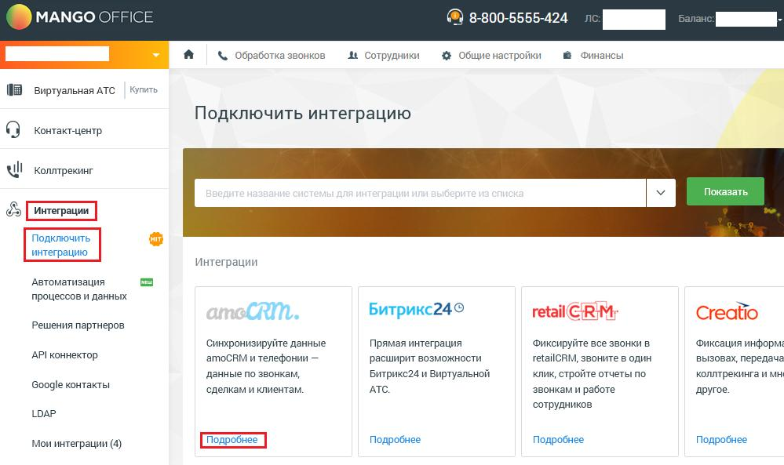
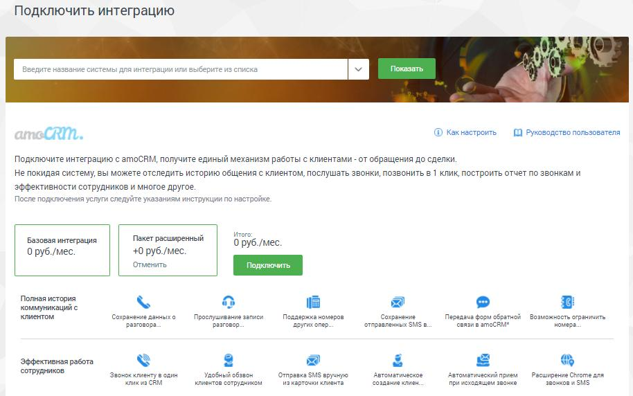
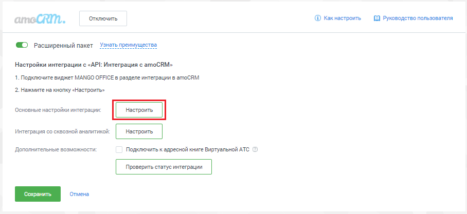
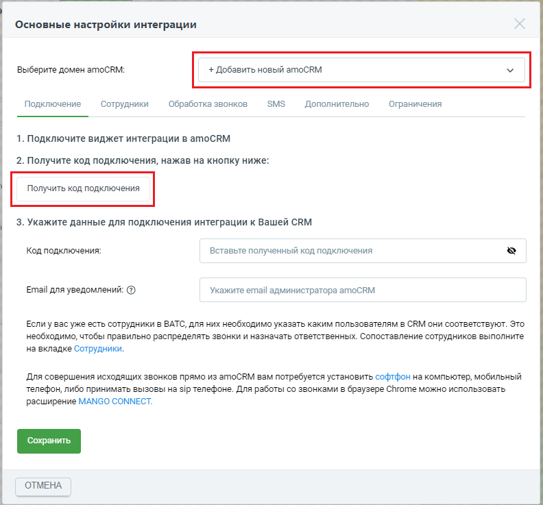
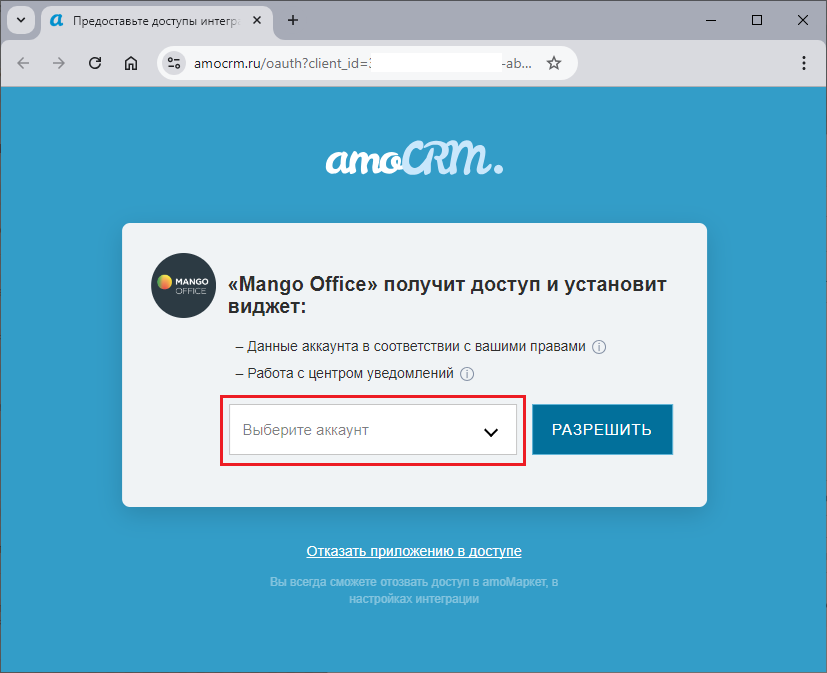
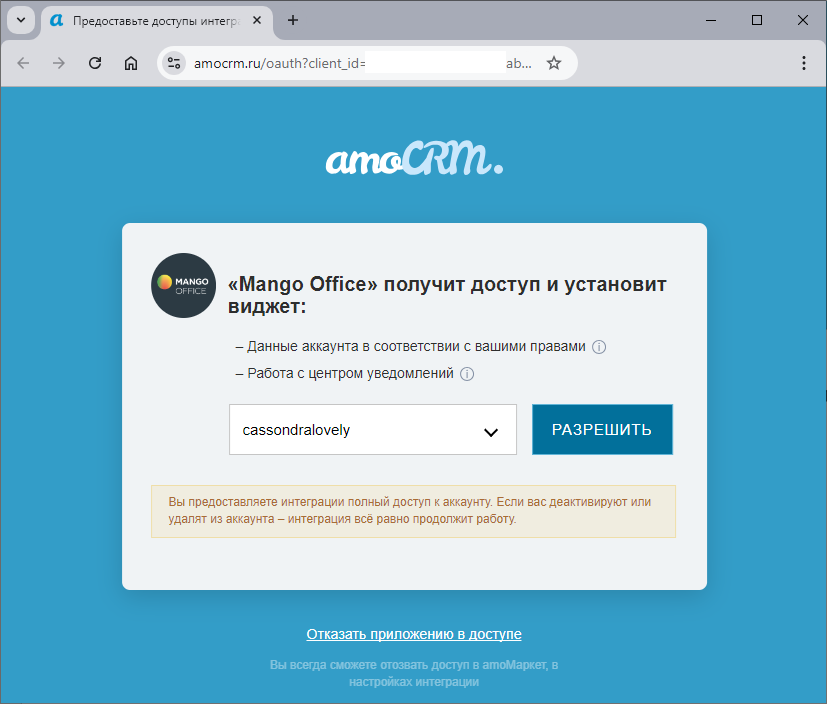
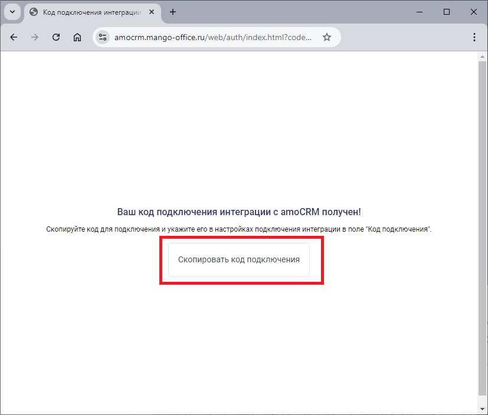
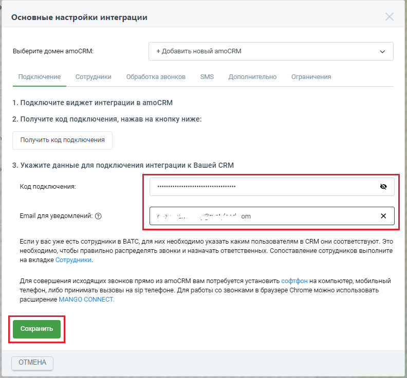
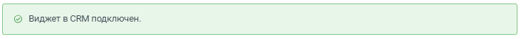

# Шаг 4. Настройка Виртуальной АТС. Выбор пакета интеграции

> Трассировка: PDF §1 · сквозные стр. 8-13 · источники: ч.1 `kb/sources/integration_amocrm/Mango_office_integration_amoCRM.pdf` с.8-13.

Это нужно сделать, чтобы Виртуальная АТС MANGO OFFICE могла передавать в вашу amoCRM данные о звонках. Для этого необходимо: 1) войти в Личный кабинет Виртуальной АТС; 2) выбрать вашу Виртуальную АТС, если у вас их несколько; 3) перейти в раздел “Интеграции”; 4) нажать на пункт “Подключить интеграцию”; 5) в блоке “amoCRM” нажать кнопку “Подробнее”:

> **Описание иллюстрации INTAMO-§1-1** (к §1 «Шаг 4. Настройка Виртуальной АТС. Выбор пакета интеграции», стр. 8; 999×593 px). Снимок экрана / схема.
> Относится к тексту руководства: «…льную АТС, если у вас их несколько; 3) перейти в раздел “Интеграции”; 4) нажать на пункт “Подключить интеграцию”; 5) в блоке “amoCRM” нажать кнопку “Подробнее”:».
> Текст на изображении (OCR, требует сверки): МАМСО О; @) 8-800-5555-424; @ Финансы; \ Обработка звонков; в сотрудники; 4+ Общие настройки; EB виртуальная АТС; Купить; Подключить интеграцию; ЧИ Konmpenner; Показать:; ЕЕ ИИ; интеграции; Автоматизация; процессов и данных; CRM.; Битрикс24®; retail: RM;; Creatio; Решения партнеров; Синхронизируйте данные; Прямая интеграция; ‘Фиксируйте ace звонки в; ‘Фиксация информ; АРИконнектор.; amoCRM и телефонии —; расширит возможности; retailRM, звоните в один; вызовах, передача; данные по звонкам,; Битрикс24 и Виртуальной; клик, стройте отчеты по; коллтрекинга имн; Google контакты; ‘сделкам и клиентам.…

6. будут выполнены следующие действия: – если у вас уже была подключена интеграция к Виртуальной АТС, то, после нажатия кнопки “Подробнее”, будет открыта страница “Мои интеграции”, на которой показан блок “amoCRM”; – если вы впервые подключаете интеграцию с amoCRM, то будет предложено выбрать пакет интеграции: базовая интеграция, пакет расширенный. Нажмите на пакет, который хотите подключить, затем нажмите на кнопку “Подключить”. Виджет интеграции будет подключен к вашей Виртуальной АТС и в Личном кабинете MANGO OFFICE на странице “Мои интеграции” будет показан блок “amoCRM”. Интеграция Виртуальной АТС MANGO OFFICE и amoCRM | Версия от 25.08.2025

> **Описание иллюстрации INTAMO-§1-2** (к §1 «Шаг 4. Настройка Виртуальной АТС. Выбор пакета интеграции», стр. 9; 914×572 px). Снимок экрана / схема.
> Относится к тексту руководства: «…одключить”. Виджет интеграции будет подключен к вашей Виртуальной АТС и в Личном кабинете MANGO OFFICE на странице “Мои интеграции” будет показан блок “amoCRM”.».
> Текст на изображении (OCR, требует сверки): Подключить интеграцию; Введите название систе; Apa интеграции или выберите из списка; Показать; @® какнастроить; 1] Руководство пользователя; CRM,; Подключите интеграцию с amoCRM, получите единый механизм работы с клиентами - от обращения до сделки; Непокидая систему, вы можете отследить историю общения с клиентом, послушать звонки, позвонить в 1 клик построить отчет по звонкам и; эффективности сотрудников и многое другое; После подключения услуги следуйте указаниям инструкции по настройке.; Пакет расширенный; от; Базовая интеграция; 0 руб./мес.; руб./мес.; Отменить; Полная история; коммуникац…

7. нажмите на кнопку “Настроить” в блоке “amoCRM”;

> **Описание иллюстрации INTAMO-§1-3** (к §1 «Шаг 4. Настройка Виртуальной АТС. Выбор пакета интеграции», стр. 9; 908×417 px). Снимок экрана / схема.
> Относится к тексту руководства: «…7. нажмите на кнопку “Настроить” в блоке “amoCRM”;».
> Текст на изображении (OCR, требует сверки): отключить; @ Какнастроить.; 1 Руководство пользователя; CRM.; © Расширенный пакет 55; Настройки интеграции с «АР!; теграция с amoCRM»; 1. Подключите виджет MANGO OFFICE в разделе интеграции в amoCRM; 2. Нажмите на кнопку «Настроить»; ‘Основные настройки интеграции:; интеграция со сквозной аналитикой:; Дополнительные возможности:; Подключить к адресной книге Виртуальной ATO

8. проверьте, что в окне “Основные настройки интеграции” в поле “Выбрать домен amoCRM” указано значение “+ Добавить новый amoCRM”. Если в этом поле указано другое значение, значит надо в выпадающем списке “Выбрать домен amoCRM” выбрать значение “+Добавить новый amoCRM”; 9. нажмите кнопку “Получить код подключения”: Интеграция Виртуальной АТС MANGO OFFICE и amoCRM | Версия от 25.08.2025

> **Описание иллюстрации INTAMO-§1-4** (к §1 «Шаг 4. Настройка Виртуальной АТС. Выбор пакета интеграции», стр. 10; 792×737 px). Снимок экрана / схема.
> Относится к тексту руководства: «…другое значение, значит надо в выпадающем списке “Выбрать домен amoCRM” выбрать значение “+Добавить новый amoCRM”; 9. нажмите кнопку “Получить код подключения”:».
> Текст на изображении (OCR, требует сверки): Основные настройки интеграции; Выберите домен amoCRM:; + Добавить новый amoCRM; Подключение; Сотрудники; Обработка звонков; SMS; Дополнительно; Ограничения; 1. Подключите виджет интеграции в amoCRM; 2. Получите код подключения, нажав на кнопку ниже:; Получить код подключения; 3. Укажите данные для подключения интеграции к Вашей СВМ; Код подключения:; Вставьте полученный код подключения; Email для уведомлений: (3); Укажите email администратора amoCRM; Если у вас уже есть сотрудники в ВАТС, для них необходимо указать каким пользователям в CRM они соответствуют. Это; необходимо, чтобы правильно р…

10. будет открыта новая вкладка вашего браузера. На ней, если вы уже вошли в аккаунт AmoCRM, будет открыта форма для предоставления доступа виджету интеграции к вашему аккаунту amoCRM (см. рисунок ниже). В противном случае вам будет предложено авторизоваться в AmoCRM при помощи ваших логина и пароля, а затем будет открыта форма для предоставления доступа виджету интеграции к вашему аккаунту amoCRM; 11. в поле “Выберите аккаунт” выберите аккаунт AmoCRM, с которым будет настроена интеграция;

> **Описание иллюстрации INTAMO-§1-5** (к §1 «Шаг 4. Настройка Виртуальной АТС. Выбор пакета интеграции», стр. 10; 827×673 px). Снимок экрана / схема.
> Относится к тексту руководства: «…предоставления доступа виджету интеграции к вашему аккаунту amoCRM; 11. в поле “Выберите аккаунт” выберите аккаунт AmoCRM, с которым будет настроена интеграция;».
> Текст на изображении (OCR, требует сверки): У. Предоставьте доступы интегр.; сэся; amocrm.ru/oauth?client_id=:; amet.; «Mango Office» получит доступ и установит; виджет:; — Данные аккаунта в соответствии с вашими правами (т); — Работа с центром уведомлений ©; Отказать приложению в доступе; Вы всегда сможете отозвать доступ в атоМаркет, в; настройках интеграции

Интеграция Виртуальной АТС MANGO OFFICE и amoCRM | Версия от 25.08.2025 12. нажмите кнопку “Разрешить”, чтобы разрешить виджету интеграции доступ к вашему аккаунту AmoCRM;

> **Описание иллюстрации INTAMO-§1-6** (к §1 «Шаг 4. Настройка Виртуальной АТС. Выбор пакета интеграции», стр. 11; 827×704 px). Снимок экрана / схема.
> Относится к тексту руководства: «…12. нажмите кнопку “Разрешить”, чтобы разрешить виджету интеграции доступ к вашему аккаунту AmoCRM;».
> Текст на изображении (OCR, требует сверки): У. @ Предоставьте доступы интегр.; amocrm.ru/oauth?client_id=; amet.; «Mango Office» получит доступ и установит; виджет:; — Данные аккаунта в соответствии с вашими правами (т); — Работа с центром уведомлений (п); Отказать приложению в доступе; Вы всегда сможете отозвать доступ в атоМаркет, в; настройках интеграции

13. будет создан код подключения интеграции с amoCRM, который вам необходимо скопировать. Для этого, нажмите кнопку “Скопировать код подключения”: Интеграция Виртуальной АТС MANGO OFFICE и amoCRM | Версия от 25.08.2025

> **Описание иллюстрации INTAMO-§1-7** (к §1 «Шаг 4. Настройка Виртуальной АТС. Выбор пакета интеграции», стр. 12; 827×704 px). Снимок экрана / схема.
> Относится к тексту руководства: «…аунту AmoCRM; 13. будет создан код подключения интеграции с amoCRM, который вам необходимо скопировать. Для этого, нажмите кнопку “Скопировать код подключения”:».
> Текст на изображении (OCR, требует сверки): © кодподключения интеграции Х; сэосяа; amocrm.mango-office.ru/web/auth/index.html?code...; Ваш код подключения интеграции с атоСВМ получен!; Скопируйте код для подключения и укажите его в настройках подключения интеграции в поле "Код подключения"; Скопировать код подключения

14. в окне “Основные настройки интеграции” вставьте скопированный код в поле “Код подключения”; 15. в поле “Email для уведомлений” укажите электронную почту, на которую хотите получать уведомления от amoCRM; 16. нажмите на кнопку “Сохранить”:

> **Описание иллюстрации INTAMO-§1-8** (к §1 «Шаг 4. Настройка Виртуальной АТС. Выбор пакета интеграции», стр. 12; 792×737 px). Снимок экрана / схема.
> Относится к тексту руководства: «…подключения”; 15. в поле “Email для уведомлений” укажите электронную почту, на которую хотите получать уведомления от amoCRM; 16. нажмите на кнопку “Сохранить”:».
> Текст на изображении (OCR, требует сверки): Основные настройки интеграции; Выберите домен amoCRM:; + Добавить новый amoCRM; SMS; Подключение; Сотрудники; Обработка звонков; Дополнительно; Ограничения; 1. Подключите виджет интеграции в amoCRM; 2. Получите код подключения, нажав на кнопку ниже:; Получить код подключения; 3. Укажите данные для подключения интеграции к Вашей СВМ; Код подключения:; Email для уведомлений: (3); ими в Je; om; Если у Bac уже есть сотрудники в BATC, для них необходимо указать каким пользователям в CRM они соответствуют. Это; необходимо, чтобы правильно распределять звонки и назначать ответственных. Сопоставление …

17. если подключение виджета интеграции выполнено успешно, то будет выдано сообщение “Виджет в CRM подключен” (см. рисунок ниже). Иначе, будет выдано сообщение об ошибке, в этом случае проверьте, правильно ли выполнены пункты 1 - 16. Интеграция Виртуальной АТС MANGO OFFICE и amoCRM | Версия от 25.08.2025

> **Описание иллюстрации INTAMO-§1-9** (к §1 «Шаг 4. Настройка Виртуальной АТС. Выбор пакета интеграции», стр. 13; 733×56 px). Снимок экрана / схема.
> Относится к тексту руководства: «…о сообщение “Виджет в CRM подключен” (см. рисунок ниже). Иначе, будет выдано сообщение об ошибке, в этом случае проверьте, правильно ли выполнены пункты 1 - 16.».
> Текст на изображении (OCR, требует сверки): © Виджет в CRM подключен.
