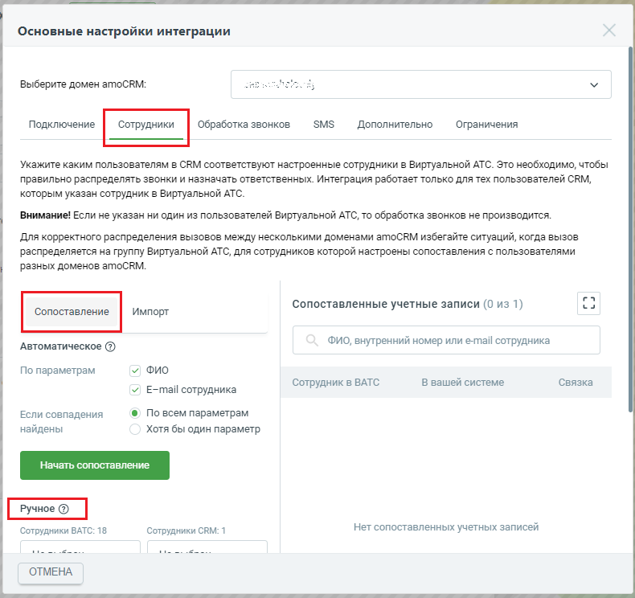
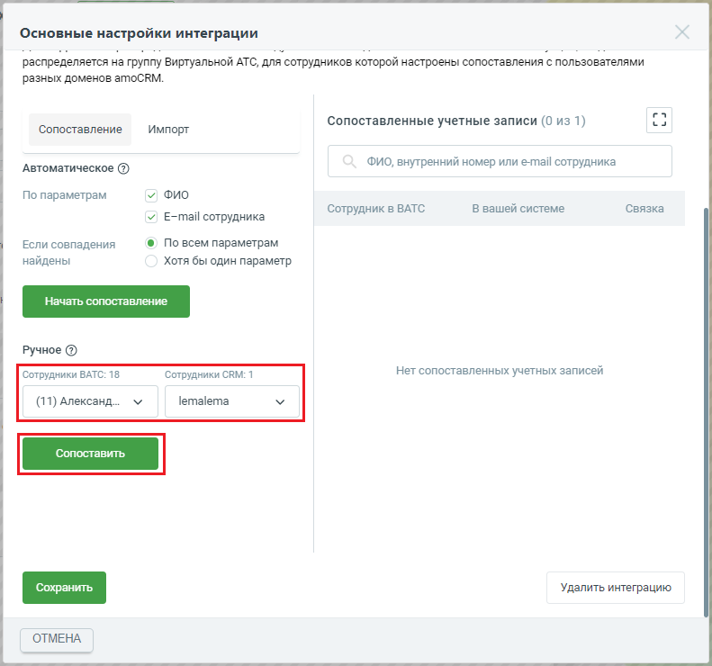
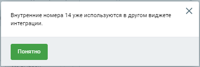
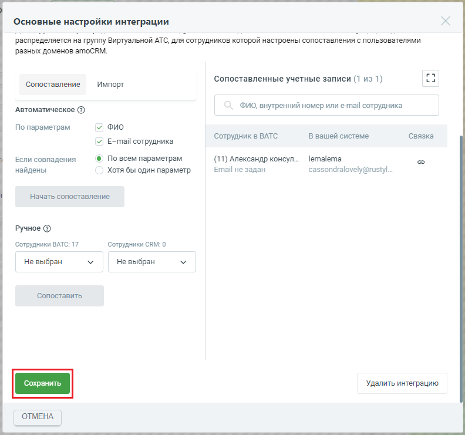
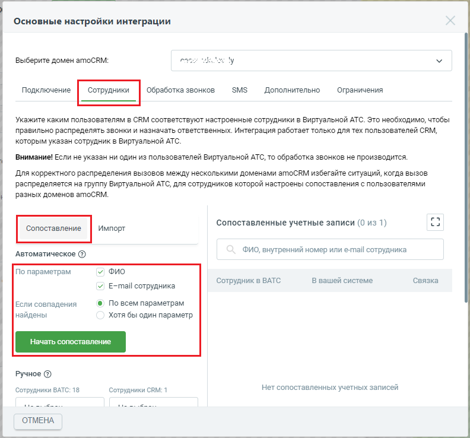
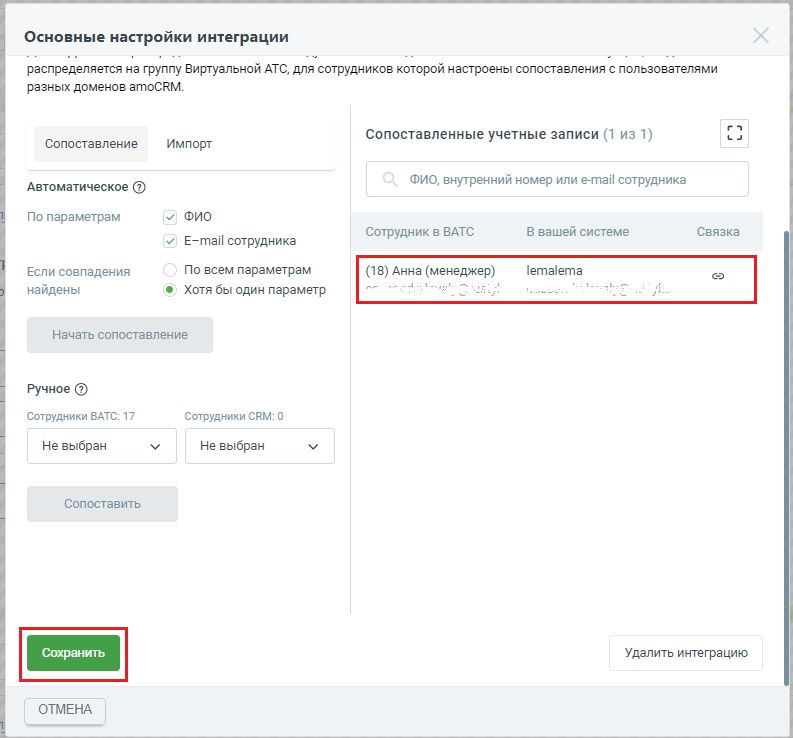

# Шаг 5. Сопоставление сотрудников Виртуальной АТС и amoCRM

> Трассировка: PDF §1 · сквозные стр. 13-18 · источники: ч.1 `kb/sources/integration_amocrm/Mango_office_integration_amoCRM.pdf` с.13-18.

Уважаемые абоненты! Без сопоставления сотрудников из личного кабинета MANGO OFFICE в виджете MANGO OFFICE в amoCRM интеграция работать не будет. Общее Важнейшей задачей интеграции является корректное распределение звонков между пользователями. Приложение интеграции хранит таблицу сопоставления сотрудников Виртуальной АТС с пользователями amoCRM, которую вы можете видеть в блоке “Сотрудники”. Эту таблицу составляете вы. В ней вы указываете какому сотруднику Виртуальной АТС соответствует сотрудник amoCRM. Когда пользователь, кликнув по номеру телефона в amoCRM, инициирует исходящий звонок отправку sms, приложение интеграции сравнивает данные этого пользователя с таблицей сопоставления сотрудников Виртуальной АТС с пользователями amoCRM. Если обнаруживается совпадение (пользователю amoCRM, инициировавшему звонок отправку sms, поставлен соответствующий сотрудник Виртуальной АТС), то звонок отправка sms выполняется от соответствующего сотрудника Виртуальной АТС. И наоборот, когда поступает входящий звонок от Клиента и Виртуальная АТС распределяет его на конкретного сотрудника, приложение интеграции сравнивает данные этого сотрудника с таблицей сопоставления. Если обнаруживается совпадение, то звонок направляется на соответствующего пользователя amoCRM. Обратите внимание. Если вы указали не всех менеджеров в таблице сопоставления сотрудников, а также, если вы хотите фиксировать звонки сотрудников, которые не работают в amoCRM, но могут звонить клиентам (например, бухгалтер, курьер и т.д.), то вы можете включить настройку “Сохранять все звонки” и указать в ней нужного сотрудника amoCRM. Тогда к этому сотруднику будут автоматически привязываться разговоры с Клиентами сотрудников, не указанных в таблице сопоставления. Эта настройка доступна только в расширенном пакете интеграции. Ограничения для сопоставления сотрудников 1) Запрещается одного и того же сотрудника amoCRM указывать более чем в одном виджете интеграции; 2) Чтобы виджет интеграции корректно распределял звонки, в настройках виджета интеграции не рекомендуется указывать сотрудника Виртуальной АТС, состоящего в группе, участники которой настроены в другом виджете интеграции (зарегистрированы в другом домене amoCRM). 3) Запрещается одному сотруднику Виртуальной АТС ставить в соответствие нескольких пользователей amoCRM. Если в настройке сопоставления сотрудника вами выбран сотрудник Виртуальной АТС, ранее указанный в настройках другого вашего виджета интеграции, будет выдано сообщение об ошибке. Интеграция Виртуальной АТС MANGO OFFICE и amoCRM | Версия от 25.08.2025 Как настроить сопоставление сотрудников Вариант 1. Вручную Если вы хотите настроить сопоставление сотрудников amoCRM и Виртуальной АТС вручную, выполните: 1) убедитесь, что вы зарегистрировали всех нужных сотрудников в обоих системах; 2) перейдите в окно “Основные настройки интеграции”, проверьте что открыта вкладка “Сотрудники” 3) проверьте что нажата кнопку “Сопоставление”; 4) прокрутите окно колесиком мыши, чтобы было видно блок “Ручное”;

> **Описание иллюстрации INTAMO-§1-1** (к §1 «Шаг 5. Сопоставление сотрудников Виртуальной АТС и amoCRM», стр. 14; 790×744 px). Снимок экрана / схема.
> Относится к тексту руководства: «…”, проверьте что открыта вкладка “Сотрудники” 3) проверьте что нажата кнопку “Сопоставление”; 4) прокрутите окно колесиком мыши, чтобы было видно блок “Ручное”;».
> Текст на изображении (OCR, требует сверки): Основные настройки интеграции; Выберите домен amoCRM:; Укажите каким пользователям в СЕМ соответствуют настроенные сотрудники в Виртуальной АТС. Это необходимо, чтобы; правильно распределять звонки и назначать ответственных. Интеграция работает только для тех пользователей СЕМ,; которым указан сотрудник в Виртуальной АТС.; Внимание! Если не указан ни один из пользователей Виртуальной АТС, то обработка звонков не производится.; Для корректного распределения вызовов между несколькими доменами атоСЕМ избегайте ситуаций, когда вызов; распределяется на группу Виртуальной АТС, для сотрудников которо…

5) укажите пару сотрудник ВАТС-сотрудник CRM в поле “Ручное”; 6) нажмите кнопку “Сопоставить”; Интеграция Виртуальной АТС MANGO OFFICE и amoCRM | Версия от 25.08.2025

> **Описание иллюстрации INTAMO-§1-2** (к §1 «Шаг 5. Сопоставление сотрудников Виртуальной АТС и amoCRM», стр. 15; 791×740 px). Снимок экрана / схема.
> Относится к тексту руководства: «…) прокрутите окно колесиком мыши, чтобы было видно блок “Ручное”; 5) укажите пару сотрудник ВАТС-сотрудник CRM в поле “Ручное”; 6) нажмите кнопку “Сопоставить”;».
> Текст на изображении (OCR, требует сверки): Основные настройки интеграции; распределяется на группу Виртуальной АТС, для сотрудников которой настроены сопоставления с пользователями; разных доменов amoCRM.; гл; us; Сопоставление; Импорт; Сопоставленные учетные записи (0 из 1); Автоматическое (@); ФИО, внутренний номер или e-mail сотрудника; По параметрам; у Фио; В вашей системе; Связка; Сотрудник в ВАТС; У E-mail сотрудника; Если совпадения; @ По всем параметрам; найдены; Хотя бы один параметр; Ручное @; Сотрудники ВАТС: 18; Сотрудники СВМ: 1; Нет сопоставленных учетных записей; (11) Александ...; lemalema; Удалить интеграцию; ОТМЕНА

Будет выполнена проверка возможности сопоставления указанных вами сотрудников. Если проверка пройдена успешно, будет выдано сообщение “Пара сопоставлена и добавлена в список”:

> **Описание иллюстрации INTAMO-§1-3** (к §1 «Шаг 5. Сопоставление сотрудников Виртуальной АТС и amoCRM», стр. 15; 332×52 px). Снимок экрана / схема.
> Относится к тексту руководства: «… проверка возможности сопоставления указанных вами сотрудников. Если проверка пройдена успешно, будет выдано сообщение “Пара сопоставлена и добавлена в список”:».
> Текст на изображении (OCR, требует сверки): @ Пара сопоставлена и добавлена в список Х

Если сотрудников нельзя сопоставить, будет выдано сообщение об ошибке. Вам нужно нажать кнопку “Ок” в сообщении об ошибке, затем укажите других сотрудников в настройке сопоставления.

> **Описание иллюстрации INTAMO-§1-4** (к §1 «Шаг 5. Сопоставление сотрудников Виртуальной АТС и amoCRM», стр. 15; 394×133 px). Снимок экрана / схема.
> Относится к тексту руководства: «…я сопоставить, будет выдано сообщение об ошибке. Вам нужно нажать кнопку “Ок” в сообщении об ошибке, затем укажите других сотрудников в настройке сопоставления.».
> Текст на изображении (OCR, требует сверки): Внутренние номера 14 уже используются в другом виджете; интеграции.

7) настройте сопоставление всех нужных вам сотрудников ВАТС и amoCRM, повторив шаги 5 и 6; 8) после сопоставления сотрудников обязательно сохраните настройки интеграции, нажав кнопку “Сохранить” Примечание. Если группа полей “Ручное” не отображается, значит ранее она была скрыта.

> **Описание иллюстрации INTAMO-§1-5** (к §1 «Шаг 5. Сопоставление сотрудников Виртуальной АТС и amoCRM», стр. 15; 29×29 px). Пиктограмма (значок элемента интерфейса).
> Относится к тексту руководства: «…ников обязательно сохраните настройки интеграции, нажав кнопку “Сохранить” Примечание. Если группа полей “Ручное” не отображается, значит ранее она была скрыта.».
> Текста на изображении нет; назначение элемента — см. текст, к которому он относится.

Нажмите на кнопку , чтобы эта группа полей вновь отобразилась на экране. Интеграция Виртуальной АТС MANGO OFFICE и amoCRM | Версия от 25.08.2025

> **Описание иллюстрации INTAMO-§1-6** (к §1 «Шаг 5. Сопоставление сотрудников Виртуальной АТС и amoCRM», стр. 16; 792×741 px). Снимок экрана / схема.
> Относится к тексту руководства: «…” Примечание. Если группа полей “Ручное” не отображается, значит ранее она была скрыта. Нажмите на кнопку , чтобы эта группа полей вновь отобразилась на экране.».
> Текст на изображении (OCR, требует сверки): Основные настройки интеграции; распределяется на группу Виртуальной АТС, для сотрудников которой настроены сопоставления с пользователями; разных доменов amoCRM.; га; Сопоставленные учетные записи (1 из 1); us; Сопоставление; Импорт; ФИО, внутренний номер или e-mail сотрудника; Автоматическое (@); По параметрам; у Фи; Сотрудник в ВАТС; В вашей системе; Связка; У E-mail сотрудника; Если совпадения; @ По всем параметрам; (11) Александр консул...; lemalema; eS; найдены; Хотя бы один параметр; Email не задан; cassondralovely@rustyl...; Начать сопоставление; Ручное @; Сотрудники ВАТС: 17; Сотрудник…

Вариант 2. Автоматически Функция автоматического сопоставления сотрудников сравнивает ФИО иe-mail сотрудников и составляет список совпадающих сотрудников. Важно! Учтите, что автоматическое сопоставление требует, чтобы ФИО и email сотрудников были записаны одинаково в вашем amoCRM и в Виртуальной АТС. Если появится сообщение “Пары для сопоставления не найдены”, убедитесь, что ФИО и e-mail сотрудников записаны в вашем amoCRM и Виртуальной АТС одинаково. Чтобы автоматически сопоставить сотрудников, выполните следующие действия 1) убедитесь, что вы зарегистрировали всех нужных сотрудников в обоих системах; 2) перейдите в окно “Основные настройки интеграции”, проверьте что открыта вкладка “Сотрудники” 3) проверьте что нажата кнопку “Сопоставление”; 4) в группе полей “Автоматическое”: выберите параметры для сопоставления: ФИО, E-mail; 5) выберите режим сопоставления: по всем параметрам (точное совпадение) или хотя бы по одному параметру; 6) нажмите кнопку “Начать сопоставление”. Интеграция Виртуальной АТС MANGO OFFICE и amoCRM | Версия от 25.08.2025

> **Описание иллюстрации INTAMO-§1-7** (к §1 «Шаг 5. Сопоставление сотрудников Виртуальной АТС и amoCRM», стр. 17; 792×738 px). Снимок экрана / схема.
> Относится к тексту руководства: «… ФИО, E-mail; 5) выберите режим сопоставления: по всем параметрам (точное совпадение) или хотя бы по одному параметру; 6) нажмите кнопку “Начать сопоставление”.».
> Текст на изображении (OCR, требует сверки): Основные настройки интеграции; pac; Выберите домен amoCRM:; Подключение Обработка звонков 3МЗ Дополнительно — Ограничения; Укажите каким пользователям в СЕМ соответствуют настроенные сотрудники в Виртуальной АТС. Это необходимо, чтобы; правильно распределять звонки и назначать ответственных. Интеграция работает только для тех пользователей СЕМ,; которым указан сотрудник в Виртуальной АТС.; Внимание! Если не указан ни один из пользователей Виртуальной АТС, то обработка звонков не производится.; Для корректного распределения вызовов между несколькими доменами атоСЕМ избегайте ситуаций, когда выз…

7) В результате в поле “Сопоставленные учетные записи” будет показан список пар сотрудник ВАТС-сотрудник CRM, либо выдано сообщение “Пары для сопоставления не найдены”; 8) прокрутите окно “Основные настройки интеграции” вниз до конца, чтобы появилась кнопка “Сохранить”. Нажмите на эту кнопку.

> **Описание иллюстрации INTAMO-§1-8** (к §1 «Шаг 5. Сопоставление сотрудников Виртуальной АТС и amoCRM», стр. 17; 793×738 px). Снимок экрана / схема.
> Относится к тексту руководства: «…Пары для сопоставления не найдены”; 8) прокрутите окно “Основные настройки интеграции” вниз до конца, чтобы появилась кнопка “Сохранить”. Нажмите на эту кнопку.».
> Текст на изображении (OCR, требует сверки): Основные настройки интеграции; распределяется на группу Виртуальной АТС, для сотрудников которой настроены сопоставления с пользователями; разных доменов amoCRM.; га; Сопоставленные учетные записи (1 из 1); us; Сопоставление; Импорт; ФИО, внутренний номер или e-mail сотрудника; Автоматическое (@); у Фи; По параметрам; Сотрудник в ВАТС; В вашей системе; Связка; У E-mail сотрудника; lemalema; Если совпадения; По всем параметрам; (18) Анна (менеджер); найдены; © Хотя бы один параметр; Начать сопоставление; Ручное @; Сотрудники ВАТС: 17; Сотрудники СВМ: 0; Не выбран; Сопоставить; Удалить интеграци…

Интеграция Виртуальной АТС MANGO OFFICE и amoCRM | Версия от 25.08.2025 Примечание. Если группа полей “Автоматическое” не отображается (см. рисунок ниже), значит

> **Описание иллюстрации INTAMO-§1-9** (к §1 «Шаг 5. Сопоставление сотрудников Виртуальной АТС и amoCRM», стр. 18; 29×29 px). Пиктограмма (значок элемента интерфейса).
> Относится к тексту руководства: «…Примечание. Если группа полей “Автоматическое” не отображается (см. рисунок ниже), значит».
> Текста на изображении нет; назначение элемента — см. текст, к которому он относится.

ранее она была скрыта. Нажмите на кнопку , чтобы группа полей “Автоматическое” вновь отобразилась на экране. Как сохранять все звонки в amoCRM. Обобщенно По умолчанию, виджет интеграции сохраняет в amoCRM данные о звонках только “сопоставленных” сотрудников, то есть сотрудников, указанных в таблице сопоставления. При этом, звонки “не сопоставленных сотрудников” не сохраняются. Вы можете поменять эту настройку, при подключении расширенного пакета интеграции. Вы можете включить настройку “Сохранять все звонки” и указать нужного вам сотрудника. Тогда все разговоры сотрудников в Клиентами будут сохранятся в amoCRM. Перед тем как включать данную настройку, узнайте больше о принципе ее работы в параграфе “Настройка “Сохранять все звонки” или как сохраняются звонки сотрудников, не указанных в таблице сопоставления”. Как удалить пару сотрудник ВАТС-сотрудник CRM В поле “Сопоставленные учетные записи” вы можете удалить любую пару поле “Сопоставленные учетные записи”. Наведите курсор на строку с данными нужной пары, появится иконка в столбце “Связка”. Нажмите на нее. Выбранная пара будет удалена.

> **Описание иллюстрации INTAMO-§1-10** (к §1 «Шаг 5. Сопоставление сотрудников Виртуальной АТС и amoCRM», стр. 18; 16×17 px). Пиктограмма (значок элемента интерфейса).
> Относится к тексту руководства: «…к CRM В поле “Сопоставленные учетные записи” вы можете удалить любую пару поле “Сопоставленные учетные записи”. Наведите курсор на строку с данными нужной пары,».
> Текста на изображении нет; назначение элемента — см. текст, к которому он относится.

Прокрутите окно “Основные настройки интеграции” вниз до конца, чтобы появилась кнопка “Сохранить”. Нажмите на эту кнопку.
