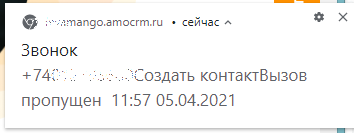
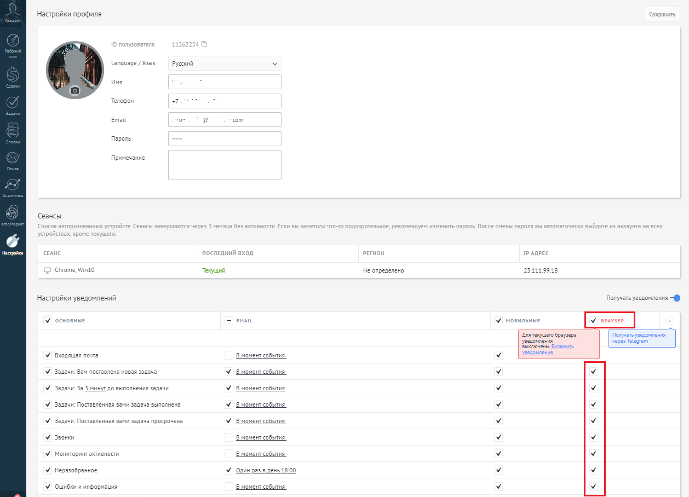

# 2.1. Включение уведомлений в браузере

> Трассировка: PDF §2.1 · сквозные стр. 22-23 · источники: ч.1 `kb/sources/integration_amocrm/Mango_office_integration_amoCRM.pdf` с.22-23.

Можно получать уведомления о пропущенных звонках и прочих событиях прямо на вашем компьютере, в браузере Google Chrome, Opera, Firefox, Safari. Для этого, должно быть открыто окно браузера, в котором выполнен вход в amoCRM. К примеру, уведомление о создании новой заявки в браузере Google Chrome выглядит так:

> **Описание иллюстрации INTAMO-§2.1-1** (к §2.1 «Включение уведомлений в браузере», стр. 22; 354×133 px). Снимок экрана / схема.
> Относится к тексту руководства: «…того, должно быть открыто окно браузера, в котором выполнен вход в amoCRM. К примеру, уведомление о создании новой заявки в браузере Google Chrome выглядит так:».
> Текст на изображении (OCR, требует сверки): G s-amango.amocrm.ru + сейчас ^; Звонок; +7457. onc CO3QaTb контактВызов; пропущен 11:57 05.04.2021

Важно! Уведомления не будут приходить, если в браузере запрещен показ всплывающих окон и/или включено блокирование рекламы. Чтобы включить показ уведомлений amoCRM на вашем компьютере, нужно включить показ всплывающих окон в вашем браузере: Google Chrome (подробнее..), Opera (подробнее…), Firefox (подробнее…). Чтобы более гибко настроить показ уведомлений в браузере, необходимо: 1) открыть ваш профиль пользователя amoCRM. Будет открыта страница “Настройки профиля”; 2) в блоке “Настройки уведомлений” нужно: - установить флаг “Браузер” (если он был выключен); - установить флаги в стройках тех событий, о которых нужно получать уведомления; 3) нажать кнопку “Сохранить” вверху окна “Настройки профиля”: Интеграция Виртуальной АТС MANGO OFFICE и amoCRM | Версия от 25.08.2025

> **Описание иллюстрации INTAMO-§2.1-2** (к §2.1 «Включение уведомлений в браузере», стр. 23; 1258×908 px). Снимок экрана / схема.
> Относится к тексту руководства: «…он был выключен); - установить флаги в стройках тех событий, о которых нужно получать уведомления; 3) нажать кнопку “Сохранить” вверху окна “Настройки профиля”:».
> Текст на изображении (OCR, требует сверки): Настройки профиля; окранить; 20; Language / Язык; Русский; имя; Телефон; Email; com; Пароль; Примечание; Сеансы; soon; cr.; доз; пре; ceaHC; en; ход; per; Chrome, Wind; Tecnu; He определено; 11.99.48; Настройки уведомлений; Получать уведомления —@; ни,; ильныЕ; Braue Cees; Eevcrowena: moos; Входящая почта; Bower; бы; sure; Задачи: Вам поставлена новая задача; Задачи: За 5 минут a0 выполнения задечи; Bowen события; Задачи: Поставленная вами задача выполнена; Задачи: Поставленная вами задача просрочена; Звонки; Мониторинг активности; exp 18:00; Неразобранное; Ошибки и информация
