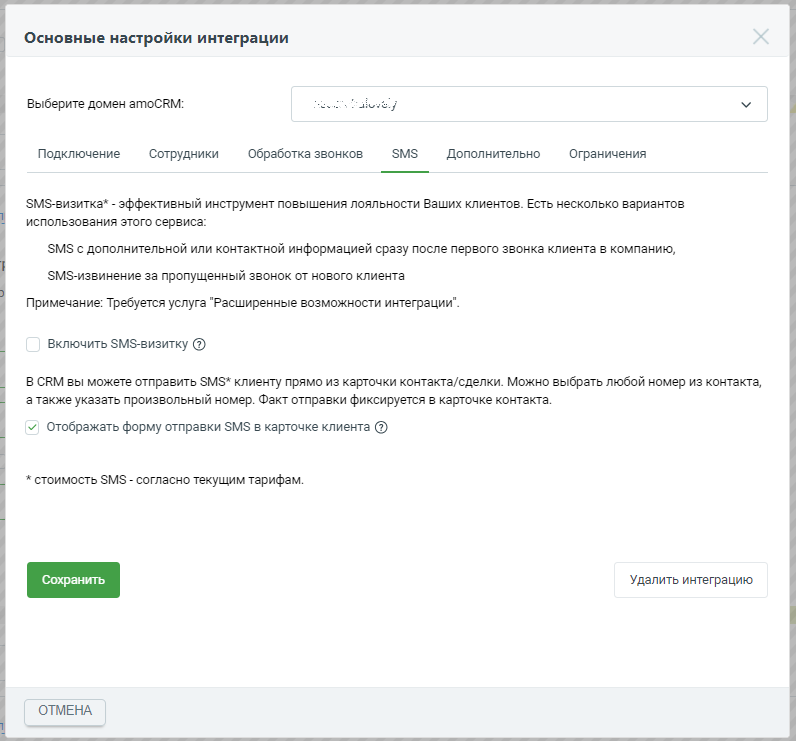
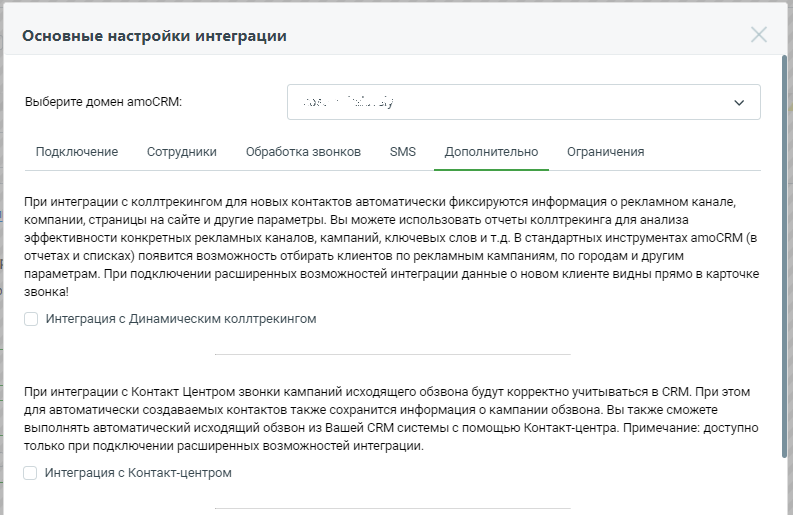
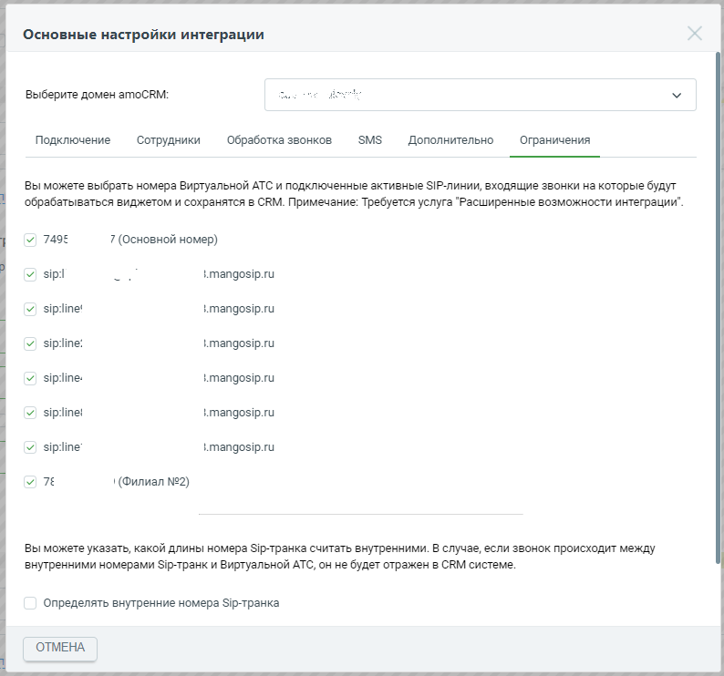

# 2.2. Дополнительные настройки интеграции. Обзор

> Трассировка: PDF §2.2 · сквозные стр. 23-25 · источники: ч.1 `kb/sources/integration_amocrm/Mango_office_integration_amoCRM.pdf` с.23-25.

В зависимости от ваших задач можно указать дополнительные настройки интеграции. На вкладке “Обработка звонков” настраивается логика обработки звонков – нужно ли автоматически создавать контакт или создавать в “неразобранном”, нужно ли ставить задачи по пропущенным звонкам и т.д.: . Снимок экрана / схема.
> Относится к тексту руководства: «…й Клиент, практически сразу после первого звонка, перезвонил вам для уточнения деталей, то в категории “НЕРАЗОБРАННОЕ” будут зафиксированы два отдельных звонка:».
> Текст на изображении (OCR, требует сверки): СДЕЛКИ; НЕРАЗОБРАННОЕ; ПЕРВИЧНЫЙ КОНТАКТ; Заявок: 16; 0 сделок: 0 руб; кому: Mari-Mari; Сегодня 11:57; Быстрое добавление; YS; “/ Звонок от +7401279-:; 00:00; Сегодня 11:56; “/ Звонок от +7401279:; 00:05:36 Скачать

На вкладке “SMS” настраивается работа с SMS – нужно ли использовать SMS-визитку, дать сотрудникам возможность отправлять SMS из карточки контакта и т.д.: Интеграция Виртуальной АТС MANGO OFFICE и amoCRM | Версия от 25.08.2025

> **Описание иллюстрации INTAMO-§2.2-2** (к §2.2 «Дополнительные настройки интеграции. Обзор», стр. 24; 796×741 px). Снимок экрана / схема.
> Относится к тексту руководства: «…вонка: На вкладке “SMS” настраивается работа с SMS – нужно ли использовать SMS-визитку, дать сотрудникам возможность отправлять SMS из карточки контакта и т.д.:».
> Текст на изображении (OCR, требует сверки): Основные настройки интеграции; Выберите домен amoCRM:; SMS; Подключение; Сотрудники; Обработка звонков; Дополнительно; Ограничения; $М$-визитка* - эффективный инструмент повышения лояльности Ваших клиентов. Есть несколько вариантов; использования этого сервиса:; SMS с дополнительной или контактной информацией сразу после первого звонка клиента в компанию,; $М5$-извинение за пропущенный звонок от нового клиента; Примечание: Требуется услуга "Расширенные возможности интеграции".; Включить $М$-визитку @; В CRM вы можете отправить $М$* клиенту прямо из карточки контакта/сделки. Можно выбрать любой…

На вкладке “Дополнительно” настраивается интеграция с Коллтрекингом MANGO OFFICE (сквозная аналитика), Контакт-центром, Digital-воронкой amoCRM, Речевой аналитикой:

> **Описание иллюстрации INTAMO-§2.2-3** (к §2.2 «Дополнительные настройки интеграции. Обзор», стр. 24; 793×515 px). Снимок экрана / схема.
> Относится к тексту руководства: «…кладке “Дополнительно” настраивается интеграция с Коллтрекингом MANGO OFFICE (сквозная аналитика), Контакт-центром, Digital-воронкой amoCRM, Речевой аналитикой:».
> Текст на изображении (OCR, требует сверки): Основные настройки интеграции; Выберите домен amoCRM:; ay; Подключение; Сотрудники; Обработка звонков; SMS; Дополнительно; Ограничения; При интеграции с коллтрекингом для новых контактов автоматически фиксируются информация о рекламном канале,; компании, страницы на сайте и другие параметры. Вы можете использовать отчеты коллтрекинга для анализа; эффективности конкретных рекламных каналов, кампаний, ключевых слов и т.д. В стандартных инструментах атоСВМ (в; отчетах и списках) появится возможность отбирать клиентов по рекламным кампаниям, по городам и другим; параметрам. При подключении расшире…

На вкладке “Ограничения” указывается, для каких линий Виртуальной АТС работает интеграция с amoCRM Интеграция Виртуальной АТС MANGO OFFICE и amoCRM | Версия от 25.08.2025

> **Описание иллюстрации INTAMO-§2.2-4** (к §2.2 «Дополнительные настройки интеграции. Обзор», стр. 25; 794×742 px). Снимок экрана / схема.
> Относится к тексту руководства: «…Контакт-центром, Digital-воронкой amoCRM, Речевой аналитикой: На вкладке “Ограничения” указывается, для каких линий Виртуальной АТС работает интеграция с amoCRM».
> Текст на изображении (OCR, требует сверки): Основные настройки интеграции; Выберите домен amoCRM:; Подключение; Сотрудники; Обработка звонков; SMS; Дополнительно; Ограничения; Вы можете выбрать номера Виртуальной АТС и подключенные активные $!Р-линии, входящие звонки на которые будут; обрабатываться виджетом и сохранятся в CRM. Примечание: Требуется услуга "Расширенные возможности интеграции".; У 749:; 7 (Основной номер); sip:; s.mangosip.ru; эре!; } папдоз!р.ги; эр те:; sip:line.; sip:line!; sip:line; 7Е; Вы можете указать, какой длины номера Э!р-транка считать внутренними. В случае, если звонок происходит между; внутренними номерами S…
