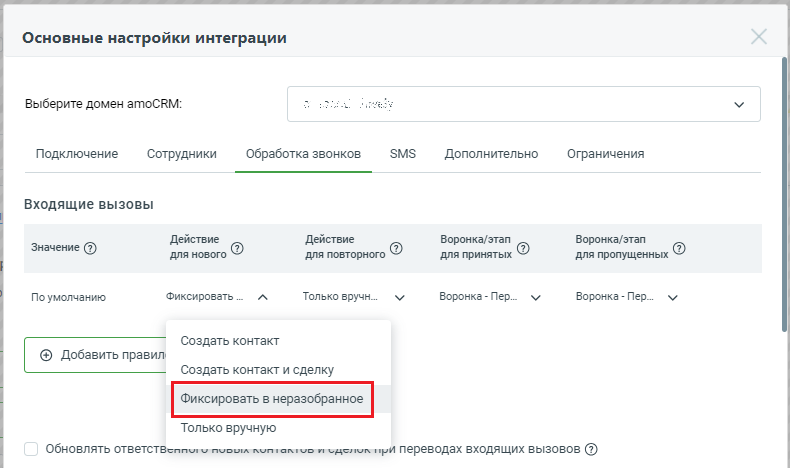
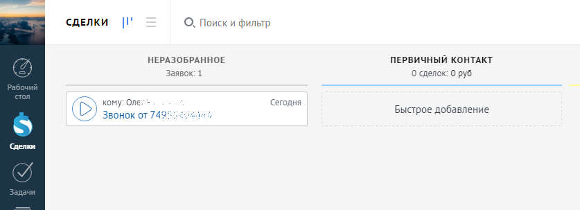
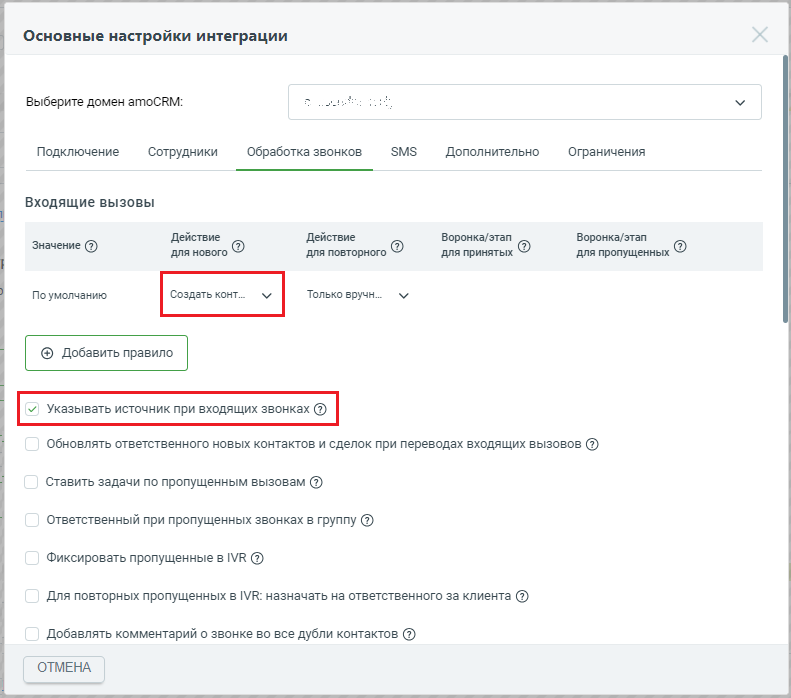
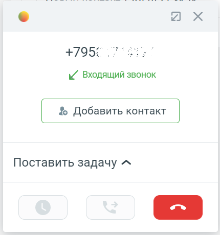
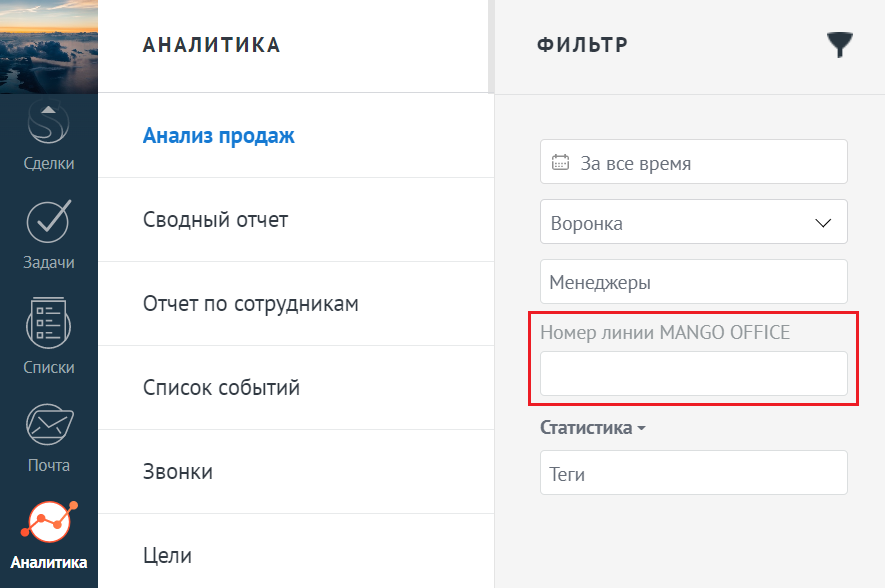

# 2.4. Обработка входящих вызовов от новых Клиентов

> Трассировка: PDF §2.4 · сквозные стр. 28-31 · источники: ч.1 `kb/sources/integration_amocrm/Mango_office_integration_amoCRM.pdf` с.28-31.

Создавать контакт при звонках с новых номеров Если в поле “Действие для нового Клиента”, в выпадающем списке выбрано значение “Создать контакт”, то после каждого принятого входящего звонка с нового номера телефона будет автоматически создан новый контакт в amoCRM. В контакте также сохранится номер телефона, с которого вам звонили. Имя контакта по умолчанию указывается в формате “Новый Клиент, ЧЧ:ММ ДД.ММ.ГГГГ” с указанием даты и времени его создания. Если звонок не был принят – контакт не создается. Можно выбрать значение “Создать контакт и сделку”, чтобы автоматически создавался не только контакт, но и сделка, связанная с контактом. Название сделки по умолчанию в формате “Сделка номер телефона” (к примеру, “Сделка 74955404444”). Примечание. При выборе значения “Создать контакт и сделку” появляется возможность настроить воронку продаж для входящих звонков.

> **Описание иллюстрации INTAMO-§2.4-1** (к §2.4 «Обработка входящих вызовов от новых Клиентов», стр. 28; 790×468 px). Снимок экрана / схема.
> Относится к тексту руководства: «…примеру, “Сделка 74955404444”). Примечание. При выборе значения “Создать контакт и сделку” появляется возможность настроить воронку продаж для входящих звонков.».
> Текст на изображении (OCR, требует сверки): Основные настройки интеграции; Выберите домен amoCRM:; Подключение; Сотрудники; Обработка звонков; SMS; Дополнительно; Ограничения; Входящие вызовы; Действие; Воронка/этап; Значение (2); для нового; ‘для повторного; для принятых; для пропущенных; По умолчанию; Фиксировать ...; Только вручн...; Воронка - Пер...; Создать контакт; Создать контакт и сделку; Только вручную; Обновлять ответственны nuowm nunranive neacnun mp Переводах входящих вызовов ($)

Если при звонках от новых Клиентов нужно фиксировать их в категорию “НЕРАЗОБРАННОЕ”, то в поле “Действие для нового Клиента” нужно выбрать значение “Фиксировать в неразобранное”. Примечание. При выборе значения “Фиксировать в неразобранное” появляется возможность настроить воронку продаж для входящих звонков. Если выбрано значение “Фиксировать в неразобранное”, то при звонке от нового Клиента в amoCRM контакт и сделка не будут созданы, информация о звонке сохранится в категории “НЕРАЗОБРАННОЕ”, можно обработать его в любой момент времени:

> **Описание иллюстрации INTAMO-§2.4-2** (к §2.4 «Обработка входящих вызовов от новых Клиентов», стр. 28; 837×303 px). Снимок экрана / схема.
> Относится к тексту руководства: «…ого Клиента в amoCRM контакт и сделка не будут созданы, информация о звонке сохранится в категории “НЕРАЗОБРАННОЕ”, можно обработать его в любой момент времени:».
> Текст на изображении (OCR, требует сверки): СДЕЛКИ; О. Поиск и фильтр; НЕРАЗОБРАННОЕ; ПЕРВИЧНЫЙ КОНТАКТ; Заявок: 1; 0 сделок: 0 руб; Сегод; ня; кому: Оле; Звонок от 74?; Быстрое добавление

Интеграция Виртуальной АТС MANGO OFFICE и amoCRM | Версия от 25.08.2025 Если нужно создавать Клиентов (при звонках от новых) только вручную, то нужно выбрать значение “Только вручную”. При такой настройке amoCRM: • при входящем звонке контакт и сделка не будут созданы автоматически; • во время разговора с Клиентом будет открыта карточка звонка, в которой отображена кнопка “Добавить контакт”. Если оператор нажмет на кнопку “Добавить контакт”, то в amoCRM будет создан новый контакт, в котором учтен входящий звонок. Примечание. Дополнительно можно включить настройку “Указывать источник при входящих звонках”. Указывать источник при входящих звонках Если у вас несколько номеров подключено к Виртуальной АТС и нужно разделять Клиентов, обращающихся по разным номерам, то нужно включить флаг “Указывать источник при входящих звонках”. Примечание. Флаг “Указывать источник при входящих звонках” доступен для настройки, если в поле “Действие для нового Клиента” выпадающем списке выбрано одно из следующих значений: Создать контакт, Создать контакт и сделку:

> **Описание иллюстрации INTAMO-§2.4-3** (к §2.4 «Обработка входящих вызовов от новых Клиентов», стр. 29; 791×698 px). Снимок экрана / схема.
> Относится к тексту руководства: «…ступен для настройки, если в поле “Действие для нового Клиента” выпадающем списке выбрано одно из следующих значений: Создать контакт, Создать контакт и сделку:».
> Текст на изображении (OCR, требует сверки): Основные настройки интеграции; Выберите домен amoCRM:; Подключение; SMS; Дополнительно; Сотрудники; Обработка звонков; Ограничения; Входящие вызовы; Действие; Воронка/этап; Значение (2); для нового; ‘для повторного; для принятых; для пропущенных; По умолчанию; Только вручн...; | @ Добавить правило |; обновлять ответственного новых контактов и сделок при переводах входящих вызовов @; Ставить задачи по пропущенным вызовам (@); Ответственный при пропущенных звонках в группу @); Фиксировать пропущенные в МК @); Для повторных пропущенных в IVR: назначать на ответственного за клиента @); Добавлять к…

Если флаг включен, то при входящем звонке в карточке звонка отобразится информация о вашем номере, на который поступил звонок от Клиента: Интеграция Виртуальной АТС MANGO OFFICE и amoCRM | Версия от 25.08.2025

> **Описание иллюстрации INTAMO-§2.4-4** (к §2.4 «Обработка входящих вызовов от новых Клиентов», стр. 30; 430×460 px). Снимок экрана / схема.
> Относится к тексту руководства: «…дать контакт и сделку: Если флаг включен, то при входящем звонке в карточке звонка отобразится информация о вашем номере, на который поступил звонок от Клиента:».
> Текст на изображении (OCR, требует сверки): ы/ Входящий звонок; % Добавить контакт; Поставить задачу ^

В автоматически создаваемом контакте в дополнительном поле “Номер линии MANGO OFFICE” указывается номер, на который поступил звонок:

> **Описание иллюстрации INTAMO-§2.4-5** (к §2.4 «Обработка входящих вызовов от новых Клиентов», стр. 30; 1505×391 px). Снимок экрана / схема.
> Относится к тексту руководства: «…В автоматически создаваемом контакте в дополнительном поле “Номер линии MANGO OFFICE” указывается номер, на который поступил звонок:».
> Текст на изображении (OCR, требует сверки): сегодня; coo; Новая сделка; +7951; Входящий звонок 00:55; Прослушать; Скачать; ий; Сегодня 13:46; JangoOffice Для поля «Название» установлено значение «Новая сдел; стол; азобранное; jangoOffice Для поля «Телефон» установ; Новый контакт +795.; Основное; Сделки; Входящий звонок 00:00; Отв-ный; Не дозвонился: входящий; Бюджет; ЕЕ; пис

Также можно разделять списки контактов и аналитику продаж по значениям этого поля:

> **Описание иллюстрации INTAMO-§2.4-6** (к §2.4 «Обработка входящих вызовов от новых Клиентов», стр. 30; 885×588 px). Снимок экрана / схема.
> Относится к тексту руководства: «…оле “Номер линии MANGO OFFICE” указывается номер, на который поступил звонок: Также можно разделять списки контактов и аналитику продаж по значениям этого поля:».
> Текст на изображении (OCR, требует сверки): АНАЛИТИКА; ФИЛЬТР; Анализ продаж; &) За все время; Сводный отчет; Воронка; nN; Менеджеры; om; Отчет по сотрудникам; Номер линии MANGO OFFICE; Список событий; Статистика ~; Звонки; Теги; Цели

Интеграция Виртуальной АТС MANGO OFFICE и amoCRM | Версия от 25.08.2025
