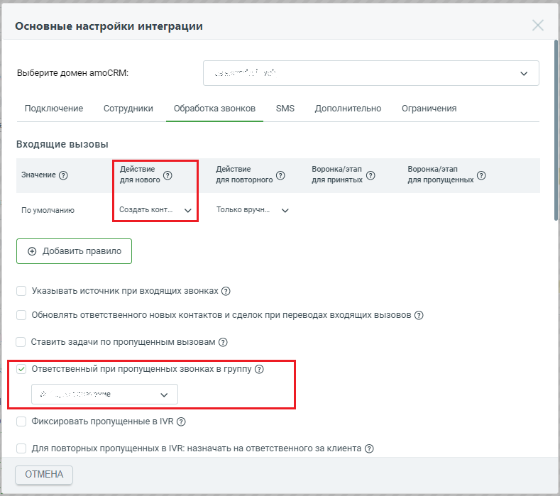

# 2.8. Ответственный при пропущенных звонках в группу

> Трассировка: PDF §2.8 · сквозные стр. 47-48 · источники: ч.1 `kb/sources/integration_amocrm/Mango_office_integration_amoCRM.pdf` с.47-48.

Если этот флаг включен, а также в поле “Действие для нового” выбрано одно из значений “Создать контакт” / “Создать контакт и сделку” / “Фиксировать в”неразобранное”, то при каждом звонке от нового Клиента, распределенном в любую группу ВАТС и пропущенном: - автоматически создается контакт; - автоматически создается сделка (если включен флаг “Создать контакт и сделку”); - в контакте (и сделке) указывается выбранный ответственный сотрудник. Если флаг выключен, то для такого звонка при создании контакта (сделки) - в качестве ответственного указывается первый сотрудник, на которого распределялся вызов. Нажмите кнопку “Сохранить” внизу закладки “Обработка звонков”, чтобы сохранить настройку. Интеграция Виртуальной АТС MANGO OFFICE и amoCRM | Версия от 25.08.2025

> **Описание иллюстрации INTAMO-§2.8-1** (к §2.8 «Ответственный при пропущенных звонках в группу», стр. 48; 789×699 px). Снимок экрана / схема.
> Относится к тексту руководства: «…венного указывается первый сотрудник, на которого распределялся вызов. Нажмите кнопку “Сохранить” внизу закладки “Обработка звонков”, чтобы сохранить настройку.».
> Текст на изображении (OCR, требует сверки): Основные настройки интеграции; Выберите домен amoCRM:; Подключение; Сотрудники; Обработка звонков; SMS; Дополнительно; Ограничения; Входящие вызовы; Действие; Воронка/этап; Значение (2); для нового ©; для повторного ©; ANA принятых ®; для пропущенных ©; По умолчанию; Создать конт...; Только вручн...; @ Добавить правило; Указывать источник при входящих звонках @); обновлять ответственного новых контактов и сделок при переводах входящих вызовов @; Ставить задачи по пропущенным вызовам (@); v) Ответственный при пропущенных звонках в группу @; лире; Фиксировать пропущенные в МК @); Для повторных п…
