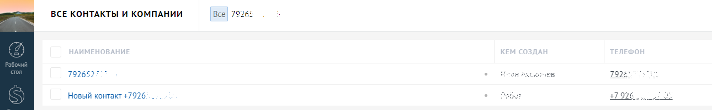
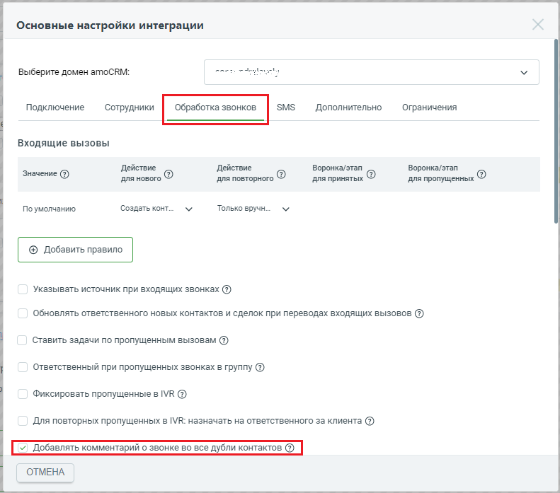
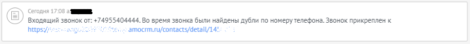
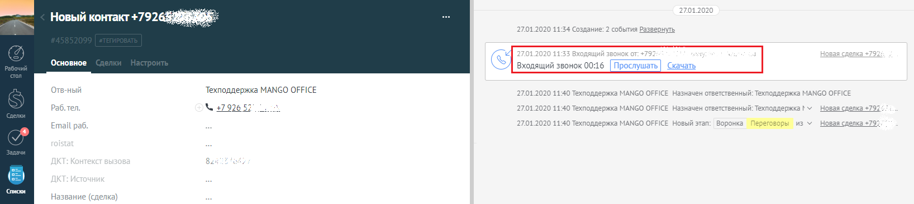
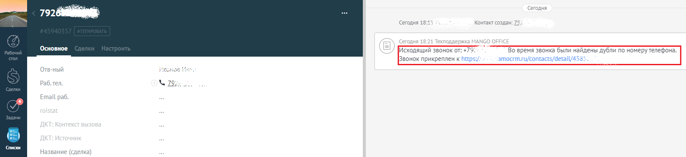

# 2.14. Наличие дублей контактов в amoCRM

> Трассировка: PDF §2.14 · сквозные стр. 57-59 · источники: ч.1 `kb/sources/integration_amocrm/Mango_office_integration_amoCRM.pdf` с.57-59.

Как сохраняется информация о звонке при дублировании контактов? В виджете по умолчанию включена автоматическая сортировка контактов/компаний во время звонка. Виджет проверяет наличие контактов/компаний, в которых указан одинаковый номер телефона (далее по тексту – дубли). Пример дублирования контактов на рисунке. Если при звонке были найдены дубли, то информация о звонке сохраняется в первом созданном контакте/компании, но не сохраняется в дубле контакта. Интеграция Виртуальной АТС MANGO OFFICE и amoCRM | Версия от 25.08.2025

> **Описание иллюстрации INTAMO-§2.14-1** (к §2.14 «Наличие дублей контактов в amoCRM», стр. 58; 1290×201 px). Снимок экрана / схема.
> Относится к тексту руководства: «…тов на рисунке. Если при звонке были найдены дубли, то информация о звонке сохраняется в первом созданном контакте/компании, но не сохраняется в дубле контакта.».
> Текст на изображении (OCR, требует сверки): ВСЕ КОНТАКТЫ И КОМПАНИИ; Все 79; 792652; ев; 79:; Новый контакт +7926; #792; да

Как помечать дубли контактов? Чтобы выявлять дубли контактов, помечать их, а также в каждом дубле одного контакта сохранять информацию о звонке, нужно включить флаг “Добавлять комментарий о звонке во все дубли контактов”:

> **Описание иллюстрации INTAMO-§2.14-2** (к §2.14 «Наличие дублей контактов в amoCRM», стр. 58; 791×697 px). Снимок экрана / схема.
> Относится к тексту руководства: «… помечать их, а также в каждом дубле одного контакта сохранять информацию о звонке, нужно включить флаг “Добавлять комментарий о звонке во все дубли контактов”:».
> Текст на изображении (OCR, требует сверки): Основные настройки интеграции; ened. eden; Выберите домен amoCRM:; SMS; Подключение; Сотрудники; Дополнительно; Ограничения; Входящие вызовы; Действие; Воронка/этап; Значение (2); для нового; ‘для повторного; для принятых; для пропущенных; По умолчанию; Создать конт...; Только вручн...; @ Добавить правило; Указывать источник при входящих звонках @); обновлять ответственного новых контактов и сделок при переводах входящих вызовов @; Ставить задачи по пропущенным вызовам (@); Ответственный при пропущенных звонках в группу @); Фиксировать пропущенные в МК @); Для повторных пропущенных в IVR: назн…

Примечание. Не забудьте сохранить настройки интеграции, нажав кнопку “Сохранить” в самом низу закладки “Обработка звонков”. Тогда, при звонке по номеру контакта виджет интеграции будет выполнять следующие действия: 1) сохранять данные о звонке в первом созданном контакте/компании; 2) сможет помечать дубли контактов/компаний комментарием “Во время звонка были найдены дубли по номеру телефона”. Вот пример отображения такого комментария:

> **Описание иллюстрации INTAMO-§2.14-3** (к §2.14 «Наличие дублей контактов в amoCRM», стр. 58; 915×87 px). Снимок экрана / схема.
> Относится к тексту руководства: «…ии; 2) сможет помечать дубли контактов/компаний комментарием “Во время звонка были найдены дубли по номеру телефона”. Вот пример отображения такого комментария:».
> Текст на изображении (OCR, требует сверки): >) Сегодня 1708 а ИВ; 1) входящий звонок от: +74955404444, Bo время звонка были найдены дубли по номеру телефона. Звонок прикреплен к; нару”; amocrm.ru/contacts/detail/14".

В результате: - в первом созданном контакте/компании будет сохранена информация о звонке по номеру: Интеграция Виртуальной АТС MANGO OFFICE и amoCRM | Версия от 25.08.2025

> **Описание иллюстрации INTAMO-§2.14-4** (к §2.14 «Наличие дублей контактов в amoCRM», стр. 59; 1636×367 px). Снимок экрана / схема.
> Относится к тексту руководства: «…номеру телефона”. Вот пример отображения такого комментария: В результате: - в первом созданном контакте/компании будет сохранена информация о звонке по номеру:».
> Текст на изображении (OCR, требует сверки): So; 01; 20; Новый контакт +7926 8:; 27.01.2020 11:34 Создание: 2 события Развернуть; Основное; Входящий звонок 00:16; Отв-ный; Техподдержка MANGO OFFICE; 27.01.2020 11:40 Техподдержка MANGO OFFICE Hi; чен ответственный: Техподдержка MANGO OFF; Раб.тел.; чен ответственный: Техподдержка bY; Новая сделка +792; Email раб.; 27.01.2020 11:40 Техподдержка MANGO OFFICE Новый 3; 82; Списки; Название (сделка)

- в дубле контакта/компании будет указана информация о звонке и пометка “Во время звонка были найдены дубли по номеру телефона”:

> **Описание иллюстрации INTAMO-§2.14-5** (к §2.14 «Наличие дублей контактов в amoCRM», стр. 59; 1594×366 px). Снимок экрана / схема.
> Относится к тексту руководства: «…- в дубле контакта/компании будет указана информация о звонке и пометка “Во время звонка были найдены дубли по номеру телефона”:».
> Текст на изображении (OCR, требует сверки): 792 ИЕ; Сегодня 18:; Контакт; Основное; [Исходящий звонок от:; Bo время звон; были найдены дубли по номерутелефон:; Ввонок прикреплен к http; amocrm.ru/contacts/d; 4588.; Отв-ный; Раб.тел.; Ул; Email раб.; Списки; Название (сделка)
