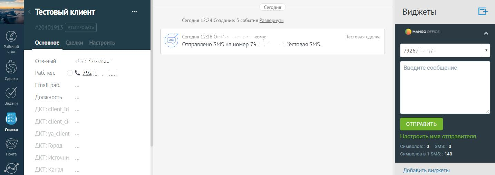
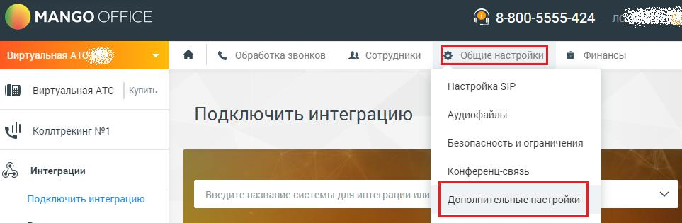
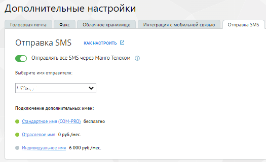

# 2.19. Отправка SMS из карточки Клиента

> Трассировка: PDF §2.19 · сквозные стр. 64-65 · источники: ч.1 `kb/sources/integration_amocrm/Mango_office_integration_amoCRM.pdf` с.64-65.

С помощью виджета интеграции MANGO OFFICE и amoCRM можно вручную отправлять SMS Клиентам из карточки Клиента или сделки. Информация об отправленной SMS автоматически фиксируется в истории коммуникаций с Клиентом и видна в карточке Клиента. Стоимость SMS - согласно текущим тарифам Виртуальной АТС. Интеграция Виртуальной АТС MANGO OFFICE и amoCRM | Версия от 25.08.2025

> **Описание иллюстрации INTAMO-§2.19-1** (к §2.19 «Отправка SMS из карточки Клиента», стр. 65; 1434×510 px). Снимок экрана / схема.
> Относится к тексту руководства: «…правленной SMS автоматически фиксируется в истории коммуникаций с Клиентом и видна в карточке Клиента. Стоимость SMS - согласно текущим тарифам Виртуальной АТС.».
> Текст на изображении (OCR, требует сверки): се; Сегодня; Тестовый клиент; Виджеты; Сегодня 12:24 Создание:; юобытия Развернуть; MANGO; ‘Основное; естовая Sh; Отправлено SMS на номер 79; Отв-ный; Vl; Email раб.; Должность; ОТПРАВИТЬ; Списки; 140; Добавить виджеты

В настройках виджета интеграции можно включить или отключить отображение формы отправки SMS в карточке Клиента и сделки – на вкладке “SMS”, настройка “Отображать форму отправки SMS в карточке Клиента”. В Личном кабинете Виртуальной АТС в разделе Общие настройки/Дополнительные настройки/Вкладка “Отправка SMS”:

> **Описание иллюстрации INTAMO-§2.19-2** (к §2.19 «Отправка SMS из карточки Клиента», стр. 65; 963×315 px). Снимок экрана / схема.
> Относится к тексту руководства: «…“Отображать форму отправки SMS в карточке Клиента”. В Личном кабинете Виртуальной АТС в разделе Общие настройки/Дополнительные настройки/Вкладка “Отправка SMS”:».
> Текст на изображении (OCR, требует сверки): ® мамсооЕЕ; ®) 8-800-5555-424; ae; \ Обработка звонков; 4 Сотрудники; fie общие настройки; @ Финансы; Купить; Настройка SIP; (03 виртуальная ATC; Аудиофайлы; Подключить интеграцию; Wl Коллтрекинг №1; Безопасность и ограничения; Конференц-связь; $ Интеграции; еназва; е систе; я интеграции или; Дополнительные настройки; ВВ

можно подключить и настроить отраслевое или индивидуальное имя отправителя SMS:

> **Описание иллюстрации INTAMO-§2.19-3** (к §2.19 «Отправка SMS из карточки Клиента», стр. 65; 525×320 px). Снимок экрана / схема.
> Относится к тексту руководства: «…й АТС в разделе Общие настройки/Дополнительные настройки/Вкладка “Отправка SMS”: можно подключить и настроить отраслевое или индивидуальное имя отправителя SMS:».
> Текст на изображении (OCR, требует сверки): Дополнительные настройки; Голосовая почта Факс Облачное хранилище; Интаграция с мобильной связью; Отправка SMS; КАК НАСТРОИТЬ; Отправка $М$; @_ отправлять все SMS через Манго Телеком @; Выберите имя отправителя:; fof,; Подключение дополнительных имен:; ® Сандартное имя (COM-; PRO) бесплатно; мя O руб./мес.; мл 6 000 руб/мес.
