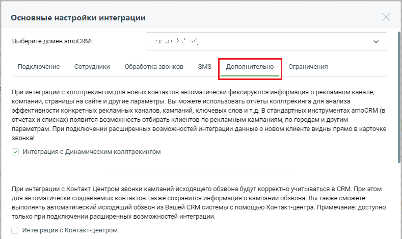
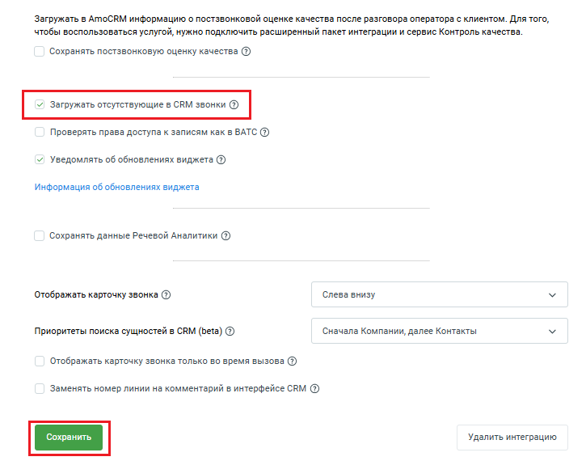

# 2.22. Загружать отсутствующие в amoCRM звонки

> Трассировка: PDF §2.22 · сквозные стр. 80-81 · источники: ч.1 `kb/sources/integration_amocrm/Mango_office_integration_amoCRM.pdf` с.80-81.

Если функция “Загружать отсутствующие в amoCRM звонки” включена, то для вашей интеграции ежедневно в 01:00 МКС будет проводиться процедура поиска и восстановления отсутствующих звонков. Имеющиеся звонки в amoCRM будут сверяться со звонками в Виртуальной АТС. Поиск потерянных звонков происходит за полный прошедший день. Примечание. Данная возможность доступна только пользователям расширенного пакета интеграции. Чтобы включить функцию загрузки отсутствующих в amoCRM звонков, в окне “Основные настройки интеграции” следует: 1. открыть вкладку “Дополнительно”; Интеграция Виртуальной АТС MANGO OFFICE и amoCRM | Версия от 25.08.2025

> **Описание иллюстрации INTAMO-§2.22-1** (к §2.22 «Загружать отсутствующие в amoCRM звонки», стр. 81; 789×469 px). Снимок экрана / схема.
> Относится к тексту руководства: «… интеграции. Чтобы включить функцию загрузки отсутствующих в amoCRM звонков, в окне “Основные настройки интеграции” следует: 1. открыть вкладку “Дополнительно”;».
> Текст на изображении (OCR, требует сверки): Основные настройки интеграции; Выберите домен amoCRM:; ot; SMS; Подключение; Сотрудники; Обработка звонков; Ограничения; При интеграции с коллтрекингом для новых контактов автоматически фиксируются информация о рекламном канале,; компании, страницы на сайте и другие параметры. Вы можете использовать отчеты коллтрекинга для анализа; эффективности конкретных рекламных каналов, кампаний, ключевых слов и т.д. В стандартных инструментах атоСВМ (в; отчетах и списках) появится возможность отбирать клиентов по рекламным кампаниям, по городам и другим; параметрам. При подключении расширенных возможност…

2. установить флаг “Загружать отсутствующие в amoCRM звонки”; 3. нажать на кнопку “Сохранить” внизу окна “Основные настройки интеграции”:

> **Описание иллюстрации INTAMO-§2.22-2** (к §2.22 «Загружать отсутствующие в amoCRM звонки», стр. 81; 725×570 px). Снимок экрана / схема.
> Относится к тексту руководства: «…2. установить флаг “Загружать отсутствующие в amoCRM звонки”; 3. нажать на кнопку “Сохранить” внизу окна “Основные настройки интеграции”:».
> Текст на изображении (OCR, требует сверки): Загружать в АтоСВМ информацию о постзвонковой оценке качества после разговора оператора с клиентом. Для того,; чтобы воспользоваться услугой, нужно подключить расширенный пакет интеграции и сервис Контроль качества.; Сохранять постзвонковую оценку качества (2); Проверять права доступа к записям как в ВАТС (2); v Уведомлять об обновлениях виджета @; Информация об обновлениях виджета; Сохранять данные Речевой Аналитики (2); Отображать карточку звонка (2); Слева внизу; Приоритеты поиска сущностей в CRM (beta) @; Сначала Компании, далее Контакты; Отображать карточку звонка только во время вызова (…
