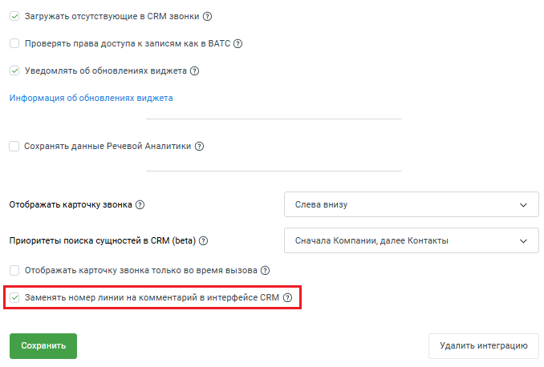
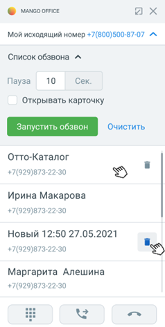

# 2.24. Заменять номер линии на комментарий в интерфейсе CRM

> Трассировка: PDF §2.24 · сквозные стр. 85-86 · источники: ч.1 `kb/sources/integration_amocrm/Mango_office_integration_amoCRM.pdf` с.85-86.

Эта настройка отображается на вкладку “Дополнительно” в нижней части:

> **Описание иллюстрации INTAMO-§2.24-1** (к §2.24 «Заменять номер линии на комментарий в интерфейсе CRM», стр. 85; 678×458 px). Снимок экрана / схема.
> Относится к тексту руководства: «…2.24 Заменять номер линии на комментарий в интерфейсе CRM Эта настройка отображается на вкладку “Дополнительно” в нижней части:».
> Текст на изображении (OCR, требует сверки): У Загружать отсутствующие в CRM звонки @; Проверять права доступа к записям как в ВАТС (2); v) Уведомлять об обновлениях виджета (@); Информация об обновлениях виджета; Сохранять данные Речевой Аналитики (2); Отображать карточку звонка (2); Слева внизу; Приоритеты поиска сущностей в CRM (beta) @; Сначала Компании, далее Контакты; Отображать карточку звонка только во время вызова ($); Удалить интеграцию

Если настройка включена, то: Интеграция Виртуальной АТС MANGO OFFICE и amoCRM | Версия от 25.08.2025 - в карточке звонка amoCRM, при выборе исходящего номера вы увидите комментарий к этому номеру, загруженный из настроек вашей ВАТС;

> **Описание иллюстрации INTAMO-§2.24-2** (к §2.24 «Заменять номер линии на комментарий в интерфейсе CRM», стр. 86; 238×472 px). Снимок экрана / схема.
> Относится к тексту руководства: «…- в карточке звонка amoCRM, при выборе исходящего номера вы увидите комментарий к этому номеру, загруженный из настроек вашей ВАТС;».
> Текст на изображении (OCR, требует сверки): Фо wanco orice; ах; Мой исходящий номер +7(800)500-87-07 “A; Список обзвона ^; Пауза; 10; Сек.; Открывать карточку; Отто-Каталог; +7(929)873-22-30; Ирина Макарова; Новый 12:50 27.05.2021; Маргарита Алешина; oes; ses; XR

- в контакте и сделке в поле “Номер линии MANGO OFFICE” вместо номера, на который звонил клиент, будет отображаться комментарий к этому номеру, загруженный из настроек Виртуальной АТС. Важно: 1) данная настройка будет работать только в тех случаях, когда поле “Комментарий” заполнено в настройках Виртуальной АТС; 2) при добавлении или изменении комментария в настройках Виртуальной АТС, следует пересохранить настройки интеграции (то есть открыть настройки интеграции на нажать кнопку “Сохранить”). Если настройка выключена: - в карточке звонка в номере линии для выбора отображаются только линии, без комментариев. При входящих и исходящих вызовах в номер входящей/исходящей линии отображается номер линии; - в соответствующей сделке или в контакте, в поле “номер линии MANFO OFFICE” записывается значение номера линии. Если звонок от клиента создает повторную сделку, то правило наименования новой сделки брать на момент создания этой сделки. То есть, предыдущий сделки могут иметь другой формат наименования.
