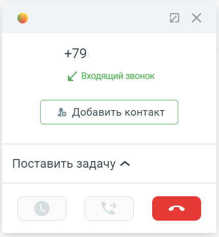

# 3.1. Общее

> Трассировка: PDF §3.1 · сквозные стр. 89 · источники: ч.1 `kb/sources/integration_amocrm/Mango_office_integration_amoCRM.pdf` с.89.

При входящем звонке у сотрудника зазвонит телефон (указанный в карточке сотрудника в Личном кабинете в качестве средства приема вызова), а в amoCRM покажется карточка звонка. Если звонит новый Клиент и нужно создать новый контакт во время разговора, то достаточно нажать на кнопку “Добавить контакт”:

> **Описание иллюстрации INTAMO-§3.1-1** (к §3.1 «Общее», стр. 89; 429×465 px). Снимок экрана / схема.
> Относится к тексту руководства: «… amoCRM покажется карточка звонка. Если звонит новый Клиент и нужно создать новый контакт во время разговора, то достаточно нажать на кнопку “Добавить контакт”:».
> Текст на изображении (OCR, требует сверки): ы/ Входящий звонок; % Добавить контакт; Поставить задачу ^

Важно. Закрытие карточки звонка в amoCRM не завершает разговор. Чтобы завершить разговор нужно положить трубку, либо нажать кнопку “Завершить вызов” (если вы используете софтфон),

> **Описание иллюстрации INTAMO-§3.1-2** (к §3.1 «Общее», стр. 89; 112×36 px). Фрагмент интерфейса (кнопка, переключатель или поле).
> Относится к тексту руководства: «…точки звонка в amoCRM не завершает разговор. Чтобы завершить разговор нужно положить трубку, либо нажать кнопку “Завершить вызов” (если вы используете софтфон),».
> Текста на изображении нет; назначение элемента — см. текст, к которому он относится.

либо нажать кнопку в карточке звонка.
