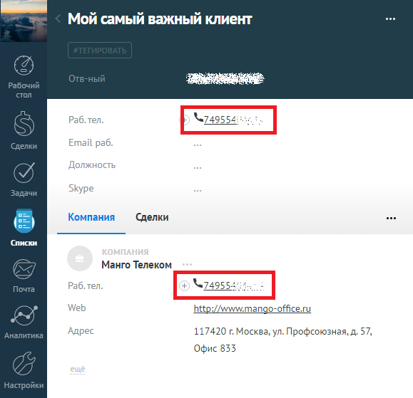

# 4. Исходящий звонок

> Трассировка: PDF §4 · сквозные стр. 90-91 · источники: ч.1 `kb/sources/integration_amocrm/Mango_office_integration_amoCRM.pdf` с.90-91.

Сотрудник может кликнуть на номер телефона в amoCRM или набрать его на своем рабочем телефоне, в amoCRM будет показана карточка исходящего звонка. При этом, если сотрудник кликнул на номер телефона в amoCRM, то сначала зазвонит его рабочий телефон, и только после того как сотрудник поднимет трубку – начнется звонок на выбранный номер телефона.

> **Описание иллюстрации INTAMO-§4-1** (к §4 «Исходящий звонок», стр. 90; 579×559 px). Снимок экрана / схема.
> Относится к тексту руководства: «…мер телефона в amoCRM, то сначала зазвонит его рабочий телефон, и только после того как сотрудник поднимет трубку – начнется звонок на выбранный номер телефона.».
> Текст на изображении (OCR, требует сверки): ose; Мой самый важный клиент; Ww; Компания; Сделки; Манго Телеком; http; ww.mango-office.ru; ey); 117420 г. Москва, ул. Профсоюзная, д. 57,; Офис 835

Интеграция Виртуальной АТС MANGO OFFICE и amoCRM | Версия от 25.08.2025
